# yubi-OS/yubiOS — CI Architecture Map

> Regenerated 2026-11-24 from main `8157d4e6226a6551bd2c928beba4d328b3ad6cf2`
> (tree `8157d4e6`, HEAD committed 2026-11-24T05:04:56Z). Modeled on
> [ENDPOINTS.md](ENDPOINTS.md): every YAML automation surface in the repo is
> inventoried, grouped into capability domains, and cross-checked against the live
> tracker. The `.yml` files are the source of truth; this document is the
> architectural reference. [ci-launchpad](https://ci-launchpad-55qejzzz.sauna.new/)
> (Sauna app, updated 2026-11-24) tracks every `.yml` file in the repo live via
> a git-tree census, mirrors all 15 `ci.yml` group choices, and reads every
> workflow's `workflow_dispatch` inputs live from GitHub at dispatch time.
> [PINNED.md](../PINNED.md) remains the source of truth for approved action SHAs
> and image digests; `yubiOS-bake.hcl` remains the source of truth for every
> Docker build in the non-`ci_fork*` chain.
>
> Lineage: previous full regeneration 2026-10-06 (header recorded main
> `e46a3cb8`; doc commit `7a94974`), followed by the YubiKey → U2F/HSM
> terminology pass at `be89bf0` (2026-11-19). This pass is a full content
> regeneration against `8157d4e6`.

## Census

| Measure | Count |
|---|---|
| `.yml` files in the repo | 44 |
| GitHub Actions workflows (`.github/workflows/*.yml`) | 43 |
| Non-workflow YAML (`.github/FUNDING.yml`) | 1 |
| Workflows with `workflow_dispatch` | 43 |
| Scheduled workflows (`schedule:` cron) | 7 |
| Push-triggered workflows (branch/path-scoped) | 2 (`lean-check.yml`, `lean-run.yml`) |
| Pull-request-triggered workflows | 10 (8 path-scoped + 2 unscoped `types:`-only) |
| `workflow_call`-callable workflows | 1 (`ci_test_sealed-uki-vm.yml`) |
| Total declared jobs across all workflows | 101 |
| ci.yml `group` choice options | 15 (`none` + 8 canonical stage groups + 5 subset/alias groups + `all`) |
| Canonical execution stages (ci.yml header) | 7 (`docker` → `fetches` → `tests` + `forks` → `builds` → `vms` → `misc` → `flash`) |
| Workflows in the ci.yml group taxonomy | 42 |
| Workflows outside ci.yml's own group lists | 1 (`ci.yml` itself) |
| ci.yml `all` group size (independent dispatches) | 42 |
| ci.yml `PUSH_WORKFLOWS` (honor `Docker_push`) | 5 (`ci_firmware-rk.yml`, `yubiOS-ci.yml`, `ci_dev_image.yml`, `ci_assured_image.yml`, `ci_mkosi-installer.yml`) |
| Workflows declaring the legacy `ci_callback` input | 23 (22 of them still carry a `ci-callback` job) |
| Largest workflow file | `ci_firmware-rk.yml` (81,659 B) |
| Second-largest workflow file | `ci_test-vgpu-vm.yml` (77,650 B) |

**Delta since the 2026-10-06 regeneration (40 → 44 `.yml`, 39 → 43 workflows, 87 → 101 jobs):**

| Change | Workflows |
|---|---|
| Added (8) | `autoinstall-verify.yml`, `ci_assured_image.yml`, `ci_docker-purge.yml`, `ci_docker-repos-ensure.yml`, `ci_flash-device-e2e.yml`, `ci_fork_gnome-control-center.yml`, `ci_test-uki-local-oci-vm.yml`, `ci_test_uki-composefs-matrix.yml` |
| Removed (4) | `phonon-followups.yml`, `zernike-caustics.yml`, `zernike-lens.yml`, `zernike-spectrum.yml` — their runs were folded into the now 5-job `lean-check.yml` / `lean-run.yml` twins (lean-run's header lists Zernike caustics, Zernike Gap D lens, and Phonon bridge follow-ups in its measurement suite) |
| Re-shaped | `ci.yml` (10 → 15 group choices, 7-stage canonical sequence, `all` 38 → 42, `PUSH_WORKFLOWS` 4 → 5); `ci_firmware-rk.yml` (new `burn_otp_fuses` input, PineTab2 RK3566 board, StMM arm64-only); `lean-check.yml` / `lean-run.yml` (3 / 2 → 5 jobs each, unscoped `pull_request`); `ci_mkosi-installer.yml` (also bakes `yubios-uki`) |
| Runner fleet | every hosted job moved from `ubuntu-24.04` / `ubuntu-latest` to `ubuntu-26.04` / `ubuntu-26.04-arm` (0 references to the old labels remain); self-hosted selectors are `["self-hosted","Linux","ARM64","KVM"]` (rock1) and, new for the flash lane, `["self-hosted","Linux","X64","KVM"]` |

Job-count arithmetic: 87 (2026-10-06) − 4 (removed research runners) + 13
(new workflows: 1 + 4 + 1 + 1 + 1 + 2 + 2 + 1) + 5 (lean-check +2, lean-run +3)
= 101.

History: the 2026-10-06 pass superseded the 2026-09-18 drift-check addendum (which
flagged the map's counts vs the 39-workflow census and deferred the content pass)
and the 2026-10-05 map (main `a8959116`), adding the `audits` and `research`
choices and correcting the PR-trigger count from 7 to 6. This 2026-11-24 pass
supersedes the 2026-10-06 map in turn. The prior `group-routing-redesign`
(PR #145) history (no-chain model, no callback contract) is preserved below in
condensed form.

## Capability Map

`ci.yml`'s `group` choice now carries 15 values: `none`, the eight **canonical
stage groups** that partition the 42 dispatchable workflows in execution order
(`docker`, `fetches`, `tests`, `forks`, `builds`, `vms`, `misc`, `flash`), five
**subset/alias groups** kept for targeted re-runs and back-compat (`firmware`,
`ci-builders`, `vm-tests`, `audits`, `research`), and `all` (the union, 42
dispatches). Every one of the 42 non-orchestrator workflows is in exactly one
canonical stage group, so every workflow on main is orchestrator-reachable.
Domain membership below is by dispatch contract and blast radius, not filename
convention alone.

| Domain | Stage group | Subset group(s) | Workflows | Publishes |
|---|---|---|---|---|
| Orchestrator | — | — | `ci.yml` | nothing (fans out dispatches) |
| Docker Hub registry hygiene | `docker` | `audits` | `ci_docker-purge.yml`, `ci_docker-repos-ensure.yml` | registry-side repo/description state; tag deletion only on explicit `mode=purge` |
| Fetches (pin refresh) | `fetches` | — | `fetch-dhi-manifest.yml`, `fetch-fedora-bootc-manifest.yml`, `fetch-released-tag-ref.yml` | commits to `PINNED.md` on drift |
| Pre-image test chain | `tests` | — | `ci_test_rootless-docker.yml`, `ci_test_pq_tls_verify.yml`, `ci_test-fedora-bootc-arm64-pull.yml` | nothing (evidence only) |
| Fork component CI | `forks` | — | 9 × `ci_fork_*.yml` (incl. new `ci_fork_gnome-control-center.yml`) | build/lint/test artifacts; gnome-control-center can publish RPM releases on opt-in |
| Image builders | `builds` | `ci-builders` | `yubiOS-ci.yml`, `ci_dev_image.yml`, `ci_assured_image.yml`, `ci_mkosi-installer.yml`, `ci_build-test-fixtures.yml` | production, dev, assured, installer + UKI OCI, fixture image tags |
| Firmware lane | `builds` | `firmware` | `ci_firmware-rk.yml` | firmware OCI (board-scoped) |
| VM e2e + image-level verification | `vms` | `vm-tests` (alias) | `ci_test-vm.yml`, `ci_test-vgpu-vm.yml`, `ci_test_sealed-uki-vm.yml`, `ci_test-ftpm-tpm0.yml`, `ci_test-bootc-lifecycle.yml`, `ci_test-sysext-portable.yml`, `ci_test_bootc-filesystem.yml`, `ci_test-uki-local-oci-vm.yml`, `ci_test_uki-composefs-matrix.yml` | nothing (evidence only) |
| Governance + drift guards | `misc` | `audits` | `ci_token-audit.yml`, `ci_input-shape.yml`, `ci_dispatch-reachability.yml`, `ci_fork-drift-detect.yml`, `ci_package-floor.yml`, `autoinstall-verify.yml` | issues/exit codes on drift |
| Diagnostics | `misc` | — | `diag_sign-matrix.yml` | nothing (evidence only) |
| Research CI | `misc` | `research` | `lean-check.yml`, `lean-run.yml` | nothing (papers/tools evidence) |
| Hardware flash lane | `flash` | — | `ci_flash-device-e2e.yml` | physical SD/USB media + boot logs artifact |
| Non-workflow | — | — | `.github/FUNDING.yml` | GitHub Sponsors config |

Domain count check: 1 + 2 + 3 + 3 + 9 + 5 + 1 + 9 + 6 + 1 + 2 + 1 = 43
workflows, + 1 non-workflow = 44 `.yml` files.

### Orchestrator (`ci.yml`)

Single `group:` choice input with 15 options, in file order: `none / docker /
fetches / tests / forks / builds / vms / misc / flash / firmware / ci-builders /
vm-tests / audits / research / all`, plus `reason`, `target_ref`, `Docker_push`
(4 inputs, 1 job `dispatch`, `ubuntu-26.04`, `permissions: contents: read,
actions: write`). When dispatched it fires one independent `workflow_dispatch`
per workflow in the chosen group's `WORKFLOWS` array, then exits. There is no
state machine, no callback handoff, no chain: every workflow in a group runs
standalone from its own dispatch call.

Canonical 7-stage execution sequence (from the ci.yml header comment and the
`all` array order):

| # | Stage group | Size | Members (dispatch order) |
|---|---|---|---|
| 1 | `docker` | 2 | `ci_docker-purge.yml`, `ci_docker-repos-ensure.yml` |
| 2 | `fetches` | 3 | `fetch-dhi-manifest.yml`, `fetch-fedora-bootc-manifest.yml`, `fetch-released-tag-ref.yml` |
| 3a | `tests` | 3 | `ci_test_rootless-docker.yml`, `ci_test_pq_tls_verify.yml`, `ci_test-fedora-bootc-arm64-pull.yml` |
| 3b | `forks` | 9 | `ci_fork_mkosi.yml`, `ci_fork_bcvk.yml`, `ci_fork_arm-trusted-firmware.yml`, `ci_fork_optee-os.yml`, `ci_fork_ms-tpm-20-ref.yml`, `ci_fork_optee-ftpm.yml`, `ci_fork_u-boot.yml`, `ci_fork_edk2.yml`, `ci_fork_gnome-control-center.yml` |
| 4 | `builds` | 6 | `yubiOS-ci.yml`, `ci_dev_image.yml`, `ci_assured_image.yml`, `ci_mkosi-installer.yml`, `ci_firmware-rk.yml`, `ci_build-test-fixtures.yml` |
| 5 | `vms` | 9 | `ci_test-vm.yml`, `ci_test-vgpu-vm.yml`, `ci_test_sealed-uki-vm.yml`, `ci_test-ftpm-tpm0.yml`, `ci_test-bootc-lifecycle.yml`, `ci_test-sysext-portable.yml`, `ci_test_bootc-filesystem.yml`, `ci_test-uki-local-oci-vm.yml`, `ci_test_uki-composefs-matrix.yml` |
| 6 | `misc` | 9 | `ci_token-audit.yml`, `ci_input-shape.yml`, `ci_dispatch-reachability.yml`, `ci_fork-drift-detect.yml`, `ci_package-floor.yml`, `autoinstall-verify.yml`, `diag_sign-matrix.yml`, `lean-check.yml`, `lean-run.yml` |
| 7 | `flash` | 1 | `ci_flash-device-e2e.yml` |
| — | `all` | 42 | stages 1–7 concatenated in the order above (2 + 3 + 3 + 9 + 6 + 9 + 9 + 1) |

Subset/alias groups (dispatch-only shortcuts; no member is unique to them):

| Group | Size | Members | `PUSH_WORKFLOWS` in that branch |
|---|---|---|---|
| `firmware` | 1 | `ci_firmware-rk.yml` | `ci_firmware-rk.yml` |
| `ci-builders` | 5 | `yubiOS-ci.yml`, `ci_dev_image.yml`, `ci_assured_image.yml`, `ci_mkosi-installer.yml`, `ci_build-test-fixtures.yml` | the first four |
| `vm-tests` | 9 | identical to `vms` (shared `vms\|vm-tests)` case arm) | — |
| `audits` | 8 | `ci_token-audit.yml`, `ci_input-shape.yml`, `ci_dispatch-reachability.yml`, `ci_fork-drift-detect.yml`, `ci_package-floor.yml`, `ci_docker-purge.yml`, `ci_docker-repos-ensure.yml`, `autoinstall-verify.yml` | — |
| `research` | 2 | `lean-check.yml`, `lean-run.yml` | — |

`Docker_push` handling: the dispatch loop sends `{Docker_push: <bool>}` only to
workflows in the active branch's `PUSH_WORKFLOWS` array and `{}` to everything
else. The `builds` and `all` branches list all five pushers
(`ci_firmware-rk.yml`, `yubiOS-ci.yml`, `ci_dev_image.yml`,
`ci_assured_image.yml`, `ci_mkosi-installer.yml`); `ci-builders` lists the four
image pushers; `firmware` lists only itself.

2026-11 re-sequencing: the earlier domain-only taxonomy (10 choices, `all` = 38)
was re-cut into the 7-stage canonical sequence. Relative to 2026-10-06:
`bootc-filesystem`, `bootc-lifecycle`, `sysext-portable`, and `ftpm-tpm0` moved
from `tests` to `vms`; `diag_sign-matrix` moved from `tests` to `misc`; the
`audits` guards and the `research` lean pair now ride in the `misc` stage (their
old groups survive as subset groups); `ci_firmware-rk.yml` joined the `builds`
stage; and four new stage groups (`docker`, `builds`, `vms`, `misc`) plus `flash`
were added.

2026-10-06 (history): the `audits` (5 governance guards) and `research` (6
research workflows) group choices were added to ci.yml (commit `e46a3cb8`),
promoting what the ci-launchpad app had tracked as hand-maintained taxonomy rows
into real orchestrator dispatch targets. The same commit added `lean-run.yml` and
`phonon-followups.yml` to `research` and `all`, clearing the dispatch-reachability
orphans those two workflows had in the `all` union.

Key invariants:
- No chain: a group dispatch does not sequence its members; each runs
  independently. The 7-stage order is the dispatch order and the recommended
  operator order, not an enforced dependency.
- `Docker_push` is honored only by the five `PUSH_WORKFLOWS`
  (`ci_build-test-fixtures` push is controlled by its own `push` input, not
  `Docker_push`).
- Re-running means re-dispatching (same group, or the workflow directly).
- The `all` group's `WORKFLOWS` array equals the concatenation of the eight
  stage arrays (verified 2026-11-24: 42 entries, no duplicates);
  `ci_dispatch-reachability.yml` asserts reachability on Mondays and on
  workflow-file PRs.

Composes with:
- ci-launchpad (the Sauna app fires the same `workflow_dispatch` calls with the
  full input schema visible, mirrors all 15 group choices, and tracks every
  `.yml` file in the repo).
- Every group member (independent dispatch targets).

### Image builders (production / dev / assured / installer / fixtures)

Five OCI builders (the `ci-builders` subset of the `builds` stage), four of them
Bake-driven from `yubiOS-bake.hcl`:

- `yubiOS-ci.yml` — production image (8 jobs: shellcheck, hadolint, unit-tests,
  mkosi config validation, build, merge-manifest, verify-attest, legacy
  ci-callback). Bake `yubios-ci` then `yubios`. Publishes per-arch tags then a
  `<sha>`/`latest` multi-arch index.
- `ci_dev_image.yml` — TEST-only image with software FIDO2 (swu2f, ADR-026).
  Bake `yubios-dev-ci` then `yubios-dev`. Publishes `dev-<sha>`/`dev`.
- `ci_assured_image.yml` — **new**: assured cloud node image (vTPM + StrongBox
  Pair Quorum) from `Containerfile.assured`. 4 jobs (`build` amd64 + arm64
  matrix, `merge-manifest`, `verify-attest`, legacy `ci-callback`). Bake
  `yubios-assured-ci` (build + two-clean-build arm64 equality proof) then
  `yubios-assured`; publishes `0mniteck/yubios:assured-<sha>` and the floating
  `assured` tag, with a manifest-tag guard that refuses any non-`assured` tag.
  The only builder that also triggers on `pull_request` (main, paths
  `Containerfile.assured`, `yubiOS-bake.hcl`, its own workflow file,
  `usr/lib/yubiOS/attest/**`); publication jobs gate on
  `workflow_dispatch && Docker_push == true`, so PR runs are build/proof only.
  Its `Docker_push` input is `required: true` (same as `ci_dev_image.yml`).
- `ci_mkosi-installer.yml` — mkosi disk image + signed-UKI verification +
  ARM64 reproducibility proof (amd64 + arm64 primary + arm64-repro rebuild) +
  installer artifact. Bake `installer` and, new since 2026-10-06, `yubios-uki`
  (`uki-<sha>-<arch>` tags). Publishes `installer[-sha]`.
- `ci_build-test-fixtures.yml` — builds and optionally pushes the test-fixture
  image tags consumed by other workflows (`tag` default `v1`, immutable by
  convention; `push` input defaults true on dispatch; 15-min timeout). Not a
  Bake target and not a `Docker_push` honoring workflow.

Key invariants:
- Every Bake build passes the `yubiOS.rego` OPA policy (`reset=true, strict=true`)
  on the user-scoped `hardened` builder over the rootless Docker socket.
- Reproducibility: production, dev, assured, and installer each build their
  subject twice in clean ARM64 jobs and compare canonical bytes; signed
  envelopes (installer signatures, QEMU's random TF-A signing envelope,
  external-TPL-dependent RK3588 final image) are recorded but excluded from byte
  equality.
- Publication is two-stage for prod/dev/assured (per-arch tags, then
  `imagetools` multi-arch index) and direct registry-export for
  firmware/installer.

Composes with:
- Bake `_policy` / `_source-metadata` / `_image-export` / `_yubios-base` hidden targets.
- `fetch-*` workflows (consume the digests `PINNED.md` pins).
- `ci_docker-repos-ensure.yml` (declares the Docker Hub repos the builders push to).

### Firmware lane (`ci_firmware-rk.yml`)

The orchestrated ARM64/RK firmware integration: StandaloneMM RPMB build
(arm64 primary + arm64-repro rebuild, both on `ubuntu-26.04-arm`; the amd64 leg
was dropped since 2026-10-06), OP-TEE/fTPM/TF-A/U-Boot board builds (QEMU,
RK3399 RockPro64, **RK3566 PineTab2 (new)**, RK3588 ROCK 5B — 8 matrix legs:
4 boards × primary/repro), a blocking unsigned-component equality proof across
the 4 boards before QEMU, QEMU fTPM e2e asserts, then optional board-scoped
publication through the Bake `firmware` target. 81,659 B, 6 jobs, 13 inputs
(3 external: `reason`, `Docker_push`, and the new `burn_otp_fuses`) — the
largest workflow in the repo.

Key invariants:
- Blocking comparison of intended unsigned components (per-board 30-day JSON
  evidence) runs before QEMU executes.
- The RK3588 TPL publish gate (`rk_tpl_gate` step) refuses publication when the
  external TPL dependency is unresolved (OMN-56).
- `burn_otp_fuses` (boolean, default false) disables OP-TEE
  `CFG_RK_SECURE_BOOT_SIMULATION` so the build can burn OTP fuses on hardware —
  IRREVERSIBLE; keep false except on a sacrificial board. It is never set by
  `ci.yml` (the orchestrator sends only `Docker_push`).
- Board-scoped tags `0mniteck/yubios:firmware-${BOARD}` from the 4-board
  publish matrix (`firmware-qemu-arm64`, `firmware-rock5b-rk3588`,
  `firmware-rockpro64-rk3399`, `firmware-pinetab2-rk3566`); the QEMU board
  keeps the compatibility `firmware` tags.

Composes with:
- The 9 fork workflows (component artifacts feed stitching, conceptually; the
  fork workflows validate pinned forks but do not stitch).
- `ci_test-ftpm-tpm0.yml` and the VM lane (consume `firmware-qemu-arm64`).
- `ci_flash-device-e2e.yml` (writes Rockchip loaders + the yubiOS image to
  physical media for the same boards).

### Pre-image test chain (`tests` group)

Three workflows that validate the build host and pinned inputs before image
publication (down from eight on 2026-10-06; the VM-shaped tests moved to `vms`
and `diag_sign-matrix` moved to `misc`):

- `ci_test_rootless-docker.yml` — rootless daemon + hardened Buildx builder
  across step boundaries (amd64/arm64 in the pinned DHI container); 4-step job
  plus legacy ci-callback.
- `ci_test_pq_tls_verify.yml` — PQ hybrid TLS drift check (ADR-025),
  non-blocking, cacheonly Bake target `pq-tls-verify`.
- `ci_test-fedora-bootc-arm64-pull.yml` — arm64 pull integrity of the pinned
  fedora-bootc index digest (OMN-139); 15-min timeout.

Key invariants:
- All three are `workflow_dispatch`-only.
- Evidence-only: none publish artifacts to a registry.

### VM e2e lane (`vms` stage / `vm-tests` group)

Nine workflows run VM and image-level end-to-end verification (`vm-tests` is now
an alias of `vms`, sharing one case arm in ci.yml):

- `ci_test-vm.yml` and `ci_test-vgpu-vm.yml` (77,650 B — the second largest
  file) run the bcvk-based VM e2e: bcvk built at pinned source, hard `/dev/kvm`
  gate, yubiOS image pulled into Podman storage, mandatory
  CTAP2/LUKS2/homed/ed25519-sk assertions; the arm64 leg (`primary: true`) runs
  on `["self-hosted","Linux","ARM64","KVM"]` (rock1), amd64 on `ubuntu-26.04`.
  The vGPU variant adds the vGPU/virtio CI legs (and defaults
  `ftpm_linux_payload: true`); both carry the DESTRUCTIVE `hw_device` input
  (spare block device on rock1, wipes it), `hw_image`, `firmware_image`, and the
  real-U2F guard input `allow_real_u2f` (`ALLOW_REAL_U2F=1` required on rock1
  because a physical U2F/HSM is attached; PR #144 refuses to silently run
  passless tests there).
- `ci_test_sealed-uki-vm.yml` — sealed-UKI Secure Boot VM e2e (PR #155 green at
  V83); the only `workflow_call`-callable workflow in the repo (3 jobs incl.
  negative tamper tests; 30/60/60-min timeouts) and also directly dispatchable.
- `ci_test-ftpm-tpm0.yml` — fTPM `/dev/tpm0` guest verify against the published
  QEMU ARM64 firmware (OMN-96); Stage B (in-guest Linux payload) opt-in via
  `ftpm_linux_payload`; 10-min timeout. Moved here from `tests`.
- `ci_test-bootc-lifecycle.yml` — bootc upgrade/rollback + homed migration
  (OMN-156); VM legs optional on rock1 via `run_vm_legs` (45/30-min timeouts).
  Moved here from `tests`.
- `ci_test-sysext-portable.yml` — sysext attach/detach + portable-service
  activation (OMN-156); same optional VM-legs shape (30/30-min). Moved here from
  `tests`.
- `ci_test_bootc-filesystem.yml` — bootc install-to-filesystem on a disposable
  GPT disk: strict fs-verity composefs proof, EROFS metadata validation,
  unsealed BLS classification, omitted `root=` (now 9 steps, 60-min timeout).
  Moved here from `tests`.
- `ci_test-uki-local-oci-vm.yml` — **new**: ADR-034 / OMN-191 end-to-end.
  `lint-and-unit` (shellcheck, `bash -n`, Bats `test-uki-sync-and-sign.bats` +
  `test-enroll-sb.bats`, `assert-dispatch-reachable.py` in the pinned DHI
  container) then `vm-uki-local-oci-e2e` (12 steps; arm64 primary on rock1,
  amd64 on hosted): boots the dev image in a bcvk ephemeral VM with
  `--swtpm --swu2f`, mounts a real 3-way OverlayFS on `/usr`, and runs
  `tests/vm/test-uki-local-oci-ci.sh` (real ukify + systemd-sbsign + sbverify,
  local composefs OCI Image Layout repo `/var/lib/yubiOS/oci`,
  `95-yubios-uki-resign.install`, `enroll-sb.sh` resign, negative fail-closed
  check). Inputs: `image`, `allow_real_u2f` (default **true** here); declares
  `ci_callback`/`ci_chain_ref`/`ci_reason` but has no `ci-callback` job.
- `ci_test_uki-composefs-matrix.yml` — **new**: 10-path UKI + sealed composefs
  reproducibility matrix (V1–V10: 68-layer `FROM fedora-bootc` variants with
  ostree stripping / SDE=0 / timestamp rewriting, the upstream bootc
  split-kernel-and-rootfs pattern, 2- and 3-layer squashed bases, and a
  single-layer `FROM scratch` control) on `ubuntu-26.04-arm`, 25-min timeout,
  `fail-fast: false`, pinned `BUILDKIT_IMAGE` (v0.35.0) and
  `FEDORA_BOOTC_IMAGE` (45.20261114.0). Single `reason` input.

Key invariants:
- The `hw_device` input is destructive and opt-in only; it never runs on push.
- The VM lane intentionally stays outside Bake (bcvk reads Podman's local store).
- ARM64 DirectBoot delivers the public root key via the systemd kernel
  command-line `tmpfiles.extra` credential path.
- Hosted amd64 legs loud-skip KVM-only assertions with ADR-023 rationale.

### Fetches (pin refresh) (`fetches` group)

Three workflows that keep `PINNED.md` honest: `fetch-dhi-manifest.yml` (DHI
Debian base digests), `fetch-fedora-bootc-manifest.yml` (fedora-bootc index
digest), `fetch-released-tag-ref.yml` (fork/upstream release mappings, peeled
commits verified from each fork; now also covers the gnome-control-center fork).
All commit updated pins themselves when drift exists; none are scheduled (manual
dispatch, via the `fetches` stage or `all`).

### Fork component CI (`forks` group)

Nine `ci_fork_*.yml` workflows build/lint/test the yubi-OS forks at immutable
release or approved release-descendant commits pinned by
`fetch-released-tag-ref.yml`: mkosi (validate-profile/shellcheck/ruff), bcvk
(unit-tests/clippy), TF-A, OP-TEE OS, ms-tpm-20-ref, optee_ftpm, U-Boot, edk2
(StandaloneMM), and — new — **gnome-control-center**: multi-arch Fedora 45 RPMs
(x86_64 on `ubuntu-26.04` + aarch64 on `ubuntu-26.04-arm`, 45-min timeout)
carrying the native yubiOS System Trust panel (`CcSystemTrustPanel`), built
inside the digest-pinned Fedora 45 bootc base at a pinned `yubios`-branch commit
(51.2.1 descendant), verifying panel registration + desktop/icon assets.
Inputs `reason`, `publish_release` (default false) and `release_tag` (default
`v51.2.1-yubios.1`) let a dispatch publish the RPMs to
`yubi-OS/gnome-control-center` Releases. Unlike the other eight, it also runs on
`pull_request` (main, paths: its workflow file, `PINNED.md`,
`usr/lib/yubiOS/system-trust-status.sh`,
`refs/gnome-settings-system-trust-2026-11-19.md`).

None stitch a full firmware image; stitching is `ci_firmware-rk.yml`'s job. The
original eight fork runs are manual-only since PR #145 (the four former
path-scoped upstream-sync auto-runs were removed; dispatch the `forks` group to
re-pin and validate).

### Governance + drift guards (`audits` group)

Eight registry/CI-surface guard workflows form the `audits` subset group; six
of them ride in the `misc` stage and the two Docker Hub workflows ride in the
`docker` stage:

| Workflow | Stage | Cron (UTC) | PR trigger | What it guards |
|---|---|---|---|---|
| `ci_input-shape.yml` | misc | `0 9 * * 1` (Mon 09:00) | paths (`.github/workflows/**`, validate-input-shape action) | workflow_dispatch input shapes (OMN-158) |
| `ci_token-audit.yml` | misc | `0 9 * * 1` (Mon 09:00) | paths (workflows, actions, audit script + allowlist) | workflow token scopes (OMN-161) |
| `ci_dispatch-reachability.yml` | misc | `0 9 * * 1` (Mon 09:00) | paths (workflows, `assert-dispatch-reachable.py`) | workflow_dispatch→group reachability (OMN-159) |
| `ci_package-floor.yml` | misc | `0 6 * * *` (daily) | paths (`PINNED.md`, Containerfiles, floor script) | package version floors against the dev image (OMN-62) |
| `ci_fork-drift-detect.yml` | misc | `0 6 * * *` (daily) | — | fork/upstream drift beyond a commit threshold (OMN-160) |
| `autoinstall-verify.yml` | misc | — | — | **new**: schema-checks an autoinstall `user-data` seed (default `0mniteck/U-Boot` @ `Docker`, `Deploy/ubuntu/user-data`) with the canonical/subiquity parser at `subiquity_ref` |
| `ci_docker-purge.yml` | docker | — | — | **new**: Docker Hub tag/manifest history for `0mniteck/*`; default `mode=report` (dry-run listing), deletion only with explicit `mode=purge`; repositories are never deleted |
| `ci_docker-repos-ensure.yml` | docker | — | — | **new**: creates missing Docker Hub repos and re-PATCHes drifted descriptions from `.github/docker-repos.json`; never deletes |

The input-shape / token-audit / dispatch-reachability trio accept a `fail_on`
choice (default `ERROR`); `ci_fork-drift-detect` takes `threshold_commits`
(default 10) + `apply`; `ci_package-floor` takes `target_image`. All are designed
to file issues / exit non-zero on drift. The trio are also the PR-time
self-edit validators for workflow file changes (path-scoped `pull_request`
triggers — the class of automatic trigger PR #145 deliberately kept), each with
a 5-min timeout.

### Research CI (`research` group)

Two workflows serving the papers/ + tools/ research corpus, now 1:1 twins
(identical apart from the name, lean-run's header comment, and the `reason`
input's description/default;
5 jobs each: `check` 30 steps/25 min, `verify-measurements` 8/30,
`verify-tools` 29/45, `run-real-corpus` 20/60, `run-real-statements` 2/10):

- `lean-check.yml` — Lean CI: machine-checks CurvedCorpus.lean + §10-§13 (Lean
  4.33.0, no `sorry`, kernel replay, axiom coverage) and runs each tool's
  synthetic `--selftest` (incl. the edge-standard suite added 2026-10-05).
- `lean-run.yml` — real-data companion with tool/measurement parity: the full
  measurement suite (verify_claims, verify_rayleigh_claims, Zernike caustics,
  Zernike Gap D lens, Phonon bridge follow-ups) over the actual evidence bundle
  (`papers/is-this-x-2026-08-12-Final.zip`, the 2286×9 corpus) and committed
  real-data fixtures across all 17 tools, plus tautology-discerner over the live
  `docs/*.md` statement corpus.

Triggers: push to `main`/`lean-check-*` (paths `papers/data/lean/**`,
`papers/scripts/**`, `tools/**`, and both workflow files), **every** pull request
(`types: opened, synchronize, reopened` — no path filter), and dispatch.
`phonon-followups.yml` and the three `zernike-*.yml` runners listed on
2026-10-06 are gone from main; their workloads live inside the lean pair.

All run on hosted `ubuntu-26.04`; none publish anything. `research` remains a real
orchestrator dispatch target (subset group); the pair also rides in the `misc`
stage.

### Hardware flash lane (`flash` group)

`ci_flash-device-e2e.yml` — "yubiOS Direct-to-SD Flash & Boot Verification
(rock1 / x86_64-uefi)" — is the seventh and final canonical stage: it provisions
real removable media from the published bootc image and verifies the signed
boot chain. 1 job (`flash-device-e2e`, 4 steps: workspace reclaim, checkout,
`scripts/flash-device-e2e.sh`, upload `flash-device-e2e-logs` artifact from
`/tmp/yubios-flash-e2e-logs/*.log` with 14-day retention), 180-min timeout,
`permissions: contents: read, actions: read`, Docker Hub credential from
`secrets.DOCKER`.

`workflow_dispatch` inputs (7, none internal):

| Input | Type | Required | Default | Options / notes |
|---|---|---|---|---|
| `SIGNKEY` | choice | yes | `test` | `test` \| `production` — test = touch `never`, unattended CI; production = touch `cached`, owner key |
| `board` | choice | yes | `rock5b-rk3588` | `rock5b-rk3588` \| `pinetab2-rk3566` \| `rockpro64-rk3399` \| `x86_64-uefi` — Rockchip boards get U-Boot written at sector 64; `x86_64-uefi` gets a standard UEFI GPT + `BOOTX64.EFI` |
| `sd_device` | string | yes | `/dev/mmcblk1` | removable target on the runner host; guarded against `/`, `/boot`, `/mnt/extended`, `mmcblk0`, `nvme0n1` |
| `image` | string | no | `docker.io/0mniteck/yubios:dev` | yubiOS bootc OCI image ref to install |
| `sign_with_u2f_hsm` | boolean | no | `false` | optional flash-time re-signing with the attached U2F/HSM (default uses the CI-signed PK/PK_null/KEK/db.auth, systemd-boot and UKI from the image) |
| `piv_touch_policy` | choice | no | `auto` | `auto` \| `cached` \| `never` \| `always` — U2F/HSM PIV slot 9a touch override; `auto` follows `SIGNKEY` |
| `run_post_install_vm_boot` | boolean | no | `false` | optional post-install VM boot check (first-boot Secure Boot enrollment needs board StMM/OP-TEE or UEFI SetupMode=1) |

Runner routing (`runs-on` expression):

| `board` | Runner labels |
|---|---|
| `x86_64-uefi` (or legacy alias `amd64-uefi`) | `["self-hosted", "Linux", "X64", "KVM"]` |
| `rock5b-rk3588`, `pinetab2-rk3566`, `rockpro64-rk3399` | `["self-hosted", "Linux", "ARM64", "KVM"]` (rock1) |

Key invariants:
- Destructive by design (it writes the target block device); dispatch-only, never
  on push/PR/cron. When fired from `ci.yml` (`flash` or `all`) it receives `{}`
  and runs with its defaults (`SIGNKEY=test`, `board=rock5b-rk3588`,
  `/dev/mmcblk1`).
- Not a `Docker_push` workflow; it consumes images, never publishes them.

### Non-workflow YAML

`.github/FUNDING.yml` (26 B, blob `89b039d5`) — GitHub Sponsors configuration,
not an automation. Listed in the census because the tracker covers every `.yml`
in the repo and must be able to say so honestly.

## Architecture Diagrams

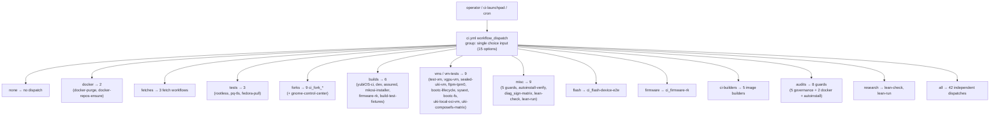

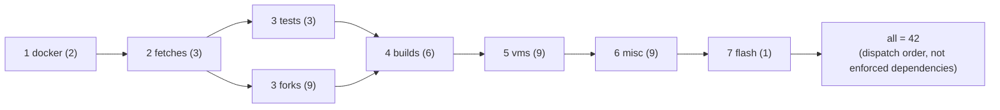

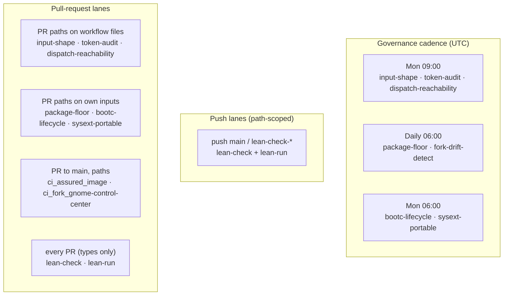

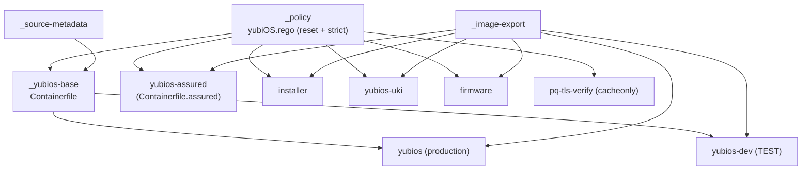

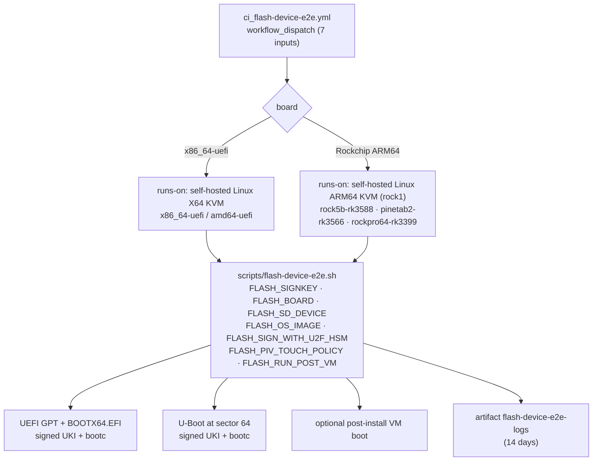

### Diagrams carried from the pre-regeneration map

The diagrams below are carried from the pre-regeneration CI_MAP (2026-07-29
shape, drifted-note 2026-09-18, re-synced 2026-10-06). Group lists in the
dispatch router and the trigger-policy diagram are updated to the 2026-11-24
15-option taxonomy; the firmware, lane, fork-chain, and artifact diagrams are
updated to the 2026-11-24 workflow set; the callback-contract diagram is
historical: PR #145 removed the callback chain, so that diagram describes a
contract that no longer fires.

**Top-level dispatch router (group choice fan-out)**

```mermaid
flowchart TD
    start["ci.yml dispatch step"]
    pick{"group: choice"}
    none_path["none\nno dispatch"]
    docker_path["docker\n[docker-purge, docker-repos-ensure]\n(2 independent dispatches)"]
    fetches_path["fetches\n[dhi, fedora-bootc, released-tag]\n(3 independent dispatches)"]
    tests_path["tests\n[rootless-docker, pq-tls-verify, fedora-pull]\n(3 independent dispatches)"]
    forks_path["forks\n[9 ci_fork_*]\n(9 independent dispatches)"]
    builds_path["builds\n[yubiOS-ci, ci_dev_image, ci_assured_image,\nci_mkosi-installer, ci_firmware-rk,\nci_build-test-fixtures]\n(6 independent dispatches; 5 get Docker_push)"]
    vms_path["vms | vm-tests\n[test-vm, vgpu-vm, sealed-uki-vm, ftpm-tpm0,\nbootc-lifecycle, sysext-portable, bootc-filesystem,\nuki-local-oci-vm, uki-composefs-matrix]\n(9 independent dispatches)"]
    misc_path["misc\n[token-audit, input-shape, dispatch-reachability,\nfork-drift-detect, package-floor, autoinstall-verify,\ndiag_sign-matrix, lean-check, lean-run]\n(9 independent dispatches)"]
    flash_path["flash\n[ci_flash-device-e2e]\n(1 independent dispatch)"]
    firmware_path["firmware\n[ci_firmware-rk]\n(1 independent dispatch)"]
    ci_builders_path["ci-builders\n[yubiOS-ci, ci_dev_image, ci_assured_image,\nci_mkosi-installer, ci_build-test-fixtures]\n(5 independent dispatches)"]
    audits_path["audits\n[token-audit, input-shape, dispatch-reachability,\nfork-drift-detect, package-floor, docker-purge,\ndocker-repos-ensure, autoinstall-verify]\n(8 independent dispatches)"]
    research_path["research\n[lean-check, lean-run]\n(2 independent dispatches)"]
    all_path["all\nstages 1-7 concatenated\n(42 independent dispatches)"]
    done["exit"]

    start --> pick
    pick -- "none" --> none_path --> done
    pick -- "docker" --> docker_path --> done
    pick -- "fetches" --> fetches_path --> done
    pick -- "tests" --> tests_path --> done
    pick -- "forks" --> forks_path --> done
    pick -- "builds" --> builds_path --> done
    pick -- "vms / vm-tests" --> vms_path --> done
    pick -- "misc" --> misc_path --> done
    pick -- "flash" --> flash_path --> done
    pick -- "firmware" --> firmware_path --> done
    pick -- "ci-builders" --> ci_builders_path --> done
    pick -- "audits" --> audits_path --> done
    pick -- "research" --> research_path --> done
    pick -- "all" --> all_path --> done
```

**Canonical Docker Bake graph**

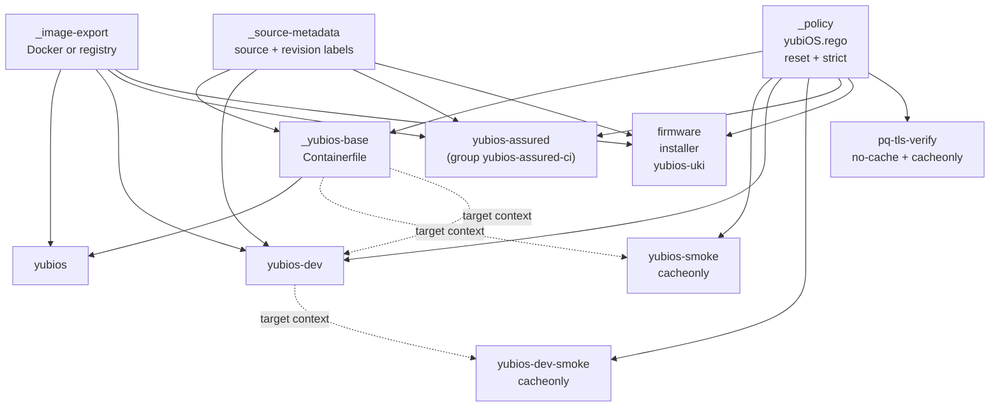

**ARM64/RK firmware integration**

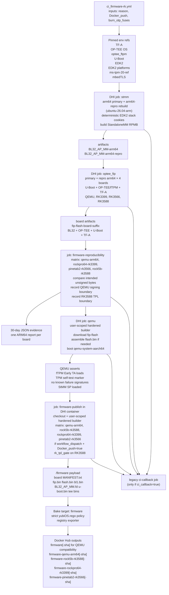

**TEST / production / dev / assured / installer / final VM / flash lanes**

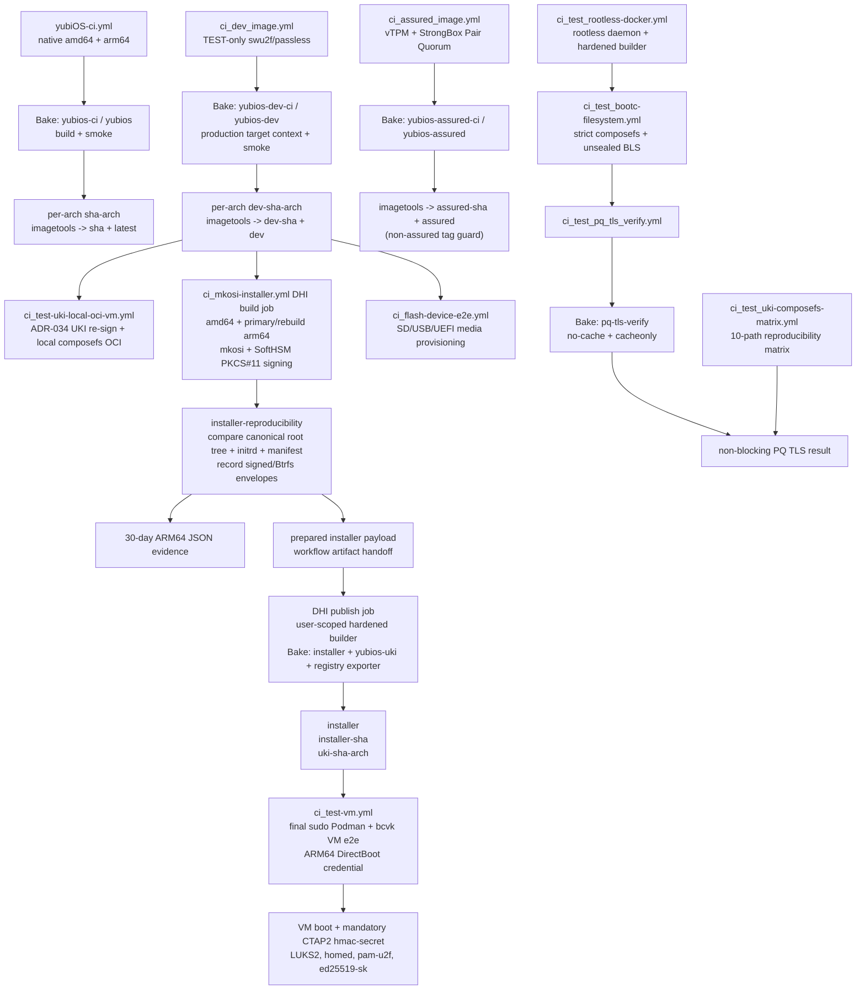

**Optional fork component CI chain**

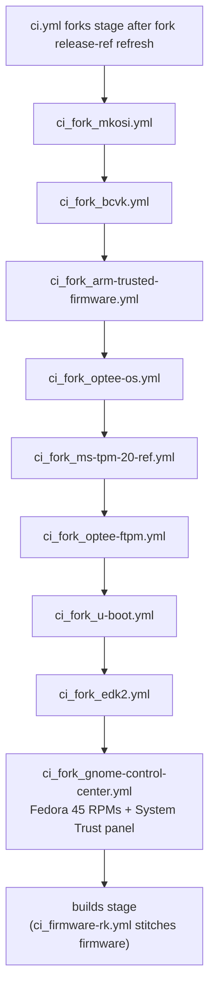

**Trigger policy (post-PR-#145)**

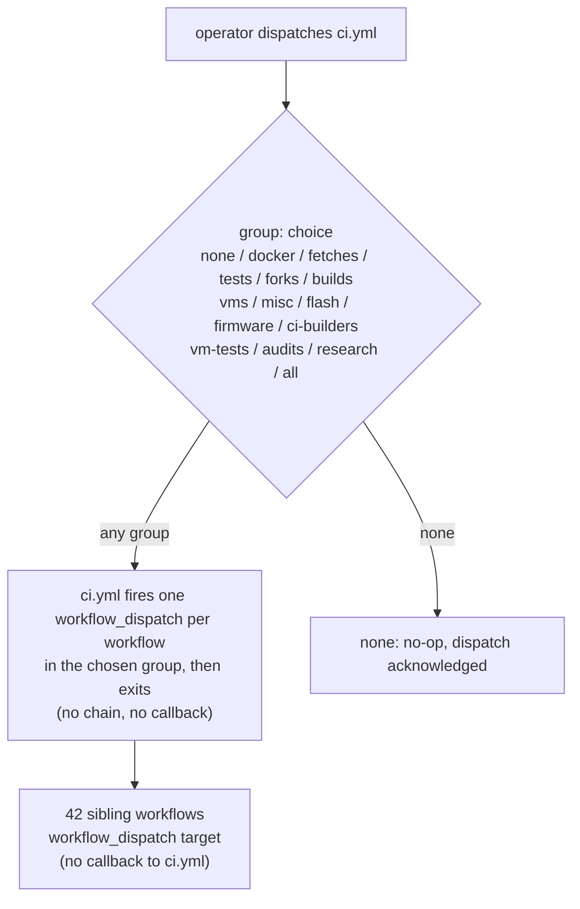

**Artifact and registry output map**

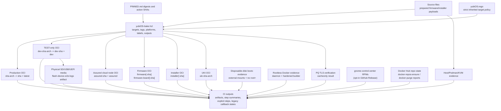

**Callback contract (historical, pre-PR-#145)**

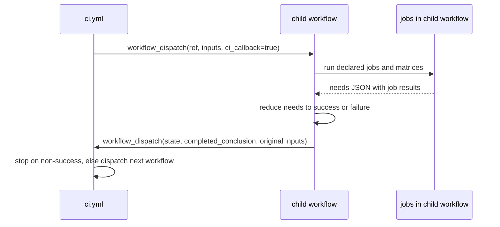

## Canonical Docker Bake Graph

`yubiOS-bake.hcl` owns every Docker build in the non-fork chain. Four hidden
targets provide the shared contract: `_policy` (exactly one `yubiOS.rego` with
`reset=true, strict=true`), `_source-metadata` (source/revision OCI labels),
`_image-export` (Docker output with provenance and manifest-list mode disabled
when `PUSH=false`; registry output with both retained when `PUSH=true`), and
`_yubios-base` (the pinned production Containerfile build). The design
rationale lives in [the Bake consolidation note](../refs/docker-bake-consolidation-2026-07-17.md).
Target names below are taken from the `docker buildx bake` invocations in the
workflow files at `8157d4e6`.

| Workflow | CI target/group | Explicit publication target |
|---|---|---|
| `yubiOS-ci.yml` | `yubios-ci` (`yubios` + `yubios-smoke`) | `yubios` |
| `ci_dev_image.yml` | `yubios-dev-ci` (`yubios-dev` + `yubios-dev-smoke`) | `yubios-dev` |
| `ci_assured_image.yml` | `yubios-assured-ci` | `yubios-assured` |
| `ci_firmware-rk.yml` | none unless publication requested | `firmware` |
| `ci_mkosi-installer.yml` | DHI-contained mkosi validation + ARM64 comparison | `installer`, `yubios-uki` |
| `ci_test_pq_tls_verify.yml` | `pq-tls-verify` | none (cacheonly) |

Publication shape: prod/dev/assured publish per-arch tags through Bake then
assemble the multi-arch index with `imagetools`; firmware/installer/UKI publish
directly with the registry exporter from privileged DHI container jobs on
user-scoped `hardened` builders.

## Full .yml Inventory

Every `.yml` file in the repo, generated from the main tree at `8157d4e6`
(trigger labels condensed; "ext inputs" counts non-`ci_*` workflow_dispatch
inputs; "jobs" counts declared jobs; "blob" is the short git blob SHA at
`8157d4e6`). 44 rows: 43 workflows + 1 non-workflow; 101 jobs total.

| File | Workflow name | Kind | Triggers | ext inputs | jobs | blob |
|---|---|---|---|---|---|---|
| `.github/workflows/autoinstall-verify.yml` | autoinstall-verify | workflow | workflow_dispatch | 4 | 1 | `436aa6cb` |
| `.github/workflows/ci.yml` | CI | workflow | workflow_dispatch | 4 | 1 | `2fa8a49c` |
| `.github/workflows/ci_assured_image.yml` | yubiOS assured cloud node image (vTPM + StrongBox Pair Quorum) | workflow | workflow_dispatch + pull_request (main, paths) | 1 | 4 | `9f677c35` |
| `.github/workflows/ci_build-test-fixtures.yml` | ci_build-test-fixtures | workflow | workflow_dispatch | 2 | 1 | `c1276866` |
| `.github/workflows/ci_dev_image.yml` | yubiOS dev/test image (swu2f, ADR-026) | workflow | workflow_dispatch | 1 | 4 | `1d17dba6` |
| `.github/workflows/ci_dispatch-reachability.yml` | ci_dispatch-reachability | workflow | workflow_dispatch + schedule + pull_request (paths) | 1 | 1 | `5b63ff3f` |
| `.github/workflows/ci_docker-purge.yml` | docker-purge | workflow | workflow_dispatch | 3 | 1 | `c90e6b00` |
| `.github/workflows/ci_docker-repos-ensure.yml` | docker-repos-ensure | workflow | workflow_dispatch | 1 | 1 | `74b522a0` |
| `.github/workflows/ci_firmware-rk.yml` | yubiOS RK firmware | workflow | workflow_dispatch | 3 | 6 | `97c2f04a` |
| `.github/workflows/ci_flash-device-e2e.yml` | yubiOS Direct-to-SD Flash & Boot Verification (rock1 / x86_64-uefi) | workflow | workflow_dispatch | 7 | 1 | `cb78059a` |
| `.github/workflows/ci_fork-drift-detect.yml` | ci_fork-drift-detect | workflow | workflow_dispatch + schedule | 2 | 1 | `e038668e` |
| `.github/workflows/ci_fork_arm-trusted-firmware.yml` | ci_fork_arm-trusted-firmware | workflow | workflow_dispatch | 1 | 2 | `8ee9fb81` |
| `.github/workflows/ci_fork_bcvk.yml` | ci_fork_bcvk | workflow | workflow_dispatch | 1 | 3 | `1fe68a34` |
| `.github/workflows/ci_fork_edk2.yml` | ci_fork_edk2 | workflow | workflow_dispatch | 1 | 2 | `cb087e85` |
| `.github/workflows/ci_fork_gnome-control-center.yml` | ci_fork_gnome-control-center | workflow | workflow_dispatch + pull_request (main, paths) | 3 | 2 | `d0672037` |
| `.github/workflows/ci_fork_mkosi.yml` | ci_fork_mkosi | workflow | workflow_dispatch | 1 | 4 | `ac575dd2` |
| `.github/workflows/ci_fork_ms-tpm-20-ref.yml` | ci_fork_ms-tpm-20-ref | workflow | workflow_dispatch | 1 | 2 | `8e375da7` |
| `.github/workflows/ci_fork_optee-ftpm.yml` | ci_fork_optee_ftpm | workflow | workflow_dispatch | 1 | 2 | `53cbf68f` |
| `.github/workflows/ci_fork_optee-os.yml` | ci_fork_optee_os | workflow | workflow_dispatch | 1 | 2 | `a778b593` |
| `.github/workflows/ci_fork_u-boot.yml` | ci_fork_u-boot | workflow | workflow_dispatch | 1 | 2 | `9501e2eb` |
| `.github/workflows/ci_input-shape.yml` | ci_input-shape | workflow | workflow_dispatch + schedule + pull_request (paths) | 1 | 1 | `8cf57f51` |
| `.github/workflows/ci_mkosi-installer.yml` | yubiOS mkosi-installer | workflow | workflow_dispatch | 2 | 6 | `e61fbc63` |
| `.github/workflows/ci_package-floor.yml` | ci_package-floor | workflow | workflow_dispatch + schedule + pull_request (paths) | 1 | 1 | `90573e80` |
| `.github/workflows/ci_test-bootc-lifecycle.yml` | ci_test-bootc-lifecycle | workflow | workflow_dispatch + schedule + pull_request (paths) | 4 | 2 | `2616be51` |
| `.github/workflows/ci_test-fedora-bootc-arm64-pull.yml` | yubiOS fedora-bootc arm64 pull integrity (OMN-139) | workflow | workflow_dispatch | 1 | 1 | `75235181` |
| `.github/workflows/ci_test-ftpm-tpm0.yml` | yubiOS fTPM /dev/tpm0 guest verify (OMN-96) | workflow | workflow_dispatch | 3 | 1 | `6c47cd49` |
| `.github/workflows/ci_test-sysext-portable.yml` | ci_test-sysext-portable | workflow | workflow_dispatch + schedule + pull_request (paths) | 5 | 2 | `78671cd3` |
| `.github/workflows/ci_test-uki-local-oci-vm.yml` | yubiOS UKI Re-Sign & Local Composefs OCI VM e2e (ADR-034, swu2f) | workflow | workflow_dispatch | 2 | 2 | `ad4ffe63` |
| `.github/workflows/ci_test-vgpu-vm.yml` | yubiOS vGPU VM e2e (tests/vm) | workflow | workflow_dispatch | 6 | 3 | `cc9e935c` |
| `.github/workflows/ci_test-vm.yml` | yubiOS VM e2e (tests/vm) | workflow | workflow_dispatch | 6 | 3 | `f0ee6d0c` |
| `.github/workflows/ci_test_bootc-filesystem.yml` | TEST - bootc to-filesystem install e2e | workflow | workflow_dispatch | 1 | 2 | `98e5ba80` |
| `.github/workflows/ci_test_pq_tls_verify.yml` | TEST - PQ hybrid TLS verification (ADR-025) | workflow | workflow_dispatch | 0 | 2 | `688fe462` |
| `.github/workflows/ci_test_rootless-docker.yml` | TEST - Rootless Docker bootstrap validation | workflow | workflow_dispatch | 0 | 2 | `c27bee80` |
| `.github/workflows/ci_test_sealed-uki-vm.yml` | TEST - sealed UKI Secure Boot VM e2e | workflow | workflow_dispatch + workflow_call | 1 | 3 | `85655c07` |
| `.github/workflows/ci_test_uki-composefs-matrix.yml` | TEST - UKI & Sealed Composefs Reproducibility Matrix (10 Paths) | workflow | workflow_dispatch | 1 | 1 | `2062bb9e` |
| `.github/workflows/ci_token-audit.yml` | ci_token-audit | workflow | workflow_dispatch + schedule + pull_request (paths) | 1 | 1 | `e747dd66` |
| `.github/workflows/diag_sign-matrix.yml` | DIAG - UKI signing matrix (10 variants) | workflow | workflow_dispatch (no inputs) | 0 | 1 | `7109c30a` |
| `.github/workflows/fetch-dhi-manifest.yml` | fetch-dhi-manifest | workflow | workflow_dispatch | 1 | 2 | `2ef32c9c` |
| `.github/workflows/fetch-fedora-bootc-manifest.yml` | fetch-fedora-bootc-manifest | workflow | workflow_dispatch | 1 | 2 | `353eee92` |
| `.github/workflows/fetch-released-tag-ref.yml` | fetch-released-tag-ref | workflow | workflow_dispatch | 1 | 2 | `9492bba5` |
| `.github/workflows/lean-check.yml` | lean-check | workflow | workflow_dispatch + push (branch/paths) + pull_request (types, unscoped) | 1 | 5 | `5965c85d` |
| `.github/workflows/lean-run.yml` | lean-run | workflow | workflow_dispatch + push (branch/paths) + pull_request (types, unscoped) | 1 | 5 | `2a221733` |
| `.github/workflows/yubiOS-ci.yml` | yubiOS CI | workflow | workflow_dispatch | 1 | 8 | `f2f23e51` |
| `.github/FUNDING.yml` | (n/a) | non-workflow | non-workflow YAML | 0 | 0 | `89b039d5` |

Per-file job trees (jobs with declared step counts and `timeout-minutes` where
set, generated):

#### `.github/workflows/autoinstall-verify.yml` — autoinstall-verify

Triggers: workflow_dispatch. Jobs (1): `validate` (1 steps). Runner(s): ubuntu-26.04. Blob `436aa6cb`, 4,885 B.

#### `.github/workflows/ci.yml` — CI

Triggers: workflow_dispatch. Jobs (1): `dispatch` (1 steps). Runner(s): ubuntu-26.04. Blob `2fa8a49c`, 8,018 B.

#### `.github/workflows/ci_assured_image.yml` — yubiOS assured cloud node image (vTPM + StrongBox Pair Quorum)

Triggers: workflow_dispatch · pull_request (main, paths). Jobs (4): `build` (10 steps), `merge-manifest` (9 steps), `verify-attest` (4 steps), `ci-callback` (1 steps). Runner(s): ${{ matrix.runner }}; ubuntu-26.04. Blob `9f677c35`, 29,167 B.

#### `.github/workflows/ci_build-test-fixtures.yml` — ci_build-test-fixtures

Triggers: workflow_dispatch. Jobs (1): `build-fixtures` (3 steps, 15 min). Runner(s): ubuntu-26.04. Blob `c1276866`, 1,840 B.

#### `.github/workflows/ci_dev_image.yml` — yubiOS dev/test image (swu2f, ADR-026)

Triggers: workflow_dispatch. Jobs (4): `build` (10 steps), `merge-manifest` (9 steps), `verify-attest` (4 steps), `ci-callback` (1 steps). Runner(s): ${{ matrix.runner }}; ubuntu-26.04. Blob `1d17dba6`, 28,800 B.

#### `.github/workflows/ci_dispatch-reachability.yml` — ci_dispatch-reachability

Triggers: workflow_dispatch · schedule · pull_request (paths). Jobs (1): `assert` (5 steps, 5 min). Runner(s): ubuntu-26.04. Blob `5b63ff3f`, 1,580 B.

#### `.github/workflows/ci_docker-purge.yml` — docker-purge

Triggers: workflow_dispatch. Jobs (1): `purge` (1 steps). Runner(s): ubuntu-26.04. Blob `c90e6b00`, 5,055 B.

#### `.github/workflows/ci_docker-repos-ensure.yml` — docker-repos-ensure

Triggers: workflow_dispatch. Jobs (1): `ensure` (2 steps). Runner(s): ubuntu-26.04. Blob `74b522a0`, 4,266 B.

#### `.github/workflows/ci_firmware-rk.yml` — yubiOS RK firmware

Triggers: workflow_dispatch. Jobs (6): `stmm` (11 steps), `optee_fip` (22 steps), `firmware-reproducibility` (10 steps), `qemu` (10 steps), `firmware-publish` (11 steps), `ci-callback` (1 steps). Runner(s): ${{ matrix.runner }}; ubuntu-26.04. Blob `97c2f04a`, 81,659 B.

#### `.github/workflows/ci_flash-device-e2e.yml` — yubiOS Direct-to-SD Flash & Boot Verification (rock1 / x86_64-uefi)

Triggers: workflow_dispatch. Jobs (1): `flash-device-e2e` (4 steps, 180 min). Runner(s): ${{ (inputs.board == 'x86_64-uefi' || inputs.board == 'amd64-uefi') && fromJSON('["self-hosted", "Linux", "X64", "KVM"]') || fromJSON('["self-hosted", "Linux", "ARM64", "KVM"]') }}. Blob `cb78059a`, 3,640 B.

#### `.github/workflows/ci_fork-drift-detect.yml` — ci_fork-drift-detect

Triggers: workflow_dispatch · schedule. Jobs (1): `detect` (6 steps, 10 min). Runner(s): ubuntu-26.04. Blob `e038668e`, 2,262 B.

#### `.github/workflows/ci_fork_arm-trusted-firmware.yml` — ci_fork_arm-trusted-firmware

Triggers: workflow_dispatch. Jobs (2): `build-tfa` (8 steps), `ci-callback` (1 steps). Runner(s): ${{ matrix.runner }}; ubuntu-26.04. Blob `8ee9fb81`, 10,997 B.

#### `.github/workflows/ci_fork_bcvk.yml` — ci_fork_bcvk

Triggers: workflow_dispatch. Jobs (3): `unit-tests` (5 steps), `clippy` (3 steps), `ci-callback` (1 steps). Runner(s): ${{ matrix.runner }}; ubuntu-26.04. Blob `1fe68a34`, 7,892 B.

#### `.github/workflows/ci_fork_edk2.yml` — ci_fork_edk2

Triggers: workflow_dispatch. Jobs (2): `build-standalonemm` (6 steps), `ci-callback` (1 steps). Runner(s): ${{ matrix.runner }}; ubuntu-26.04. Blob `cb087e85`, 8,052 B.

#### `.github/workflows/ci_fork_gnome-control-center.yml` — ci_fork_gnome-control-center

Triggers: workflow_dispatch · pull_request (main, paths). Jobs (2): `build-rpm` (4 steps, 45 min), `ci-callback` (1 steps). Runner(s): ${{ matrix.runner }}; ubuntu-26.04. Blob `d0672037`, 9,286 B.

#### `.github/workflows/ci_fork_mkosi.yml` — ci_fork_mkosi

Triggers: workflow_dispatch. Jobs (4): `validate-profile` (4 steps), `shellcheck` (3 steps), `ruff` (4 steps), `ci-callback` (1 steps). Runner(s): ubuntu-26.04. Blob `ac575dd2`, 6,827 B.

#### `.github/workflows/ci_fork_ms-tpm-20-ref.yml` — ci_fork_ms-tpm-20-ref

Triggers: workflow_dispatch. Jobs (2): `build-ms-tpm-20-ref` (6 steps), `ci-callback` (1 steps). Runner(s): ${{ matrix.runner }}; ubuntu-26.04. Blob `8e375da7`, 9,960 B.

#### `.github/workflows/ci_fork_optee-ftpm.yml` — ci_fork_optee_ftpm

Triggers: workflow_dispatch. Jobs (2): `build-ftpm-ta` (6 steps), `ci-callback` (1 steps). Runner(s): ${{ matrix.runner }}; ubuntu-26.04. Blob `53cbf68f`, 9,936 B.

#### `.github/workflows/ci_fork_optee-os.yml` — ci_fork_optee_os

Triggers: workflow_dispatch. Jobs (2): `build-optee` (4 steps), `ci-callback` (1 steps). Runner(s): ${{ matrix.runner }}; ubuntu-26.04. Blob `a778b593`, 7,941 B.

#### `.github/workflows/ci_fork_u-boot.yml` — ci_fork_u-boot

Triggers: workflow_dispatch. Jobs (2): `build-uboot` (7 steps), `ci-callback` (1 steps). Runner(s): ${{ matrix.runner }}; ubuntu-26.04. Blob `9501e2eb`, 9,813 B.

#### `.github/workflows/ci_input-shape.yml` — ci_input-shape

Triggers: workflow_dispatch · schedule · pull_request (paths). Jobs (1): `validate` (5 steps, 5 min). Runner(s): ubuntu-26.04. Blob `8cf57f51`, 1,503 B.

#### `.github/workflows/ci_mkosi-installer.yml` — yubiOS mkosi-installer

Triggers: workflow_dispatch. Jobs (6): `build` (14 steps), `installer-reproducibility` (8 steps), `installer-publish` (10 steps), `merge-manifest` (8 steps), `verify-attest` (4 steps), `ci-callback` (1 steps). Runner(s): ${{ matrix.runner }}; ubuntu-26.04. Blob `e61fbc63`, 52,492 B.

#### `.github/workflows/ci_package-floor.yml` — ci_package-floor

Triggers: workflow_dispatch · schedule · pull_request (paths). Jobs (1): `verify-floor` (4 steps, 15 min). Runner(s): ubuntu-26.04. Blob `90573e80`, 1,375 B.

#### `.github/workflows/ci_test-bootc-lifecycle.yml` — ci_test-bootc-lifecycle

Triggers: workflow_dispatch · schedule · pull_request (paths). Jobs (2): `test-upgrade` (5 steps, 45 min), `test-homed-migrate` (5 steps, 30 min). Runner(s): ${{ inputs.run_vm_legs == true && fromJSON('["self-hosted","Linux","ARM64","KVM"]') || 'ubuntu-26.04' }}. Blob `2616be51`, 8,552 B.

#### `.github/workflows/ci_test-fedora-bootc-arm64-pull.yml` — yubiOS fedora-bootc arm64 pull integrity (OMN-139)

Triggers: workflow_dispatch. Jobs (1): `pull-arm64-integrity` (4 steps, 15 min). Runner(s): ubuntu-26.04. Blob `75235181`, 6,861 B.

#### `.github/workflows/ci_test-ftpm-tpm0.yml` — yubiOS fTPM /dev/tpm0 guest verify (OMN-96)

Triggers: workflow_dispatch. Jobs (1): `ftpm-tpm0-verify` (8 steps, 10 min). Runner(s): ${{ matrix.runner }}. Blob `6c47cd49`, 8,869 B.

#### `.github/workflows/ci_test-sysext-portable.yml` — ci_test-sysext-portable

Triggers: workflow_dispatch · schedule · pull_request (paths). Jobs (2): `test-sysext` (5 steps, 30 min), `test-portable` (5 steps, 30 min). Runner(s): ${{ inputs.run_vm_legs == true && fromJSON('["self-hosted","Linux","ARM64","KVM"]') || 'ubuntu-26.04' }}. Blob `78671cd3`, 8,736 B.

#### `.github/workflows/ci_test-uki-local-oci-vm.yml` — yubiOS UKI Re-Sign & Local Composefs OCI VM e2e (ADR-034, swu2f)

Triggers: workflow_dispatch. Jobs (2): `lint-and-unit` (2 steps), `vm-uki-local-oci-e2e` (12 steps). Runner(s): ubuntu-26.04; ${{ matrix.runner }}. Blob `ad4ffe63`, 14,569 B.

#### `.github/workflows/ci_test-vgpu-vm.yml` — yubiOS vGPU VM e2e (tests/vm)

Triggers: workflow_dispatch. Jobs (3): `lint-vm-scripts` (3 steps), `vgpu-vm-e2e` (32 steps), `ci-callback` (1 steps). Runner(s): ubuntu-26.04; ${{ matrix.runner }}. Blob `cc9e935c`, 77,650 B.

#### `.github/workflows/ci_test-vm.yml` — yubiOS VM e2e (tests/vm)

Triggers: workflow_dispatch. Jobs (3): `lint-vm-scripts` (3 steps), `vm-e2e` (24 steps), `ci-callback` (1 steps). Runner(s): ubuntu-26.04; ${{ matrix.runner }}. Blob `f0ee6d0c`, 60,108 B.

#### `.github/workflows/ci_test_bootc-filesystem.yml` — TEST - bootc to-filesystem install e2e

Triggers: workflow_dispatch. Jobs (2): `install-to-filesystem` (9 steps, 60 min), `ci-callback` (1 steps). Runner(s): ${{ matrix.runner }}; ubuntu-26.04. Blob `98e5ba80`, 18,160 B.

#### `.github/workflows/ci_test_pq_tls_verify.yml` — TEST - PQ hybrid TLS verification (ADR-025)

Triggers: workflow_dispatch. Jobs (2): `pq-tls-verify` (5 steps), `ci-callback` (1 steps). Runner(s): ubuntu-26.04. Blob `688fe462`, 10,951 B.

#### `.github/workflows/ci_test_rootless-docker.yml` — TEST - Rootless Docker bootstrap validation

Triggers: workflow_dispatch. Jobs (2): `rootless-docker` (4 steps), `ci-callback` (1 steps). Runner(s): ${{ matrix.runner }}; ubuntu-26.04. Blob `c27bee80`, 17,159 B.

#### `.github/workflows/ci_test_sealed-uki-vm.yml` — TEST - sealed UKI Secure Boot VM e2e

Triggers: workflow_dispatch · workflow_call. Jobs (3): `build-and-verify-uki` (9 steps, 30 min), `boot-secure-vm` (4 steps, 60 min), `negative-tamper-tests` (5 steps, 60 min). Runner(s): ${{ matrix.runner }}; ubuntu-26.04. Blob `85655c07`, 52,791 B.

#### `.github/workflows/ci_test_uki-composefs-matrix.yml` — TEST - UKI & Sealed Composefs Reproducibility Matrix (10 Paths)

Triggers: workflow_dispatch. Jobs (1): `uki-composefs-matrix` (3 steps, 25 min). Runner(s): ubuntu-26.04-arm. Blob `2062bb9e`, 20,825 B.

#### `.github/workflows/ci_token-audit.yml` — ci_token-audit

Triggers: workflow_dispatch · schedule · pull_request (paths). Jobs (1): `audit` (5 steps, 5 min). Runner(s): ubuntu-26.04. Blob `e747dd66`, 1,671 B.

#### `.github/workflows/diag_sign-matrix.yml` — DIAG - UKI signing matrix (10 variants)

Triggers: workflow_dispatch (no inputs). Jobs (1): `sign-variant` (4 steps, 15 min). Runner(s): ubuntu-26.04. Blob `7109c30a`, 6,959 B.

#### `.github/workflows/fetch-dhi-manifest.yml` — fetch-dhi-manifest

Triggers: workflow_dispatch. Jobs (2): `fetch` (2 steps), `ci-callback` (1 steps). Runner(s): ubuntu-26.04. Blob `2ef32c9c`, 9,790 B.

#### `.github/workflows/fetch-fedora-bootc-manifest.yml` — fetch-fedora-bootc-manifest

Triggers: workflow_dispatch. Jobs (2): `fetch` (2 steps), `ci-callback` (1 steps). Runner(s): ubuntu-26.04. Blob `353eee92`, 11,461 B.

#### `.github/workflows/fetch-released-tag-ref.yml` — fetch-released-tag-ref

Triggers: workflow_dispatch. Jobs (2): `fetch-release-refs` (2 steps), `ci-callback` (1 steps). Runner(s): ubuntu-26.04. Blob `9492bba5`, 13,969 B.

#### `.github/workflows/lean-check.yml` — lean-check

Triggers: workflow_dispatch · push (branch/paths) · pull_request (types, unscoped). Jobs (5): `check` (30 steps, 25 min), `verify-measurements` (8 steps, 30 min), `verify-tools` (29 steps, 45 min), `run-real-corpus` (20 steps, 60 min), `run-real-statements` (2 steps, 10 min). Runner(s): ubuntu-26.04. Blob `5965c85d`, 40,976 B.

#### `.github/workflows/lean-run.yml` — lean-run

Triggers: workflow_dispatch · push (branch/paths) · pull_request (types, unscoped). Jobs (5): `check` (30 steps, 25 min), `verify-measurements` (8 steps, 30 min), `verify-tools` (29 steps, 45 min), `run-real-corpus` (20 steps, 60 min), `run-real-statements` (2 steps, 10 min). Runner(s): ubuntu-26.04. Blob `2a221733`, 41,583 B.

#### `.github/workflows/yubiOS-ci.yml` — yubiOS CI

Triggers: workflow_dispatch. Jobs (8): `shellcheck` (2 steps), `hadolint` (2 steps), `unit-tests` (4 steps), `mkosi` (3 steps), `build` (10 steps), `merge-manifest` (8 steps), `verify-attest` (4 steps), `ci-callback` (1 steps). Runner(s): ubuntu-26.04; ${{ matrix.runner }}. Blob `f2f23e51`, 31,582 B.

#### `.github/FUNDING.yml`

Triggers: non-workflow YAML. Jobs (0): (no jobs — declarative only). Runner(s): —. Blob `89b039d5`, 26 B.

## Documented vs Code (ci-launchpad cross-check)

ci-launchpad (the Sauna CI app, `apps/github-yubios-KS9n5GAT/ci-launchpad/`) is
the live tracker for this surface. The 2026-11-24 update brings it to full
parity with `ci.yml` at `8157d4e6`:

**1. Group + push parity (`src/handler.ts`).**

| ci.yml construct | ci-launchpad source | Parity |
|---|---|---|
| 15 `group` options | `ORCH_GROUPS` set + `WORKFLOW_INPUTS` offline fallback `options` | exact (same 15 values, same order) |
| 8 canonical stage arrays (`docker`, `fetches`, `tests`, `forks`, `builds`, `vms`, `misc`, `flash`) | `GROUPS` | exact membership and order (2 / 3 / 3 / 9 / 6 / 9 / 9 / 1) |
| `all` array (42) | `GROUPS.all` = ordered de-duplicated union of the 8 stage arrays | exact (42, same order) |
| subset/alias arrays (`firmware`, `ci-builders`, `vm-tests`, `audits`, `research`) | `GROUP_WORKFLOWS` (`vm-tests` = `[...GROUPS.vms]`) | exact (1 / 5 / 9 / 8 / 2) |
| `none` | `GROUPS.none = []` | exact |
| `PUSH_WORKFLOWS` (5) | `PUSH_WORKFLOWS` set: `ci_firmware-rk.yml`, `yubiOS-ci.yml`, `ci_dev_image.yml`, `ci_assured_image.yml`, `ci_mkosi-installer.yml` | exact; `/api/groups` and `/api/workflow-inputs` expose it as `pushWorkflows` |

`POST /api/dispatch` rejects any group outside `ORCH_GROUPS` with the list ci.yml
accepts, so the app can no longer offer a choice the orchestrator would reject
(or miss one it accepts).

**2. Live GitHub input fetching.** `GET /api/workflow-file-schema/:file`,
`GET /api/workflow-inputs` (ci.yml's own schema), and
`POST /api/dispatch-workflow` all call `getWorkflowSchema()`, which fetches the
workflow YAML live from `GET /repos/yubi-OS/yubiOS/contents/.github/workflows/<file>?ref=<ref>`
(raw media type, optional `?ref=`, default `main`) on every request. The two GET
routes answer with `Cache-Control: no-store`; the POST validates the payload
against the schema parsed from that same live fetch at the dispatch `ref`. The
`workflow_schemas` table is written only for `main`-ref fetches and read only as
an offline fallback when GitHub is unreachable (cached rows carry `rawYaml` and
are re-parsed with the current parser). This replaces the 1-hour schema TTL
described in earlier app notes.

**3. Indentation-aware `workflow_dispatch.inputs` parser.** `parseWorkflowInputs()`
tracks the indent of `on:`, `workflow_dispatch:` (block or inline `{}` form),
`inputs:`, each input name, and each sub-key, and accepts `options:` list items
at any indent ≥ the sub-key indent — both the 8-space style (`- none` level with
`options:`, as in `ci.yml`, `ci_docker-purge.yml`) and the 10-space style
(`- test` nested under `options:`). That fixes the choice inputs of
`ci_flash-device-e2e.yml` (`SIGNKEY`, `board`, `piv_touch_policy`) as well as
the `fail_on` choices of `ci_input-shape.yml`, `ci_token-audit.yml`, and
`ci_dispatch-reachability.yml`. Inline `[a, b]` option lists, block-scalar
descriptions (`|`, `>`), boolean defaults, and empty choice defaults (first
option) are normalized post-parse. Internal inputs are then flagged by
`isInternalInput()` *after* parsing: an exact match in `INTERNAL_INPUTS`
(`ci_callback`, `ci_chain_ref`, `ci_reason`, `ci_Docker_push`,
`ci_Dev_Docker_push`, `ci_Firmware_Docker_push`, `ci_Installer_Docker_push`,
`ci_fork_run`, `ci_test_run`, `ci_vm_image`) or any `ci_*` input whose
description starts with `Internal:`. Flagged inputs are dropped from the UI
schema and never user-settable; the workflow's declared defaults apply.

**4. Direct workflow trigger (`src/client.tsx`).** The top panel now has a
workflow selector (`ci.yml` plus every tracked workflow, `ci.yml` first, from
`/api/workflow-inputs` `workflows`) and a `⚡ flash CI (ci_flash-device-e2e.yml)`
shortcut button; choosing a non-orchestrator workflow swaps the ci.yml form for
that workflow's live input form and dispatches through
`/api/dispatch-workflow`. In ci.yml mode, selecting a single-workflow group
(`flash` → `ci_flash-device-e2e.yml`, `firmware` → `ci_firmware-rk.yml`)
auto-loads that workflow's live inputs beneath the group form so it can be fired
directly with non-default inputs (e.g. a specific `board` / `SIGNKEY`). Every
tracked row carries a `▶ trigger` button that expands a per-workflow form; row
expansion state is keyed by `${group}:${file}` (and `other:${file}` for
census-adopted workflows outside the groups), so a workflow that appears in
several displayed groups (its stage group and `all`) expands independently in
each. Direct dispatches are
audit-logged with `workflowFile` set to the file and, when a `board` input is
present, a default reason of `board=<board> SIGNKEY=<SIGNKEY>`.

History — the 2026-10-06 re-sync: what was a hand-maintained 27-file taxonomy
with 12 stragglers on 2026-10-05 became the real group input. The straggler
assignments were promoted into real ci.yml groups by commit `e46a3cb8`, and the
app taxonomy was re-synced in the same pass (deploy `c1c70026`): `audits` and
`research` became orchestrator dispatch targets, `fork-drift-detect` moved from
the app's interim `fetches` assignment into ci.yml's real `audits` group, and
the app's group-choice list, dispatch gating, and per-workflow group labels were
regenerated from the live ci.yml source (including the inline-brace parser fix
for `diag_sign-matrix.yml`'s inputless `workflow_dispatch: {}`).

2026-10-05 straggler assignments (historical record; live groups updated to
2026-11-24):

| Straggler | 2026-10-05 app group | ci.yml group (2026-10-06) | ci.yml groups (2026-11-24) |
|---|---|---|---|
| `ci_input-shape.yml` | tests | audits | misc + audits |
| `ci_token-audit.yml` | tests | audits | misc + audits |
| `ci_dispatch-reachability.yml` | tests | audits | misc + audits |
| `ci_package-floor.yml` | tests | audits | misc + audits |
| `ci_fork-drift-detect.yml` | fetches | audits | misc + audits |
| `ci_build-test-fixtures.yml` | ci-builders | ci-builders | builds + ci-builders |
| `lean-check.yml` | research | research | misc + research |
| `lean-run.yml` | research (display-only) | research (real, since e46a3cb8) | misc + research |
| `phonon-followups.yml` | research (display-only) | research (real, since e46a3cb8) | removed from main (folded into lean-run) |
| `zernike-lens.yml` | research (display-only) | research (real, since e46a3cb8) | removed from main (folded into lean-run) |
| `zernike-caustics.yml` | research (display-only) | research (real, since e46a3cb8) | removed from main (folded into lean-run) |
| `zernike-spectrum.yml` | research (display-only) | research (real, since e46a3cb8) | removed from main (folded into lean-run) |

Census tracking (since 2026-10-05, unchanged): the app derives its workflow set
from a full-repo git-tree census (one
`GET /repos/yubi-OS/yubiOS/git/trees/main?recursive=1` call filtered to `*.yml`,
≤6 h TTL) and auto-adopts every `.github/workflows/*.yml` it finds into run
tracking, so the doc/app gap class can no longer occur silently — a new workflow
file becomes tracked on the next status poll after it lands on main. Non-workflow
YAML (`.github/FUNDING.yml`) is inventoried in the app's `/api/yml-inventory`
endpoint (with kind, path, and blob sha) but not run-tracked, since it has no
Actions surface.

Cross-check at regeneration time (2026-11-24, `8157d4e6`):

| Measure | Count |
|---|---|
| `.yml` files in repo census | 44 |
| Workflows run-tracked by ci-launchpad | 43 |
| Non-workflow YAML inventoried (not run-tracked) | 1 |
| ci.yml group choices mirrored by the app | 15 / 15 |
| `PUSH_WORKFLOWS` mirrored by the app | 5 / 5 |
| Files in the app's group taxonomy | 43 (42 dispatchable stage-group members + ci.yml) |
| Files reachable via taxonomy + auto-adoption | 43 |
| Workflows whose dispatch schema the app reads live from GitHub | 43 (all) |
| Doc-only entries (documented, not on main) | 0 (the 4 removed research runners are marked historical) |
| Code-only entries (on main, undocumented here) | 0 |

Known issues and drift findings (documented, not fixed in this pass):

- RESOLVED (still true): the 2026-10-05 `ci_test_pq_tsl_verify.yml` typo in the
  `all` group is gone — no `pq_tsl` string remains anywhere in the 44 `.yml`
  files at `8157d4e6`, and `app.md` was refreshed in the 2026-11-24 pass to
  match the 42-workflow `all` union and live schema fetching.
- `client.tsx` `GROUP_LABELS` covers the 10 display groups (`none` + 8 stages +
  `all`); the 5 subset/alias groups are dispatch choices only and are not
  rendered as separate row sections (their members already appear under their
  stage group).
- ci.yml self-description drift: the `Docker_push` input description still
  names four builders ("ci_firmware-rk, yubiOS-ci, ci_dev_image,
  ci_mkosi-installer") while the `PUSH_WORKFLOWS` arrays honor five (adding
  `ci_assured_image.yml`); the header comment's `misc` stage ends in a stray
  `#,,,` line.
- `ci_docker-purge.yml` / `ci_docker-repos-ensure.yml` header comments say they
  are "intentionally NOT in the `all` group", but ci.yml's `all` array (and the
  `docker` stage) dispatches both. The `all` dispatch sends `{}`, so purge runs
  in its default `mode=report` (dry-run) and cannot delete tags; repos-ensure
  only creates/patches. Safe today, but the comments are stale.
- `ci_assured_image.yml`'s header comment is copied from `ci_dev_image.yml`
  (describes `Containerfile.dev` and the `dev` / `dev-<sha>` tags); the
  workflow actually builds `Containerfile.assured` and publishes `assured` /
  `assured-<sha>`.
- 23 child workflows still declare the legacy `ci_callback` internal input from
  the pre-#145 callback-chain design (up from 10 recorded on 2026-10-06, which
  under-counted: the fetches, image builders, VM tests, and several TEST
  workflows also carry it); 22 still have the `ci-callback` job
  (`ci_test-uki-local-oci-vm.yml` declares the inputs without the job).
  ci-launchpad filters all of them out of its trigger UI and the workflows'
  defaults apply.
- `lean-check.yml` / `lean-run.yml` run on every pull request (no path filter)
  and are now near-identical 5-job twins, so each PR runs the full Lean + real
  data suite twice.
- Carried from 2026-10-06, not re-verified in this pass: the full CI-path
  dispatch test (recorded out-of-repo in the Sauna workspace at
  `session/ci-test/ci-path-test-report-2026-10-06.md`) found several fork
  workflows failing at their dependencies-install steps and some builder
  workflows failing during build stages; the dispatch plumbing itself was
  verified reachable.

## Trigger policy

- 42 group members + ci.yml: dispatch-driven (manual, via the app, or via a
  ci.yml group); 43 workflows declare `workflow_dispatch`.
- 7 workflows also run on cron: the 3 workflow-file guards (Mondays 09:00 UTC),
  package-floor + fork-drift-detect (daily 06:00 UTC), bootc-lifecycle +
  sysext-portable (Mondays 06:00 UTC).
- 2 workflows also run on path-scoped push: lean-check/lean-run (main +
  `lean-check-*`). The former `phonon-followups-*` push lane is gone with the
  workflow.
- 10 workflows also run on pull requests: 6 path-scoped validators (the 3
  guards, package-floor, bootc-lifecycle, sysext-portable — each scoped to its
  own files/inputs), 2 path-scoped to `main` (`ci_assured_image.yml`,
  `ci_fork_gnome-control-center.yml`), and 2 unscoped (`lean-check.yml`,
  `lean-run.yml`, `types: opened, synchronize, reopened`).
- 1 workflow is `workflow_call`-callable: `ci_test_sealed-uki-vm.yml`.
- Destructive / irreversible inputs stay dispatch-only and default off:
  `hw_device` (VM lane), `burn_otp_fuses` (firmware), `mode=purge`
  (docker-purge), and the whole `ci_flash-device-e2e.yml` workflow (writes
  `sd_device`).
- No workflow dispatches another workflow back; the callback contract is gone
  (PR #145). The `ci-callback` jobs still present in 22 child workflows are
  legacy no-ops (gated on `ci_callback == true`) kept for history.

## Drift discipline

This document is regenerated, not maintained by hand-edits: the census and
inventory blocks are generated from the workflow YAMLs themselves (2026-11-24:
from a full dump of all 44 `.yml` blobs at `8157d4e6`), and the ci-launchpad
`/api/yml-inventory` endpoint can produce the same 44-file census on demand (one
git-tree call), so the map's counts can be re-verified in a single API call at
any time; `/api/groups` and `/api/workflow-inputs` expose the 15-group taxonomy
and the 5 `PUSH_WORKFLOWS` for the same check. The 2026-09-18 addendum pattern (a
drift record flagging count mismatches, deferring the fix) is replaced by: any
session touching a workflow file re-runs the census and appends a dated drift
note if counts moved.
