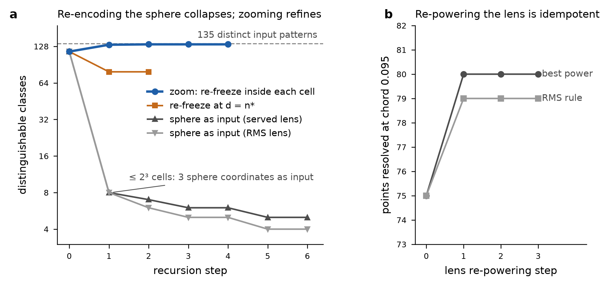

# Can the focal-point pipeline be applied recursively?

Companion note to paper 4 (*How Many Remain at Scale ε?*), 2026-11-10. Data: map #598 (n = 3,232), reproduced from its recovered inputs with the repository `pointmap.js`. Each step is scored with the `jev-focal-point.js` module.

**Short answer: yes, but what happens depends on which stage is repeated.** All four variants reach a fixed point within a few steps, and the theorems below say they must.

- **Lens alone:** re-powering converges in one step and gains nothing further.
- **Re-freeze at d = n\*:** converges in one step.
- **Sphere as the next input:** contracts, losing information at every step.
- **Zoom (local re-freeze inside each cell):** the only variant that increases resolution.

## 1. Four recursions and what is proved about them

| recursion | what is repeated | behaviour | proof |
|---|---|---|---|
| R1 lens only | the stereographic power on the current sphere | idempotent after one step | the power is a Möbius dilation: k₂∘k₁ = k₁k₂, and RMS(w/RMS(w)) = 1 exactly |
| R2 re-freeze | map at d, then re-map at d = n\* on the same frame | idempotent after one step | `FocalBounds.focalDim_take_self`, `focalDim_refreeze_fixed` (new) |
| R3 sphere→input | the sphere points become the next input vectors; a new frame is frozen | class count non-increasing; stabilizes within N₀ steps | `distinctCount_map_le`, plus new `recode_count_antitone`, `recode_stabilizes`, `antitone_stabilizes` |
| Zoom | a new local frame is frozen inside every cell of the previous one | class count non-decreasing, bounded by the distinct inputs | `distinctCount_map_le`, applied twice (old cell = function of new label; new label = function of input) |

The six new theorems are appended to `FocalBounds.lean` (core Lean 4.33.0, no imports), bringing it to 25. They pass every focal gate: forbidden tokens, no `sorry`, `leanchecker --fresh`, axiom coverage over 57 gated declarations within {propext, Quot.sound, Classical.choice}, `FOCAL_SCOPE_MANIFEST_OK 25`, statement and definition pins, and `ALL_FOCAL_GATES_OK`. Injecting `sorry` into `recode_stabilizes` is rejected. The toolchain-tarball checksum step was skipped because the tarball is not in the workspace. One proof originally used `simp`, which generated an auxiliary `distinctCount.congr_simp` lemma that the coverage gate rejects; it was rewritten rather than relaxing the gate.

## 2. Results on map #598

**R1, lens only.** RMS rule: the plane RMS goes 0.645 → 1.000 → 1.000, and N(0.095) goes 75 → 79 → 79 → 79. Best-power rule: N goes 75 → 80 → 80 → 80; after one step the best power is the served power. Re-powering composes multiplicatively, so any chain of lens steps equals one lens with the product power. Recursion adds no expressiveness here; only the choice rule matters, and both rules are fixed points after one application.

**R2, re-freeze at d = n\*.** d = 9 → n\* = 7 → re-map at d = 7. The new ladder is exactly the truncated one, [2, 4, 8, 16, 30, 49, 79], and n\* = 7 = d, so this is a fixed point. On the re-frozen sphere, isolated points drop 2 → 0. N(0.095) at served/RMS/best is 71/72/72, so the RMS power is already optimal. At the fixed point the null also selects every axis, so the null comparison carries no information there.

**R3, sphere as the next input** (classes per step):

| step | 0 | 1 | 2 | 3 | 4 | 5 | 6 |
|---|---|---|---|---|---|---|---|
| served lens | 116 | 8 | 7 | 6 | 6 | 5 | 5 |
| RMS-powered lens | 116 | 8 | 6 | 5 | 5 | 4 | 4 |
| bits, served (log₂ classes) | 6.86 | 3.0 | 2.81 | 2.58 | 2.58 | 2.32 | 2.32 |

The first step loses 116 → 8 classes (6.86 → 3 bits). A 3-coordinate input frame can hold at most 2³ cells (`prefix_count_pow` with d = 3), and every later step keeps or lowers the count. The sequences reach fixed points of 5 (served) and 4 (RMS) classes by step 5, well inside the proved bound of N₀ = 116 steps. The literature survey predicted that retained information would shrink by a roughly constant factor per step, via the strong data-processing inequality. The data do not support that for the class count: one cap-driven drop is followed by slow decay to a non-trivial attractor. The SDPI bounds information about the original corpus, not the number of classes of the map's own fixed point.

**Zoom (divisive) recursion.** Freezing a new `pointmap.js` frame inside each cell (repository code; only the bits are used):

| depth | 1 (deployed frame) | 2 | 3 | 4 | 5 |
|---|---|---|---|---|---|
| leaves | 116 | 132 | 133 | 133 | 133 |
| single-pattern leaves | 99 | 129 | 131 | 131 | 131 |

This recovers 17 of the 19 input patterns that the global frame merges (133 of 135), and is a fixed point from depth 3. The two unsplit cells are a limitation of the median rule on tied 0/1 scores: when one pattern holds the median, the cut cannot separate it from the rest.

## 3. Prior state of the art

A sub-agent surveyed 8 clusters and kept 45 works, each verified against CrossRef, arXiv or OpenAlex. Three DOIs were re-resolved independently (Horn 1965; Gong et al. 2013; Kato & McCullagh 2020); all matched.

- [prior_art_survey.md](prior_art_survey.md) — annotated survey
- [prior_art.bib](prior_art.bib) — 45 verified entries
- [prior_art_verification.csv](prior_art_verification.csv) — 90 rows: the 45 cited works, 44 reserve candidates (43 verified, 1 unverified) and the failed starting DOIs

Nine annotations are marked *metadata only* (no abstract retrieved).

**Closest prior art to paper 4:**

- **Choosing n\* against a null: parallel analysis.** Horn (1965), *Psychometrika*, doi:10.1007/BF02289447; Buja & Eyuboglu (1992); Dobriban (2020), *Ann. Statist.*, doi:10.1214/19-AOS1907. These choose the number of components against permuted data. Paper 4's column-permutation null is the same idea applied to class counts instead of eigenvalues; the fixed-row-and-column curveball null and the ½-bit gain criterion are the differences.
- **Median or sign splits on PCA axes: learned binary codes.** Spectral hashing (Weiss et al. 2008); PCA hashing; Iterative Quantization, Gong et al. (2013), *IEEE TPAMI*, doi:10.1109/TPAMI.2012.193. ITQ exists because un-rotated PCA axes align poorly with the binary cube, which is the same misalignment behind paper 4's 135 → 116 loss. ITQ's alternating rotation is itself a recursion with a fixed point.
- **Counting cells of hyperplane tessellations.** Plan & Vershynin (2013), doi:10.1007/s00454-013-9561-6, and Sauer–Shelah-type bounds give general context for the distinguishability ladder.
- **Fixed-margin nulls.** Strona et al. (2014), *Nat. Commun.*, doi:10.1038/ncomms5114 (curveball), and Carstens (2015).
- **Anisotropy of language-model embeddings.** Ethayarajh (2019), doi:10.18653/v1/D19-1006; Mu & Viswanath, "all-but-the-top" (arXiv). This is the main objection to expect: the top principal axes may carry shared, less discriminative structure. Re-running the ladder after dropping axes 1–2 would answer it.
- **Möbius maps on the sphere.** Kato & McCullagh (2020), *Bernoulli*, doi:10.3150/20-BEJ1222, is the nearest mathematical precedent for treating the stereographic scale as a Möbius lens. None of the surveyed works tunes that scale to maximize a resolution count, though a 45-work survey is not exhaustive.
- **Iterated maps and fixed points.** Mean shift (Cheng 1995); Lloyd (1982), doi:10.1109/TIT.1982.1056489; ITQ; data-processing inequalities (Cover & Thomas 2005; Raginsky 2016); layer-wise intrinsic-dimension profiles of deep networks (Ansuini et al. 2019, arXiv:1905.12784). None studies the fixed points of the full remap / re-freeze / re-power loop.
- **Divisive partition trees (added here; not in the survey).** These are the established precedent for the zoom recursion, and they come with intrinsic-dimension adaptivity results:
  - Dasgupta & Freund (2008), *Random projection trees and low dimensional manifolds*, STOC, doi:10.1145/1374376.1374452;
  - Verma, Kpotufe & Dasgupta (2009), *Which spatial partition trees are adaptive to intrinsic dimension?*, UAI, arXiv:1205.2609, which analyses PCA trees;
  - Kpotufe & Dasgupta (2012), *A tree-based regressor that adapts to intrinsic dimension*, JCSS, doi:10.1016/j.jcss.2012.01.002.

  All three were verified on CrossRef or arXiv.

## 4. Recommendation

To push resolution, recurse **inward** (zoom): freeze a local frame per cell. That is a PCA-tree analogue with a known theory of intrinsic-dimension adaptivity, and here it recovers 133 of 135 patterns. **Do not** feed the sphere back in as input: it is a contraction to a 4–5-cluster attractor, which may be useful as coarse-graining but not for resolution. Re-powering the lens or re-freezing at n\* settles in one step, so a single application suffices.

Possible next steps:

1. A zoom mode for `/api/jev/map/focal` that returns the per-cell local ladders.
2. A sign-symmetric or mean threshold to split the two tied cells.
3. The anisotropy control (drop axes 1–2) suggested by the survey.

## Files

- [FocalBounds.lean](FocalBounds.lean) — 25 theorems (6 new, §D)
- [focal-scope.json](focal-scope.json) — updated manifest
- [gate_log.txt](gate_log.txt) — gate run
- [recursion_results.json](recursion_results.json) and [zoom_results.json](zoom_results.json) — results
- [recurse.mjs](recurse.mjs) and [zoom.mjs](zoom.mjs) — experiment scripts

Caveats:

- One corpus with 0/1 inputs.
- The R3/R2 nulls use K = 10 draws with 50·n trades per seed (a reduced budget), so verdicts at small d are descriptive only.
- Greedy packings are lower bounds.
