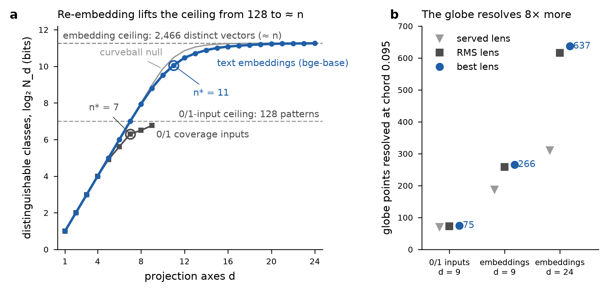

# Past the 0/1-input ceiling: map #598 documents re-embedded from text

2026-11-11. This follows `anisotropy_ceiling_report.md`, which showed that no re-framing of map #598's 0/1 inputs can exceed its distinct-input count. Here the input itself is replaced.

## Data

- **Texts.** Map #598's labels are file paths in `github.com/yubi-OS/knowledge`. At commit `787860b` (the last before the map was created, 2026-10-29), 2,742 of the 3,232 labels resolve to a document. The other 490 (derived numbered sections, `harness_and_workflows`, `corpus_and_math`, …) are in neither `knowledge` nor `yubiOS`.
- **Vectors.** Embeddings come from the live steady-orbit route `POST /api/jev/map/embed` with `vectorize: false`, so nothing goes into the search index. As you chose, only the platform's **cached bge-base vectors** were used: `@cf/baai/bge-base-en-v1.5`, 768-D, `chunked/v1` preprocessing (400-byte chunks, byte-weighted mean + L2).
  - 2,467 documents were cache hits.
  - 275 failed: the live default has moved to bge-m3, so new texts fail the route's 768-D check (see below).
- **Analysis set.** 2,467 of the 3,232 items (76%). The 0/1 comparison uses map #598 restricted to the same items: 128 distinct 0/1 input patterns and 109 deployed classes.
- **Maps.** Built locally with the repository `pointmap.js`: seed 20260906, K = 200, median thresholds unless stated; `pointmap.js` caps d at 24. Each was scored with `jev-focal-point.js` (K = 20 per seed, 100·n trades). No map was persisted to the platform.

## Results (same 2,467 items)

| input | d | classes | ceiling | n\* (½ bit) | null n\* | globe points at chord 0.095 (served / RMS / best) | V₂ (null z) |
|---|---|---|---|---|---|---|---|
| 0/1 coverage inputs (map 598) | 9 | 109 | 128 patterns | 7 | — | 71 / 73 / 75 | — |
| bge-base embeddings | 9 | 448 | 2,466 vectors | 9 (= d) | [9] | 188 / 259 / 266 | 0.261 (8.99) |
| bge-base embeddings | 24 | 2451 | 2,466 vectors | 11 | [11] | 311 / 616 / 637 | 0.105 |
| bge-base, threshold "zero" | 24 | 2451 | 2,466 vectors | 11 | [11] | 323 / 618 / 631 | 0.104 |

The 0/1 row's n\* is the prefix-ladder value on these items. Its ladder is 2, 4, 8, 16, 30, 49, 79, 91, 109.

**Reading.**

1. **Replacing the input lifts the ceiling from 128 to 2,466, and the instrument nearly reaches it.** The d = 24 ladder ends at 2451 classes (99.4% of 2,466) and D₀ = 11.26 bits, against 6.77 bits for the 0/1 inputs. At d = 9 alone the classes rise 4.1-fold (109 → 448).
2. **The binding limit is now the number of items, not the input.**
   - The focal rule selects n\* = 11, but the ladder saturates at log₂ n = 11.27 bits, and the curveball null also gives n\* = 11.
   - So n\* is sample-limited here, like maps #595 and #596, and its stable τ band is narrow: (0.412, 0.541].
   - A higher resolution now needs more documents. Each doubling of n adds about one bit of ceiling.
3. **The corpus still differs from its margins.** Beyond d = 8 the real ladder lies below the null (448 vs 507 at d = 9; 732 vs 933 at d = 10). At d = 9 the V₂ concentration stays above the null (z = 8.99). The text corpus is more clustered than balanced random bits.
4. **The globe resolves 8.5× more points** (best lens 637 vs 75). The RMS lens stays close to the best power, and the served `0.9/max r` rule loses half: 311 of 637 at d = 24.
5. **The extra resolution is fragile.** Certified classes at d = 24 fall 2451 → 822 → 259 → 52 for ℓ∞ input perturbations ε = 0, 0.001, 0.0016, 0.0026. The vectors are unit-norm with coordinate RMS 0.036, so ε = 0.001 is 2.8% of a typical coordinate. Many items sit close to the median cuts.

## Live-platform issue found (bge-m3 switch)

| route | result | cause |
|---|---|---|
| `POST /api/jev/map/embed`, uncached text | 502 "embedding provider returned a vector with unexpected dimension" | the route checks `v.length !== 768`, but bge-m3 returns 1024-D |
| `POST /api/jev/map/embed`, cached text | 200, old bge-base 768-D vectors | the content-cache key is fixed to the old `MODEL` constant |
| `POST /api/jev/map/vector/search` | 500 "expected 768 dimensions, got 1024" | the `sos-embeddings` Vectorize index is 768-D |

Until this is fixed, new texts cannot be embedded on the live site, and new text maps would mix models.

A fix needs four parts:

- the model's dimension, derived from `getActiveModel("embeddings")`;
- a model- and dimension-scoped cache key;
- a 1024-D Vectorize index for bge-m3;
- a single model per map, recorded in `preprocessing_id`.

## Files

- [bge_results.json](bge_results.json) — the three maps' summaries
- [bge_items.json](bge_items.json) — map-598 item indices, labels, source commit and the 275 uncached labels
- [bge_base_cached_2467.npy](bge_base_cached_2467.npy) — 2,467 × 768 float32 vectors, rows in `bge_items.json` order
- [run_bge.mjs](run_bge.mjs) — runner
