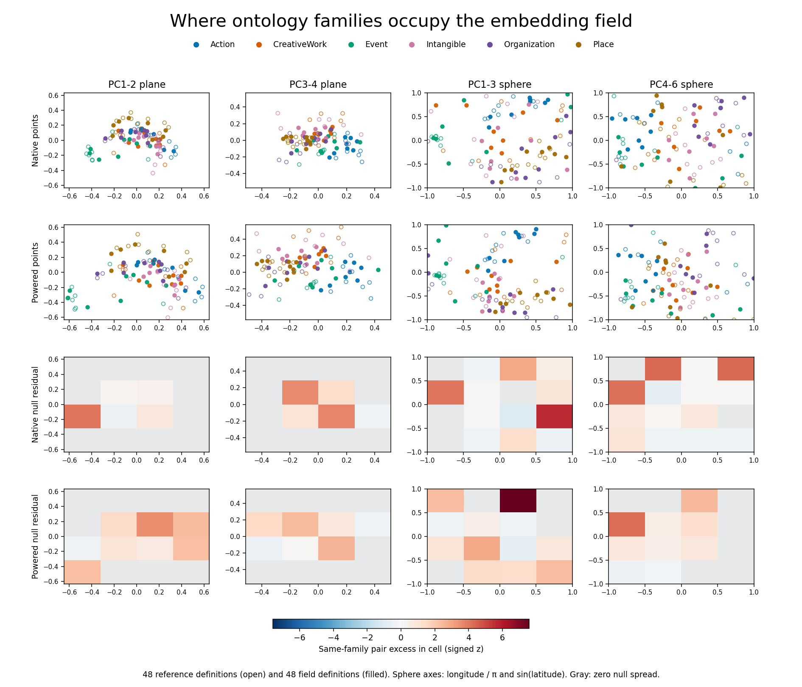
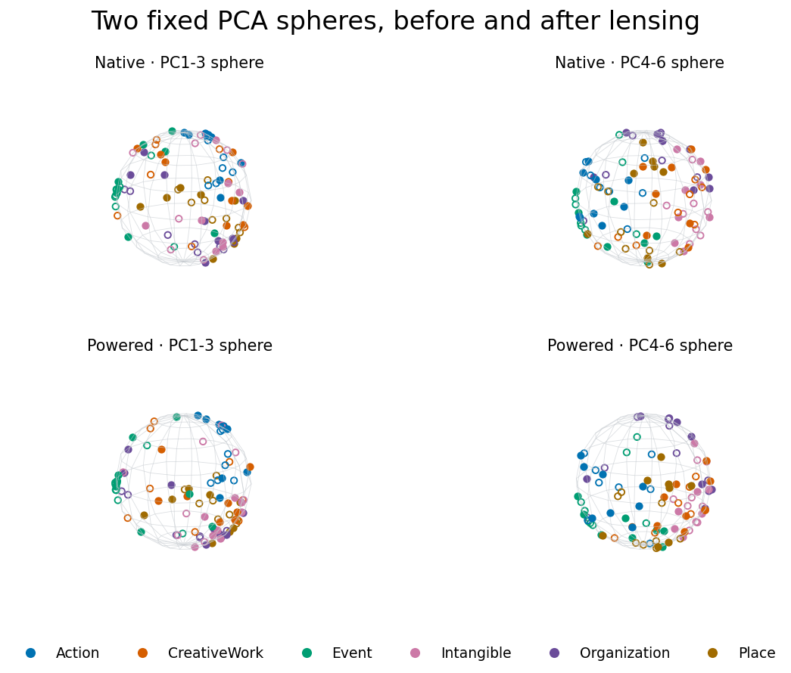

# Where ontology families occupy the embedding field

**Same-family definitions were closer on average than shuffled labels predicted in all eight projections.** The six families overlapped in every chart. The endpoint compares average distances across the 48 field definitions. All eight one-sided tests reached the permutation floor after correction across four charts and both lens states (p = 0.001). Lensing enlarged the family gap on the first PCA sphere and reduced it on the second. These are comparisons of distances across the field. No per-definition recognition endpoint was used.

The full bank contains 96 definitions, eight references and eight field terms for each family. Cloudflare Workers AI returned 96 × 1,024 coordinates in twelve direct BGE-M3 calls; each reported CLS pooling. Only definition text was embedded. Labels come from the published transitive subclass graph. Related definitions often share wording or name their parent. This is evidence for recovering spatial structure in this vocabulary under a label-exchangeability null. Discovery of previously unknown concepts, generalization to another vocabulary and production D1 state remain open.

## Reading the optical maps

The same points, axes, partition and display scales appear in both states. Filled marks are field definitions and open marks are calibration references. The bottom rows count pairs of field terms from the same family in each cell and compare them with 999 shuffles at the observed positions. Red means more same-family pairs than expected. Blue means fewer. Gray cells have no variation under this null. The fixed plane limits contained every field point. The four-by-four cells are descriptive and depend on the chosen boundaries.

For example, one powered cell on the first sphere contained five Action definitions. All ten pairs shared a family, against a shuffle mean of 1.51 (z = +7.60). The JSON records the count of each family in every cell, including empty ones. This cell was identified after viewing the maps; the adjusted tests below use all field pairs.

Planes retain projected coordinates and their scale. Each sphere normalizes its three PC coordinates to unit length. The sphere atlas above restores the globe; its flat version uses longitude and sine of latitude. Statistics on a sphere use its three-dimensional chords, so the map seam has no effect. Native reference PC1–3 account for 24.05% of the centered reference variance and PC4–6 for 13.83%. The figures cover the full sampled bank through selected projections of a 1,024-dimensional representation.

## Family structure on each chart

The gap is mean squared distance between different-family pairs minus mean squared distance within a family. Positive values mean tighter within-family grouping. Standardized scores compare each gap with the common permutation ensemble. The p column uses the largest standardized gap across all eight tests on each permutation.

| Frozen view | Native gap | Powered gap | Native z | Powered z | Adjusted p, both |
| --- | ---: | ---: | ---: | ---: | ---: |
| PC1–2 plane | 0.0297 | 0.0710 | 5.32 | 5.64 | 0.001 |
| PC3–4 plane | 0.0298 | 0.0630 | 8.76 | 8.48 | 0.001 |
| PC1–3 sphere | 0.5972 | 0.7713 | 5.95 | 8.25 | 0.001 |
| PC4–6 sphere | 0.7140 | 0.6162 | 7.01 | 7.04 | 0.001 |

The supplementary 1,024-dimensional chord gap was 0.1173 native and 0.2585 powered. A difference between two chart gaps has no paired significance test in this protocol. The plane gap is sensitive to dilation. Shapes, sphere normalization and the stated null determine what can be compared.

## Following the five papers

| Stage | Observed result |
| --- | --- |
| I · curve and atoms | Reference harmonic ridge curves on the first sphere had mean field chord residual 0.712 native and 0.733 powered. The supplementary repository point map found 41 and 43 beneficial single-bit moves; mean chord gain fell from 0.457 to 0.414. |
| II · geometry null and Boltzmann shells | Native focal collisions were 35 (null means 36.23, 35.93). Powered collisions were 71 (56.45, 56.54), with z +2.16/+2.33, levels +6.69/+7.36 dBc and upper tails 0.04/0.02. The six-axis V2 upper tails were 0.28–0.35 across states and seeds. The reference compass's analytic mean shell was 5.799; its 2,000-step trajectory averaged 0.873. Detailed balance held analytically, while this trajectory did not reproduce the equilibrium mean. |
| III · angular spectrum and README heat flow | On the PC4–6 sphere, the degree-one power share shifted from 0.031 to 0.290. At t=0.1 the corresponding predicted shares in units of original truncated power are 0.021 and 0.194. These apply the heat factor to measured initial shares. |
| IV · focal dimension, packing and classes | The native reference prefix counts from zero through six bits were 1, 2, 4, 8, 16, 27, 38. The half-bit rule stopped at five. Field occupancy fell from 24 to 20 distinct prefixes and from 34 to 28 full codes. At the native median chord (0.994), ambient greedy packing rose from 6 to 41. At each chart's own reference median (powered 1.441) it fell from 6 to 3. The nominal lens power was 2.482. |
| V · conserved class amounts and signed degrees | Both Gibbs allocations sum to 48 definition-equivalents and 6,247 UTF-8 bytes. For Event, native versus powered allocations were 10.60 versus 8.76 definition-equivalents, and 718.54 versus 527.44 bytes. Organization's degree-four signed reference/field Walsh alignment changed from +0.00391 to −0.00195. Summing all degrees reproduces the dot product of the two class-occupancy distributions. |

The geometry null trades the six-bit field matrix while preserving each row sum and each column sum. It tests code organization. The label null holds every position fixed and tests ontology association. A globally associated ontology can coexist with ordinary V2 under this fixed-margin null. The secondary geometry tails use 99 draws per seed (floor 0.01) and receive no study-wide multiplicity adjustment.

The deployed-style point map and supplementary full-space gap were added after the frozen protocol. The point map uses the repository's own axis construction, whose six-bit reference ladder ends at 39 and passes the half-bit threshold. It is reported separately from the five-bit frozen PCA frame. On the first sphere, 41/48 native and 37/48 powered field directions had no reference center within the deployment's 0.095 chord. Those points retain an explicit unassigned category. The route analogy therefore does not require treating every projected point as an existing class.

[Five-paper plan](PLAN.md) · [Protocol, routes, data attribution](PROTOCOL.md) · [All numbers, cell counts and coordinates](results.json) · [Observed inference metadata](inference.json) · [Replay the instrument](../../../tools/ontology-field/README.md)
