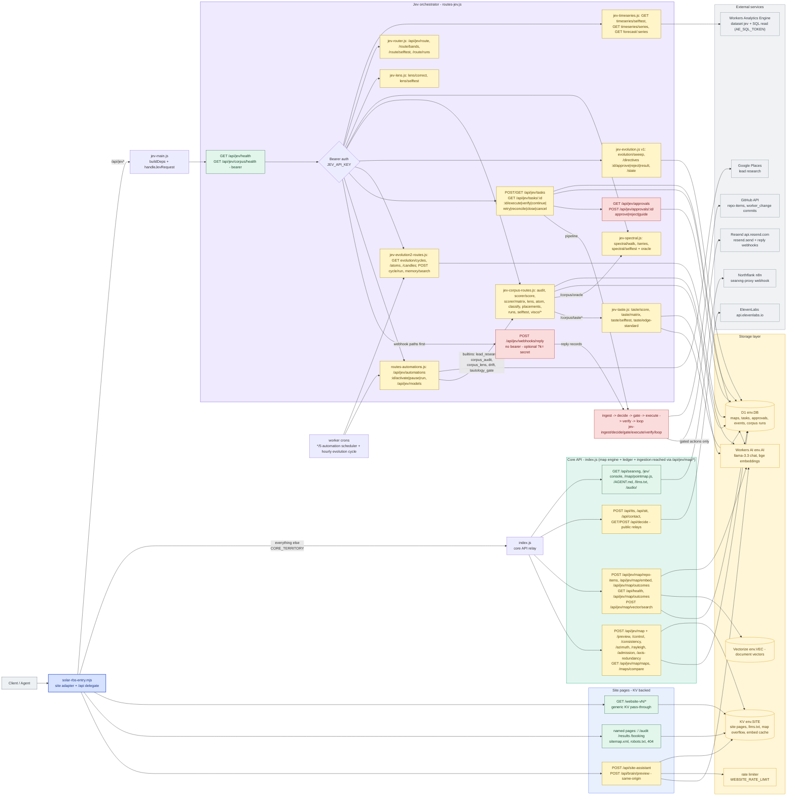

# Steady Orbit Systems - Endpoint Reference

> Generated 2026-10-05. Refreshed 2026-10-05 after discrepancy resolution. The live
> worker (steady-orbit.systems-a.workers.dev) serves all endpoints listed here.
> AGENT.md is the operational contract; this document is the architectural reference.
> Updated 2026-10-16 for the wave-2 build (worker etag b1b71b39, policy v24) and refreshed 2026-11-24 for the 98-part bundle (93 `.js`/`.mjs` modules + 5 `fixtures/*.mjs` packs; 24 bindings, 3 cron schedules: `0 * * * *` hourly evolution cycle, `*/15 * * * *` 15-min Polymarket forecaster ingest & $200 slip grading, `*/5 * * * *` 5-min automation & scheduled messaging tick; 369+ HTTP routes + 60 prefix delegations; 388 MCP tools in the unified staged bundle = 376 `FUNNEL_CATALOG` targets + 15 `HARNESS_AND_META_MCP_TOOLS` - 3 overlapping `harness.*` names, up from the 351-tool / 339-target pre-integration baseline; live policy v28). The deployed source is not kept in this repo.

Assembled from five parallel lanes:

| Lane | Deliverable | Headline numbers |
|---|---|---|
| A | Endpoint inventory from worker code | 121 route rows, 7 module parts (2026-10-05 lane count; live bundle has 61 module parts on 2026-10-16 and 98 module parts on 2026-11-24) |
| B | AGENT.md cross-reference | 85 documented, 14 code-only, 0 doc-only, 12 discrepancies |
| C | Capability map | 13 domains, 97 endpoint assignments, 16 cross-domain flows, 7 resources |
| D | Lean verification map | 12 Lean files, 15 endpoint-to-Lean mappings, 5 CI jobs |
| E | API flow diagram | 78-line mermaid graph |

Resolution refresh (2026-10-05, lanes R1+R2, verified by R3):

| Lane | Deliverable | Headline numbers |
|---|---|---|
| R1 | AGENT.md doc additions (KV write) | 15 new rows: public relays, site surfaces, CORS preflights, map/app.js, audio replies, jev pause GET, approvals guide POST, fits CRUD |
| R2 | Code patches (index.js, exactly 4 hunks) | requireOperatorAuth added to DELETE /api/jev/map/maps/:id and DELETE /api/jev/map/sos/fits/:id; n_controls usage-block comment 2..12 -> 2..6 |
| R3 | Fresh cross-reference (updated KV AGENT.md vs patched bundle) | 110 documented, 0 code-only, 0 doc-only, 0 actionable discrepancies |

Reconciliation: Lane A has 121 route rows over 109 unique paths. Lane C assigns 85
unique paths to capability domains. The difference is 6 CORS preflights (OPTIONS),
method variants that collapse onto one path (GET|POST, DELETE 405 guards), and 24
solar-rbs-entry site routes plus 7 API routes Lane C did not assign. All of them are
placed in a domain below, marked with a dagger (†). Every endpoint from Lane A
appears in this document at least once.

After the resolution refresh every endpoint AGENT.md documents resolves to a served
route and every served route is documented: 110 documented endpoints, 0 code-only,
0 doc-only, 0 actionable discrepancies. The daggers below are retained as
reconciliation history - they marked endpoints Lane C had not assigned when the
original was assembled; they are all in AGENT.md now.

## Capability Map

Sixteen capability domains cover the worker. Endpoints marked † were added during
reconciliation from Lane A routes Lane C did not assign; after the 2026-10-05
resolution refresh every one of them is documented in AGENT.md as well. Auth is
taken from Lane A, updated by the R2 code patches where DELETE auth changed.

### Jev Orchestrator (gated task engine)

The Jev v2 gated-approval orchestration core: it ingests a task (caller-supplied actions or a freeform prompt), understands/decides via the clef model (Workers AI binding; policy `decision_model`), passes every proposed action through a deterministic fail-closed gate (allowed / needs_approval / blocked), executes approved actions, verifies outcomes independently, and drives the task to one of six terminal states. Approvals bind actor, target, payload, limits, expiry and policy version; every stage appends an append-only audit event. Learning proposals can only become active policy through an explicit human promote (no automated promotion path exists).

Endpoints:

| Method | Path | Auth | Falsification Harness |
|---|---|---|---------|
| GET | `/api/jev/health` | none | No |
| GET\|POST | `/api/jev/tasks` | bearer | No |
| GET | `/api/jev/tasks/:id` | bearer | No |
| POST | `/api/jev/tasks/:id/execute` | bearer | No |
| POST | `/api/jev/tasks/:id/verify` | bearer | No |
| POST | `/api/jev/tasks/:id/continue` | bearer | No |
| POST | `/api/jev/tasks/:id/retry` | bearer | No |
| POST | `/api/jev/tasks/:id/reconcile` | bearer | No |
| POST | `/api/jev/tasks/:id/close` | bearer | No |
| POST | `/api/jev/tasks/:id/cancel` | bearer | No |
| GET | `/api/jev/approvals` | bearer | No |
| POST | `/api/jev/approvals/:id/approve` | bearer | No |
| POST | `/api/jev/approvals/:id/reject` | bearer | No |
| GET\|POST | `/api/jev/pause` | bearer | No |
| GET | `/api/jev/summary` | bearer | No |
| GET\|POST | `/api/jev/learnings` | bearer | No |
| POST | `/api/jev/learnings/:id/promote` | bearer | No |
| GET | `/api/jev/policy` | bearer | No |
| GET | `/api/jev/policy/tools` | bearer | No |
| POST | `/api/jev/workspaces` | bearer | No |
| GET | `/api/jev/workspaces/:id` | bearer | No |
| DELETE | `/api/jev/workspaces/:id` | bearer | No |
| GET | `/api/jev/workspaces/:id/artifacts` | bearer | No |
| GET | `/api/jev/workspaces/:id/artifacts/:name` | bearer | No |
| GET\|POST | `/api/jev/system/switches` | bearer | Yes - `switches_store_roundtrip` + `switches_autoapprove_decision` |
| GET | `/api/jev/history/backup` | bearer | Yes - `history_build_backup` |
| POST | `/api/jev/history/clear` | bearer | Yes - `history_clear_fail_closed` |
| POST | `/api/jev/history/restore` | bearer | Yes - `history_restore_roundtrip` |
| GET\|POST | `/api/jev/models` | bearer | Yes - `C1_model_stack_7cat` + `jev-llm` `selfCheck` |
| GET\|POST | `/api/jev/verify/blind-judge` | bearer | Yes - `quadrat-model-eval` 2-step blind verbatim-quote judge |
| GET\|POST | `/api/jev/verify/rubric-grade` | bearer | Yes - `rubric_em` multi-criterion decomposition |
| GET\|POST | `/api/jev/decide/canvas-batch` | bearer | Yes - `open-jev` `FieldCanvas` multi-question schema batcher |
| POST | `/api/jev/approvals/:id/guide` † | bearer | No |
| GET | `/api/jev/selftest` † | bearer | Yes - the selftest harness itself (27 lifecycle checks) |
| GET | `/api/jev/selftest/ledger` † | bearer | Yes - the selftest harness itself (ledger chain integrity) |
| GET | `/api/jev/selftest/coverage` † | bearer | Yes - the module coverage selftest harness itself |

Module parts: jev-main.js, routes-jev.js, jev-ingest.js, jev-state.js, jev-decide.js, jev-gate.js, jev-execute.js, jev-verify.js, jev-llm.js, jev-switches.js, jev-history.js, jev-history-restore.js, jev-quality.js, jev-close.js, jev-stale.js, jev-review.js, jev-loop.js, jev-improve.js, dbx.js

Bindings: DB, SITE, JEV_API_KEY, AI, GITHUB_API_KEY, RESEND_API_KEY, DAYTONA_API_KEY, GOOGLE_PLACES_API_KEY, TWILIO_ACCT_SID, TWILIO_AUTH_KEY

Terminal states: succeeded; blocked; rejected; expired; failed; cancelled

Key invariants:
- Fail-closed deterministic gate: allowed, needs_approval, or blocked - never open by default
- Approvals invalidated on policy version change; a policy bump invalidates affected approvals
- Six terminal states; unknown outcomes reconcile-before-repeat; never re-dispatch on unknown
- Every stage appends an audit event (append-only)
- No automated policy promotion - promoteLearning() is human-only via POST /api/jev/learnings/:id/promote
- Idempotency: task create dedupes per (tenant, idempotency_key)
- Pause blocks new and queued dispatch but never undoes completed effects
- Invalid resend.send bodies are rejected at propose-time (422 / task closed rejected), never a 500 that orphans the task
- Approver allowlist (2026-10-11): `POST /api/jev/approvals/:id/approve` and `/reject` accept only actors on the policy `approvers` list (case-insensitive). With no `approvers` field the default is `["jenny","ermine"]`; a malformed list fails closed. A non-listed actor gets 403 `APPROVER_NOT_ALLOWED`, checked before any approval lookup. Task cancel (`POST /api/jev/tasks/:id/cancel`) is not behind this allowlist. Directive decisions use the same list (see Evolution).
- GitHub contents writes (2026-10-11): a mutating write to a repo- or path-scoped tool must name a `branch`; a write with no branch is refused (`branch_missing`). main is denied for contents writes.
- Text with zero scorer evidence (short prompts) routes to the `text-no-evidence` band (lane-classify, provisional) instead of blocking at 0 bits. See Policy v21.

Composes with:
- Automations (propose_actions stage feeds proposals into the same gate)
- Evolution (directive execution goes through this gate)
- Taste Engine / Corpus Math (clef decision model shared with the scorer and quality gates)

#### Policy (live jev-policy.json, version 24)

`GET /api/jev/policy` returns the stored `jev-policy.json` as-is and `GET /api/jev/policy/tools` returns its `tools` registry. Both are bearer-gated (401 without a bearer, verified live 2026-10-09). Policy changes still go only through `POST /api/jev/learnings/:id/promote`. The live policy has 11 tools:

| Tool | Methods | Hosts | requires_approval | max_cost_usd | Notes |
|---|---|---|---|---|---|
| `http.fetch` | GET | api.github.com | false | 0.5 | GET only; no defapi host since the 2026-10-10 expunge |
| `github.contents_put` | PUT | api.github.com | true | 0 | GitHub Contents writes; deny_branches `main`, path_prefix_allowlist `scratch/`, blob sha required on update |
| `daytona.sandbox` | POST, DELETE | app.daytona.io, proxy.app.daytona.io | true | 0.25 | command_allowlist |
| `searxng.dig` | GET | p01--n8n-service--mcx7zcrbvdyt.code.run | false | 0 | allowed_query_params; search dig via the n8n webhook |
| `route.dispatch` | POST | jev.route | false | 0 | 12 targets; requires_approval stays false by decision (Jenny) |
| `resend.send` | POST | api.resend.com | true | 0.5 | |
| `web.fetch_public` | GET | `*` | false | 0 | |
| `places.search` | POST | places.googleapis.com | false | 0 | |

#### Policy v21 (live, read 2026-10-11)

The v16 table above is kept as the historical record. The live policy is version 21 (`GET /api/jev/health` returns `policy_version: 21`). What the policy document now says, as read from `GET /api/jev/policy`:

- `decision_model` is `clef`.
- There is no `approvers` field, so the approver default applies (see Jev Orchestrator key invariants).
- `route.dispatch.read_only_targets` is `["corpus_scorer"]`. For a read-only target the gate skips only the band checks. The declared-target, pause and limit checks still run.
- Routing band `text-no-evidence`: modality text, feature `scorer.bits` between 0 and 1, lane-classify, provisional. Text with zero scorer evidence goes to the classify lane for review.

Tool registry at v21 (9 tools):

| Tool | Methods | Hosts | requires_approval | max_cost_usd | Credential |
|---|---|---|---|---|---|
| `http.fetch` | GET | api.github.com | false | 0.5 | GITHUB_API_KEY |
| `github.read` | GET | api.github.com | false | 0.5 | GITHUB_API_KEY |
| `github.contents_put` | PUT | api.github.com | true | 0 | GITHUB_API_KEY |
| `resend.send` | POST | api.resend.com | true | 0.5 | RESEND_API_KEY |
| `web.fetch_public` | GET | steadyorbitsystems.com | false | 0 | none |
| `places.search` | POST | places.googleapis.com | false | 0 | GOOGLE_PLACES_API_KEY |
| `route.dispatch` | POST | jev.route | false | 0 | none (12 targets; read_only_targets `corpus_scorer`) |
| `searxng.dig` | GET | p01--n8n-service--mcx7zcrbvdyt.code.run | false | 0 | none |
| `daytona.sandbox` | POST, DELETE | app.daytona.io, proxy.app.daytona.io | true | 0.25 | DAYTONA_API_KEY |

#### Policy v28 (live jev-policy.json, verified 2026-11-24)

The v24 and v21 tables above are preserved as the historical record. The live policy in KV `SITE` (`jev-policy.json`, served by `GET /api/jev/policy` and `GET /api/jev/policy/tools`) is **version 28** (`paused: false`, `pause_scope: "all"`, `decision_model: "clef"`, `blocked_action: "terminal"`):

- `limits`: `max_actions_per_task: 10`, `max_retries_per_action: 2`, `max_task_cost_usd: 5`, `min_ms_between_dispatches: 1000`.
- `thresholds`: `auto_act_is_actionable: 0.8`, `review_floor: 0.3`, `risk_requires_approval: 2`, `decision_threshold: 0.55`.
- `categories`: `lead_intake`, `research`, `communication`, `data_change`, `other`.
- `routing`: `default_on_no_band: "blocked"`, **15 bands** (7 `calibrated`, 8 `provisional`):
  - Image (6): `corrected-hierarchy` (`calibrated` -> `lane-correct`), `aberrated-hierarchy-escalation` (`provisional` -> `lane-draft`), `hierarchy-confirmed` (`calibrated` -> `lane-draft`), `hierarchy-image` (`[1.45, 2]` `calibrated` -> `lane-draft`), `ordered-image` (`[1, 1.45]` `calibrated` -> `lane-classify`), `sparse-image` (`[0, 1]` `calibrated` -> `lane-classify`).
  - Multimodal (1): `multimodal-probe` (`[0, 1]` `calibrated` -> `lane-draft`; router forces `needs_approval`).
  - Text (8): `text-corpus-audit` (`provisional` -> `corpus_audit`), `text-corpus-audit-adjacent` (`provisional` -> `corpus_audit`), `text-corpus-measure` (`provisional` -> `corpus_scorer`), `text-corpus-taxonomy` (`provisional` -> `corpus_classify`), `text-runbook-read` (`provisional` -> `outcomes_read`), `text-communication` (`provisional` -> `lane-draft`), `text-no-evidence` (`[0, 1]` `scorer.bits`, `provisional` -> `lane-classify`), `console-funnel` (`[0, 1]` `console_funnel.passthrough`, `calibrated` -> `workflow.unit_round`).

Tool registry at v28 (**12 tools**):

| Tool | Methods | Hosts | requires_approval | max_cost_usd | Credential | Scope & Notes |
|---|---|---|---|---|---|---|
| `http.fetch` | GET | api.github.com | false | 0.5 | GITHUB_API_KEY | GET only |
| `github.read` | GET | api.github.com | false | 0.5 | GITHUB_API_KEY | Read-only GitHub REST metadata/blobs |
| `github.contents_put` | PUT | api.github.com | true | 0 | GITHUB_API_KEY | `repo_allowlist: ["yubi-OS/yubiOS", "yubi-OS/knowledge"]`, `path_prefix_allowlist: ["scratch/", "refs/", "knowledge/"]`, `branch_prefix_allowlist: ["scratch/", "refs/"]`, `deny_branches: ["main"]`, `require_blob_sha_on_update: true` |
| `resend.send` | POST | api.resend.com | true | 0.5 | RESEND_API_KEY | Sender pinned to `@axel.steadyorbitsystems.ai` |
| `twilio.send` | POST | api.twilio.com | true | 0.5 | TWILIO_AUTH_KEY | E.164 recipient, <=1600 chars |
| `web.fetch_public` | GET | steadyorbitsystems.com | false | 0 | none | Read-only public site fetch |
| `places.search` | POST | places.googleapis.com | false | 0 | GOOGLE_PLACES_API_KEY | Google Places v1 `places:searchText` |
| `route.dispatch` | POST | jev.route | false | 0 | none | **94 declared targets**, **82 `read_only_targets`**, **34 `endpoint_map` entries**, **2 `model_routes`** (`lane-classify`, `lane-draft`); `requires_approval: false` |
| `searxng.dig` | GET | p01--n8n-service--mcx7zcrbvdyt.code.run | false | 0 | none | `allowed_query_params: ["endpoint", "qs"]` via DAG Search Proxy |
| `daytona.sandbox` | POST, DELETE | app.daytona.io, proxy.app.daytona.io | true | 0.25 | DAYTONA_API_KEY | `command_allowlist: ["echo qa-ok"]`, `sandbox_command_mode: "single_line"` (create -> exec -> delete in one action) |
| `workspace.write` | LOCAL | workspace | false | 0 | none | `jev://workspace`, `max_bytes: 262144`, `max_per_task: 5` (`markdown`, `json`, `text`) |
| `research.report` | LOCAL | research | false | 0.05 | none | `jev://research`, `max_per_task: 2` (SearXNG dig + 2-pass LLM synthesis + workspace artifact write) |

### Automations (versioned stage pipelines + cron)

Versioned automation definitions stored in D1 (`jev_automations`, unique index `jev_automations_namever(name, version)`) that run a stage pipeline per fire across 13 supported stage types: `tool` (GET-only unless a server-resolved policy tool covers the host and method; capped, every call audited), `llm` (interpolated prompt <=8000 chars, JSON repair), `builtin` (pure deterministic function), `guard` (advisory safety verdict - unsafe skips `propose_actions` and routes to human review), `propose_actions` (proposals enter the same Policy v27 gate as hand-written ones), `funnel`, `funnel_parallel` (1..16 concurrent targets), `enrich`, `transform`, `condition`, `loop`, `harness` (`HARNESS_STAGE_OPS`: `tree`, `ppc`, `reflect`, `ledger_check`), and `dag` (`dagToAutomationDef` compiles a DAG into a single-stage automation). Interval automations (`every_minutes` 5..10080) fire on the `*/5 * * * *` worker cron via compare-and-set on `last_fired_at` and `status = active` (`idempotencyKey = auto-<name>-v<version>-<floor(now/interval)>`) so double-fire is impossible. Hosts the 17-builtin registry (`lead_research`, `lead_outreach`, `corpus_audit`, `corpus_lens`, `corpus_drift`, `tautology_gate`, `visco_hysteresis`, `visco_snapback`, `enrich_domain`, `enrich_lead`, `enrich_corpus_item`, `enrich_market`, `enrich_blindspot`, `enrich_repo`, `enrich_compare`, `enrich_batch`, `n8n_dag`).

Endpoints:

| Method | Path | MCP Tool (dot / underscore) | Auth | Falsification Harness |
|---|---|---|---|---|
| GET | `/api/jev/automations` | `automation.list` / `automation_list` | bearer | No |
| POST | `/api/jev/automations` | `automation.create` / `automation_create` | bearer | No |
| POST | `/api/jev/automations/:id/activate` | `automation.activate` / `automation_activate` | bearer | No |
| POST | `/api/jev/automations/:id/pause` | `automation.pause` / `automation_pause` | bearer | No |
| POST | `/api/jev/automations/:id/run` | `automation.run` / `automation_run` | bearer | No |
| GET\|POST | `/api/jev/models` | `orchestrator.models` / `orchestrator_models` | bearer | No |
| POST | `/api/jev/webhooks/reply` | `automation.webhook_reply` / `automation_webhook_reply` | `?k=` (`REPLY_WEBHOOK_KEY` / `JEV_API_KEY`) | No |
| POST | `/api/jev/webhooks/twilio` | (webhook-only, excluded from MCP) | `?k=` (`TWILIO_WEBHOOK_KEY`) | No |
| POST | `/api/jev/console/builtin` | `automation.builtin_run` / `automation_builtin_run` | bearer | No |
| GET\|POST | `/api/jev/console/crons` | `orchestrator.crons` / `orchestrator_crons` | bearer | No |
| GET | `/api/jev/automations/selftest` † | `automation.selftest` / `automation_selftest` | bearer | Yes - the selftest harness itself |

Module parts: routes-automations.js, jev-automations.js, jev-engine.js, jev-scheduler.js, jev-queue.js, jev-loop.js, jev-notify.js, jev-llm.js, jev-lead.js, jev-lead-lib.js, jev-corpus-builtins.js, jev-console-funnel.js

Bindings: DB, AI, SITE, JEV_API_KEY, TWILIO_WEBHOOK_KEY, TWILIO_ACCT_SID, TWILIO_AUTH_KEY, RESEND_API_KEY, GITHUB_API_KEY, GOOGLE_PLACES_API_KEY, DAYTONA_API_KEY, NORTHFLANK_API_KEY

Key invariants:
- Single-active automation per name (`name` kebab-case <=64 chars); versioned defs in D1 (`409 VERSION_CONFLICT` on concurrent duplicate version insert; `409 ALREADY_ACTIVE` / `409 ALREADY_PAUSED` on redundant state transitions; `retired` rows cannot be re-activated or paused)
- Interval fires use compare-and-set on `last_fired_at` + `expectedStatus = "active"` and bucket-aligned due check so cron jitter never skips a 5-minute window and double-fire is impossible
- 7-category LLM model stack in KV (`SITE` key `jev:model-stack-v1`): `classify`, `draft`, `coding`, `guard`, `decision`, `extract`, `embeddings`; `raw:@cf/...` pins an explicit Workers AI model
- Tool stage is GET-only unless a server-resolved policy `tool_refs` entry covers the host and method (caller-supplied `def.tool_refs` is stripped at validation and runtime); every call is audited and capped
- Builtins are pure: no fetch; `{ref}`/`{source_ref}` inputs rejected
- Reply webhook (`POST /api/jev/webhooks/reply`) is the human loop-closer for lead outreach (`handleReplyWebhook`); Twilio inbound webhook (`POST /api/jev/webhooks/twilio?k=`) validates `TWILIO_WEBHOOK_KEY` in constant time, deduplicates `MessageSid`, sends Resend operator notifications via `twilio_notify_email`, and when `twilio_ai_autoreply` is enabled drafts via `runSiteAssistantReply` and dispatches via Twilio REST `Messages.json` (single-source messaging, never TwiML; `dry_run` never sends live SMS)
- Durable evolution queue (`jev-queue.js`, D1 `jev_evolution_queue` + `jev_evolution_events`) enforces exponential `backoffMs(n) = 2^n` minutes (`MAX_ATTEMPTS = 5`), atomic `claimDue`, status-guarded `complete`/`fail`/`release`, and 30-minute `CLAIM_LEASE_MS` stale-claim recovery

Composes with:
- Jev Orchestrator (`propose_actions` and `guard` human-review feed the gate; `execute` runs gated actions; `jev-loop.js` handles CAS `closeTask`, `continueTask`, `retryAction`, and `reconcileAction`)
- Corpus Math (`corpus_audit` / `corpus_lens` / `corpus_drift` / `tautology_gate` builtins)
- Visco Instruments (`visco_hysteresis` / `visco_snapback` builtins)
- Evolution & Messaging (`*/5 * * * *` cron runs both `runScheduledMessagingBatches` and `runSchedulerTick` with injected `buildDeps`)

### Unified Messaging, Templated Outreach Batches & Twilio SMS Loop (`jev-messaging.js` `v1.3.1`)

Unified Twilio SMS (`+16502500485`) and Resend Email (`site@axel.steadyorbitsystems.ai`) inbox, 1:1 thread management, AI reply drafting, two-stage templated list-outreach pipeline (Stage 1: `@cf/cloudflare/clairic` typed field normalization + deterministic kernel; Stage 2: small-model `<marker>` replacement verified by `verifySmallModelOutput` against dropped values or hallucinated numbers/URLs/emails), and a hard tab-local human approval hold (`held_for_approval`). Staged batches never auto-send (`autoapprove`, `system:autoapprove`, Agentic Console, and DAGs are rejected with `409 AUTOAPPROVE_FORBIDDEN_FOR_LIST_SEND`); only `{surface: "messaging_tab", actor: <human>, batch_sha256}` can approve a batch for immediate dispatch or 5-minute grid-snapped scheduled dispatch (`approved_scheduled`, drained by `runScheduledMessagingBatches` on `*/5 * * * *`).

Endpoints:

| Method | Path | MCP Tool (dot / underscore) | Auth | Falsification Harness |
|---|---|---|---|---|
| GET | `/api/jev/messaging` | `messaging.index` / `messaging_index` | bearer | No |
| GET | `/api/jev/messaging/inbox` | `messaging.inbox` / `messaging_inbox` | bearer | Yes (`M8`, `M9`) |
| GET | `/api/jev/messaging/threads/:contact` | `messaging.thread` / `messaging_thread` | bearer | Yes (`M11`) |
| POST | `/api/jev/messaging/threads/start` | `messaging.start_thread` / `messaging_start_thread` | bearer + approver (if body) | Yes (`M11`, `M13`) |
| POST | `/api/jev/messaging/threads` | `messaging.start_thread` / `messaging_start_thread` | bearer + approver (if body) | Yes (`M11`, `M13`) |
| GET | `/api/jev/messaging/leads` | `messaging.leads` / `messaging_leads` | bearer | No |
| POST | `/api/jev/messaging/draft-reply` | `messaging.draft_reply` / `messaging_draft_reply` | bearer | No |
| POST | `/api/jev/messaging/reply` | (tab-local human send, excluded from MCP) | bearer + approver | Yes (`M11`) |
| GET | `/api/jev/messaging/batches` | `messaging.batches` / `messaging_batches` | bearer | Yes (`M5`..`M7`) |
| GET | `/api/jev/messaging/batches/:id` | `messaging.batch_get` / `messaging_batch_get` | bearer | Yes (`M5`..`M7`) |
| POST | `/api/jev/messaging/batches/stage` | `messaging.stage_batch` / `messaging_stage_batch` | bearer | Yes (`M5`, `M5b`, `M9`) |
| POST | `/api/jev/messaging/batches/preview` | `messaging.preview_batch` / `messaging_preview_batch` | bearer | Yes (`M3`, `M4`) |
| PATCH\|POST | `/api/jev/messaging/batches/:id/items/:itemId` | (tab-local item edit, excluded from MCP) | bearer | Yes (`M7`) |
| POST | `/api/jev/messaging/batches/:id/approve` | (tab-local human approve, excluded from MCP) | bearer + approver | Yes (`M6`, `M7`, `M10`) |
| POST | `/api/jev/messaging/batches/:id/reject` | `messaging.reject_batch` / `messaging_reject_batch` | bearer + approver | Yes (`M7`) |
| POST | `/api/jev/messaging/batches/:id/schedule` | `messaging.schedule_batch` / `messaging_schedule_batch` | bearer + approver | Yes (`M10`, `M15`) |
| POST | `/api/jev/messaging/cron-tick` | `messaging.cron_tick` / `messaging_cron_tick` | bearer | Yes (`M10`, `M15`) |
| GET | `/api/jev/messaging/templates` | `messaging.templates` / `messaging_templates` | bearer | Yes (`M9`) |
| POST | `/api/jev/messaging/templates` | `messaging.template_save` / `messaging_template_save` | bearer | Yes (`M9`) |
| DELETE | `/api/jev/messaging/templates/:id` | (DELETE route, HTTP-only) | bearer | Yes (`M9`) |
| GET | `/api/jev/messaging/notify-email` | `messaging.notify_email` / `messaging_notify_email` | bearer | Yes (`M12`) |
| POST | `/api/jev/messaging/notify-email` | `messaging.notify_email_set` / `messaging_notify_email_set` | bearer | Yes (`M12`) |
| GET | `/api/jev/messaging/selftest` † | `messaging.selftest` / `messaging_selftest` | bearer | Yes (`M1`..`M15`, 16/16 checks) |
| GET\|POST | `/api/jev/twilio` | `twilio.messages` / `twilio_messages` | bearer | No |
| GET\|POST | `/api/jev/twilio/messages` | `twilio.messages` / `twilio_messages` | bearer | No |
| GET\|POST | `/api/jev/twilio/replies` | `twilio.replies` / `twilio_replies` | bearer | No |

Module parts: jev-messaging.js, routes-automations.js, routes-jev.js, jev-console-funnel.js, jev-agentic-console.js, jev-n8n-dag.js, jev-llm.js, jev-switches.js

Bindings: DB, AI, RESEND_API_KEY, TWILIO_ACCT_SID, TWILIO_AUTH_KEY, TWILIO_WEBHOOK_KEY, JEV_API_KEY

Key invariants:
- Hard tab-local approval hold: `stageMessagingBatch` always lands in `held_for_approval`; `approveMessagingBatch` requires `surface === "messaging_tab"`, a human approver, and a matching `batch_sha256` over sorted items
- Item edits (`PATCH /api/jev/messaging/batches/:id/items/:itemId`) validate held recipients, check for unresolved `<marker>` tokens, recompute `batch_sha256`, and update D1 atomically via `db.batch`
- Scheduled batches snap to 5-minute UTC slots (`snapToFiveMinutesIso`), transition `held_for_approval -> approved_scheduled -> dispatching -> dispatched | partial_failure`, and never allow `dry_run: false` to override an approved dry-run batch
- All outbound SMS and email sends check Policy v27 `doc.paused` and dispatch strictly via REST (`sendTwilioSmsDirect` / `sendResendEmail`), never TwiML

### Read-Only Flow Instrument (`jev-flow.js`, `FLOW_VERSION = "flow"`)

Read-only conservation, occupancy, bottleneck, Lindley backlog recursion ($q_{t+1} = \max(0, q_t + a_t - s_t)$), Little's Law time-average WIP, and lifecycle DAG rank-bound ($9B + \text{rank}_0$) telemetry over `jev_tasks`, `jev_actions`, `jev_approvals`, `jev_evolution_queue`, and `jev_evolution_directives`.

Endpoints:

| Method | Path | MCP Tool (dot / underscore) | Auth | Falsification Harness |
|---|---|---|---|---|
| GET | `/api/jev/flow` | `orchestrator.flow` / `orchestrator_flow` | bearer | Yes (`FL1`..`FL19`) |
| GET | `/api/jev/flow/selftest` † | `orchestrator.flow_selftest` / `orchestrator_flow_selftest` | bearer | Yes (`FL1`..`FL19`, 19/19 checks) |

Module parts: jev-flow.js, jev-close.js, jev-review.js, jev-stale.js, jev-state.js, routes-jev.js

Bindings: DB, JEV_API_KEY

Key invariants:
- Strictly read-only: `handleJevFlow` executes only `SELECT` queries and returns before any `expireStale` or stale-dispatch sweep runs; D1 read errors surface in `read_errors[]` with `ok: false, verdict: "incomplete_read"` rather than silently reporting `flowing`
- Lifecycle rank model (`RANK_SPAN = 9`, 5 back-edges) proves every transition either decreases rank or traverses a counted back-edge (`checkLifecycleModel`)

### Evolution (hourly cycle + directives)

The self-improvement loop: a scheduled sweep ingests structured reports into directives, the hourly machine cycle (`0 * * * *`: preflight, measure, recall, propose at most 1 gated action, candle, notify, failure probe) measures worker and corpus state, and directives are executed only after fail-closed kind classification plus human approval for every kind outside the auto whitelist. Cycle history, the atom ledger and standard-candle ledger accumulate as measured evidence; memory recall runs on the 1024-D `EVEC` (`@cf/baai/bge-m3`, index `jev-evolution-m3`) vector index with D1 exact/note fallback; Discovery Replay (`jev-dream-rsi.js`) evaluates candidate exploration policies over recorded `TraceEnv` trees; cycle digests go out by email.

Endpoints:

| Method | Path | MCP Tool (`dot` / `underscore`) | Auth | Falsification Harness |
|---|---|---|---|---|
| POST | `/api/jev/evolution/sweep` | `evolution.sweep` / `evolution_sweep` | bearer | No |
| GET | `/api/jev/evolution/directives` | `evolution.directives` / `evolution_directives` | bearer | No |
| POST | `/api/jev/evolution/directives/:id/result` | `evolution.directive_result` / `evolution_directive_result` | bearer | No |
| POST | `/api/jev/evolution/directives/:id/approve` | `evolution.directive_approve` / `evolution_directive_approve` | bearer + approver | No |
| POST | `/api/jev/evolution/directives/:id/reject` | `evolution.directive_reject` / `evolution_directive_reject` | bearer + approver | No |
| POST | `/api/jev/evolution/directives/:id/cancel` | `evolution.directive_cancel` / `evolution_directive_cancel` | bearer + approver | No |
| GET | `/api/jev/evolution/state` | `evolution.state` / `evolution_state` | bearer | No |
| GET | `/api/jev/evolution/cycles` | `evolution.cycles` / `evolution_cycles` | bearer | No |
| POST | `/api/jev/evolution/cycle/run` | `evolution.cycle_run` / `evolution_cycle_run` | bearer | No |
| POST | `/api/jev/evolution/cycle/scheduled` | `evolution.cycle_scheduled` / `evolution_cycle_scheduled` | bearer | No |
| GET | `/api/jev/evolution/atoms` | `evolution.atoms` / `evolution_atoms` | bearer | No |
| GET | `/api/jev/evolution/candles` | `evolution.candles` / `evolution_candles` | bearer | No |
| GET | `/api/jev/evolution/queue` | `evolution.queue` / `evolution_queue` | bearer | No |
| POST | `/api/jev/evolution/memory/search` | `evolution.memory_search` / `evolution_memory_search` | bearer | No |
| POST | `/api/jev/evolution/memory/store` | `evolution.memory_store` / `evolution_memory_store` | bearer | No |
| GET | `/api/jev/evolution/memory/log` | `evolution.memory_log` / `evolution_memory_log` | bearer | No |
| POST | `/api/jev/evolution/memory/reindex` | `evolution.memory_reindex` / `evolution_memory_reindex` | bearer | No |
| GET | `/api/jev/evolution/dream/selftest` † | `dream.selftest` / `dream_selftest` | bearer | Yes (`G1..G8` Discovery Replay harness) |
| POST | `/api/jev/evolution/dream/replay` | `dream.replay` / `dream_replay` | bearer | Yes (`G1..G6` TraceEnv + Pareto $\rho$-sweep) |
| POST | `/api/jev/evolution/dream/directions` | `dream.directions` / `dream_directions` | bearer | Yes (`G7` root-direction diversity) |
| POST | `/api/jev/evolution/dream/promote-check` | `dream.promote_check` / `dream_promote_check` | bearer | Yes (`G6` replay-set monotonicity) |
| GET | `/api/jev/evolution/selftest` † | `evolution.selftest` / `evolution_selftest` | bearer | Yes - the selftest harness itself |
| GET | `/api/jev/evolution/selftest/candle` † | `evolution.selftest_candle` / `evolution_selftest_candle` | bearer | Yes - the selftest harness itself |

Module parts: `jev-evolution.js`, `jev-evolution2-routes.js`, `jev-cycle.js`, `jev-improve.js`, `jev-memory.js`, `reindex-memory.js`, `jev-dream-rsi.js`, `jev-engine.js`, `jev-atoms.js`, `jev-research.js`, `jev-queue.js`, `jev-notify.js`, `jev-quality.js`, `jev-selftest-evolution.js`, `index.js` (scheduled handler / `runJevScheduled` dispatch)

Bindings: `DB`, `AI`, `EVEC` (1024-D `@cf/baai/bge-m3`, index `jev-evolution-m3`; legacy 768-D `EVEC_768` bound as archive), `SITE` (`jev-policy.json`), `TS` (Analytics Engine `selftest_probe`), `GITHUB_API_KEY`, `RESEND_API_KEY`, `JEV_API_KEY`

Terminal states: directive `executed` / `failed` / `rejected` / `cancelled`; auto kinds: `record_learning`, `note` - everything else approval-gated (`memory_edit`, `skill_push`, `schedule_change`, `repo_push`, `worker_change`, `ops_fix`, `external_comms`)

Key invariants:
- Fail-closed directive kinds: `record_learning` and `note` auto-execute when confidence is at or above `CONFIDENCE_FLOOR` (`0.5`); `memory_edit`, `skill_push`, `schedule_change`, `repo_push`, `worker_change`, `ops_fix`, `external_comms` need approval; unknown kinds rejected (`status = 'rejected'`, `reason = 'unknown_kind'`)
- Sweep ingest is idempotent per `(fire, sweep_date)`
- Sweep ingest scoring (2026-10-11): each `note` and `record_learning` proposal in a sweep gets one decision-model score (`@cf/cloudflare/clef` noul `supported`) at ingest. A score at or above `0.5` (`SWEEP_CONFIDENCE_FLOOR`) stamped with `confidence_source: 'sweep_ingest_clef'` lets the auto gate run it. No score, a failed call, or a score below `0.5` leaves the proposal `needs_approval`.
- Directive cancel (2026-10-11): `POST /api/jev/evolution/directives/:id/cancel` with body `{"actor": "<name>", "reason"?: "<text>"}` moves an `approved_ready` or `proposed` directive to `cancelled`. The write is a compare-and-set (`WHERE id = ? AND status IN ('approved_ready', 'proposed')`) and writes a `directive_cancelled` event. Any other status returns `409 DIRECTIVE_NOT_CANCELLABLE`.
- Approver gate on directives (2026-10-11, aligned 2026-10-12): directive `approve`, `reject` (`routes-jev.js:525`) and `cancel` (`jev-evolution2-routes.js:1365`) check `policy.approvers` (defaulting to `["jenny", "ermine"]` when `approvers` is absent; `403 APPROVER_NOT_ALLOWED`; empty actor returns `400`/`422 INVALID_ACTOR`).
- Orphan re-enqueue & queue pass (2026-10-12): an approved runnable directive (`DELEGATE_KINDS`: `external_comms`, `skill_push`, `repo_push`, `memory_edit`, plus `AUTO_KINDS`: `record_learning`, `note`) is re-enqueued when it has no `pending` or `claimed` queue row, with at most 3 terminal `failed` rows (`ORPHAN_MAX_TERMINAL_FAILURES = 3`). Approved `note` and `record_learning` run through the approved path. A payload with `low_confidence: true` stays `needs_approval`.
- Memory store, search, reindex & log (2026-10-11 / 2026-10-21): `POST /api/jev/evolution/memory/store` (`{ text, kind?: "user_note", ref_id?: "console" }`) embeds via `@cf/baai/bge-m3` (1024-D), upserts to `EVEC`, and writes `jev_evolution_memory` keyed by deterministic `identity_key = kind:ref_id:fnv1a(text)`. `POST /api/jev/evolution/memory/reindex` (`{ rows?, limit?: 1..2000, dry_run? }`) idempotently re-embeds and re-upserts `jev_evolution_memory` rows into `EVEC`. `POST /api/jev/evolution/memory/search` (`{ text|query, k?: 1..25 }`) merges D1 exact/note matches with `EVEC` top-$k$ cosine recall. An approved `memory_edit` appends a row to the append-only D1 table `jev_memory_log` (`key, body, directive_id, actor, created_at`), read via `GET /api/jev/evolution/memory/log?key=&limit=`.
- Scheduled cron diagnostic (`POST /api/jev/evolution/cycle/scheduled`): runs `runEvolutionCycleScheduled(env)` (the exact `0 * * * *` hourly cron path: `runScheduledPass()` + read-back verification against the newest 50 `cycle_completed` events) and returns `{ ok: true, scheduled: { ok, reason, persisted, cycle_id, errors, persist_check_error } }`.
- Before 5 completed cycles of history, the cycle records an honest corpus error (`insufficient_history`) instead of fabricating metrics
- Directive claiming uses CAS (`claim=1`); queue driver has exponential backoff (`2^attempts` min, max 5 attempts); double-fire impossible via scheduler idempotency keys
- Notify digest is silent-cycle aware and never invents atoms/steps (`selfCheck` parity); failed queue rows trigger a fail-soft follow-up digest

Composes with:
- Jev Orchestrator (directives execute through the gate; `jev-quality` wraps the decide call; `jev-improve` promotes learnings to `jev-policy.json` with WLF anchor snapshots)
- Corpus Math (hourly cycle measures corpus metrics `dbc`/`z`/`verdict`/`drift` once history exists; lens candidates become fail-closed `note` directives)
- Discovery Replay (`jev-dream-rsi.js` replays discovery traces across `parallel_refine`, `ucb_greedy`, `thompson_prune`, `breadth_first`, `depth_first` under Eq. 1 Pareto $\rho$-sweep)
- Automations & Research (`jev-engine.js` executes multi-stage and Harness² pipelines; `jev-research.js` plans queries, ranks/dedupes sources, and validates cited markdown notes)
- Outcome Ledger (realized outcome rows from gated commits)

### Corpus Math (jev-corpus)

The corpus-audit math engine, parity-tested against the Python sources of record (papers/data/lean/verify_claims.py + tools/*): scores a documents x 12-NSS-axis matrix into the V2/z/verdict/dBc/level_dbc audit, proposes lens-format atomic candidates with paired controls, computes dry-run atom plans under the delta >= 0 invariant, classifies tautologies, computes curation-bits sonometer metrics, and records every measurement in `jev_corpus_runs`. The structured-evidence scorer (deterministic extraction + one batched clef call) is the low-noise grader that replaced free-prose scoring.

Endpoints:

| Method | Path | Auth | Falsification Harness |
|---|---|---|---|
| GET | `/api/jev/corpus/health` | bearer (via `handleJev` gate; unauthenticated on direct module entry; MCP `corpus.health` / `corpus_health`) | No |
| POST | `/api/jev/corpus/audit` | bearer (MCP `corpus.audit` / `corpus_audit`) | Partial - parity-tested vs Python sources of record |
| POST | `/api/jev/corpus/scorer/score` | bearer (MCP `corpus.scorer` / `corpus_scorer`) | Partial - byte-exact parity + gold slice (PR #297: specificity 4/4 PASS; recall 0/4 = the v2.3 extractor-recall gap) |
| POST | `/api/jev/corpus/scorer/matrix` | bearer (MCP `corpus.scorer_matrix` / `corpus_scorer_matrix`) | Partial - byte-exact parity + gold slice (PR #297: specificity 4/4 PASS; recall 0/4 = the v2.3 extractor-recall gap) |
| POST | `/api/jev/corpus/oracle` | bearer (MCP `spectral.oracle` / `spectral_oracle`) | Yes - falsification corpus (gold families `gasket`/`tri`, D1 `map:<ids>`, + Einstein consistency gate; honest `insufficient` is first-class) |
| POST | `/api/jev/corpus/lens` | bearer (MCP `corpus.lens` / `corpus_lens`) | Partial - parity-tested vs Python sources of record |
| POST | `/api/jev/corpus/atom` | bearer (MCP `corpus.atom` / `corpus_atom`) | Partial - parity-tested vs Python sources of record |
| POST | `/api/jev/corpus/classify` | bearer (MCP `corpus.classify` / `corpus_classify`) | Partial - parity-tested vs Python sources of record |
| POST | `/api/jev/corpus/placements` | bearer (MCP `corpus.placements` / `corpus_placements`, `read_only: false`) | Partial - parity-tested vs Python sources of record |
| GET, POST | `/api/jev/corpus/curation-bits` | bearer (MCP `corpus.curation_bits` / `corpus_curation_bits`) | Yes - Lane A benchmark summary + candidate curation-bits sonometer |
| GET | `/api/jev/corpus/runs` | bearer (MCP `corpus.runs` / `corpus_runs`) | No |
| GET | `/api/jev/corpus/selftest` | bearer (MCP `corpus.selftest` / `corpus_selftest`) | Yes - the parity selftest harness itself (37 fixtures: 28 core math + 9 visco, plus atom, lens, stamp, and scorer-v2 checks) |

Module parts: jev-corpus-routes.js, jev-corpus-math.js, jev-corpus-lens.js, jev-corpus-atom.js, jev-corpus-scorer.js, jev-corpus-deps.js, jev-corpus-builtins.js, jev-oracle-gold.js, fixtures/corpus-math-fixtures.mjs

Bindings: DB, AI, JEV_API_KEY

Key invariants:
- Audit is idempotent per input sha256 - repeat returns the same run_id + cached:true (when result_json is uncapped <= 64 KB)
- Audit seed (2026-10-11, AUDIT_PIPELINE `audit-v3-matrix-seed`): null draws are seeded from the matrix alone (first 32 bits of SHA-256 over canonical JSON `{"kind":"audit-null-seed","matrix":...}`; `seed_source` `matrix_sha256_prefix32`). Labels and the null count do not reshuffle the draws. Every audit result echoes `nulls`, `nulls_source` (`default` or `request`), `seed` and `seed_source`, plus `level_dbc = 20*log10(|z|)` and `z_se`. Placements reports the same z and dbc as POST /audit for the same matrix and nulls. The v3 input hash changed, so audit hashes stored under v2 do not recompute.
- Multipass Decision-B mode: each pass (`passes: [matrix x 2..8]`) runs through the same computeAudit path; `inter_pass_offset_dbc` is the measurement band
- The math is a port, never a re-derivation: fixture parity vs the Python sources; on mismatch the JavaScript is wrong until proven otherwise
- Every jev_corpus_runs row carries policy_version (NULL = pre-stamp era, never backfilled)
- Audit/lens results are data, never authorization: only directives through the gate act
- Atom plan is dry-run only with the delta >= 0 invariant asserted; execution is a gated directive, never inline
- Nulls default 200 (clampNulls in jev-corpus-routes.js; earlier notes said 100), cap 1000; scorer (`SCORER_VERSION = "scorer-v2.2"`, opt-in `recall_v23` `"scorer-v2.3"`) carries 0.45/0.55 hysteresis v2.1 and ~$0.0002/call cost
- Exact root `/api/jev/corpus` is a namespace prefix in `routes-jev.js` that returns `404 NOT_FOUND` (intentionally excluded from MCP tools)

Composes with:
- Wayfinder Point-Map (placements forwards vectors in-process to `deps.mapHandler` wired from `index.js`; `MAP_FAILED` relays rejections)
- Jev Orchestrator (lens candidates become gated directives; audit results are data, never authorization)
- Visco Instruments (visco endpoints audit base+loaded internally using this domain's computeAudit path)
- Automations (6 corpus builtins in `jev-corpus-builtins.js`: `corpus_audit`, `corpus_lens`, `corpus_atom`, `tautology_gate`, `visco_hysteresis`, `visco_snapback`)
- Evolution (hourly cycle consumes audit metrics via `buildCorpusInj`)

### Taste Engine (taste-v1)

The nature-based taste instrument: deterministic extraction (box-counting fractal dimension D, mirror symmetry, scale coherence - fixture-parity-tested against the Python extractor source of record) plus ONE batched clef call over 8 nature-law axes where every instruction carries a measured number. Includes edge-standard-v1, the standardized ink-normalized edge-map pipeline that made image-derived D comparable across sources and resolved the photo-pipeline confound. Admission stays false pending a human-rated real-photo gold set.

Endpoints:

| Method | Path | MCP Tool (`dot` / `underscore`) | Auth | Falsification Harness |
|---|---|---|---|---------|
| POST | `/api/jev/corpus/taste/score` | `taste.score` / `taste_score` | bearer | Partial - jitter + calibration sweeps + gold set; no falsification corpus |
| POST | `/api/jev/corpus/taste/matrix` | `taste.matrix` / `taste_matrix` | bearer | Partial - jitter + calibration sweeps + gold set; no falsification corpus |
| GET | `/api/jev/corpus/taste/selftest` | `taste.selftest` / `taste_selftest` | bearer | Partial - 14 checks (7 core + 6-fixture parity + `T_8AXIS_GOLD`); no falsification corpus |
| POST | `/api/jev/corpus/taste/edge-standard` | `taste.edge_standard` / `taste_edge_standard` | bearer | Yes - falsification-validated pipeline (4-fixture parity in `tools/edge-standard`) |

Module parts: `jev-taste.js`, `jev-taste-math.js`, `jev-edge-standard.js`, `fixtures/taste-fixtures.mjs` (deploy part `fixtures__taste-fixtures.mjs`)

Bindings: DB, AI, JEV_API_KEY

Key invariants:
- The instrument never awards itself a quality score; admitted:false stays until the gold-set gate
- Every clef instruction carries a measured number; order_seed permutation controls position bias
- Caller-supplied measurements are stamped source: caller
- Fixture parity vs the Python source of record (edge-standard max dD 4.4e-16 across 4 fixtures in `tools/edge-standard`; `fixtures/taste-fixtures.mjs` carries 6 64x64 box-counting + symmetry parity fixtures verified in `GET /api/jev/corpus/taste/selftest`)
- 0.45/0.55 hysteresis; matrix is paced batching (1..20 items, `spacing_ms` 0..60000 default 0), recording N per-item `taste` run rows plus one `taste-matrix` summary run row per batch
- Calibration sweeps are exact (symmetry 0.6 step, 0.3-0.95 variation window, complexity 0.5 step); sterile-perfect rejected
- Degenerate scale coherence (2026-10-11): on a solid field (ink at or above 0.99 of the grid), a near-empty field (ink below 0.01), or a zero-variance box count in either half of the scale window, scale coherence is `not_applicable` with reason `degenerate_input:<case>`. It is never reported as satisfied and the coherence value is not computed. An all-zero grid still fails with `EMPTY_EDGE_MAP`.

Composes with:
- Corpus Math (same runs-ledger, same hysteresis and batch-pacing conventions)
- Jev Orchestrator / jev-quality (the clef decision call shape is shared)

### Visco Instruments (rate-dependent round gates)

The viscoelastic measurement layer over the corpus-audit and outcomes history: persistence of bit flips under independent re-grading (scorer variance as the rate dimension), hysteresis rollup over the outcomes supersedes chains, Prony relaxation fitting over the runs history, cell-mobility mining of accumulated lens runs, and the mechanized snapback stop-halt verdict. These instruments turn round-level prediction-vs-realized deltas into measured gate inputs instead of prose judgment.

Endpoints:

| Method | Path | Auth | Falsification Harness |
|---|---|---|---|
| POST | `/api/jev/corpus/visco/persistence` | bearer (MCP `visco.persistence` / `visco_persistence`) | Partial - fixture anchors (3 `visco_persistence` fixtures) + recorded-series honest gates |
| GET | `/api/jev/corpus/visco/hysteresis` | bearer (MCP `visco.hysteresis` / `visco_hysteresis`) | Yes - falsification corpus (PR #296: 102.86 recorded round-3 value, tolerance ±0.05, 9 chain-shape fixtures, live contract checks; synthetic fixtures reference-only, live reads the production `outcomes` ledger) |
| GET | `/api/jev/corpus/visco/prony` | bearer (MCP `visco.prony` / `visco_prony`) | Partial - fixture anchors (2 `visco_prony` fixtures) + recorded-series honest gates |
| GET | `/api/jev/corpus/visco/mobility` | bearer (MCP `visco.mobility` / `visco_mobility`) | Partial - fixture anchors + recorded-series honest gates |
| POST | `/api/jev/corpus/visco/snapback` | bearer (MCP `visco.snapback` / `visco_snapback`) | Yes - falsification corpus (PR #296: 852/852 verdict classes + FPR-vs-analytic 4/4; recorded round-3 series reproduced live: runs [[4],[6,7],[10]] -> halt_round) |
| GET | `/api/jev/corpus/visco/policy-log` | bearer (MCP `visco.policy_log` / `visco_policy_log`) | Partial - fixture anchors (`stampSelfTest` in `jev-corpus-deps.js`) + recorded-series honest gates |

Module parts: jev-visco-math.js, jev-corpus-routes.js (visco route block), jev-corpus-deps.js (`viscoSelfTest`, `stampSelfTest`, `createViscoLedgerRows`), jev-corpus-builtins.js (`visco_hysteresis`, `visco_snapback`)

Bindings: DB, JEV_API_KEY

Terminal states: snapback verdict -> gate_input halt_round | continue (verdicts only, never auto-actions)

Key invariants:
- Snapback and hysteresis return verdicts only - they never execute an action themselves
- Verdicts only, never auto-actions; the prose gate rule remains the fallback
- Empty ledger -> no_data; fewer than 5 points -> 422 INSUFFICIENT_SERIES
- Deterministic scoring collapses R (text-revert recovery) to 1 - stays unmeasured
- `GET /api/jev/corpus/visco/hysteresis` requires the query parameter `baseline_id` (numeric). Without it the route returns 422 `INVALID_BASELINE` ("baseline_id query parameter is required"), verified live 2026-10-09.
- Prony policy_version filter excludes NULL-era rows

Composes with:
- Corpus Math (persistence audits base + loaded internally using `computeAudit` and `auditSeedOf`; runs history feeds prony/mobility)
- Outcome Ledger (hysteresis closes supersedes chains; snapback reads the ledger series)
- Automations (visco_hysteresis / visco_snapback are pure hourly-cycle builtins)
- Jev Orchestrator (policy-log is the wipe-proof changelog appended on every promote-flow version bump)

### Spectral Standard + Hierarchy Oracle

The spectral-standard instrument: walk-mode spectral dimension d_w (ink / centroid /
graph modes over the pinned 256-step ladder) and series counting d_s with the
log-periodic staircase secondary gate, gated by the Einstein relation
d_s = 2 d_f / d_w. The oracle endpoint (`handleOracleRequest` in `jev-spectral.js`) composes edge-standard D + the
centroid-Delaunay walk + the Einstein gate into one hierarchy verdict across four input forms: raw 8-bit grayscale (`{gray_b64, width, height}`), binary bitmap (`{bitmap_b64, width, height}`), registered gold render (`{gold: "gasket" | "tri"}`), or D1 mapped-corpus hierarchy (`{map_id}`, `{map_ids: [...]}`, or `{gold: "map:1+2"}` with `lens_power?: boolean`, reading D1 `maps` + `map_classes`); honest
`insufficient` verdicts are first-class (zero false "consistent" on real supersolid
data). Honest instrument finding carried from the falsification corpus: D and d_w are
hierarchy/fill detectors, not order detectors (order-blind at matched extent).

Endpoints:

| Method | Path | MCP Tool (`dot` / `underscore`) | Auth | Falsification Harness |
|---|---|---|---|---|
| POST | `/api/jev/corpus/spectral/walk` | `spectral.walk` / `spectral_walk` | bearer | Yes |
| POST | `/api/jev/corpus/spectral/series` | `spectral.series` / `spectral_series` | bearer | Yes |
| GET | `/api/jev/corpus/spectral/selftest` | `spectral.selftest` / `spectral_selftest` | bearer | Yes |
| POST | `/api/jev/corpus/oracle` | `spectral.oracle` / `spectral_oracle` | bearer | Yes |

Module parts: `jev-spectral.js`, `jev-spectral-math.js`, `jev-spectral-centroid.js`, `fixtures/spectral-fixtures.mjs`, `jev-delaunay-exact.js`, `jev-oracle-gold.js`

Bindings: DB (`jev_corpus_runs`, `maps`, `map_classes`), JEV_API_KEY

Key invariants:
- Walk-mode d_w is primary for the gasket family; series counting for smooth spectra; the staircase is handled by the secondary gate, never forced into the primary fit
- Einstein on measured inputs correctly returns `insufficient` below the pinned scale; zero false "consistent" on real data (11/11 held)
- Falsification harness: 15/15 gold PASS + 61 committed anchors in tools/spectral-standard (on main via PR #292, merged 2026-10-07; run in lean-check.yml verify-tools)

Composes with:
- Taste Engine (edge-standard D is an oracle input)
- Hierarchy Router (edge-standard D and the traced droplet count are the band features; the centroid walk d_w is diagnostic only since policy v24)
- Falsification corpus (gold families with exact closed-form d_f / d_w)
- Wayfinder Point-Map & Layered Ontology (`map_classes` rows in D1 power the `hierarchy-oracle-v1+mapped-corpus` oracle form)

### Lens Standard (corrected-hierarchy)

The lens-standard instrument: estimates astig / spherical / trefoil aberration and
applies the pinned sequential correction (astig -> spherical -> trefoil) through the
nint re-rasterization, then re-measures D. The corrected-hierarchy router band
consumes detect_score >= 1 with thresholds T(m) = max(10x noise, r_min/20) from the
selftest residual maxima. Cross-talk leakage is real and recorded (astig 0.1 reads
trefoil at ~66x T(trefoil)); the envelope guard fails closed on out-of-envelope
readings and the convergence gate (`jev-router.js` `reroute_not_converged`) blocks routing a mis-corrected artifact.

Endpoints:

| Method | Path | MCP Tool (`dot` / `underscore`) | Auth | Falsification Harness |
|---|---|---|---|---|
| POST | `/api/jev/corpus/lens/correct` | `lens.correct` / `lens_correct` | bearer | Yes |
| GET | `/api/jev/corpus/lens/selftest` | `lens.selftest` / `lens_selftest` | bearer | Yes |

Module parts: `jev-lens.js`, `jev-lens-math.js`, `fixtures/lens-fixtures.mjs`

Bindings: DB, JEV_API_KEY

Key invariants:
- Explicit reference required on `/api/jev/corpus/lens/correct`: caller must supply either `ref_gray_b64` (a `gh x gw` `0`/`1` mask matching the traced grid) or `family` (`"gasket"` or `"tri"` at canonical `512x512` geometry); missing reference returns 422 `ESTIMATE_SKIPPED`
- Envelope-guarded warp: out-of-envelope estimates are recorded as score Infinity on the selftest/router detection path and unrecoverable out-of-envelope warps are refused fail-closed (422 `ESTIMATE_FAILED` / `CORRECT_FAILED`)
- Convergence gate: on the router path (`POST /api/jev/route`), the corrected artifact must re-verify (`detect_score < 1`) before the route proceeds, else `reroute_not_converged`; `/api/jev/corpus/lens/correct` returns `{verdict: "no-aberration-detected" | "recovered" | "reduced-not-eliminated" | "corrected-unverified"}`
- Calibrated for astig-driven distortion (full loop verified live, D recovery exact); spherical and trefoil recorded as scope limits

Composes with:
- Hierarchy Router (lane-correct band target, router-side inline correction)
- Taste Engine (re-measures D through the same edge-standard pipeline)

### Hierarchy Router (measurement-gated routing)

Routes artifacts to policy-defined lanes: measure (edge-standard D, centroid walk
d_w, lens features on family-declared canonical renders) -> select band from policy
`routing.bands` -> gated dispatch to the band target. The detector proposes, the
fail-closed gate disposes: no matching band -> blocked; multimodal -> needs_approval
(never auto-dispatched); unknown artifact/tool -> fail-closed error. Bands live in
policy (v7-v28, 15 bands in live Policy v28 across image [6], multimodal [1], and text [8]), never hardcoded; the corrected-hierarchy band is CALIBRATED (Set A
clean golds + Set B detection thresholds; live-route calibration 6/6).

Endpoints:

| Method | Path | Auth | Falsification Harness |
|---|---|---|---|
| POST | `/api/jev/route` | bearer | Partial - e2e routing corpus (PR #297: 11/12 band + gate outcomes; F1 `all`-clauses surfaced in `formatBandDescriptor`; MCP `router.route` / `router_route`) |
| GET | `/api/jev/route/bands` | bearer | Yes - `routerSelfTest` descriptor check (MCP `router.bands` / `router_bands`) |
| POST | `/api/jev/route/selftest` | bearer | Yes - `routerSelfTest` 7-check suite (MCP `router.selftest` / `router_selftest`) |
| GET | `/api/jev/route/runs` | bearer | No (MCP `router.runs` / `router_runs`) |

Module parts: jev-router.js (gate + execute routing pieces inlined per SPEC-ROUTER)

Bindings: DB, AI, JEV_API_KEY

Key invariants:
- Bands live in policy routing.bands; code never hardcodes them
- Multimodal probes route to needs_approval, never auto-dispatched
- Verify semantics per dispatch type: model dispatches verify on text_len > 0, automation dispatches on the run task's terminal state
- Caller caveats: degenerate stub images fail clef inference (422 MEASUREMENT_FAILED); family gating requires a registered gold family on canonical 512x512 gray

Composes with:
- Taste Engine + Spectral Standard + Lens Standard (the measurement layer)
- Jev Orchestrator (policy versions, gated dispatch, task ledger, approvals)

### Timeseries & Forecast (WAE telemetry + advisory ETS & 3-stage cascade)

Workers Analytics Engine (binding `TS` for dataset `jev`, binding `TS_IMPORTED` for dataset `imported`) is the trajectory tier for jev
events and imported market series (D1 stays the append-only system of record; WAE keeps 3 months and sampling is irrelevant at jev volume). Write sites:
task_state / task_terminal (wrapped deps.transit), approval created/approved/rejected
(jev-review), corpus_run (recordRun), and `/api/jev/timeseries/import` (`tsWriteImported`). `tsWrite` swallows every error - telemetry never
breaks orchestration. Every jev event lands as a datapoint in dataset `jev`:
`index1` = series name, `blob1..3` = ids/dimensions, `double1..2` = values. The damped-trend Holt forecaster (`jev-forecast-math.js`; Python
source of record `tools/forecast-standard/forecast_ets.py`, parity max |delta| = 0 on 4
fixtures) and the 3-stage Clairic -> TimesFM 2.5/3.0 -> Clef cascade (`jev-cascade-forecast.js`; Python source of record `tools/timesfm-clairic-clef/timesfm_clairic_clef.py`, 9/9 gates `G1..G9` PASS) are advisory: forecasts never authorize, and a gate-consuming forecast must
first record a `{predicted, realized}` pair in the outcomes ledger (`/api/jev/map/outcomes`).

Endpoints:

| Method | Path | MCP Tool (`dot` / `underscore`) | Auth | Falsification Harness |
|---|---|---|---|---|
| GET | `/api/jev/forecast/:series` | `forecast.ets` / `forecast_ets` | bearer | Partial (default ETS v2) / Yes (`?engine=cascade`, 9/9 gates G1..G9 PASS) - default ETS v2: G2 FAIL (100-replicate coverage C0 99, C1 99, C2 98, C3 93, C4 99 vs [88,98]), band NOT calibrated; `?engine=cascade`: 3-stage Clairic + TimesFM 2.5->3.0 fallback + Clef cascade, 9/9 pre-registered gates G1..G9 PASS (conformal G2 80/100 in [0.72,0.94], G6 auto 2.5->3.0 fallback MASE 1.0827->0.0545, G9 tail-aligned covariate length invariance) |
| POST | `/api/jev/forecast/:series` | `forecast.cascade` / `forecast_cascade` | bearer | Yes - 9/9 pre-registered gates G1..G9 PASS in `cascade_selftest` and `lean-check.yml` (`tools/timesfm-clairic-clef/timesfm_clairic_clef.py`) |
| POST | `/api/jev/forecast/cascade` | `forecast.cascade` / `forecast_cascade` | bearer | Yes (`G1..G9`, 9/9 PASS) - direct 3-stage Clairic -> TimesFM 2.5/3.0 -> Clef cascade over caller `series`/`values` or `state_text` |
| POST | `/api/jev/forecast/clairic` | `forecast.clairic` / `forecast_clairic` | bearer | Yes (`G7`) - direct Stage 1 `@cf/cloudflare/clairic` structured series extraction, byte-offset spans, and 99-quantile short-horizon forecast (`h=1..64`) |
| POST | `/api/jev/forecast/events` | `forecast.events` / `forecast_events` | bearer | Yes - 3-path (`cascade`, `ets`, `clairic`) end-time forecasting for prediction-market event batches (`events[1..100]`) against WAE `imported` trades (`blob5 = conditionId`, `double5 = 0`) |
| GET | `/api/jev/timeseries/series` | `timeseries.series` / `timeseries_series` | bearer | No - WAE `jev` (`GROUP BY index1`) and `imported` dataset inventory plus `ts_write_stats` |
| GET | `/api/jev/timeseries/rates` | `timeseries.rates` / `timeseries_rates` | bearer | No - D1 `jev_tasks` state and terminal-outcome transition rates over `?hours=1..168` (default 24) |
| GET | `/api/jev/timeseries/export` | `timeseries.export` / `timeseries_export` | bearer | Yes - bounded WAE row export (`?from=<iso>&to=<iso>&dataset=jev\|imported`, max 10,000 rows, ClickHouse `toDateTime('YYYY-MM-DD HH:MM:SS')` via `jev-timeseries-export.js`) |
| POST | `/api/jev/timeseries/import` | `timeseries.import` / `timeseries_import` | bearer | Yes (`import_selftest`) - imports up to 5,000 datapoints (`points`, `rows`, `data`, `values`, or `csv`) into WAE dataset `imported` (`TS_IMPORTED`) |
| GET | `/api/jev/timeseries/readiness` | `forecast.readiness` / `forecast_readiness` | bearer | Yes (`jev-forecast-readiness.js`) - zero-write deterministic readiness check over `etsSelfTest` (`G1..G6`, `NEG_G2`) and `cascadeSelfTest` (`G1..G9`); returns HTTP 503 `status: "degraded"` while ETS v2 `G2`/`NEG_G2` remain uncalibrated (`authorizes_action: false`, `analytics_written: false`) |
| GET | `/api/jev/timeseries/selftest` | `timeseries.selftest` / `timeseries_selftest` | bearer | Yes - the selftest harness itself (`math_selftest` ETS gates + `cascade_selftest` G1..G9 9/9 PASS + `import_selftest` + live WAE write/read-back probe + `SELECT *` schema probe); top-level `ok` stays `false` while ETS v2 `G2`/`NEG_G2` fail |

Module parts: jev-timeseries.js, jev-timeseries-export.js, jev-forecast-math.js, jev-forecast-readiness.js, jev-cascade-forecast.js

Bindings: TS (analytics_engine, dataset jev), TS_IMPORTED (analytics_engine, dataset imported), DB (D1 `jev_tasks` for `/api/jev/timeseries/rates`), AE_SQL_TOKEN (secret_text, Account Analytics Read token), AI (`@cf/cloudflare/clairic` and `@cf/cloudflare/clef`), JEV_API_KEY

Key invariants:
- Bearer-gated centrally in routes-jev.js plus the defense-in-depth re-check inside handleJevTimeseries
- Fail-closed errors: 503 MISSING_READ_TOKEN, 422 BAD_SERIES_NAME (series must match ^[a-z_]+$), 502 WAE_SQL_ERROR (upstream body truncated)
- WAE SQL reads lag writes a few seconds - the selftest reports the lag honestly instead of failing
- Forecast v4 (2026-10-11): pre-registered and not wired into any route. The live forecast and the timeseries selftest keep the v2 band. `quality.calibrated` stays false, and the timeseries selftest reports `ok: false` by design (G2 and NEG_G2 stay failing). Do not describe the forecast as calibrated.
- The WAE SQL time column is timestamp (empirically settled by the selftest schema probe); ORDER BY needs the column in the SELECT list
- Band v2 (`v2-mad-train`): band[j] = 1.96 x bandSd x sqrt(j), with bandSd = 1.4826 x median |one-step residual| over the train segment only. `quality.calibrated` is false. v2 failed the pre-registered G2 pass rule: 100-replicate band coverage C0 99, C1 99, C2 98, C3 93, C4 99 against [88,98]% (over-covers). The gate was not moved and the forecast is not described as calibrated. The retired v1 band (holdout RMS) measured 84/100. The recorded v3 harness failed clause (i) with C2 at 100 and both of its negative controls fire (recorded result; no v3 artifact on main). The live selftest returns ok:false with failing_gates [G2, NEG_G2]; NEG_G2 (band halved on C0 must fall outside [88,98]) is not detected on the live v2 band.

Composes with:
- Jev Orchestrator (telemetry series ride the transit / approval / recordRun paths)
- Outcome Ledger (phase-2 {predicted, realized} rows are the visco hysteresis shape)
- Knowledge mint `timesfm-tsfm-landscape` (yubi-OS/knowledge PR #334) grounds the TSFM landscape
- Falsification-corpus discipline (the forecaster's gates are pre-registered; never retune post-hoc)

### Wayfinder Point-Map (frozen-frame geometric instrument)

The pointmap/0.2 instrument: maps documents or numeric vectors onto a frozen binary/PCA/sphere frame (PCA, binary placement, stereographic lift), compares real edits against that same frame, and exposes the diagnostic family - math diagnostics, candidate preview, positive control, exact isolation ledger, radius profiles, axis-redundancy / rayleigh / azimuth admission trials, dimensional focal point `n*` & powered Möbius lens (`focal-point/2`, `dimension-structure`), D1 `map_classes` materialization, perturbation consistency, rung placement. Geometry diagnoses movement; an independent task check always decides usefulness. Serves the /map/ browser UI and its dependency-free numeric core (`jev-pointmap-client.js`).

Endpoints:

| Method | Path | Auth | Falsification Harness |
|---|---|---|---------|
| POST | `/api/jev/map` | bearer (`map.create` / `map.run`) | Partial - Lean bounds + regression suite |
| GET | `/api/jev/map/maps` | bearer (`map.maps`) | No |
| DELETE\|GET | `/api/jev/map/maps/:id` | bearer (`map.get` / `map.delete`) | No |
| POST | `/api/jev/map/maps/compare` | bearer (`map.compare`) | No |
| POST | `/api/jev/map/preview` | bearer (`map.preview`) | Partial - Lean bounds + regression suite |
| POST | `/api/jev/map/control` | bearer (`map.control`) | Yes - positive-control falsification endpoint |
| POST | `/api/jev/map/axis-redundancy` | bearer (`map.axis_redundancy`) | Yes - matched-null falsification trials |
| POST | `/api/jev/map/admission` | bearer (`map.admission`) | Yes - matched-null falsification trials |
| POST | `/api/jev/map/focal` | bearer (`map.focal`) | Yes - matched-null falsification trials (`focal-point/2`, `FocalBounds.lean` 25 theorems, 6/6 selftest) |
| GET | `/api/jev/map/classes` | bearer (`map.classes`) | Yes - D1 `map_classes` read (`focal_prefix_class`, `bit_class`, `lensed_sphere_class`) |
| POST | `/api/jev/map/classes/sync` | bearer (`map.classes_sync`, mutating) | Yes - D1 `map_classes` sync (transactional batch, `jev-map-storage.js`) |
| POST | `/api/jev/map/remap` | bearer (`map.remap`, mutating) | Yes - D1 + Vectorize 1024-D `bge-m3` (`@cf/baai/bge-m3`) remap at computed `n*` (no fixed `d=7` default) + D1 `map_classes` + Vectorize `EVEC`/`VEC` |
| GET | `/api/jev/ontology/mapped-classes` | bearer (`ontology.mapped_classes`) | Yes - D1 ontology class compilation (`maps` + `map_classes` -> 4-layer Ontology units & 3-level hierarchy) |
| POST | `/api/jev/map/azimuth` | bearer (`map.azimuth`) | Yes - matched-null falsification trials |
| POST | `/api/jev/map/rayleigh` | bearer (`map.rayleigh`) | Yes - matched-null falsification trials |
| POST | `/api/jev/map/consistency` | bearer (`map.consistency`) | Partial - sign-agreement control |
| GET\|POST | `/api/jev/map/outcomes` | bearer (`map.outcomes` / `map.outcomes_post`) | No (append-only pre-registration ledger) |
| GET | `/map/` | none | No (410 moved to `/jev/` Map card) |
| GET | `/map/pointmap.js` | none | No (bundled `POINTMAP_CLIENT_JS` from `jev-pointmap-client.js`; also served at `/api/jev/map/pointmap.js`) |
| GET | `/api/jev/map/pointmap.js` | none | No (API-prefixed alias serving `POINTMAP_CLIENT_JS`) |

Module parts: index.js (map routes + PM numeric core + map handlers), jev-focal-point.js (`focal-point/2` + `dimension-structure`), jev-map-storage.js (transactional D1 `map_classes` + `map_cleanup` KV overflow deleter), jev-pointmap-client.js (`POINTMAP_CLIENT_JS`), jev-delaunay-exact.js (exact BigInt orient2d/incircle + SoS Bowyer-Watson Delaunay triangulation), solar-rbs-entry.mjs (site adapter; delegates the core /api + /map surface)

Bindings: DB, AI, VEC, VEC_768, EVEC, SITE, JEV_API_KEY

Key invariants:
- Frozen-baseline discipline: baseline_id inherits the complete numeric frame; unchanged vectors keep exactly unchanged positions
- Frame/instrument/run_fingerprint hashing: a frame conflict stops comparison, never silently refits
- Preview/control/consistency write NOTHING (no map row, no Vectorize) - persisted:false is structural
- Exact isolation ledger must agree with an independent recount or the result halts
- admitted:false is hard-coded for axis-redundancy and azimuth; rayleigh/admission admission is computed, never hard-coded
- Transition declaration: a corpus differing by more than the declared transition is 409, persisted:false
- Positive-control recipe is fixed (cutpaste-splice 0.25, centered window); tuning knobs are rejected
- Deletion is never recommended or executed; the 12 NSS axes are an explicitly unvalidated lens dictionary
- Stored maps above ~1.9 MB overflow to KV (map-json:<id>) behind a D1 pointer; DELETE /api/jev/map/maps/:id is operator bearer-auth guarded (R2 patch: 503 when the JEV_API_KEY binding is missing, 401 on a missing or wrong token)

Composes with:
- Ingestion & Embeddings (embeds full-content texts on the frozen frame; content-hash cache shared)
- Outcome Ledger (preview/control feed pre-registration; observed_delta recomputed via PM.explainTransition)
- Corpus Math (placements composes with /api/jev/map)
- Jev Orchestrator (mapHandler wired into handleJevRequest so jev tasks can drive the map)

### Ingestion & Embeddings (full-content chunked/v1)

Turns repositories and raw text into numeric material for the map: `/api/jev/map/repo-items` (`GET|POST`) fetches sorted full-text repo items from GitHub (with `resolved_ref` and truncation flags, or queries D1 `jev_harness_library` when called via `GET` or without `repo`), `/api/jev/map/embed` runs `chunked/v1+bge-m3` 1024-D full-content ingestion (`@cf/baai/bge-m3` default, or 768-D `@cf/baai/bge-base-en-v1.5` for legacy `chunked/v1` baselines; explicit mean pooling, <=400-byte UTF-8 chunks, byte-length-weighted mean, L2 normalization) with a content-hash embedding cache, and `/api/jev/map/vector/search` queries the stored Vectorize index (`VEC` `sos-embeddings-m3` for 1024-D, `VEC_768` `sos-embeddings` for 768-D). Coverage is input coverage, not a claim about preserved meaning.

Endpoints:

| Method | Path | Auth | Falsification Harness |
|---|---|---|---------|
| GET\|POST | `/api/jev/map/repo-items` | bearer | No |
| POST | `/api/jev/map/embed` | bearer | No |
| POST | `/api/jev/map/vector/search` | bearer | No |
| GET | `/api/jev/map/selftest` † | bearer | Partial - live contract probes |

Module parts: index.js (embeddings, repo fetch, vector search, chunked/v1+bge-m3 & chunked/v1 cache)

Bindings: DB, AI, VEC, VEC_768, GITHUB_API_KEY, SITE

Key invariants:
- Every input byte is submitted - including content after character 2,000; chunk coverage is disclosed
- Cache key includes complete content, model, dimension, pooling, chunk size and aggregation version; no raw document text in the cache
- Uncached work is bounded separately (1,000 docs / 12,000 chunks per request; 413 with counts; warm-then-retry protocol)
- Vectorize metadata holds bounded text snippets only - no secrets or private customer data in the public map storage
- Truncated repo files must be resolved before mapping (prefer a 40-char commit SHA; branch names are mutable)
- Rectangular, finite, D=2..1024 vectors (1024-D `@cf/baai/bge-m3` default, 768-D `@cf/baai/bge-base-en-v1.5` legacy); empty/oversized/misaligned inputs fail explicitly

Composes with:
- Wayfinder Point-Map (supplies the vectors every map/preview/control/consistency run embeds)
- Corpus Math (scorer/matrix inputs are ingested documents)
- Evolution (memory recall uses its own EVEC index, same Workers AI embed model)

### Outcome Ledger (append-only pre-registration)

The typed, append-only home for every predicted-vs-realized comparison the wayfinder ever reported in prose. A row separates the prediction (frozen before the check) from the decision outcome (the independent verifier's verdict: pending / kept / reverted / declined / abstained / neutral). Corrections are new rows with supersedes - both stay visible; GET returns a contingency of counts, never a rate.

Endpoints:

| Method | Path | Auth | Falsification Harness |
|---|---|---|---------|
| GET\|POST | `/api/jev/map/outcomes` | bearer | No |
| GET\|POST | `/api/jev/map/outcomes?baseline_id=` | bearer | No |
| GET\|POST | `/api/jev/map/outcomes?frame_id=` | bearer | No |
| DELETE | `/api/jev/map/outcomes/*` † | bearer | No |

Module parts: index.js (outcomes routes + 405 guard on PUT/PATCH/DELETE)

Bindings: DB

Terminal states: verdicts: pending, kept, reverted, declined, abstained, neutral

Key invariants:
- Append-only: no PUT, PATCH or DELETE (405); a correction is a new supersedes row
- score / quality / success_rate / rate / confidence / z are rejected as inputs - no rates, percentages or z ever computed
- verifier names the independent checker; 'geometry' is refused for any non-pending verdict
- observed_source is server:explainTransition or caller - never mixed in one row
- A row arriving with prediction AND non-pending verdict is stored preregistered:false
- A sign-exact geometric prediction is an instrumentation outcome; a kept verdict does not imply the geometry predicted it

Composes with:
- Wayfinder Point-Map (with after_id the server recomputes observed_delta via PM.explainTransition on the frozen frame; 409 on frame conflict)
- Visco Instruments (hysteresis closes supersedes chains; snapback reads the ledger series)
- Evolution (round records and realized outcome rows land here)

### Repo Assessment (SOS Agent FIT)

The original Steady Orbit business API, relocated 2026-10-08 into the bearer-gated `/api/jev/map/sos/*` surface (rewritten in `index.js` to `/api/map/sos/assess`, `/api/map/sos/fits`, `/api/map/sos/fits/:id`, and `/api/map/sos/narrate`): `POST /api/jev/map/sos/assess` fetches and assesses a GitHub repository into a FIT.json report, `GET /api/jev/map/sos/fits` lists the stored assessment population, and `POST /api/jev/map/sos/narrate` produces natural-language narration over an assessment using Workers AI. Direct un-prefixed calls to `/api/assess`, `/api/fits`, `/api/fits/:id`, and `/api/narrate` return 410 gone.

Endpoints:

| Method | Path | Auth | Falsification Harness |
|---|---|---|---------|
| POST | `/api/jev/map/sos/assess` | bearer | No |
| GET | `/api/jev/map/sos/fits` | bearer | No |
| POST | `/api/jev/map/sos/narrate` | bearer | No |
| DELETE\|GET | `/api/jev/map/sos/fits/:id` † | bearer | No |

Module parts: index.js (assess/fits/narrate routes, refineBasis)

Bindings: DB, AI, GITHUB_API_KEY

Key invariants:
- Core API surface: deliberately unchanged by the v0.2 map release; llms.txt fallback documents it
- Assessment reports are stored rows in D1 listed by /api/jev/map/sos/fits
- DELETE /api/jev/map/sos/fits/:id is operator bearer-auth guarded (R2 patch): 503 when the JEV_API_KEY binding is missing, 401 on a missing or wrong token

Composes with:
- Ingestion & Embeddings (repo fetching shares the GitHub path)
- Wayfinder Point-Map (historically the first consumer of /api/jev/map on assessed corpora)

### Public Relays (media, contact, chat, decide)

Relay endpoints serving the Steady Orbit website and operator clients: text-to-speech (`/api/tts`, `/api/voice`, `/api/voice/tts`) via Cloudflare Workers AI `@cf/deepgram/aura-2-en` (fallback `@cf/deepgram/aura-1`), speech-to-text (`/api/stt`, `/api/voice/stt`) via Cloudflare Workers AI `@cf/openai/whisper-large-v3-turbo` (fallback `@cf/openai/whisper`), the website contact form (`/api/contact`) and landing Growth Plan audit intake (`/api/audit-requests`) via Resend + D1/KV, unified site chat (`/api/site-assistant`, `/api/brain/preview`, `/api/brain/demo`, `/api/chat`) via Workers AI `@cf/meta/llama-4-scout-17b-16e-instruct` (with SSE + per-sentence TTS), and the bearer-gated clef decision relay (`/api/decide` and `/api/jev/map/decide` -> `/api/map/decide`). Relay CORS is origin-allowlisted (`RELAY_ORIGINS`: `steady-orbit.systems-a.workers.dev`, `steadyorbitsystems.com`, `steadyorbitsystems.ai`) and rate-limited through `WEBSITE_RATE_LIMIT` (12 req/60s per IP).

Endpoints:

| Method | Path | Auth | Falsification Harness |
|---|---|---|---------|
| GET\|POST\|OPTIONS | `/api/tts` | none | No |
| GET\|POST\|OPTIONS | `/api/voice` | none | No |
| GET\|POST\|OPTIONS | `/api/voice/tts` | none | No |
| POST\|OPTIONS | `/api/stt` | none | No |
| POST\|OPTIONS | `/api/voice/stt` | none | No |
| POST\|OPTIONS | `/api/contact` | none | No |
| POST\|OPTIONS | `/api/audit-requests` | none | No |
| POST | `/api/chat` | none | No |
| POST | `/api/site-assistant` † | none | No |
| POST | `/api/brain/preview` † | none | No |
| POST | `/api/brain/demo` | none | No |
| GET\|POST\|OPTIONS | `/api/decide` | bearer | No |
| GET\|POST\|OPTIONS | `/api/jev/map/decide` | bearer | No |
| GET | `/api/relay/selftest` † | bearer | Partial - live contract probes |

Module parts: solar-rbs-entry.mjs (siteChat, handleLandingAuditRequest, Retell/Lumina relays), index.js (relay block: tts/voice/stt/contact/decide/chat, relayRateLimited, RELAY_CORS)

Bindings: AI, DB, SITE, RESEND_API_KEY, JEV_API_KEY, WEBSITE_RATE_LIMIT

Key invariants:
- Per-endpoint rate limits (tts/stt 15, contact 5) via WEBSITE_RATE_LIMIT
- 503 with a named error when the backing secret is not configured - never a silent fallback
- Contact mail is composed server-side (name/company/email/message + source), HTML-escaped, sent to the fixed site inbox with reply_to
- STT caps uploads at 10 MB; TTS caps text at 4000 chars (POST) / 900 chars (GET)
- CORS preflight OPTIONS handled explicitly per relay endpoint

Composes with:
- Jev Orchestrator / jev-quality (the /api/decide relay exposes the same clef decision model the gate and scorer use)
- Repo Assessment (narrate/chat share the Workers AI model route)
- Jev Orchestrator execute (resend.send actions use the same Resend credential)

### SEO Dig Proxy (searxng)

A single GET endpoint that forwards a searXNG endpoint + urlencoded query string to the n8n searxng-proxy webhook running on Northflank, with open CORS, no rate limiting and a 20-second timeout. It is the web-search dig path that the refs-refresh sweep and knowledge-corpus minting use to collect source results.

Endpoints:

| Method | Path | Auth | Falsification Harness |
|---|---|---|---------|
| GET\|OPTIONS | `/api/searxng` | none | No |

Module parts: index.js (searxng proxy block)

Bindings: NORTHFLANK_API_KEY

Key invariants:
- Stateless passthrough - endpoint and qs are forwarded verbatim to the upstream webhook
- Upstream failures surface as 502 searxng_proxy_failed with detail, never a fabricated result
- CORS open (Access-Control-Allow-Origin: *), explicit OPTIONS preflight, no rate limiting by design

Composes with:
- Automations (tool stage can call it under policy)
- External callers: refs-refresh-sweep / knowledge-corpus-mint sessions use it as their dig endpoint

### Platform Surface & Ops Console

The operator- and answer-engine-facing surface of the worker: bearer-gated `GET /api/health` (and `/api/jev/map/health` -> `/api/map/health`, returning version info incl. diagnostic module versions), `GET /AGENT.md` (and `/agent.md`) and `GET /ENDPOINTS.md` (and `/endpoints.md`) served no-cache from KV `SITE`, `GET /llms.txt` business summary, `GET /crafts` and `GET /crafts/manifest.json` (plus `/crafts/<app>/*` WASM suite), the `/jev/` ops console (`jev-index.html`), and the site page adapter (`solar-rbs-entry.mjs`) that serves the v19 website from KV and delegates everything else to `index.js`. Also hosts the worker's `scheduled` entrypoint dispatching `0 * * * *` (hourly evolution cycle), `*/15 * * * *` (15-min Polymarket forecaster ingest & slip grading), and `*/5 * * * *` (5-min messaging batch & automations scheduler tick), plus `runStaleDispatchSweep`.

Endpoints:

| Method | Path | Auth | Falsification Harness |
|---|---|---|---------|
| GET | `/api/health` | bearer | No |
| GET | `/api/jev/map/health` | bearer | No |
| GET | `/AGENT.md` | none | No |
| GET | `/agent.md` | none | No |
| GET | `/ENDPOINTS.md` | none | No |
| GET | `/endpoints.md` | none | No |
| GET | `/llms.txt` | none | No |
| GET | `/crafts` | none | No |
| GET | `/crafts/manifest.json` | none | Yes (`design/selftest` `D10`) |
| GET | `/jev` | none | No |
| GET | `/jev/` | none | No |
| GET | `/` † | none | No |
| GET | `/revenue-blind-spot[/]` † | none | No |
| GET | `/systems-lab[/]` † | none | No |
| GET | `/founders[/]` † | none | No |
| GET | `/terms[/]` † | none | No |
| GET | `/privacy[/]` † | none | No |
| GET | `/brain[/]` † | none | No |
| GET | `/audit[/]` † | none | No |
| GET | `/results[/]` † | none | No |
| GET | `/booking[/]` † | none | No |
| GET | `/sitemap.xml` † | none | No |
| GET | `/robots.txt` † | none | No |
| GET | `/website-vN/<file>` † | none | No |
| GET | `/audio/reply-1\|2\|3.mp3` † | none | No |

Module parts: index.js (health/AGENT/llms/console routes + scheduled handler), solar-rbs-entry.mjs (site pages + /website-vN assets), jev-main.js (console wiring)

Bindings: SITE, DB

Key invariants:
- AGENT.md is the source of truth served no-cache from KV - the homepage 'Copy agent guide' button references it
- Ops console is bearer-auth via JEV_API_KEY on every route except /api/jev/health and POST /api/jev/webhooks/reply (optional ?k= shared secret); the key lives in sessionStorage, never persisted
- Cron dispatch is by cron expression: the evolution cron runs the evolution cycle, any other cron keeps the automations scheduler tick
- Site adapter passes every /website-vN/* asset through from KV generically and delegates everything else unchanged

Composes with:
- Jev Orchestrator (the console is the human surface for tasks/approvals/pause)
- Automations + Evolution (the scheduled handler dispatches runJevScheduled by cron expression)

### Patched15 notes (2026-10-11)

- POST /api/jev/map (index.js): optional `source` field, one of `synthetic`, `vectors` or `texts` (422 otherwise). `source: "texts"` needs a texts input. `source: "synthetic"` or `"vectors"` needs a vectors input. The recorded map source is `texts:<model>` for text runs, `synthetic` for synthetic runs, and `vectors` otherwise.
- Selftest envelopes (jev-selftest.js, used by the jev selftest routes that share the runner): a failing run returns `failures` (one `{name, reason}` per failing check), `failed` (the first failing name) and `checks`. The `schema_bootstrap` check is recorded, and a bootstrap failure ends the run early.
- Branch rule for GitHub contents writes (jev-gate.js): a mutating write to a repo- or path-scoped tool must name `branch`. The prompt path sets `create: true` for a `scratch/` path on a `scratch/` branch with no sha (applyGithubCreateShape in jev-decide.js). jev-execute resolves create or update at dispatch.
- Approver allowlist: see Jev Orchestrator key invariants. Directive decisions: see Evolution key invariants, including the known cancel default gap.
- Degenerate scale coherence: see Taste Engine key invariants.
- Forecast v4: see Timeseries key invariants.
- Historical names: earlier revisions of this doc named DEFAPI_API_KEY and the jev-1.13 model; both were removed from the worker on 2026-10-10 (DefAPI connection removed 2026-10-11). The live decision model is `clef` (policy `decision_model`, version 24), called through the Workers AI `AI` binding with no external egress.

## Endpoint Inventory

The complete 135-route inventory (121 from Lane A + 10 added 2026-10-06; the 2026-10-08 auth pass + SOS fold took it to 129, the map fold to 127 canonical, the timeseries wave to 130, and 5 added 2026-10-19: the PWC switches pair, the history backup/clear pair and the evolution queue: the map engine, outcome ledger and ingestion surface moved under /api/jev/map/*, the /map/ page folded into the /jev/ console's Map card, and the WAE telemetry + forecast routes landed under /api/jev/timeseries/* and /api/jev/forecast/*; old paths serve 410 aliases), grouped by
module part. Auth is `bearer` (JEV_API_KEY) on every /api/jev route except the two
health endpoints and the reply webhook. Six rows are CORS preflights (OPTIONS).

Falsification Harness column legend: **Yes** = a pre-registered falsification corpus (synthetic
known-answer gold set, pinned gate windows, committed anchors) or a matched-null
falsification trial validates the endpoint's math. **Partial** = fixture parity,
calibration sweeps, Lean bounds or recorded-series honesty gates without a dedicated
falsification corpus. **No** = contract-level validation only (no measurement to
falsify). The falsification-corpus operating procedure lives in
skills/falsification-corpus and the candidate list in
refs/falsification-harness-coverage-2026-10-06.md.

### solar-rbs-entry.mjs (site adapter + entry API) - 26 routes & page families

| Method | Path | Auth | Description | Falsification Harness |
|---|---|---|---|---------|
| POST\|OPTIONS | `/api/audit-requests` | none | Landing Growth Plan audit intake: validates business/contact fields, sends Resend email to `mike@steadyorbitsystems.com`, writes D1 `landing_audit_requests` + KV `audit-req:<id>` (90d TTL), and logs `jev_events` + `jev_messaging_threads`; rate-limited | No |
| POST | `/api/site-assistant` | none | Unified Steady Orbit site chat assistant (`siteChat`, `@cf/meta/llama-4-scout-17b-16e-instruct` + Workers AI TTS sentences, JSON or SSE), grounded on KV `llms.txt`; same-origin + rate-limited (12/min) | No |
| POST | `/api/brain/preview` | none | Brain preview chat endpoint - identical `siteChat` handler to `/api/site-assistant`; same-origin + rate-limited | No |
| POST | `/api/brain/demo` | none | Brain demo chat endpoint - identical `siteChat` handler to `/api/site-assistant`; same-origin + rate-limited | No |
| POST | `/api/chat` | none | Entry-module site chat alias (`siteChat`); shadows legacy `index.js` `/api/chat` on external HTTP requests | No |
| ANY | `/api/retell/*` | same-origin | Retell voice demo relay to `https://sos.luminasales.io`; non-GET rate-limited | No |
| ANY | `/api/demo/*` | same-origin | Systems Lab demo relay to `https://sos.luminasales.io`; non-GET rate-limited | No |
| GET\|HEAD | `/_next/static/*` | none | Proxies static Next.js assets from `https://sos.luminasales.io` | No |
| GET\|HEAD | `/lumina-embed/property` | none | Serves `website-v19/lumina-embed-property.html` from KV `SITE` | No |
| GET\|HEAD | `/lumina-embed/coatings` | none | Serves `website-v19/lumina-embed-coatings.html` from KV `SITE` | No |
| GET\|HEAD | `/landing[/]` | none | Serves standalone `/landing/*` assets from KV `SITE` | No |
| GET | `/` | none | KV-served site landing page (`website-v19/index.html`); also `/index.html` | No |
| GET | `/revenue-blind-spot[/]` | none | Revenue Blind Spot landing page (`website-v19/revenue-blind-spot.html`) | No |
| GET | `/systems-lab[/]` | none | Systems Lab page (`lab.html`) with 5 single-company demos | No |
| GET | `/founders[/]` | none | Founders page (`founders.html`) | No |
| GET | `/terms[/]` | none | Terms page (`terms.html`) | No |
| GET | `/privacy[/]` | none | Privacy page (`privacy.html`) | No |
| GET | `/brain[/]` | none | Brain demo page (`brain.html`) | No |
| GET | `/audit[/]` | none | RBS suite v2 audit page (`audit.html`) | No |
| GET | `/results[/]` | none | RBS suite v2 results page (`results.html`) | No |
| GET | `/booking[/]` | none | RBS suite v2 booking wizard page (`booking.html`) | No |
| GET | `/radiant[/]` | none | Steady Orbit Gradient Designer (`website-v19/radiant.html`) | No |
| GET | `/forecasts[/]` | none | WAE & Forecasts Hub (`forecasts-hub.html`, plus `/forecasts/terminal[/]` and `/forecasts/refinery[/]`) | No |
| GET | `/sitemap.xml` | none | Sitemap served from KV `SITE` (`sitemap.xml`) | No |
| GET | `/robots.txt` | none | Robots policy served from KV `SITE` (`robots.txt`) | No |
| GET | `/website-vN/<file>` | none | Generic asset pass-through: `/website-v<digits>/<[A-Za-z0-9._-]+>` served from KV key `website-vN/<file>` | No |

### index.js (core API module) - 67 routes & rewrite aliases

| Method | Path | Auth | Description | Falsification Harness |
|---|---|---|---|---------|
| GET | `/AGENT.md` | none | Agent guide document (also `/agent.md`) served no-cache from KV `SITE` | No |
| GET | `/agent.md` | none | Lowercase alias for `/AGENT.md` served no-cache from KV `SITE` | No |
| GET | `/ENDPOINTS.md` | none | Endpoint architectural reference (also `/endpoints.md`) served no-cache from KV `SITE` | No |
| GET | `/endpoints.md` | none | Lowercase alias for `/ENDPOINTS.md` served no-cache from KV `SITE` | No |
| GET | `/llms.txt` | none | Business summary for answer engines from KV `SITE` (`llms.txt`) | No |
| GET | `/crafts` | none | Design Workbench ArtCraft & Excalidraw WASM suite entry (delegates `/crafts` and `/crafts/manifest.json` to `handleCraftsAsset` in `jev-design.js`) | Yes (`design/selftest` `D10`) |
| GET | `/crafts/manifest.json` | none | ArtCraft 17-app WASM suite manifest (`jev-design.js`) | Yes (`design/selftest` `D10`) |
| GET | `/map/pointmap.js` | none | Dependency-free numeric pointmap core from bundled `POINTMAP_CLIENT_JS` / KV `pointmap.js` (also served at `/api/jev/map/pointmap.js`) | No |
| GET | `/api/jev/map/pointmap.js` | none | Console Map card script alias of `/map/pointmap.js` serving the bundled `POINTMAP_CLIENT_JS` (`pointmap/0.2` browser client module from `jev-pointmap-client.js`) | No |
| GET | `/jev[/]` | none | Ops console HTML (`jev-index.html` from KV `SITE`) | No |
| GET | `/[/index.html]` | none | Fallback site index from KV (shadowed by `solar-rbs-entry.mjs` page table when KV page exists) | No |
| GET | `/audio/reply-1\|2\|3.mp3` | none | Pre-baked voice reply audio files from KV (`audio/reply-N.mp3`) | No |
| ANY | `/mcp` | bearer/oauth | Root Streamable HTTP + SSE MCP gateway alias (rewrites `/mcp*` -> `/api/jev/mcp*`) | Yes (`mcp/selftest`) |
| ANY | `/v1` | bearer/oauth | Root OpenComputerUse REST tools alias (rewrites `/v1` -> `/api/jev/v1/tools` and `/v1/*` -> `/api/jev/v1/*`) | No |
| GET | `/.well-known/openid-configuration` | none | OIDC discovery alias (rewrites along with `/.well-known/oauth-*` and `/oauth/*` to `/api/jev/mcp/*`) | No |
| OPTIONS | `/api/searxng` | none | CORS preflight for the searXNG proxy | No |
| GET | `/api/searxng` | none | searXNG proxy: forwards `?endpoint=&qs=` to the n8n searxng-proxy webhook on Northflank | No |
| OPTIONS | `/api/tts` | none | CORS preflight for TTS relay (also `/api/voice` and `/api/voice/tts`) | No |
| GET\|POST | `/api/tts` | none | Text-to-speech via Cloudflare Workers AI `@cf/deepgram/aura-2-en` (fallback `@cf/deepgram/aura-1`); 4000-char POST / 900-char GET cap; rate-limited | No |
| GET\|POST\|OPTIONS | `/api/voice` | none | Voice TTS alias for `/api/tts` (`@cf/deepgram/aura-2-en` / `aura-1`) | No |
| GET\|POST\|OPTIONS | `/api/voice/tts` | none | Voice TTS alias for `/api/tts` (`@cf/deepgram/aura-2-en` / `aura-1`) | No |
| OPTIONS | `/api/stt` | none | CORS preflight for STT relay (also `/api/voice/stt`) | No |
| POST | `/api/stt` | none | Speech-to-text via Cloudflare Workers AI `@cf/openai/whisper-large-v3-turbo` (fallback `@cf/openai/whisper`); 10 MB multipart or JSON base64 `audio`; rate-limited | No |
| POST\|OPTIONS | `/api/voice/stt` | none | Voice STT alias for `/api/stt` (`@cf/openai/whisper-large-v3-turbo` / `whisper`) | No |
| OPTIONS | `/api/contact` | none | CORS preflight for contact relay | No |
| POST | `/api/contact` | none | Website contact form -> Resend email to `mike@steadyorbitsystems.com`; rate-limited | No |
| OPTIONS | `/api/decide` | none | CORS preflight for decision-model relay | No |
| GET\|POST | `/api/decide` | bearer | Clef decision relay via Workers AI (`@cf/cloudflare/clef`); operator bearer auth required; also reachable at `/api/jev/map/decide` (internal rewrite `/api/map/decide` -> `/api/decide`) | No |
| GET | `/api/health` | bearer | Worker version info + diagnostic module versions; operator bearer auth required; also reachable at `/api/jev/map/health` (internal rewrite `/api/map/health` -> `/api/health`) | No |
| GET | `/api/jev/map/sos/fits` | bearer | List stored repository FIT assessments (internal rewrite `/api/map/sos/fits`; un-prefixed `GET /api/fits` returns 410) | No |
| GET | `/api/jev/map/sos/fits/:id` | bearer | One stored FIT with full `fit_json` and `population_comparison` (internal rewrite `/api/map/sos/fits/:id`; un-prefixed `GET /api/fits/:id` returns 410) | No |
| DELETE | `/api/jev/map/sos/fits/:id` | bearer | Delete a stored FIT row (internal rewrite `/api/map/sos/fits/:id`; un-prefixed `DELETE /api/fits/:id` returns 410) | No |
| POST | `/api/jev/map/sos/narrate` | bearer | Stream plain-text FIT narrative via Workers AI `@cf/meta/llama-3.3-70b-instruct-fp8-fast` and persist to `fits.narrative` (internal rewrite `/api/map/sos/narrate`; un-prefixed `POST /api/narrate` returns 410) | No |
| POST | `/api/jev/map/sos/assess` | bearer | Assess a GitHub repo into a `FIT.json` report (internal rewrite `/api/map/sos/assess`; un-prefixed `POST /api/assess` returns 410) | No |
| GET\|POST | `/api/jev/map/repo-items` | bearer | Fetch sorted full-text repo items from GitHub (`POST` with `repo`) or query D1 `jev_harness_library` (`GET` or `!repo`) (internal rewrite `/api/map/repo-items` -> `/api/repo-items`; direct `/api/repo-items` returns 410) | No |
| POST | `/api/jev/map/vector/search` | bearer | Cosine search over `VEC` (`sos-embeddings-m3`, 1024-D) or `VEC_768` (`sos-embeddings`, 768-D) (internal rewrite `/api/map/vector/search` -> `/api/vector/search`; direct `/api/vector/search` returns 410) | No |
| POST | `/api/jev/map/embed` | bearer | Full-content document embedding (`chunked/v1+bge-m3` 1024-D default or `chunked/v1` 768-D legacy; internal rewrite `/api/map/embed` -> `/api/embed`; direct `/api/embed` returns 410) | No |
| POST | `/api/chat` | none | Legacy in-process site assistant (`@cf/meta/llama-4-scout-17b-16e-instruct`; shadowed externally by `solar-rbs-entry.mjs`) | No |
| POST | `/api/jev/map` | bearer | Wayfinder: map texts or vectors onto the frozen `pointmap/0.2` frame (internal rewrite `/api/map`; direct `/api/map` returns 410) | Partial - Lean bounds + regression suite |
| POST | `/api/jev/map/preview` | bearer | Preview ONE candidate (`ADD`/`CHANGE`) against a stored baseline's frozen frame (internal rewrite `/api/map/preview`; direct returns 410) | Partial - Lean bounds + regression suite |
| POST | `/api/jev/map/control` | bearer | CutPaste-style positive control: seeded splice `CHANGE`s on the frozen frame (internal rewrite `/api/map/control`; direct returns 410) | Yes - positive-control falsification endpoint |
| POST | `/api/jev/map/consistency` | bearer | Measure ONE candidate under 1..3 caller-supplied text variants on the frozen frame (internal rewrite `/api/map/consistency`; direct returns 410) | Partial - sign-agreement control |
| POST | `/api/jev/map/axis-redundancy` | bearer | Per-axis leave-one-out NN-vote predictability trial vs fixed-margin null (internal rewrite `/api/map/axis-redundancy`; direct returns 410) | Yes - matched-null falsification trials |
| POST | `/api/jev/map/admission` | bearer | Unified membership trials: rayleigh, axis trial, spectra shares, radius `I(r)` grid (internal rewrite `/api/map/admission`; direct returns 410) | Yes - matched-null falsification trials |
| POST | `/api/jev/map/rayleigh` | bearer | Isolation-graph components/isolates, Fiedler `lambda2` + exact Rayleigh-Ritz cut witness (internal rewrite `/api/map/rayleigh`; direct returns 410) | Yes - matched-null falsification trials |
| POST | `/api/jev/map/focal` | bearer | Dimensional focal point `n*` & powered Möbius lens (`map.focal`, single `map_id` or multi-map `map_ids` `1..16` cross-corpus projection): bit ladder, Rényi spectrum, two-seed curveball null, `dimension-structure` profile, certified classes, pre/post lens clusters (`focal-point/2`, `FocalBounds.lean` 25 theorems; internal rewrite `/api/map/focal`; direct returns 410) | Yes - matched-null (`6/6` selftest) |
| GET | `/api/jev/map/classes` | bearer | Read D1-stored `map_classes` (`map.classes`: `?map_id=&map_ids=&kind=&corpus=`; `focal_prefix_class`, `bit_class`, `lensed_sphere_class`) persisted alongside `maps` for Ontology & Hierarchy Oracle consumption (internal rewrite `/api/map/classes`; direct returns 410) | Yes - D1 |
| POST | `/api/jev/map/classes/sync` | bearer | Sync stored maps (`map.classes_sync`, `{ map_id? }`) into D1 `map_classes` and update `n_star` / `patterns_count` / `classes_json` via transactional `replaceMapClasses` (internal rewrite `/api/map/classes/sync`; direct returns 410) | Yes - D1 |
| POST | `/api/jev/map/remap` | bearer | Remap a stored map ID (`map.remap`, `{ map_id, d?, in_place?, texts?, precomputed_map? }`) at its computed focal dimension `n*` (no fixed `d=7` default; previously documented as `d = n* = 7`) using 1024-D `@cf/baai/bge-m3` embeddings (`chunked/v1+bge-m3`), upsert to `sos-embeddings-m3`, and sync `map_classes` (internal rewrite `/api/map/remap`; direct returns 410) | Yes - D1 + Vectorize |
| GET | `/api/jev/ontology/mapped-classes` | bearer | Compile and inspect 4-layer Ontology units & 3-level hierarchy (`ontology.mapped_classes`, `?map_id=&corpus=`) directly from D1 `maps` + `map_classes` (`jev-ontology.js`) | Yes - D1 |
| POST | `/api/jev/ontology/reingest` | bearer | Refresh seeded 4-layer Ontology Maps (`ontology.reingest`) in D1 `jev_ontologies` and return aligned D1 point-map summaries (`GET` returns `405 Allow: POST`) | Yes - D1 |
| POST | `/api/jev/map/azimuth` | bearer | Rotation/reflection-invariant Rayleigh `Z_m` (`m=2,3,4,6,12`) + largest circular gap trial (internal rewrite `/api/map/azimuth`; direct returns 410) | Yes - matched-null falsification trials |
| POST | `/api/jev/map/outcomes` | bearer | Append-only pre-registration ledger write (internal rewrite `/api/map/outcomes` -> `/api/outcomes`; direct `/api/outcomes` returns 410) | No |
| GET | `/api/jev/map/outcomes` | bearer | Ledger rows + contingency of counts (internal rewrite `/api/map/outcomes` -> `/api/outcomes`; direct `/api/outcomes` returns 410) | No |
| DELETE | `/api/jev/map/outcomes/* (also PUT, PATCH)` | bearer | Explicit 405: outcomes ledger is append-only | No |
| GET | `/api/jev/map/maps` | bearer | Stored map metrics list (internal rewrite `/api/map/maps` -> `/api/maps`; direct `/api/maps` returns 410) | No |
| GET | `/api/jev/map/maps/:id` | bearer | Complete stored `MapResult` (internal rewrite `/api/maps/:id`; direct `/api/maps/:id` returns 410) | No |
| DELETE | `/api/jev/map/maps/:id` | bearer | Delete one saved map + KV overflow cleanup (internal rewrite `/api/maps/:id`; direct `/api/maps/:id` returns 410) | No |
| POST | `/api/jev/map/maps/compare` | bearer | Compare two stored maps on compatible frames (internal rewrite `/api/maps/compare`; direct `/api/maps/compare` returns 410) | No |
| GET | `/api/jev/map/selftest` † | bearer | Ingestion recall selftest (`jev-selftest-live.js` invoked from `index.js`) | Partial - live contract probes |
| GET | `/api/relay/selftest` † | bearer | Live relay diagnostics (`jev-selftest-live.js` invoked from `index.js`) | Partial - live contract probes |

### routes-jev.js (jev orchestrator & sub-router dispatcher) - 59 routes & prefix delegations

| Method | Path | Auth | Description | Falsification Harness |
|---|---|---|---|---------|
| OPTIONS | `/api/jev/*/` | none | Catch-all CORS preflight for all `/api/jev/*` routes (also re-handled inside sub-routers) | No |
| GET | `/api/jev/health` | none | Jev health: policy version + paused flag (MCP `orchestrator.health` / `orchestrator_health`) | No |
| GET | `/api/jev/policy` | bearer | Stored `jev-policy.json` (Policy v28) returned as-is (404 POLICY_MISSING if absent; MCP `orchestrator.policy` / `orchestrator_policy`); rate-limited | No |
| GET | `/api/jev/policy/tools` | bearer | Policy tool registry only (`tools` object, 12 tools in Policy v28; MCP `orchestrator.policy_tools` / `orchestrator_policy_tools`); rate-limited | No |
| POST | `/api/jev/tasks` | bearer | Task create: caller-supplied `payload.actions` or freeform `prompt`; runs ingest->understand->decide->gate pipeline; optional body `workspace_id` binds the task to a workspace (unknown or archived id: 404 NOT_FOUND, nothing created; MCP `orchestrator.create_task` + task-gated wrappers `workspace.write`, `research.report`, `github.contents_put`, `resend.send`, `twilio.send`, `daytona.sandbox`); rate-limited | No |
| GET | `/api/jev/tasks` | bearer | List tasks (`?state=&limit=`, runs `expireStale` first; MCP `orchestrator.tasks` / `orchestrator_tasks`); rate-limited | No |
| GET | `/api/jev/tasks/:id` | bearer | Task detail with actions, approvals, audit events, cost (MCP `orchestrator.task_get` / `orchestrator_task_get`); rate-limited | No |
| POST | `/api/jev/tasks/:id/execute` | bearer | Dispatch task actions (re-checks pause; skips rather than firing; MCP `orchestrator.task_execute` / `orchestrator_task_execute`); rate-limited | No |
| POST | `/api/jev/tasks/:id/verify` | bearer | Verify action outcome (`{action_id}`; MCP `orchestrator.task_verify` / `orchestrator_task_verify`); rate-limited | No |
| POST | `/api/jev/tasks/:id/continue` | bearer | Continue task: `more_work` (re-decide + re-gate) or `terminal` (MCP `orchestrator.task_continue` / `orchestrator_task_continue`); rate-limited | No |
| POST | `/api/jev/tasks/:id/retry` | bearer | Retry an action within limits (`{action_id}`; MCP `orchestrator.task_retry` / `orchestrator_task_retry`); rate-limited | No |
| POST | `/api/jev/tasks/:id/reconcile` | bearer | Reconcile an unknown outcome with evidence (`{action_id, evidence}`; never re-dispatches; MCP `orchestrator.task_reconcile` / `orchestrator_task_reconcile`); rate-limited | No |
| POST | `/api/jev/tasks/:id/close` | bearer | Close task (`jev-close.js`, `{reason?, actor?}`) or terminal outcome (`MCP orchestrator.task_close` / `orchestrator_task_close`); rate-limited | No |
| POST | `/api/jev/tasks/:id/cancel` | bearer | Cancel task (`{reason?, actor?}`, closes `cancelled`; MCP `orchestrator.task_cancel` / `orchestrator_task_cancel`); rate-limited | No |
| GET | `/api/jev/approvals` | bearer | Pending approvals queue with expiry countdowns (`expireStale` first; MCP `orchestrator.approvals` / `orchestrator_approvals`); rate-limited | No |
| POST | `/api/jev/approvals/:id/approve` | bearer | Approve (`{actor, note?}`): auto-dispatches bound action after CURRENT-policy gate re-check, then verifies + continues/closes task in-request; approver allowlist (403 APPROVER_NOT_ALLOWED; MCP `orchestrator.approval_approve` / `orchestrator_approval_approve`); rate-limited | No |
| POST | `/api/jev/approvals/:id/reject` | bearer | Reject an approval (`{actor, reason}`; approver allowlist 403 APPROVER_NOT_ALLOWED; MCP `orchestrator.approval_reject` / `orchestrator_approval_reject`); rate-limited | No |
| POST | `/api/jev/approvals/:id/guide` | bearer | Attach human guidance (`{actor, guidance, task_id?}`) to the approval's task (documented in AGENT.md by the R1 refresh; MCP `orchestrator.approval_guide` / `orchestrator_approval_guide`); rate-limited | No |
| GET | `/api/jev/pause` | bearer | Read pause state (fail-closed: unreadable policy reports `paused:true` `scope:"all"`; MCP `orchestrator.pause_get` / `orchestrator_pause_get`); rate-limited | No |
| POST | `/api/jev/pause` | bearer | Set pause `{paused, scope?, note?}`; blocks new and queued dispatch, never undoes completed effects (MCP `orchestrator.pause` / `orchestrator_pause`); rate-limited | No |
| GET | `/api/jev/system/switches` | bearer | PWC switches view (SPEC-PWC-SWITCHES D8): switch states (`approval_emails`, `autoapprove` with allowlist + per-hour cap, `twilio_ai_autoreply`, `twilio_notify_email`) plus `used_last_hour` count; 503 NOT_CONFIGURED / SWITCHES_UNREADABLE on failure (MCP `orchestrator.switches` / `orchestrator_switches`); rate-limited | Yes - `switches_store_roundtrip` |
| POST | `/api/jev/system/switches` | bearer | Set a switch `{name, enabled, actor, notify_email?}`; actor recorded; 503 SWITCH_WRITE_FAILED on failure (state may be unchanged, re-read and retry; MCP `orchestrator.switches_set` / `orchestrator_switches_set`); rate-limited | Yes - `switches_store_roundtrip` |
| GET | `/api/jev/history/backup` | bearer | Full jev-history backup envelope (`jev-history-backup`) built from the history driver; `Content-Disposition` attachment + `X-Backup-Sha256` header; 500 `BACKUP_FAILED` on failure (nothing changed; MCP `orchestrator.history_backup` / `orchestrator_history_backup`); rate-limited | Yes - `history_build_backup` |
| POST | `/api/jev/history/clear` | bearer | Clear jev history tables (`{confirm:"CLEAR HISTORY", backup_sha256, actor}`; destructive; active learnings preserved; take `GET /api/jev/history/backup` first; MCP `orchestrator.history_clear` / `orchestrator_history_clear`); rate-limited | Yes - `history_clear_fail_closed` |
| POST | `/api/jev/history/restore` | bearer | Restore D1 history tables from a verified backup envelope (`{envelope|backup, truncate?}`, `jev-history-restore.js`): verifies SHA-256, enforces `TASKS_IN_FLIGHT`, restores in parent-first order; refuses non-empty tables (`409 RESTORE_NOT_EMPTY`) and SHA mismatches (`422 RESTORE_SHA_MISMATCH`) (MCP `orchestrator.history_restore` / `orchestrator_history_restore`); rate-limited | Yes - `history_restore_roundtrip` |
| GET | `/api/jev/summary` | bearer | Tasks by state/outcome, pending approvals, cost/neuron rollup + policy version + active 7-category model stack (MCP `orchestrator.summary` / `orchestrator_summary`); rate-limited | No |
| GET\|POST | `/api/jev/models` | bearer | Read or switch the active 7-category Workers AI model stack persisted in KV `jev-models.json` (`jev-llm.js`, also reachable on `/api/jev/automations/models`) | No |
| GET\|POST | `/api/jev/help` | bearer | Platform Help & Documentation Agent (`jev-refinery.js`; `GET` returns docs & quick items, `POST` answers operator questions) | No |
| POST | `/api/jev/help/ask` | bearer | Ask the Platform Help Agent (`help.ask` / `help_ask`; `jev-refinery.js`, alias `POST /api/jev/help`) | No |
| GET | `/api/jev/help/docs` | bearer | Read Platform Help system prompt, quick items, and tool counts (`help.docs` / `help_docs`; `jev-refinery.js`, alias `GET /api/jev/help`) | No |
| GET\|POST | `/api/jev/suggest` | bearer | Contextual next-action wayfinder chips (`agent.wayfinder_suggest` / `agent_wayfinder_suggest`; alias `/api/jev/console/wayfinder-suggest`) | Yes (`console_funnel_selftest`) |
| GET\|POST | `/api/jev/flow` | bearer | Read-only flow-of-work instrument (`jev-flow.js`) | Yes (`flow/selftest`) |
| GET | `/api/jev/flow/selftest` | bearer | Flow instrument selftest (`jev-flow.js`, 19 checks) | Yes - the selftest harness itself |
| GET | `/api/jev/learnings` | bearer | Learning proposal ledger list (MCP `orchestrator.learnings` / `orchestrator_learnings`); rate-limited | No |
| POST | `/api/jev/learnings` | bearer | Propose a learning (`{proposal, note?, task_id?}`; MCP `orchestrator.learning_propose` / `orchestrator_learning_propose`); rate-limited | No |
| POST | `/api/jev/learnings/:id/promote` | bearer | Human promotion (`{actor, new_policy?, summary?}`): bumps policy version (`new_policy` optional - falls back to current doc version bump), expires affected approvals, appends policy changelog row (MCP `orchestrator.learning_promote` / `orchestrator_learning_promote`); rate-limited | No |
| GET\|POST | `/api/jev/verify/blind-judge` | bearer | Two-step blind verbatim-quote judge (`jev-verify.js` `runTwoStepBlindVerbatimJudge`, `GET` runs frozen sample, `POST` grades `{source_prompt, candidate_output, untrusted_span?, required_constraints?}`; MCP `verify.blind_judge` / `verify_blind_judge`); rate-limited | Yes - `quadrat-model-eval` |
| GET\|POST | `/api/jev/verify/rubric-grade` | bearer | Multi-criterion weighted rubric decomposer (`jev-verify.js` `runRubricEmDecomposition`, `GET` runs frozen sample, `POST` grades `{text, rubric_id?, criteria?}`; MCP `verify.rubric_grade` / `verify_rubric_grade`); rate-limited | Yes - `rubric_em` |
| GET\|POST | `/api/jev/decide/canvas-batch` | bearer | `FieldCanvas` multi-question schema batcher (`jev-decide.js` `runFieldCanvasBatch`, `GET` runs frozen sample, `POST` evaluates `{items, schema, live_clef?}`; MCP `decide.canvas_batch` / `decide_canvas_batch`); rate-limited | Yes - `open-jev` |
| GET | `/api/jev/selftest` † | bearer | Orchestrator lifecycle + module coverage selftest (`jev-selftest.js`): 27 in-process checks (`schema_bootstrap` + 26 lifecycle checks: ingest validation, gate decisions, approval binding + expiry-on-policy-change, dropped-approvals-adapter trap, verify/terminal mapping, six terminal states distinct) against a memory driver - zero D1 writes, zero model calls; on failure returns `failures` (name and reason per failing check) and `failed` (first failing name; MCP `orchestrator.selftest_all` / `orchestrator_selftest_all`); rate-limited | Yes - the selftest harness itself |
| GET | `/api/jev/selftest/coverage` | bearer | Module-part selftest coverage suite (`jev-selftest.js` `runCoverageSelftest`) | Yes - the selftest harness itself |
| GET | `/api/jev/selftest/ledger` † | bearer | Outcomes ledger integrity selftest (`jev-selftest.js`): supersedes-chain fixtures through the real `consolidateLedgerChains` + read-only parse of the real ledger (`SELECT`-only; MCP `orchestrator.selftest_ledger` / `orchestrator_selftest_ledger`); rate-limited | Yes - the selftest harness itself |
| GET | `/api/jev/selftest/coverage` † | bearer | Module coverage selftest (`jev-selftest.js` `runCoverageSelftest`, 22 gates across `jev-switches.js`, `jev-history.js`, `jev-history-restore.js`, `reindex-memory.js`, and subsystem summaries; MCP `orchestrator.selftest_coverage` / `orchestrator_selftest_coverage`); rate-limited | Yes - the selftest harness itself |

`routes-jev.js` also dispatches prefix delegations to the domain sub-routers: `/api/jev/mcp` (and `/api/jev/mcp/.well-known/*`, `/api/jev/mcp/oauth/*`), `/api/jev/v1` and `/api/jev/v1/tools`, `/api/jev/agents`, `/api/jev/console`, `/api/jev/forecaster`, `/api/jev/refinery`, `/api/jev/timeseries/wae-summary`, `/api/jev/ontology`, `/api/jev/harness`, `/api/jev/workflows`, `/api/jev/enrich`, `/api/jev/n8n`, `/api/jev/coding`, `/api/jev/design`, `/api/jev/tla`, `/api/jev/messaging`, `/api/jev/twilio`, `/api/jev/evolution/dream`, `/api/jev/evolution/selftest`, `/api/jev/evolution` (v1 & v2: `/api/jev/evolution/cycles`, `/api/jev/evolution/cycle/run`, `/api/jev/evolution/cycle/scheduled`, `/api/jev/evolution/atoms`, `/api/jev/evolution/candles`, `/api/jev/evolution/queue`, `/api/jev/evolution/memory/store`, `/api/jev/evolution/memory/search`, `/api/jev/evolution/memory/log`, `/api/jev/evolution/memory/reindex`, `/api/jev/evolution/directives/:id/:action`, `/api/jev/evolution/directives/:id/cancel`), `/api/jev/corpus`, `/api/jev/route`, `/api/jev/timeseries` and `/api/jev/forecast`, `/api/jev/workspaces`, `/api/jev/automations` (including `/api/jev/automations/selftest` and `/api/jev/automations/:id/run`), and `/api/jev/webhooks`.

### routes-automations.js, jev-automations.js & jev-scheduler.js (automations + webhooks + models + crons) - 11 routes

| Method | Path | Auth | Description | Falsification Harness |
|---|---|---|---|---------|
| POST | `/api/jev/webhooks/reply` | `?k=` | Reply webhook (provider->worker, `?k=` verified against `REPLY_WEBHOOK_KEY` / `JEV_API_KEY`): records lead reply (`automation.webhook_reply`); rate-limited | No |
| POST | `/api/jev/webhooks/twilio` | `?k=` | Inbound Twilio SMS webhook (`?k=` constant-time verified against `TWILIO_WEBHOOK_KEY`): `MessageSid` dedupe, `twilio_notify_email` Resend alert, and optional `twilio_ai_autoreply` via `runSiteAssistantReply` + Twilio REST `Messages.json` (never TwiML, `dry_run`-safe); rate-limited | Yes (`M12`) |
| GET | `/api/jev/automations` | bearer | List versioned automation defs (`automation.list`) + `guard_flagged_by_name`; rate-limited | No |
| POST | `/api/jev/automations` | bearer | Create a versioned automation def (`automation.create`, 13 stage types, server-only `tool_refs`, `409 VERSION_CONFLICT` on race); rate-limited | No |
| POST | `/api/jev/automations/:id/activate` | bearer | Activate automation (`automation.activate`, single-active per name, `409 ALREADY_ACTIVE` / `retired` guard); rate-limited | No |
| POST | `/api/jev/automations/:id/pause` | bearer | Pause an active automation (`automation.pause`, `409 ALREADY_PAUSED` / `retired` guard); rate-limited | No |
| POST | `/api/jev/automations/:id/run` | bearer | Run automation inline (`automation.run`, <=25s CPU, wired via `routes-jev.js` `runAutomationWithWorkspace`): body is the automation input (or `{prompt}`), optional `workspace_id`; rate-limited | No |
| GET\|POST | `/api/jev/models` | bearer | Read (`GET`) or update/reset (`POST {reset, category, model, routes}`) the 7-category Workers AI model stack in KV (`orchestrator.models`); rate-limited | Yes (`C1`) |
| POST | `/api/jev/console/builtin` | bearer | Metadata/stub route for deterministic automation builtins (`automation.builtin_run`, handled in `jev-console-funnel.js`) | No |
| GET\|POST | `/api/jev/console/crons` | bearer | Inspect and trigger all 3 Cloudflare Worker cron schedules (`0 * * * *` evolution, `*/15 * * * *` Polymarket forecaster, `*/5 * * * *` automations & messaging tick; `orchestrator.crons` in `jev-console-funnel.js`) | No |
| GET | `/api/jev/automations/selftest` † | bearer | Def validation (valid builtin-only / bad name / non-GET `web.fetch_public` rejection) + scheduler CAS double-fire probe on a memory driver (`automation.selftest` in `jev-selftest-evolution.js`) | Yes - the selftest harness itself |

### jev-flow.js, jev-close.js & jev-review.js (read-only flow instrument + operator close + approval review) - 3 routes

| Method | Path | Auth | Description | Falsification Harness |
|---|---|---|---|---------|
| GET | `/api/jev/flow` | bearer | Read-only flow-of-work snapshot (`FLOW_VERSION = "flow"`, `orchestrator.flow`): conservation, occupancy, holders, operator inbox, stalled tasks, throughput, cycle-time p50/p90/max, Little's Law `time_average_wip`, Lindley `backlogFlow`, and `read_errors`/`truncated` diagnostics over `?window_days=1..90` (default 7) | Yes (`FL1`..`FL19`) |
| GET | `/api/jev/flow/selftest` † | bearer | 19-check deterministic self-test (`FL1`..`FL19`, `orchestrator.flow_selftest`): lifecycle DAG rank drop, back-edges, `runLengthBound`, Lindley step, task classification, backlog flow, and snapshot conservation (zero D1 writes) | Yes - the selftest harness itself |
| POST | `/api/jev/tasks/:id/close` | bearer | Operator task close (`jev-close.js` `handleTaskClose`, `orchestrator.task_close`): sweeps stale dispatches first, CAS-transitions closable tasks (`ingested`, `understood`, `decided`, `gated`, `awaiting_approval`) to `cancelled`, CAS-rejects pending/approved approvals via `jev-review.js`, and skips undispatched actions | Yes (`jev-selftest.js`) |

### jev-messaging.js & jev-console-funnel.js (unified messaging inbox, templated batches & Twilio SMS) - 26 routes

| Method | Path | Auth | Description | Falsification Harness |
|---|---|---|---|---------|
| GET\|POST | `/api/jev/models` | bearer | 7-category LLM stack routes & catalog (`jev-llm.js`, synced with KV `SITE` `jev-model-stack.json`: `classify=@cf/meta/llama-3.1-8b-instruct-fp8-fast`, `draft=@cf/meta/llama-4-scout-17b-16e-instruct`, `coding=@cf/deepseek-ai/deepseek-v4.1-flash-1017`, `guard=@cf/meta/llama-guard-3-8b`, `decision=@cf/cloudflare/clef`, `extract=@cf/cloudflare/clairic`, `embeddings=@cf/baai/bge-m3`; `POST` updates via `{reset:true}`, `{category,model}`, or `{routes:{...}}`; `raw:` pins any `@cf/...` slug; MCP `automation.models` / `automation_models`); rate-limited | Yes - `jev-llm` `selfCheck` |
| GET | `/api/jev/messaging` | bearer | Messaging module version (`messaging-inbox-v1.3.1`), `*/5 * * * *` cron schedule, and registered route list (`messaging.index`) | No |
| GET | `/api/jev/messaging/inbox` | bearer | Unified Twilio SMS and Resend Email thread inbox (`?channel=twilio\|resend&limit<=200&q=`), held batches, switches, and unread/thread counts (`messaging.inbox`) | Yes (`M8`, `M9`) |
| GET | `/api/jev/messaging/threads/:contact` | bearer | Single contact conversation thread (`?channel=twilio\|resend`, oldest-first deduplicated messages + lead metadata, `messaging.thread`) | Yes (`M11`) |
| POST | `/api/jev/messaging/threads/start` | bearer | Start or update a 1:1 SMS/email thread (`{channel, contact, name?, subject?, body?, actor?}`, alias `POST /api/jev/messaging/threads`, `messaging.start_thread`); opening message body requires approver gate | Yes (`M11`, `M13`) |
| POST | `/api/jev/messaging/threads` | bearer | Alias for `POST /api/jev/messaging/threads/start` | Yes (`M11`, `M13`) |
| GET | `/api/jev/messaging/leads` | bearer | Importable CRM leads from `jev_leads` (`?channel=&has_phone=1&has_email=1&stage=&limit<=300`, `messaging.leads`) | No |
| POST | `/api/jev/messaging/draft-reply` | bearer | Draft a suggested reply via `runSiteAssistantReply` (`{channel, to\|contact, message?, history?}`, `messaging.draft_reply`); sends nothing | No |
| POST | `/api/jev/messaging/reply` | bearer | Send a 1:1 operator SMS or email reply (`{channel, to, body, subject?, actor, dry_run?, idempotency_key?}`); requires human approver and Policy v27 non-paused state | Yes (`M11`) |
| GET | `/api/jev/messaging/batches` | bearer | List staged/scheduled/completed outreach batches (`?channel=&status=&limit<=200&include_items=1`, or single batch via `?id=`, `messaging.batches`) | Yes (`M5`..`M7`) |
| GET | `/api/jev/messaging/batches/:id` | bearer | Fetch one outreach batch (`mb_[A-Za-z0-9]+`) with all items and `batch_sha256` (`messaging.batch_get`) | Yes (`M5`..`M7`) |
| POST | `/api/jev/messaging/batches/stage` | bearer | Stage a Clairic-normalized, small-model `<marker>`-rendered outreach batch as `held_for_approval` (`messaging.stage_batch`); never auto-dispatches | Yes (`M5`, `M5b`, `M9`) |
| POST | `/api/jev/messaging/batches/preview` | bearer | Dry-run preview of Stage 1 Clairic normalization + Stage 2 `<marker>` rendering without D1 persistence (`messaging.preview_batch`) | Yes (`M3`, `M4`) |
| PATCH\|POST | `/api/jev/messaging/batches/:id/items/:itemId` | bearer | Edit an item (`{status: "held"\|"excluded", recipient?, rendered_subject?, rendered_body?}`), validate held recipient and markers, and atomically rehash `batch_sha256` | Yes (`M7`) |
| POST | `/api/jev/messaging/batches/:id/approve` | bearer | Tab-local human approval (`{surface: "messaging_tab", actor, batch_sha256, expected_count?, scheduled_for?, dispatch_now?, dry_run?}`); dispatches immediately or moves to `approved_scheduled` | Yes (`M6`, `M7`, `M10`) |
| POST | `/api/jev/messaging/batches/:id/reject` | bearer | Reject a `held_for_approval` or `approved_scheduled` batch (`{actor, reason?}`, `messaging.reject_batch`) | Yes (`M7`) |
| POST | `/api/jev/messaging/batches/:id/schedule` | bearer | Set, move, or clear (`scheduled_for: null`) a batch's 5-minute send slot (`messaging.schedule_batch`); clearing an approved schedule reverts to `held_for_approval` | Yes (`M10`, `M15`) |
| POST | `/api/jev/messaging/cron-tick` | bearer | Inspect (`{peek: true}`) or dispatch due `approved_scheduled` batches (`messaging.cron_tick`); never allows `dry_run: false` to override `approved_dry_run` | Yes (`M10`, `M15`) |
| GET | `/api/jev/messaging/templates` | bearer | List 10 built-in and custom saved outreach templates (`?channel=&niche=`, `messaging.templates`) | Yes (`M9`) |
| POST | `/api/jev/messaging/templates` | bearer | Create or update a custom outreach template (`messaging.template_save`) | Yes (`M9`) |
| DELETE | `/api/jev/messaging/templates/:id` | bearer | Delete a custom template or reset a built-in template's `use_count` (`tpl_[A-Za-z0-9_]+`) | Yes (`M9`) |
| GET | `/api/jev/messaging/notify-email` | bearer | Read the `twilio_notify_email` switch and recipient address (`messaging.notify_email`) | Yes (`M12`) |
| POST | `/api/jev/messaging/notify-email` | bearer | Toggle `twilio_notify_email` and/or update the notification email address (`messaging.notify_email_set`) | Yes (`M12`) |
| GET | `/api/jev/messaging/selftest` † | bearer | Run the 16-check deterministic Messaging Inbox self-test (`M1`..`M15`, including `M5b`, `?live=1` for live Workers AI in M3/M4, `messaging.selftest`) | Yes - the selftest harness itself |
| GET\|POST | `/api/jev/twilio` | bearer | Fetch recent Twilio SMS messages and delivery statuses (`fetchTwilioMessages` in `jev-console-funnel.js`) | No |
| GET\|POST | `/api/jev/twilio/messages` | bearer | Fetch inbound and outbound Twilio SMS messages (`twilio.messages`, `?direction=all\|inbound\|outbound&page_size=20`) | No |
| GET\|POST | `/api/jev/twilio/replies` | bearer | Fetch inbound Twilio SMS replies (`twilio.replies`, defaults `direction=inbound`) | No |

### jev-evolution.js (evolution v1) - 6 routes

| Method | Path | Auth | Description | Falsification Harness |
|---|---|---|---|---------|
| POST | `/api/jev/evolution/sweep` | bearer | Structured report ingest (`{ fire, date, summary, axes, calibration?, proposed_changes? }`, max 20 proposals, 256 KB cap); scores `note`/`record_learning` proposals via `@cf/cloudflare/clef` (`SWEEP_CONFIDENCE_FLOOR = 0.5`); idempotent per `(fire, date)` (`duplicate: true` -> 200, new -> 201). MCP: `evolution.sweep` / `evolution_sweep`; rate-limited | No |
| GET | `/api/jev/evolution/directives` | bearer | Directive list (`?status=&limit=1..200`, default 50) or CAS claim oldest `approved_ready` row (`?claim=1\|true`). MCP: `evolution.directives` / `evolution_directives`; rate-limited | No |
| POST | `/api/jev/evolution/directives/:id/result` | bearer | Record execution result (`{ status: "executed"\|"failed", evidence? }`) for a `claimed` directive (else 409 `INVALID_STATE`); `failed` auto-proposes a `jev_learnings` row. MCP: `evolution.directive_result` / `evolution_directive_result`; rate-limited | No |
| POST | `/api/jev/evolution/directives/:id/approve` | bearer + approver | Human approval (`{ actor, note? }`) of a `proposed` `needs_approval` directive -> `approved_ready`; approver allowlist (`403 APPROVER_NOT_ALLOWED`). MCP: `evolution.directive_approve` / `evolution_directive_approve`; rate-limited | No |
| POST | `/api/jev/evolution/directives/:id/reject` | bearer + approver | Reject (`{ actor, reason?\|note? }`) a `proposed` `needs_approval` directive -> `rejected`; approver allowlist (`403 APPROVER_NOT_ALLOWED`). MCP: `evolution.directive_reject` / `evolution_directive_reject`; rate-limited | No |
| GET | `/api/jev/evolution/state` | bearer | Evolution state: newest 200 `sweeps`, newest 200 `directives`, and `calibration_trend` (`{ fire, separation, n_labeled, n_forward }`). MCP: `evolution.state` / `evolution_state`; rate-limited | No |

### jev-evolution2-routes.js (evolution v2 cycle) & jev-selftest-evolution.js - 13 routes

| Method | Path | Auth | Description | Falsification Harness |
|---|---|---|---|---------|
| GET | `/api/jev/evolution/cycles` | bearer | Cycle history (`?limit=1..200`, default 50): `cycle_completed` events newest-first with `preflight`, `preflight_failed`, `measured`, `findings_count`, `recall`, `plain_language_summary`, `proposed`, `notes`, `candle`, `steps`, `errors`. MCP: `evolution.cycles` / `evolution_cycles`; rate-limited | No |
| GET | `/api/jev/evolution/atoms` | bearer | Atom ledger (`jev_evolution_atoms`, newest-first) plus server-side asserted `cumulative` (`{ total, monotone, count }`, `jev-atoms.js`). MCP: `evolution.atoms` / `evolution_atoms`; rate-limited | No |
| POST | `/api/jev/evolution/memory/search` | bearer | Semantic + exact memory recall (`{ text\|query, k?: 1..25 }`, default 5): merges D1 `jev_evolution_memory` exact/note hits with 1024-D `EVEC` (`@cf/baai/bge-m3`) vector matches and degrade `reason` envelope. MCP: `evolution.memory_search` / `evolution_memory_search`; rate-limited | No |
| POST | `/api/jev/evolution/memory/store` | bearer | Store a persistent evolution memory entry (`{ text, kind?: "user_note", ref_id?: "console" }`): embeds via 1024-D `@cf/baai/bge-m3`, writes D1 `jev_evolution_memory` keyed by `identity_key = kind:ref_id:fnv1a(text)`, and upserts to `EVEC`. MCP: `evolution.memory_store` / `evolution_memory_store`; rate-limited | No |
| GET | `/api/jev/evolution/memory/log` | bearer | Append-only memory log read (`jev_memory_log`, written when an approved `memory_edit` directive runs), newest first; `?key=` filter; `?limit=1..200`, default 50. MCP: `evolution.memory_log` / `evolution_memory_log`; rate-limited | No |
| POST | `/api/jev/evolution/memory/reindex` | bearer | Idempotently re-embeds and re-upserts `jev_evolution_memory` rows (or caller `{ rows }`) into 1024-D `EVEC` (`{ rows?, limit?: 1..2000, dry_run? }`, `reindex-memory.js`). Returns `{ ok, dry_run, source, rows, upserted, skipped, dim_mismatches }`. MCP: `evolution.memory_reindex` / `evolution_memory_reindex`; rate-limited | No |
| POST | `/api/jev/evolution/directives/:id/cancel` | bearer + approver | Cancel an `approved_ready` or `proposed` directive (`{ actor, reason? }`); approver allowlist (`403 APPROVER_NOT_ALLOWED`); CAS update -> `cancelled` (`409 DIRECTIVE_NOT_CANCELLABLE` otherwise); writes `directive_cancelled`. MCP: `evolution.directive_cancel` / `evolution_directive_cancel`; rate-limited | No |
| GET | `/api/jev/evolution/candles` | bearer | Standard-candle ledger (`jev_evolution_candles`, newest-first) with `planted`, `detected`, `missed`, and `power` (`detectionPower` Wilson 95% CI). MCP: `evolution.candles` / `evolution_candles`; rate-limited | No |
| POST | `/api/jev/evolution/cycle/run` | bearer | Manual trigger of the hourly cycle (`stack.runScheduledPass()`): runs one cycle (`jev-cycle.js`), enqueues the proposed/candle directive, drains up to 5 due queue rows, and sends a follow-up digest on queue failures. MCP: `evolution.cycle_run` / `evolution_cycle_run`; rate-limited | No |
| POST | `/api/jev/evolution/cycle/scheduled` | bearer | Operator diagnostic for the `0 * * * *` hourly cron leg (`runEvolutionCycleScheduled(env)`): runs `runScheduledPass()` plus D1 persistence read-back over the last 50 `cycle_completed` events and returns `{ ok: true, scheduled: { ok, reason, persisted, cycle_id, errors, persist_check_error } }`. MCP: `evolution.cycle_scheduled` / `evolution_cycle_scheduled`; rate-limited | No |
| GET | `/api/jev/evolution/queue` | bearer | Durable-queue rows (`jev_evolution_queue`, oldest-first) with `?status=pending\|claimed\|completed\|failed` allowlist (else `422 INVALID_STATUS`) and `?limit=1..200` (default 50). MCP: `evolution.queue` / `evolution_queue`; rate-limited | No |
| GET | `/api/jev/evolution/selftest` † | bearer | Evolution cycle replay (`jev-selftest-evolution.js`) on `memoryEvolutionDriver` + Discovery Replay checks: preflight, measure report, decision, cycle-row persist read-back (`skipped: []`). MCP: `evolution.selftest` / `evolution_selftest` | Yes - the selftest harness itself |
| GET | `/api/jev/evolution/selftest/candle` † | bearer | Standard-candle positive control (`jev-selftest-evolution.js`): real `detectionPower` at planted amplitude detects, zero-amplitude does not, FNV-1a seal, and `candleDue` boundaries with fixed timestamps. MCP: `evolution.selftest_candle` / `evolution_selftest_candle` | Yes - the selftest harness itself |

### jev-corpus-routes.js (corpus, taste, visco, oracle) - 22 direct routes + 6 prefix delegations

| Method | Path | Auth | Description | Falsification Harness |
|---|---|---|---|---------|
| GET | `/api/jev/corpus/health` | bearer | Corpus module health: which `math`/`atom`/`lens`/`sofima`/`spherical` modules are wired + `versions: {sofima, spherical}` (bearer-gated live at `routes-jev.js:1279`, unauthenticated inside `handleJevCorpus`; MCP `corpus.health`) | No |
| GET, POST | `/api/jev/corpus/curation-bits` | bearer | Curation-bits sonometer (`curation-bits`): GET or empty POST returns Lane A benchmark summary; POST `{candidates[], n_pool?, m_selected?}` computes `log2(M)`, `rho` bits/token, `lambda` tokens/bit, and per-source efficiency; pure math, no D1 write (MCP `corpus.curation_bits`) | Yes - Lane A benchmark + unit tests |
| POST | `/api/jev/corpus/audit` | bearer | Corpus audit: `v2`, `z`, `z_se`, `mean`, `sd`, `verdict`, `dbc`, `level_dbc`, `shares`, `E_l`; idempotent per input sha256 (repeat returns same `run_id` + `cached:true`); Decision-B multipass mode (`passes: [matrix x 2..8]`); seed and nulls echo (`audit-v3-matrix-seed`, default `nulls=200`, cap `1000`); rate-limited (MCP `corpus.audit`) | Partial - parity-tested vs Python sources of record |
| POST | `/api/jev/corpus/lens` | bearer | Lens candidates (`corpus.lens` / `corpus_lens`, `jev-corpus-lens.js`): `{matrix, labels?, top?, skip?}` (`top` default 10, cap 50) -> K reals + K paired controls in guided-curve-ideate format; rate-limited | Partial - parity-tested vs Python sources of record |
| POST | `/api/jev/corpus/atom` | bearer | RSI-descent atom plan (`{matrix, max_flips?}` -> `{plan, finalDelta, converged, cycles, run_id}`), DRY-RUN only (Delta >= 0 invariant asserted); rate-limited (MCP `corpus.atom`) | Partial - parity-tested vs Python sources of record |
| POST | `/api/jev/corpus/classify` | bearer | Tautology discerner (`{sentence}` -> `{verdict, refuter, run_id}`, parity with `tools/tautology-discerner`); rate-limited (MCP `corpus.classify`) | Partial - parity-tested vs Python sources of record |
| POST | `/api/jev/corpus/placements` | bearer | Audit then forward vectors in-process to `deps.mapHandler` (wired from `index.js`); returns `map_url` `<origin>/jev/` and `map_id`; `dry_run` skips map creation; rate-limited (MCP `corpus.placements`) | Partial - parity-tested vs Python sources of record |
| GET | `/api/jev/corpus/runs` | bearer | Last 50 corpus run rows from `jev_corpus_runs`; rate-limited (MCP `corpus.runs`) | No |
| GET | `/api/jev/corpus/selftest` | bearer | All 6 module selftests (`math`, `atom`, `lens`, `visco`, `stamp` + `scorer-v2` extraction) with 37-fixture parity vs Python sources; rate-limited (MCP `corpus.selftest`) | Yes - the parity selftest harness itself |
| POST | `/api/jev/corpus/scorer/score` | bearer | Structured-evidence scorer (`scorer-v2.2` / opt-in `recall_v23` `scorer-v2.3`): deterministic per-axis extraction + ONE batched clef request, hysteresis flip p>=0.55/p<=0.45; rate-limited (MCP `corpus.scorer`) | Partial - byte-exact parity + gold slice (PR #297: specificity 4/4 PASS; recall 0/4 = the v2.3 extractor-recall gap) |
| POST | `/api/jev/corpus/scorer/matrix` | bearer | Paced batch scoring of 1..20 docs (default 4.5s spacing between docs, cap 9s); rate-limited (MCP `corpus.scorer_matrix`) | Partial - byte-exact parity + gold slice (PR #297: specificity 4/4 PASS; recall 0/4 = the v2.3 extractor-recall gap) |
| POST | `/api/jev/corpus/taste/edge-standard` | bearer | `edge-standard-v1` (`taste.edge_standard` / `taste_edge_standard`, `jev-edge-standard.js`): `{width, height, gray_b64 \| bitmap_b64}` (`gray_b64` or `bitmap_b64`) in -> ink-normalized 1px contour bitmap + features (fractal D band, mirror symmetry); rate-limited | Yes - falsification-validated pipeline (4-fixture parity in `tools/edge-standard`) |
| GET | `/api/jev/corpus/taste/selftest` | bearer | Taste-math 14-check selftest (`taste.selftest` / `taste_selftest`, `jev-taste.js` + `jev-taste-math.js`) + 6-fixture parity (`fixtures/taste-fixtures.mjs`) against the Python extractor source of record + `T_8AXIS_GOLD`; rate-limited | Partial - jitter + calibration sweeps + gold set; no falsification corpus |
| POST | `/api/jev/corpus/taste/score` | bearer | Nature-based taste instrument (`taste.score` / `taste_score`, `jev-taste.js`): deterministic extraction (box-counting D, mirror symmetry, scale coherence) + ONE batched clef call over 8 nature-law axes, 0.45/0.55 hysteresis, `order_seed` position-bias control; rate-limited | Partial - jitter + calibration sweeps + gold set; no falsification corpus |
| POST | `/api/jev/corpus/taste/matrix` | bearer | Paced batch taste scoring (`taste.matrix` / `taste_matrix`, `jev-taste.js`) of 1..20 items (`spacing_ms` 0..60000, default 0), recording N per-item `taste` run rows plus one `taste-matrix` summary run row; rate-limited | Partial - jitter + calibration sweeps + gold set; no falsification corpus |
| POST | `/api/jev/corpus/oracle` | bearer | Hierarchy oracle (`handleOracleRequest` in `jev-spectral.js` + `jev-oracle-gold.js`): accepts `gray_b64`, `bitmap_b64`, pinned `gold` (`"gasket"`\|`"tri"`), or D1 map (`gold:"map:<ids>"`, `map_id`, `map_ids`); composes edge-standard D + centroid-Delaunay walk `d_w` + Einstein gate; non-POST returns 405; rate-limited (MCP `spectral.oracle`) | Yes - falsification corpus (gold families + Einstein gate) |
| POST | `/api/jev/corpus/visco/persistence` | bearer | Persistence of flips under independent re-grading (`{matrix, flipped_cells, regraded, metric?, nulls?}`): audits base + loaded + full regraded passes internally via `computeAudit` with `auditSeedOf`; rate-limited (MCP `visco.persistence`) | Partial - fixture anchors + recorded-series honest gates |
| GET | `/api/jev/corpus/visco/hysteresis` | bearer | Close supersedes chains in the `outcomes` ledger: prediction-vs-realized dissipation rollup; requires numeric `?baseline_id=` (422 `INVALID_BASELINE` without it); rate-limited (MCP `visco.hysteresis`) | Yes - falsification corpus (PR #296: 102.86 recorded round-3 value, tolerance ±0.05, 9 chain-shape fixtures, live contract checks; synthetic fixtures reference-only, live reads the production ledger) |
| GET | `/api/jev/corpus/visco/prony` | bearer | Prony relaxation fit (`?metric=dbc\|v2\|z&arms=1..3&policy_version=N&dry_run=&fallback=`, tau grid + clip-and-resolve least squares: normal equations, negative amplitudes clipped to 0 and re-solved) over `jev_corpus_runs` audit history, `t_basis` `created_at`; rate-limited (MCP `visco.prony`) | Partial - fixture anchors + recorded-series honest gates |
| GET | `/api/jev/corpus/visco/mobility` | bearer | Mines accumulated `kind='lens'` runs (`?limit=1..1000`, default `200`) into the cell-mobility series (frozen-baseline recheck input); rate-limited (MCP `visco.mobility`) | Partial - fixture anchors + recorded-series honest gates |
| POST | `/api/jev/corpus/visco/snapback` | bearer | Mechanized stop verdict (`halt_round` \| `continue`) for a round's cumulative `(predicted_delta, realized_delta)` `series` or `baseline_id`; rate-limited (MCP `visco.snapback`) | Yes - falsification corpus (PR #296: 852/852 verdict classes + FPR-vs-analytic 4/4; recorded round-3 series reproduced live) |
| GET | `/api/jev/corpus/visco/policy-log` | bearer | Wipe-proof policy changelog (`jev_policy_changelog`; promote flow appends on every version bump via `recordPolicyPromotion`); rate-limited (MCP `visco.policy_log`) | Partial - fixture anchors + recorded-series honest gates |

Delegated sub-prefixes inside `handleJevCorpus`: `/api/jev/corpus/embedding-lens[/...]` -> `handleJevEmbeddingLens` (`jev-embedding-lens.js`), `/api/jev/corpus/sofima*` and `/api/jev/corpus/lens/elastic` -> `handleJevSofima` (`jev-sofima.js`), `/api/jev/corpus/spherical[/...]` -> `handleJevSphericalCnn` (`jev-spherical-cnn.js`), `/api/jev/corpus/spectral*` -> `handleSpectralRequest` (`jev-spectral.js`), and `/api/jev/corpus/lens/*` (`POST /lens/correct`, `GET /lens/selftest`) -> `handleLensRequest` (`jev-lens.js`). Exact root `/api/jev/corpus` returns `404 NOT_FOUND`.

### jev-spectral.js (spectral standard + hierarchy oracle) - 4 routes

| Method | Path | Auth | Description | Falsification Harness |
|---|---|---|---|---|
| POST | `/api/jev/corpus/spectral/walk` | bearer | Walk-mode spectral exponent `d_w` (`spectral.walk` / `spectral_walk`) on the pinned 256-step ladder (`[16,24,36,52,80,116,172,256]`); modes `ink` / `centroid` / `graph` (`mask_b64`, `points`, or `edges` + optional `coords`); `r2 < 0.98` `low_confidence` quality flag; rate-limited | Yes - falsification corpus (15/15 golds + 61 anchors) |
| POST | `/api/jev/corpus/spectral/series` | bearer | Series counting exponent `d_s` (`spectral.series` / `spectral_series`) over `>= 8` (up to `200,000`) spectral values; log-periodic staircase handled by the secondary gate; rate-limited | Yes - falsification corpus |
| GET | `/api/jev/corpus/spectral/selftest` | bearer | 9-check selftest (`spectral.selftest` / `spectral_selftest`): Delaunay edge parity (`c2`), walk parity vs the Python source of record, series golds (`chain_p64`, `gasket_g3_identified`, `power_law_synth`), permutation-null collapse, Einstein consistency, log-periodic staircase check (`gasket_pre_l3`), and ink mask graph coordinates | Yes - falsification corpus |
| POST | `/api/jev/corpus/oracle` | bearer | Hierarchy oracle (`spectral.oracle` / `spectral_oracle`, `handleOracleRequest` in `jev-spectral.js`): composes `edge-standard-v1` `D` + centroid-Delaunay walk `d_w`/`d_s` + Einstein gate across 4 input forms (`{gray_b64, width, height}`, `{bitmap_b64, width, height}`, `{gold: "gasket"\|"tri"}`, or D1 mapped-corpus `{map_id \| map_ids \| gold:"map:...", lens_power?}`); rate-limited | Yes - falsification corpus |

Parity source of record: tools/spectral-standard (on main via PR #292, merged 2026-10-07; run in lean-check.yml verify-tools).

### jev-lens.js (lens standard + corrected-hierarchy) - 2 routes

| Method | Path | Auth | Description | Falsification Harness |
|---|---|---|---|---|
| POST | `/api/jev/corpus/lens/correct` | bearer | Corrected-hierarchy instrument (`lens.correct` / `lens_correct`): requires `{width, height, gray_b64 \| bitmap_b64}` plus reference (`ref_gray_b64` or `family: "gasket"\|"tri"` at 512x512); estimates `astig`/`spherical`/`trefoil`, applies the pinned sequential correction (`astig -> spherical -> trefoil`), re-measures `D`; envelope-guarded, fail-closed (flat `{code, message}` error envelope); rate-limited | Yes - falsification harness (75/75 PASS + preregistration) |
| GET | `/api/jev/corpus/lens/selftest` | bearer | 10-check lens selftest (`lens.selftest` / `lens_selftest`): surface resolution, pinned thresholds `T(m)`, fixture presence, warp `c=0` idempotence, fixture warp + estimate + recovery parity (`fixtures/lens-fixtures.mjs`), idle estimate, detection gate (with LF-2 cross-talk envelope note), and determinism | Yes - falsification harness |

Parity source of record: tools/lens-standard (on main via PR #292, merged 2026-10-07; run in lean-check.yml verify-tools).

### jev-router.js (measurement-gated hierarchy router) - 4 routes

| Method | Path | Auth | Description | Falsification Harness |
|---|---|---|---|---|
| POST | `/api/jev/route` | bearer | Route an artifact: measure (edge-standard D, centroid walk d_w as diagnostic only since policy v24, lens features) -> select band from policy `routing.bands` (15 bands in Policy v28) -> gated dispatch to the band target; fail-closed on no band (`default_on_no_band = blocked`); deterministic `lane-correct` correction inline with depth cap 1 and the convergence gate; multimodal never auto-dispatched (MCP `router.route` / `router_route`) | Partial - e2e routing corpus 11/12 band + gate outcomes incl. the convergence-gate negative (PR #297); F1: `GET /bands` surfaces `all` & `any` clause arrays via `formatBandDescriptor` |
| GET | `/api/jev/route/bands` | bearer | Active band table from policy (15 bands in Policy v28: modality, feature clauses, `all`/`any` arrays, target, calibration status); `default_on_no_band = blocked` (MCP `router.bands` / `router_bands`) | Yes - `routerSelfTest` |
| POST | `/api/jev/route/selftest` | bearer | Router selftest (POST, not GET): 7-check suite covering descriptor clauses, spectral walk status, modality precedence, band edge semantics, pair-band clauses, fail-closed defaults (MCP `router.selftest` / `router_selftest`) | Yes - `routerSelfTest` |
| GET | `/api/jev/route/runs` | bearer | Recent route run rows (`?limit=1..200`, default 50) with measurement, band selection and gate verdict (MCP `router.runs` / `router_runs`) | No |

### jev-timeseries.js + jev-timeseries-export.js + jev-forecast-math.js + jev-forecast-readiness.js + jev-cascade-forecast.js (WAE telemetry, export/import, readiness & 3-stage cascade forecast) - 11 routes

| Method | Path | MCP Tool | Auth | Description | Falsification Harness |
|---|---|---|---|---|---|
| GET | `/api/jev/forecast/:series` | `forecast.ets` | bearer | Default: advisory damped-trend Holt forecast over a WAE series (newest 1,000 points; `h=1..100` default 5; `?engine=clairic` runs Stage 1 Clairic). With `?engine=cascade` (and optional `&live_clairic=1`): runs the 3-stage SCAMPER cascade (Clairic intake -> TimesFM 2.5 primary with pre-registered rolling-origin fallback gate to TimesFM 3.0 -> Clef bounded decision + deterministic fail-closed gate + `/api/jev/map/outcomes` pre-registration) | Partial (ETS v2) / Yes (`?engine=cascade`, 9/9 gates G1..G9 PASS) |
| POST | `/api/jev/forecast/:series` | `forecast.cascade` | bearer | 3-stage SCAMPER cascade over caller-supplied `{values, state_text, past_covariates, future_covariates, peer_series, horizon, season_len, action_threshold, commercial_mode, baseline_id, live_clairic, live_clef, dry_run}` or WAE series fallback; emits `stage1_clairic`, `stage2_forecast` (`timesfm-2.5-200m` or `timesfm-3.0-330m`), and `stage3_clef_gate` (`outcomes_preregistration` with `realized: null, verdict: "pending"`) | Yes - 9/9 pre-registered gates G1..G9 PASS (`tools/timesfm-clairic-clef/timesfm_clairic_clef.py`, parity max \|delta\| <= 1.42e-14 on 4 fixtures) |
| POST | `/api/jev/forecast/cascade` | `forecast.cascade` | bearer | Direct Console Funnel 3-stage Clairic -> TimesFM 2.5/3.0 -> Clef cascade on caller `{values\|series, state_text, series_name?, horizon?, season_len?, action_threshold?, commercial_mode?, live_clairic?, live_clef?, dry_run?}` without WAE read | Yes (`G1..G9`, 9/9 PASS) |
| POST | `/api/jev/forecast/clairic` | `forecast.clairic` | bearer | Direct Stage 1 `@cf/cloudflare/clairic` intake, CRLF-safe character-offset spans, innovation outlier scan, and 99-quantile short-horizon forecast (`horizon=1..64`) over caller `{values\|series, state_text}` or WAE `console_clairic` | Yes (`G7`) |
| POST | `/api/jev/forecast/events` | `forecast.events` | bearer | Runs 3-path (`cascade`, `ets`, `clairic`) end-time forecasting across `events[1..100]` (`markets[].conditionId`) against WAE `imported` trade history (`blob5 IN (...) AND double5 = 0`) | Yes |
| GET | `/api/jev/timeseries/series` | `timeseries.series` | bearer | Dataset inventory: `SELECT index1 AS series, COUNT() AS n, MIN(timestamp) AS first, MAX(timestamp) AS last FROM jev GROUP BY index1 ORDER BY n DESC` plus `imported` dataset count/bounds and `ts_write_stats` | No |
| GET | `/api/jev/timeseries/rates` | `timeseries.rates` | bearer | Task-state (`by_state`) and terminal-outcome (`by_terminal_outcome`, `failure_rate`) transition rates from D1 `jev_tasks` over `?hours=1..168` (default 24h) | No |
| GET | `/api/jev/timeseries/export` | `timeseries.export` | bearer | Bounded WAE row export (`?from=<iso>&to=<iso>&dataset=jev\|imported`, max 10,000 rows, ClickHouse `toDateTime('YYYY-MM-DD HH:MM:SS')` via `jev-timeseries-export.js`) | Yes |
| POST | `/api/jev/timeseries/import` | `timeseries.import` | bearer | Imports up to 5,000 datapoints (`points`, `rows`, `data`, `values`, or `csv` including 27-column Polymarket trade CSVs) into WAE dataset `imported` (`TS_IMPORTED`); blocks reserved core series (`task_state`, `task_terminal`, `corpus_run`, `approval`, `selftest_probe`) | Yes (`import_selftest`) |
| GET | `/api/jev/timeseries/readiness` | `forecast.readiness` | bearer | Deterministic zero-write readiness report (`jev-forecast-readiness.js`): evaluates `etsSelfTest` (`G1..G6`, `NEG_G2`) and `cascadeSelfTest` (`G1..G9`); returns HTTP 503 `status: "degraded"` while ETS v2 `G2`/`NEG_G2` remain uncalibrated (`authorizes_action: false`, `analytics_written: false`) | Yes (`jev-forecast-readiness.js`) |
| GET | `/api/jev/timeseries/selftest` | `timeseries.selftest` | bearer | Math selftest (`etsSelfTest`) + cascade selftest (`cascadeSelfTest`, 9/9 gates G1..G9 PASS) + `import_selftest` + live WAE write/read-back probe on series `selftest_probe` + `SELECT *` schema probe (`meta.columns`, `has_timestamp`); propagation lag reported honestly instead of failing | Yes - the selftest harness itself; `cascade_selftest` returns `ok:true` (9/9), top-level returns `ok:false` naming ETS v2 `[G2, NEG_G2]` |

Parity sources of record: `tools/forecast-standard/forecast_ets.py` (ETS, parity max |delta| = 0 on 4 fixtures) and `tools/timesfm-clairic-clef/timesfm_clairic_clef.py` (3-stage cascade, parity max |delta| <= 1.42e-14 on 4 fixtures, wired into `lean-check.yml` `verify-tools`).

### jev-workspace.js (operator workspaces) - 5 routes

Operator workspace directory: a named artifact store in D1 (`jev_workspaces`, `jev_workspace_artifacts`), dispatched from `routes-jev.js` after the bearer gate (accepts operator `JEV_API_KEY` via `Authorization: Bearer`, `X-API-Key`, or `?k=`, as well as HMAC-signed OAuth 2.1 `sos_mcp_v1.<exp>.<sig>` tokens). `POST /api/jev/workspaces` accepts `{ name?: string (<=120 chars), ttl_hours?: 1..720 (default 168) }` and returns `201 { ok: true, workspace }`. `DELETE /api/jev/workspaces/:id` archives the workspace (`archived_at`) and deletes its `jev_workspace_artifacts` rows (`{ ok: true, id, archived_at, artifacts_removed }`). Artifact limits: `MAX_ARTIFACT_BYTES = 524,288` (512 KB per artifact, `413 ARTIFACT_TOO_LARGE`), `MAX_WORKSPACE_BYTES = 2,097,152` (2 MB per workspace, `413 WORKSPACE_QUOTA_EXCEEDED`), `MAX_WORKSPACE_ARTIFACTS = 50`, `kind` in `{"json","markdown","text","html","csv"}`. Exposed as MCP/Funnel targets `workspace.create`, `workspace.get`, `workspace.delete`, `workspace.artifacts_list`, and `workspace.artifact_get`.

| Method | Path | Auth | Description | Falsification Harness |
|---|---|---|---|---|
| POST | `/api/jev/workspaces` | bearer / OAuth | Create a workspace (`{ name?, ttl_hours?: 1..720 }`, default 168h TTL) -> `201 { ok: true, workspace }`; rate-limited | No |
| GET | `/api/jev/workspaces/:id` | bearer / OAuth | Read one active workspace + artifact index (`404 NOT_FOUND` if missing/archived, `422 INVALID_WORKSPACE_ID` if malformed); rate-limited | No |
| DELETE | `/api/jev/workspaces/:id` | bearer / OAuth | Archive a workspace (`archived_at`) and remove its `jev_workspace_artifacts` rows (`{ ok: true, id, archived_at, artifacts_removed }`); rate-limited | No |
| GET | `/api/jev/workspaces/:id/artifacts` | bearer / OAuth | Artifact index (`name, kind, content_type, bytes, sha256, source_task_id, source_action_id, created_at, updated_at`); rate-limited | No |
| GET | `/api/jev/workspaces/:id/artifacts/:name` | bearer / OAuth | Raw artifact body with `X-Artifact-Kind`, `X-Artifact-SHA256`, `X-Workspace-Id` headers (`?download=1` adds `Content-Disposition: attachment`); rate-limited | No |

Module parts: jev-workspace.js

### Operator selftests outside routes-jev.js (jev-selftest-evolution.js, index.js) - 4 routes

Operator diagnostics, bearer-gated (all four return 401 without a bearer, verified live 2026-10-09). The evolution and automations selftests run on memory drivers only: no D1 writes, no model calls, no sends.

| Method | Path | Auth | Description | Falsification Harness |
|---|---|---|---|---|
| GET | `/api/jev/evolution/selftest` | bearer | One real-cycle replay in memory | No |
| GET | `/api/jev/evolution/selftest/candle` | bearer | Candle positive control | No |
| GET | `/api/jev/automations/selftest` | bearer | Automation definition validation and CAS probe | No |
| GET | `/api/jev/map/selftest` | bearer | Map and ingestion selftest (P1-6), served from index.js | No |

### Rate limits and notes

- /api/site-assistant and /api/brain/preview: same-origin enforced (Origin host must match, else 403 CROSS_ORIGIN), POST-only (405 otherwise), rate-limited via the WEBSITE_RATE_LIMIT binding keyed by cf-connecting-ip; limiter failure allows the request.
- /api/tts: rate-limited, 4000 char cap on POST and 900 on GET. /api/stt: rate-limited, 10 MB upload cap. /api/contact: rate-limited (5).
- /api/searxng: no rate limiting, CORS *, 20s timeout, upstream failure returns 502 searxng_proxy_failed.
- DELETE /api/jev/map/outcomes/* (and PUT, PATCH): guard route returning 405; the outcomes ledger is append-only.
- DELETE /api/jev/map/maps/:id: operator bearer auth required (R2 patch); 503 when the JEV_API_KEY binding is missing, 401 on a missing or wrong token.
- DELETE /api/jev/map/sos/fits/:id: operator bearer auth required (R2 patch); same 503/401 behavior as DELETE /api/jev/map/maps/:id.
- OPTIONS /api/jev/*: catch-all CORS preflight for all /api/jev routes; also re-handled inside the corpus, evolution and automations handlers.

## Documented vs Code

Lane B parsed AGENT.md (72997 bytes, JSON-quoted string; decoded to 71810 chars of markdown) and cross-referenced every documented row against the
actual dispatch comparisons in the 42 module parts under parts/ (the 2026-10-05 count). Refreshed 2026-10-05:
lanes R1+R2 resolved the Lane B findings (doc additions written to KV, code patches in
index.js) and lane R3 re-ran the cross-reference fresh against the updated KV AGENT.md
(76399 bytes, byte-identical to the resolved doc R1 deployed) and the patched bundle.

| Measure | Lane B (before) | R3 (after) |
|---|---|---|
| AGENT.md sections | 23 | 23 |
| Documented endpoints (rows incl. method variants and prose references) | 85 | 110 |
| Code-only endpoints (served, undocumented) | 14 | 0 |
| Doc-only endpoints (documented, not served) | 0 | 0 |
| Actionable discrepancies | 12 | 0 |

The code route set is unchanged from Lane B: the R2 patch touches index.js in exactly
4 hunks - the requireOperatorAuth/timingSafeEqual helper, the n_controls usage-block
comment 2..12 -> 2..6, and one auth guard before each of the two destructive DELETE
handlers. No route was added or removed.

Refresh note (2026-10-06, falsification-instrument wave): 10 routes shipped after the
R3 cross-reference - the hierarchy router (POST /api/jev/route, GET
/api/jev/route/bands, POST /api/jev/route/selftest, GET /api/jev/route/runs), the
spectral standard (POST /api/jev/corpus/spectral/walk, POST
/api/jev/corpus/spectral/series, GET /api/jev/corpus/spectral/selftest), the
hierarchy oracle (POST /api/jev/corpus/oracle) and the lens standard (POST
/api/jev/corpus/lens/correct, GET /api/jev/corpus/lens/selftest). All live-verified
2026-10-06: the three selftests return 200 with all checks passing, the POST routes
return their documented shape-validation 422s, /api/jev/route/bands serves the
policy v12 band table and /api/jev/route/runs serves real run rows. Per the R3
metric these 10 are code-only until AGENT.md (KV + git mirror) gains matching rows;
the worker bundle was 51 module parts at this refresh (was 42 at R3); the live bundle has 61 module parts as of 2026-10-16 (wave-2 deploy).

### Previously flagged, now resolved

The 14 Lane B code-only endpoints, every one now documented in AGENT.md:

| Method | Path | Lane B note | Resolution |
|---|---|---|---|
| GET | `/api/jev/pause` | served but only POST documented | documented with the fail-closed read contract (paused:true scope all when policy unreadable) |
| GET\|POST | `/api/tts` | completely undocumented | documented: ElevenLabs eleven_turbo_v2_5, 4000-char POST / 900-char GET caps, rate-limited 15/min |
| POST | `/api/stt` | undocumented | documented: ElevenLabs scribe_v1, 10 MB upload cap (413 over), rate-limited |
| POST | `/api/contact` | undocumented | documented: Resend send to the fixed site inbox, per-field caps, rate-limited 5/min |
| GET\|POST | `/api/decide` | undocumented | documented: clef relay via Workers AI, rate-limited |
| POST | `/api/chat` | alluded to as 'site chat', never named | documented by path; the live site pages now call /api/site-assistant |
| POST | `/api/site-assistant` | undocumented | documented: same-origin enforced, grounded on KV llms.txt, rate-limited |
| POST | `/api/brain/preview` | undocumented | documented: identical handler to /api/site-assistant |
| GET | `/sos` (+ /sos/, /sos/index.html, /sos/client.js) | undocumented | documented: SOS voice-agent UI and client script from KV |
| GET | `/index.html` | not in the endpoint table | documented: fallback site index, shadowed by the entry module page table |
| GET | `/map/app.js` | only /map/pointmap.js was documented | documented: map UI app script from KV |
| GET | `/sitemap.xml` | undocumented | documented: served from KV, falls through to the core module when missing |
| GET | `/robots.txt` | undocumented | documented: served from KV, same fallthrough |
| GET | `/AGENT.md` (and `/agent.md`) | the doc never documented its own route | documented: both spellings, no-cache, fallback text when not uploaded |

The 12 Lane B discrepancies, one by one:

1. No doc-only endpoints - confirmed again by R3: every documented endpoint resolves to a route in the patched 42 module parts (the 2026-10-05 count).
2. GET /api/jev/pause method-coverage gap - RESOLVED: new GET row documents the fail-closed read contract.
3. Four relay endpoints absent (/api/tts, /api/stt, /api/contact, /api/decide) - RESOLVED: full rows with method variants, caps and binding names.
4. POST /api/chat undocumented by path - RESOLVED: explicit row, with /api/site-assistant as the live-site assistant path.
5. solar-rbs-entry routes (/api/site-assistant, /api/brain/preview, /sitemap.xml, /robots.txt) undocumented - RESOLVED: all four documented.
6. /sos/* routes, GET /index.html and GET /map/app.js absent - RESOLVED: all documented.
7. /AGENT.md and /agent.md spellings undocumented - RESOLVED: one row documents both spellings with the no-cache contract.
8. n_controls usage-block comment said 2..12 vs actual 2..6 - RESOLVED in code (R2): index.js line 5073 now says 2..6, matching the MIN_N2=2/MAX_N3=6 validation and AGENT.md.
9. builtins table-category note - carried informational, no action.
10. POST /audit shorthand note - carried informational, no action.
11. OPTIONS CORS preflights - RESOLVED: AGENT.md now documents OPTIONS on /api/jev/* (incl. /api/jev/corpus/*), /api/searxng and the public relays (204 + Access-Control-Allow-Origin: *).
12. Numeric contracts verified in agreement (no drift) - re-verified by R3 on both sides: n_controls 2..6 (doc + index.js:5073 usage block and validation), K 2..40 for /api/jev/map family, K 2..400 for azimuth.

Code patches landed in R2 (the Lane B flags that were code-side):

- DELETE auth gaps. DELETE /api/jev/map/sos/fits/:id and DELETE /api/jev/map/maps/:id - the only two
  unauthenticated DELETE routes on the worker and the sharpest gap between the
  documented contract and the served surface - now call requireOperatorAuth first:
  Secrets Store JEV_API_KEY, fail-closed, constant-time comparison; 503 'not
  configured: JEV_API_KEY binding missing' when the binding is unbound, 401
  'unauthorized: missing or wrong bearer token' on mismatch. DELETE /api/jev/map/outcomes/*
  remains safe by design: a 405 guard route protecting the append-only ledger.
- NORTHFLANK_API_KEY note. Fixed in prose: the AGENT.md searxng row now states the
  binding is 'reserved for future direct-Northflank API access'; the current proxy
  goes through the n8n webhook, which is public.

The last 2 items R3 still flagged (R3-1/R3-2, stale DELETE-auth prose in the KV doc
rows saying 'AUTH GAP: no authentication in code') were fixed after the R3 read, so
the resolved state is 0 actionable discrepancies.

Carried informational notes (no action, unchanged from Lane B):

- The 'builtins | visco_hysteresis, visco_snapback' row in the Corpus math table
  describes automation builtins (jev-corpus-builtins.js), not HTTP endpoints.
- POST /audit in the RSI-chain runbook is shorthand for POST /api/jev/corpus/audit,
  not a separate route.
- Numeric contracts agree on both sides: no drift.

## Lean Verification Map

The math is a port, never a re-derivation: the JavaScript worker (jev-corpus-math.js,
jev-taste-math.js, jev-visco-math.js, jev-edge-standard.js, jev-spectral-math.js,
jev-spectral-centroid.js, jev-lens-math.js) is parity-tested against
the Python sources of record in tools/ and papers/data/lean/. On any fixture mismatch
the JavaScript is wrong until proven otherwise.

Refresh note (2026-10-05): the discrepancy-resolution refresh added no Lean-connected
endpoints. The newly documented routes are the public relays, site surfaces, CORS
preflights, GET /api/jev/pause, POST /api/jev/approvals/:id/guide and the fits CRUD -
none of them corpus math - so this section is unchanged from the original.

### Verification chain

```
Lean 4.33.0 kernel (check job)
  CurvedCorpus / WayfinderBounds / RadiusBounds / RayleighBounds / AzimuthBounds
  + verify_wayfinder_axioms.py: printed axioms vs scope manifests, no sorryAx
        |
        v
Python verify scripts (verify-measurements job)
  verify_claims.py CLAIM_1..8, verify_rayleigh_claims.py M1..M4
  resolves the measurement-side claims Lean deliberately does not make
        |
        v
Tool selftests + fixture parity (verify-tools job)
  11 tools --selftest, point-map regression suite (15 test files),
  edge-standard selftest + Python-vs-JS parity (taste-engine source of record)
        |
        v
Worker endpoint selftests
  GET /api/jev/corpus/selftest (math, atom, lens, visco, stamp + scorer-v2 extraction)
  GET /api/jev/corpus/taste/selftest (taste-math + 6-fixture parity)
  GET /api/jev/corpus/spectral/selftest (9 checks: parity + golds + null collapse)
  GET /api/jev/corpus/lens/selftest (fixture warp + estimate parity, thresholds, idempotence)
  POST /api/jev/route/selftest (modality + band semantics + fail-closed)
        |
        v
CI green -> endpoint serves
```

### Lean files

| File | Theorems | What it proves | Endpoints verified | CI job |
|---|---|---|---|---|
| `CurvedCorpus.lean` | 90 | The corpus-math algebra kernel-side (core Lean 4.33.0, no Mathlib): atom-plan Delta>=0 invariant (atom_delta_nonneg), cumulative monotonicity, phi-ladder telescope, heat-exponent monotonicity/additivity, checkerboard-swap (MH flux / trade) margin-preservation identities, stationary-distribution uniqueness+uniformity (stationary_unique_uniform, max_propagates), Catalan/MP moment identities (mp_rowsum_eq_catalan, catalan_first_nine), dBc level laws (bpow_*, level_double, level_injective), Zernike R-generator identities (zernikeR_gen_11..44, parity, degrees, normalized), acoustic sum rule, diatomic/gap/Klemens lemmas, Gaunt L3 triangle counts, hcomp associativity/identity, halt-lattice lemmas (blocked_is_noop, fixed_halts, capped_halts), and the dz_band_iff gate-band identity. | POST /api/jev/corpus/audit, POST /api/jev/corpus/atom, POST /api/jev/corpus/lens, GET /api/jev/corpus/selftest | check |
| `WayfinderBounds.lean` | 11 | 11 core-Lean theorems for strict threshold inequalities and the exact ADD/CHANGE isolation ledgers of the point-map instrument: stable_on/stable_off, crossing_on_iff/crossing_off_iff, old_vertex_after_add, add_isolation_delta, chg_hit_eval, change_neighbour_ledger, change_isolation_delta, change_neutral. Integer/count theorems only; nonclaims exclude float bounds, significance, forecasting, and any keep/revert rule. | POST /api/jev/map/preview, POST /api/jev/map, POST /api/jev/map/maps/compare, POST /api/jev/map/control, POST /api/jev/map/consistency | check |
| `RadiusBounds.lean` | 18 | 18 theorems behind the radius diagnostics: isoAt_le_one/isoAt_zero/isoAt_tie/isoAt_antitone, isoCount lemmas, radius_count_antitone, isoCount_le_length, isolated/connected perturbation bounds, perturbation_band, and clipped-area bounds (clampLow_ge, clampHigh_le, clipLen_nonneg/le_window, clipArea_nonneg/le_window). Canonical radius stays 0.095; continuous clipped area stays runtime-derived. | POST /api/jev/map/preview (radius_profile), POST /api/jev/map (radius_profile/radius_comparison), GET /api/jev/map/maps/:id, POST /api/jev/map/maps/compare, POST /api/jev/map/admission (radius I(r) grid) | check |
| `RayleighBounds.lean` | 16 | 16 integer/rational identities for the Rayleigh diagnostics: quadratic-form nonnegativity/consistency/shift/scale (quad_*), indicator-vs-cut identity (quad_indicator, ind_sq_diff), edgeCut/cut_singleton lemmas, quad_no_incident, and the exact rational Rayleigh-Ritz witness numerator/denominator plus path example (witness_numerator, witness_denominator, rr_path_example, rr_path_quad). Nonclaims: nullity=#components, Ky Fan, and the float lambda_2 are stated, not proved. | POST /api/jev/map/rayleigh, POST /api/jev/map (rayleigh_frame Ky Fan gap), POST /api/jev/map/admission | check |
| `AzimuthBounds.lean` | 14 | 14 theorems for the placement-plane azimuth statistics over Z[i]: \|z\|^2 >= 0 and its D4 gauge invariance (negation/conjugation/swap/quarter-rotation: absSq_neg/conj/swap/quarter, check_* lemmas), sum order-independence, replicate scaling (absSq_scale - duplicating every row k times scales \|moment\|^2 by k^2). SO(2) rotation, GL(2) rescaling, null distributions and Float behaviour are stated non-claims. | POST /api/jev/map/azimuth, POST /api/jev/map/admission | check |
| `wayfinder-scope.json` | - | Axiom scope manifest for WayfinderBounds.lean: 11 theorems, permitted axioms [propext, Classical.choice, Quot.sound], 8 nonclaims. Validated then checked against the kernel's printed axioms. | POST /api/jev/map/preview, POST /api/jev/map | check |
| `radius-scope.json` | - | Axiom scope manifest for RadiusBounds.lean: 18 theorems, permitted axioms [propext, Classical.choice, Quot.sound], 8 nonclaims (radius 0.095 unchanged; nothing admits a new score or policy). | POST /api/jev/map/preview (radius_profile) | check |
| `rayleigh-scope.json` | - | Axiom scope manifest for RayleighBounds.lean: 15 theorem entries, permitted axioms [propext, Classical.choice, Quot.sound], 5 nonclaims (nullity identity, Ky Fan, float lambda_2 explicitly not proved). | POST /api/jev/map/rayleigh | check |
| `azimuth-scope.json` | - | Axiom scope manifest for AzimuthBounds.lean: 14 theorems, permitted axioms [propext, Classical.choice, Quot.sound], 8 nonclaims (no null distribution, no p-value, gauge group is D4 not SO(2), Z_1 confounding). | POST /api/jev/map/azimuth | check |
| `verify_claims.py` | - | Measurement-side resolution of the 8 claims CurvedCorpus.lean deliberately does NOT make, on the shipped fixtures and the real 2286x9 corpus: CLAIM_1 sampler uniformity (chi2 on an exhaustively enumerated fibre), CLAIM_2 curveball mixing convergence on the real matrix, CLAIM_3 S2 heat-kernel semigroup E[Y_l(B_t)] = exp(-l(l+1)t) Y_l, CLAIM_4 Lean identities hold in float64 at machine precision (500-trade margin preservation), CLAIM_5 real V2 reproduces published 0.7235293731 with curveball null z (published +12.13), CLAIM_6 F3 null canonicity (trade-graph irreducibility; analytic V2 = 2*(d/(d-1))/d at constant margins), CLAIM_7 Lyu-Mukherjee/MP moment anchor vs the Narayana/Catalan target moments, CLAIM_8 corpus level L = 20*log10(\|dV2\|/sigma_null) in dBc (published +21.68 dBc; both windows above the +15.6 dBc floor). | POST /api/jev/corpus/audit, POST /api/jev/corpus/atom, POST /api/jev/corpus/lens | verify-measurements |
| `verify_rayleigh_claims.py` | - | Measurement-side companion to RayleighBounds.lean (rayleigh), stdlib only, on shipped fixtures and seeded random graphs: M1 quad(1_S) == cut(S) numerically on 200 seeded random graphs; M2 the exact rational witness R = n*cut/(k*(n-k)) upper-bounds the power-iteration Fiedler estimate on every fixture map; M3 BFS component count == nullity(L) via exact Fraction Gaussian elimination (the identity Lean states but does not prove); M4 degree-0 isolated count equals the fixture's stored isolated count. Exit 1 on any FAIL. | POST /api/jev/map/rayleigh, POST /api/jev/map (rayleigh_frame) | verify-measurements |
| `verify_wayfinder_axioms.py` | - | Axiom gate for ALL FOUR bounded .lean files: parses the actual #print axioms output of the pinned Lean toolchain (never source comments, never a sorry-grep), asserts every manifest theorem appears with an axiom line, each axiom set is a subset of permitted_axioms, no sorryAx anywhere, and no Lean error lines. Invoked with --axioms/--manifest for wayfinder, radius, azimuth and rayleigh scope manifests. | POST /api/jev/map/preview, POST /api/jev/map, POST /api/jev/map/rayleigh, POST /api/jev/map/azimuth, POST /api/jev/map/preview (radius_profile) | check |

### Endpoint to Lean map

| Endpoint | Worker module | Lean file | Verify script / CI |
|---|---|---|---|
| POST /api/jev/corpus/audit | jev-corpus-math.js | CurvedCorpus.lean | verify_claims.py |
| POST /api/jev/corpus/atom | jev-corpus-atom.js | CurvedCorpus.lean | verify_claims.py |
| POST /api/jev/corpus/lens | jev-corpus-lens.js | CurvedCorpus.lean | verify_claims.py |
| POST /api/jev/corpus/classify | jev-corpus-lens.js (tautologyClassify; automation builtin wrapper `tautology_gate` in jev-corpus-builtins.js) / tools/tautology-discerner parity | - | verify-tools (tautology-discerner selftest) + run-real-statements (docs corpus, 500+ sentences, fixed-refuter-bag invariance) |
| GET, POST /api/jev/corpus/curation-bits | jev-corpus-routes.js (computeCurationBitsReport) | - | Lane A benchmark summary + candidate curation-bits sonometer |
| POST /api/jev/corpus/scorer/score (+ /scorer/matrix) | jev-corpus-scorer.js | - | GET /api/jev/corpus/selftest (scorer-v2 extraction checks, fixture parity) |
| GET /api/jev/corpus/selftest | jev-corpus-routes.js + jev-corpus-deps.js (corpusSelfTestAll) | - | verify-tools (selftests of the underlying tools; 37 fixtures in fixtures/corpus-math-fixtures.mjs: 28 core + 9 visco) |
| POST /api/jev/corpus/taste/score (+ /taste/matrix, /taste/selftest) | jev-taste-math.js | - | verify-tools (corpus-sonometer/edge-standard ecosystem selftests; taste selftest endpoint) |
| POST /api/jev/corpus/taste/edge-standard | jev-edge-standard.js | - | verify-tools (edge-standard selftest + fixture parity: test_parity_edge.test.js, test_e2e_edge.test.js) |
| POST /api/jev/corpus/visco/{persistence,snapback} (+ GET hysteresis, prony, mobility, policy-log) | jev-visco-math.js | - | verify-tools (selftest discipline; 9 visco fixtures via /api/jev/corpus/selftest) |
| POST /api/jev/corpus/placements | jev-corpus-routes.js -> deps.mapHandler (/api/jev/map) | WayfinderBounds.lean | verify_wayfinder_axioms.py |

| POST /api/jev/map/preview (+ /api/jev/map, /api/jev/map/maps/compare, /api/jev/map/control, /api/jev/map/consistency) | point-map numeric core (pointmap/0.2) | WayfinderBounds.lean | verify_wayfinder_axioms.py (against wayfinder-scope.json) |
| radius_profile / radius_comparison (in /api/jev/map, /api/jev/map/preview, /api/jev/map/maps/:id) | point-map radius module | RadiusBounds.lean | verify_wayfinder_axioms.py (against radius-scope.json) |
| POST /api/jev/map/rayleigh (+ rayleigh_frame on /api/jev/map, rayleigh block in /api/jev/map/admission) | point-map rayleigh module | RayleighBounds.lean | verify_rayleigh_claims.py |
| POST /api/jev/map/azimuth (+ azimuth block in /api/jev/map/admission) | point-map azimuth module | AzimuthBounds.lean | verify_wayfinder_axioms.py (against azimuth-scope.json) |
| POST /api/jev/corpus/spectral/walk (+ /spectral/series, /spectral/selftest) | jev-spectral-math.js + jev-spectral-centroid.js | - | falsification harness in tools/spectral-standard (15/15 golds, 61 anchors; on main via PR #292, merged 2026-10-07; verify-tools) |
| POST /api/jev/corpus/oracle | jev-spectral.js (composes jev-edge-standard.js + the centroid walk) | - | falsification gold families (on main via PR #292, merged 2026-10-07) |
| POST /api/jev/corpus/lens/correct (+ GET /lens/selftest) | jev-lens-math.js | - | falsification harness in tools/lens-standard (75/75 PASS, preregistration + anchors; on main via PR #292, merged 2026-10-07) |
| POST /api/jev/map/axis-redundancy (+ axis block in /api/jev/map/admission) | point-map axis-trial module | CurvedCorpus.lean | verify_claims.py |

### Tool to CI map

| Tool | Endpoints it backs | CI job | Steps |
|---|---|---|---|
| tools/point-map/ | POST /api/jev/map; POST /api/jev/map/preview; GET /api/maps; GET /api/jev/map/maps/:id; POST /api/jev/map/maps/compare; DELETE /api/jev/map/maps/:id; POST /api/jev/map/control; POST /api/jev/map/consistency; POST /api/jev/map/axis-redundancy; POST /api/jev/map/admission; POST /api/jev/map/azimuth; POST /api/jev/map/rayleigh | verify-tools | point-map numerical, API and archive regressions (test-pointmap.js, test-api.mjs, test-tar.mjs, test-math.mjs, test-preview.mjs, test-storage.mjs, test-radius.mjs, test-radius-extra.mjs, test-limits.mjs, test-control-outcomes.mjs, test-axis-consistency.mjs, test-placement.mjs, test-rayleigh.mjs, test-admission.mjs, test-azimuth.mjs) |
| tools/corpus-auditor/ | POST /api/jev/corpus/audit; POST /api/jev/corpus/visco/persistence (internal audits) | verify-tools + run-real-corpus | corpus-auditor selftest; corpus-auditor on real matrix (reproduce published effect: v2=0.7235293731, z>6, verdict SIGNAL) |
| tools/rsi-descent/ | POST /api/jev/corpus/atom; POST /api/jev/corpus/lens (descent-side Delta accounting) | verify-tools + run-real-corpus | rsi-descent selftest; rsi-descent on real bundle (Lean Delta invariant on real data: cumulative_delta >= 0, coverage in (0,1]) |
| tools/boltzmann-collapse/ | POST /api/jev/corpus/lens (collapse diagnostic) | verify-tools | boltzmann-collapse selftest |
| tools/spectral-defocus/ | POST /api/jev/corpus/lens (defocus leg) | verify-tools + run-real-corpus | spectral-defocus selftest; spectral-defocus atomicity admission (asserts recorded negative: --admit-null --n-null 50); spectral-defocus real-corpus leg (overall_passed=true) |
| tools/injective-mapping/ | POST /api/jev/corpus/placements (slug-keyed mapping) | verify-tools + run-real-corpus | injective-mapping selftest; injective-mapping full-ladder injectivity on real corpus (2286/2286 unique keyed rows) |
| tools/corpus-sonometer/ | POST /api/jev/corpus/audit (dbc level field) | verify-tools + run-real-corpus | corpus-sonometer selftest; corpus-sonometer level of the real corpus (L > +15.6 dBc floor, published +21.68) |
| tools/tautology-discerner/ | POST /api/jev/corpus/classify | verify-tools + run-real-statements | tautology-discerner selftest; tautology-discerner over the real docs corpus (>= 500 sentences, Falsifiable 30-90%, zero Paradox, deterministic, fixed-refuter-bag invariance) |
| tools/spectral-decomposer/ | POST /api/jev/corpus/lens (candidate generation) | verify-tools + run-real-corpus | spectral-decomposer selftest; spectral-decomposer lens candidates from the real corpus (2286x9, verdicts in {YES, PARTIAL, NO}, delta_dBc fields present) |
| tools/phonon-dispersion/ | GET spectra card diagnostics (E_l, l(l+1) eigenvalues) | verify-tools | phonon-dispersion selftest |
| tools/zernike-spectrum/ | POST /api/jev/corpus/lens (Zernike admission trials) | run-real-corpus (admission non-empty on real corpus) | zernike-spectrum corpus admission (any_admitted=true) |
| tools/edge-standard/ | POST /api/jev/corpus/taste/edge-standard | verify-tools (NEWLY ADDED - taste-engine source of record) | edge-standard selftest (taste-engine source of record); edge-standard fixture parity (Python source of record vs JS worker port: test_parity_edge.test.js, test_e2e_edge.test.js) |
| tools/spectral-standard/ | POST /api/jev/corpus/spectral/walk; POST /api/jev/corpus/spectral/series; POST /api/jev/corpus/oracle | PR #292 (merged to main 2026-10-07) | 42-check selftest + 15/15 falsification golds + 61 committed anchors; verify-tools (lean-check.yml) |
| tools/lens-standard/ | POST /api/jev/corpus/lens/correct; GET /api/jev/corpus/lens/selftest | PR #292 (merged to main 2026-10-07) | 46-check selftest + 75/75 falsification PASS + preregistration/anchors; verify-tools (lean-check.yml) |

### CI jobs

| Job | Workflow | Timeout | What it does |
|---|---|---|---|
| check | lean-check.yml | 15 min | Lean 4.33.0 kernel compilation of all five papers/data/lean/*.lean files (pinned elan toolchain) + no-sorry assertions + scope-manifest well-formedness validation + printed-axiom-vs-manifest assertion via verify_wayfinder_axioms.py for all four scope manifests |
| verify-measurements | lean-check.yml | 30 min | Python verification scripts resolving the measurement-side claims the Lean files do not prove, on shipped fixtures + seeded fixtures |
| verify-tools | lean-check.yml | 45 min | Tool selftests + parity checks on planted synthetic matrices: point-map numerical/API/archive regressions (15 test files), 10 Python tool --selftest runs, spectral-defocus null admission (asserts recorded negative), and the edge-standard selftest + Python-vs-JS fixture parity (taste-engine source of record) |
| run-real-corpus | lean-run.yml | 60 min | Real-data companion: extracts the actual 2286x9 evidence bundle (papers/is-this-x-2026-08-12-Final.zip) and asserts published numbers reproduce: v2_real = 0.7235293731 (1e-6), z > 6, corpus level > +15.6 dBc floor, Delta >= 0 on real descent, Zernike admission non-empty, injectivity 2286/2286. Also runs spectral-decomposer lens candidates from the real corpus. |
| run-real-statements | lean-run.yml | 10 min | tautology-discerner over the repo's own docs/ corpus at runtime (no committed expected-verdict file, so it cannot self-confirm): >= 15 docs files, >= 500 sentences, Falsifiable share in [30%, 90%], zero Paradox verdicts, determinism across two passes, and the fixed-refuter-bag invariance (Lean sec. 8 analogue) on 5 seeded real sentences. |

**Spectral/lens cross-reference.** tools/spectral-standard and tools/lens-standard
(the sources of record behind POST /api/jev/corpus/spectral/*, POST
/api/jev/corpus/oracle and POST /api/jev/corpus/lens/correct) are on main via
PR #292 (merged 2026-10-07); their selftests and falsification golds run in
lean-check.yml verify-tools.

**Edge-standard cross-reference.** lean-check.yml `verify-tools` lists 11 tools and
its last entry is `edge-standard`, so the tool backing POST /api/jev/corpus/taste/edge-standard
is included: the job runs the edge-standard selftest plus Python-vs-JS fixture parity
(test_parity_edge.test.js, test_e2e_edge.test.js). The worker side is additionally
covered by GET /api/jev/corpus/taste/selftest (6-fixture parity, max dD 4.4e-16).

## API Flow Diagram



## Cross-Domain Flows

Sixteen flows between capability domains, from Lane C.

| From | To | What flows |
|---|---|---|
| Automations (versioned stage pipelines + cron) | Jev Orchestrator (gated task engine) | propose_actions-stage proposals and unsafe-guard human reviews enter the same fail-closed gate as hand-written actions; executed actions flow back as verified outcomes |
| Automations (versioned stage pipelines + cron) | Corpus Math (jev-corpus) | the builtins corpus_audit, corpus_lens, corpus_drift and tautology_gate call the corpus routes as pure deterministic stages |
| Automations (versioned stage pipelines + cron) | Visco Instruments (rate-dependent round gates) | the builtins visco_hysteresis and visco_snapback run visco rollups inside hourly automations under the same purity contract |
| Evolution (hourly cycle + directives) | Jev Orchestrator (gated task engine) | evolution directives (repo_push, worker_change, ops_fix, external_comms, ...) execute only through the orchestrator's gate; jev-quality wraps the decide call for proposal/execution/sweep scoring |
| Evolution (hourly cycle + directives) | Corpus Math (jev-corpus) | after 5 completed cycles of history the hourly cycle measures corpus metrics (dbc, z, verdict, drift_vs_prev); lens candidates enter as fail-closed note directives |
| Evolution (hourly cycle + directives) | Public Relays (media, contact, chat, decide) | the notify module sends cycle digests by email through Resend |
| Corpus Math (jev-corpus) | Wayfinder Point-Map (frozen-frame geometric instrument) | POST /api/jev/corpus/placements audits a matrix then POSTs its vectors to the worker's own /api/jev/map; map rejections relay back as MAP_FAILED |
| Wayfinder Point-Map (frozen-frame geometric instrument) | Outcome Ledger (append-only pre-registration) | preview/control runs are pre-registered as pending outcome rows; with after_id the ledger recomputes observed_delta on the frozen frame via PM.explainTransition |
| Visco Instruments (rate-dependent round gates) | Outcome Ledger (append-only pre-registration) | hysteresis closes the supersedes chains and snapback reads the predicted-vs-realized series straight from the ledger |
| Ingestion & Embeddings (full-content chunked/v1) | Wayfinder Point-Map (frozen-frame geometric instrument) | every map/preview/control/consistency run embeds its corpus through chunked/v1 on the shared content-hash cache; Vectorize stores the document representations for /api/jev/map/vector/search |
| Jev Orchestrator (gated task engine) | Public Relays (media, contact, chat, decide) | the execute stage performs resend.send actions with the same Resend credential, and the clef decide model backing /api/decide is the model the understand/decide and quality stages call |
| Jev Orchestrator (gated task engine) | Wayfinder Point-Map (frozen-frame geometric instrument) | handleJevRequest wires a mapHandler so orchestrator tasks can run map requests inside gated actions |
| Platform Surface & Ops Console | Jev Orchestrator (gated task engine) | the /jev/ console (bearer JEV_API_KEY, sessionStorage) is the human surface for tasks, approvals, pause and the summary/cost rollup |
| Platform Surface & Ops Console | Automations (versioned stage pipelines + cron) + Evolution (hourly cycle + directives) | the worker's scheduled handler dispatches runJevScheduled by cron expression: the evolution cron runs the machine cycle, other crons run the automation scheduler tick (compare-and-set on last_fired_at) |
| Automations (versioned stage pipelines + cron) | Jev Orchestrator (gated task engine) | the lead_research builtin produces gated resend.send outreach actions and closes the loop via POST /api/jev/webhooks/reply when a lead answers |
| SEO Dig Proxy (searxng) | External research pipelines (refs-refresh-sweep, knowledge-corpus-mint) | is the search-result dig endpoint those agentic pipelines call to collect sources; the automations tool stage can also call it under policy |

## Resource Map

All **24 live Worker bindings** on `steady-orbit` (`compatibility_date: 2026-09-01`, `main_module: solar-rbs-entry.mjs`, 98 module parts, 3 cron schedules: `0 * * * *`, `*/15 * * * *`, `*/5 * * * *`):

### DB (D1 - `sos-agent`)

Used by: Jev Orchestrator (gated task engine), Automations (versioned stage pipelines + cron), Evolution (hourly cycle + directives), Corpus Math (jev-corpus), Taste Engine (taste-v1), Visco Instruments (rate-dependent round gates), Wayfinder Point-Map (frozen-frame geometric instrument), Ingestion & Embeddings (full-content chunked/v1), Outcome Ledger (append-only pre-registration), Repo Assessment (SOS Agent FIT), Platform Surface & Ops Console.

Key tables:
- jev_tasks (+ actions, gate reasons, terminal_outcome)
- jev_approvals (bound actor/target/payload/limits/expiry/policy_version)
- jev_events (append-only per-stage audit trail)
- jev_automations (versioned defs, single-active per name, last_fired_at CAS)
- jev_learnings (proposal ledger, human-promotion only)
- jev_policy_changelog (wipe-proof policy history; NULL-era policy_version never backfilled)
- jev_corpus_runs (audit/scorer/taste/edge-standard run rows, kind-tagged, idempotent per sha256)
- evolution tables: sweeps, directives (CAS claim), cycles, atoms, standard candles
- outcomes ledger (pre-registration + realized rows with supersedes chains)
- stored maps + frames (D1 row-limit tuples; KV-overflow pointers for >1.9 MB)
- FIT assessment reports (`fits`, incl. `narrative`)
- map certified classes (`map_classes`, indexed by `idx_map_classes_map_id`)
- harness library & runs (`jev_harness_library`, `jev_harness_runs`, `jev_harness_sets`)
- messaging threads, batches & logs (`jev_messaging_threads`, `jev_messaging_batches`, `jev_chat_logs`)
- landing page Growth Plan audit intake (`landing_audit_requests`)
- scheduler `last_fired_at` state

### SITE (KV - namespace `b9de35ecd3ca44999b38cfd107c0d44a`)

Used by: Platform Surface & Ops Console, Wayfinder Point-Map, Forecaster & Slip Tracker, Design Workbench.

Key keys:
- `AGENT.md` and `ENDPOINTS.md` (instrument contract & architectural reference, raw bytes, no-cache)
- `llms.txt` (30-line business summary; inline fallback if missing)
- `jev-index.html` (Ops Console HTML), `jev-policy.json` (Policy v27), `jev-models.json` (7-category model stack)
- `pointmap.js` (`/map/pointmap.js` & `/api/jev/map/pointmap.js` asset)
- `map-json:<id>` and `maps:overflow:<id>` (oversized stored-map overflow behind a small D1 pointer)
- `audit-req:<id>` (90-day landing audit request records)
- `forecaster:dashboard-v1`, `forecaster:slips-v1`, `forecaster:cron-status-v1` (Polymarket forecaster & $200 slip state)
- `website-v19/*` pages (`index.html`, `revenue-blind-spot.html`, `lab.html`, `founders.html`, `terms.html`, `privacy.html`, `brain.html`, `audit.html`, `results.html`, `booking.html`, `radiant.html`, `forecasts-hub.html`, `lumina-embed-*.html`), `404.html`, `robots.txt`, `sitemap.xml`, `crafts/*`

### AI (Workers AI)

Used by: Ingestion & Embeddings, Wayfinder Point-Map, Automations, Evolution, Public Relays, Repo Assessment, Ontology, Coding & Design Workbenches, Cascade Forecaster.

Key models:
- `@cf/baai/bge-m3` (1024-D default embeddings, `chunked/v1+bge-m3` + evolution memory `EVEC`) and `@cf/baai/bge-base-en-v1.5` (768-D legacy `VEC_768` / `EVEC_768`)
- `@cf/meta/llama-4-scout-17b-16e-instruct` (unified site chat & relay chat) and `@cf/meta/llama-3.3-70b-instruct-fp8-fast` (`draft` / `narrate`)
- `@cf/meta/llama-3.1-8b-instruct` (`classify` route) and `@cf/meta/llama-guard-3-8b` (`guard` stage)
- `@cf/deepgram/aura-2-en` (primary TTS, fallback `@cf/deepgram/aura-1`) and `@cf/openai/whisper-large-v3-turbo` (primary STT, fallback `@cf/openai/whisper`)
- `@cf/cloudflare/clef` (sole decision model, threshold 0.55) and `@cf/cloudflare/clairic` (System One typed span/quantile extractor)

### VEC & VEC_768 (Vectorize - corpus embeddings)

Used by: Ingestion & Embeddings, Wayfinder Point-Map, Embedding Lens.

Key indexes:
- `VEC` (`sos-embeddings-m3`, 1024-D `@cf/baai/bge-m3`) and `VEC_768` (`sos-embeddings`, 768-D `@cf/baai/bge-base-en-v1.5`); dimension mismatch fails closed (503)

### EVEC & EVEC_768 (Vectorize - evolution memory)

Used by: Evolution (`jev-memory.js`, `reindex-memory.js`).

Key indexes:
- `EVEC` (1024-D `@cf/baai/bge-m3` primary) and `EVEC_768` (768-D legacy); recall/search + upsert of memory atoms

### TS, TS_CHAT & TS_IMPORTED (Workers Analytics Engine)

Used by: Timeseries & Forecaster (`jev-timeseries.js`, `jev-forecaster-ingest.js`, `jev-agentic-console.js`).

Key datasets:
- `TS` (`jev` telemetry: `task_state`, `task_terminal`, `approval`, `corpus_run`), `TS_CHAT` (`jev_chat_logs` console transcripts), `TS_IMPORTED` (imported external & Polymarket trade series)

### OPS_AGENT (Durable Object) & CODEMODE_LOADER (Worker Loader)

Used by: Agents SDK (`OpsConsoleAgent` in `jev-ops-agent.js`, re-exported by `solar-rbs-entry.mjs`) and CodeMode isolate execution (`jev-codemode.js`).

### WEBSITE_RATE_LIMIT (ratelimit)

Used by: `solar-rbs-entry.mjs` (`siteChat`, `/api/audit-requests`, Retell/demo relays) and `index.js` Public Relays (12 req/60s per IP binding).

### Secrets (Secrets Store)

Used by: all domains that fetch upstream.

Key keys:
- JEV_API_KEY - bearer auth on every jev route except /api/jev/health and POST /api/jev/webhooks/reply (optional ?k= shared secret); also the operator key behind DELETE /api/jev/map/maps/:id and DELETE /api/jev/map/sos/fits/:id (R2 patch)
- ELEVENLABS_API_KEY - /api/tts (eleven_turbo_v2_5) and /api/stt (scribe_v1)
- RESEND_API_KEY - /api/contact relay, jev resend.send actions, evolution notify digests (schema {from,to,subject,html})
- GITHUB_API_KEY - /api/jev/map/repo-items fetch, automations tool stage, repo_push directives
- NORTHFLANK_API_KEY - reserved for future direct-Northflank API access; the current searxng proxy goes through the public n8n webhook (prose corrected in the R1 refresh)
- GOOGLE_PLACES_API_KEY / DAYTONA_API_KEY - `lead_research` and `daytona.sandbox` builtin tools
- TWILIO_ACCT_SID / TWILIO_AUTH_KEY / TWILIO_WEBHOOK_KEY - outbound `twilio.send` SMS (Policy v27 gated) and inbound `/api/jev/twilio/inbound` webhook HMAC verification (`jev-messaging.js`)
- AE_SQL_TOKEN - Account Analytics Read token behind the WAE SQL reads (timeseries series inventory, forecast, selftest read-back); `secret_text` binding

## Reconciliation Notes

Decisions made while assembling the five lanes:

1. Route counts. Lane A inventory = 121 dispatch rows (115 non-OPTIONS). Unique paths = 109. Lane C assigns 97 entries over 85 unique paths. The 121-vs-97 gap decomposes into 6 OPTIONS preflights, 10 method variants collapsing onto shared paths (GET|POST pairs, the DELETE 405 guard, the query-variant forms of GET /api/jev/map/outcomes), and 24 paths Lane C did not assign.
2. The 24 uncovered paths were placed into domains and marked †: 17 solar-rbs-entry site routes into Platform Surface & Ops Console, 2 chat assistants (/api/site-assistant, /api/brain/preview) into Public Relays, 2 FIT detail routes into Repo Assessment, POST /api/jev/approvals/:id/guide into Jev Orchestrator, and the DELETE /api/jev/map/outcomes/* guard into Outcome Ledger. The catch-all OPTIONS /api/jev/* stays in the inventory only.
3. Zero contradictions between lanes: every Lane C endpoint exists in Lane A, and no doc-only endpoints exist in Lane B. Numeric contracts (K 2..40 for /api/jev/map, K 2..400 for azimuth, n_controls 2..6) were verified in agreement by Lane B.
4. Lane D cross-reference confirmed: lean-check.yml verify-tools lists edge-standard (11th tool), so the taste-engine source of record is under CI. Lane D also names GET /api/jev/corpus/selftest as the deploy gate tying every ported endpoint to its Python source of record.
5. The mermaid diagram from Lane E is raw text; it is fenced as mermaid above.
6. AGENT.md multipass note: POST /api/jev/corpus/audit carries both the single-pass and Decision-B multipass modes on one route (passes: [matrix x 2..8] -> inter_pass_offset_dbc); it is one endpoint, not two.
7. POST /audit in the RSI-chain runbook is shorthand for POST /api/jev/corpus/audit, not a separate route. The "builtins | visco_hysteresis, visco_snapback" row in the AGENT.md Corpus math table describes automation builtins (jev-corpus-builtins.js), not HTTP endpoints.

Refresh notes (2026-10-05, discrepancy resolution):

8. Lane R1 wrote 15 new AGENT.md rows to KV: the public relays (/api/tts, /api/stt, /api/contact, /api/decide and the legacy /api/chat), the site surfaces (/api/site-assistant, /api/brain/preview, /sos*, /index.html, /sitemap.xml, /robots.txt, /AGENT.md and /agent.md, /map/app.js, /audio/reply-N.mp3), the CORS preflight block, GET /api/jev/pause, POST /api/jev/approvals/:id/guide, and the /api/jev/map/sos/fits/:id GET and DELETE rows. Lane R2 patched index.js in exactly 4 hunks: the requireOperatorAuth/timingSafeEqual helper, the n_controls usage-block comment 2..12 -> 2..6, and bearer guards on both destructive DELETE handlers. Lane R3 re-ran the Lane B cross-reference fresh: 110 documented, 0 code-only, 0 doc-only, 0 actionable discrepancies.
9. The daggers in the capability map are reconciliation history, not open gaps: they marked endpoints Lane C had not assigned at assembly time, and every one is in AGENT.md now.
10. The DELETE-auth prose fix (the stale 'AUTH GAP' wording R3 flagged as R3-1/R3-2 in the KV doc rows) landed after the R3 read; this refreshed document reflects the fixed wording.
11. The Lean verification map is unchanged by the refresh: none of the newly documented endpoints has a Lean connection - they are not corpus math.
12. Refresh 2026-10-06 (falsification-instrument wave): 10 routes added (router 4, spectral 3, oracle 1, lens 2); inventory 121 -> 131; a Harness column added to every capability and inventory table (legend at the top of the Endpoint Inventory); the spectral/lens tools of record sit on draft PR #292, so their Lean-map rows point there until merge. Harness tiers: Yes = pre-registered falsification corpus or matched-null falsification trials; Partial = fixture parity / calibration sweeps / Lean bounds without a dedicated corpus; No = contract-level validation only. The candidate list for endpoints that could adopt one effectively lives at refs/falsification-harness-coverage-2026-10-06.md (draft PR).
13. Auth pass + SOS fold 2026-10-08: every non-site-tool route bearer-gated with requireOperatorAuth (map engine, outcomes ledger incl. the previously open DELETE/PUT/PATCH, ingestion repo-items/embed/vector-search, the SOS business API); SOS API relocated to /api/jev/map/sos/* with old /api/jev/map/sos/assess, /api/jev/map/sos/fits, /api/jev/map/sos/fits/:id, /api/jev/map/sos/narrate paths returning 410; /sos page routes + KV assets removed; the /map/ UI gained the /jev/-style operator-key prompt sharing the jev_key sessionStorage entry. 131 -> 129 routes. SPEC-AUTH-SOS-2026-10-08.
14. Map fold 2026-10-08: the map engine, outcome ledger and ingestion surface moved under /api/jev/map/* via a mechanical prefix rewrite in index.js (old paths 410 'moved: this API relocated to /api/jev/map/*'); the /map/ page folded into a Map card in the /jev/ console's diagnostics panel (maps list, repo->embed->map creation, pointmap.js globe, instrument buttons, outcomes ledger, NSS prompt viewer); /map/ + /map/app.js 410 'moved: the map UI lives in the /jev/ console', /map/pointmap.js kept as the card's rendering-library asset; SOS paths moved to /api/jev/map/sos/*; verification: 71-route harness, 71/71 PASS incl. bearer no-key 401 / keyed pass on every transitioned route. Deploy etag 0f07bbe2. SPEC-MAP-FOLD-2026-10-08. Card v2 (same day): full parity with the old /map/ page - the card now carries the five original tabs (instrument / results / proofs / diagnostics / rounds) with every input field, button and info-tip (source select texts/files/dirs/repo, params N/D/d/seed/T/K/baseline/labels, globe controls, candidate ladder, wayfinder prompt, certificates + lean-check CI, azimuth/rayleigh/admission/axis-redundancy/spectroscopy/radius, candidate preview/consistency/positive control/outcome ledger, download/use-as-baseline); the diagnostics panel's anchor pills became view-switching tabs (7 tabs, one card visible at a time, WAI-ARIA); Map card styled to the taste-card family. Advisor design review caught a fatal port defect (dropped src.onchange handler assignment) pre-deploy. Follow-up (owner review): scorer, taste, router and spectral promoted out of the corpus tab to their own diag tabs - the diagnostics panel is now 11 view-switching tabs (tasks, learnings, automations, evolution, corpus, scorer, taste, router, spectral, visco, map), every card with its own tab button.
15. Style + router round 2026-10-08 (parallel lanes + advisor, SPEC-STYLE-ROUTER-2026-10-08): (a) console-wide style harmonization - every diag-panel card and page-level section carries the map card's eyebrow/title/description heading pattern and surface treatment (additive jev-eyebrow/jev-title/jev-sub/jev-surface classes; scripts byte-identical); (b) prompt intake routed through the hierarchy router - selectForPrompt (jev-router) measures the prompt as a text artifact (scorer.bits), policy v15 adds 6 provisional text bands and 9 tool targets in the route.dispatch targets registry, decideActionsFromPrompt branches on the band target: model lanes (lane-draft 70b / lane-classify 8b / model:*) run the draft flow on that model (decided_via router:<target>), tool targets emit ONE gated route.dispatch action (in-process dispatch via handleJevCorpus / policy-named-credential fetch, never self-fetch, provisional bands never auto-execute), and no matching band falls back to the legacy 70b flow (router: no_band in intent_json); routeArtifact's run-row hash now includes policy_version (stale pre-promote rows no longer replay). Policy v15 promoted via the audited flow (learning l_1110f0713212b026, actor jenny, approvals_expired 2). Harness verify-prompt-router.mjs: 14/14 PASS post-promote (determinism compares decision signatures; a first routed call returns 201 Created because it creates the gated task). Deploy etags 806539f1 -> 8b0c6c6b.
16. Timeseries wave + harness recatalog 2026-10-08 (this refresh): (a) 3 routes added - GET /api/jev/timeseries/selftest, GET /api/jev/timeseries/series and GET /api/jev/forecast/:series (Workers Analytics Engine dataset jev via the TS analytics_engine binding + the AE_SQL_TOKEN Account Analytics Read token; damped-trend Holt forecaster in jev-forecast-math.js, Python source of record tools/forecast-standard/forecast_ets.py, parity max |delta| = 0 on 4 fixtures; WAE write sites: wrapped deps.transit task_state/task_terminal, jev-review approval created/approved/rejected, recordRun corpus_run; tsWrite never throws into the request path); deploy etag chain 7f8fa641 -> dda2f487 -> f0c6d7c7 -> f2313fa6. (b) Falsification Harness column recataloged against the harnesses shipped since the 2026-10-06 refresh: visco snapback + hysteresis Yes (PR #296 - 852/852 snapback verdict classes + FPR-vs-analytic, 102.86 hysteresis anchor + 9 chain fixtures), router e2e corpus + scorer gold slice noted as Partial with their PR #297 findings (router 11/12 band + gate outcomes, F1 bands-doc defect open; scorer specificity 4/4 PASS, recall 0/4 = the v2.3 extractor-recall gap), spectral centroid fixture regenerated under the euclidean metric (PR #298). (c) The column header is renamed Harness -> Falsification Harness on every capability and inventory table. (d) The flow diagram gained the timeseries node + WAE external and a cron node replacing the client-cron edge, and was re-verified in both light and dark themes. 127 -> 130 routes. (e) Restoration pass after the merge: the parallel time-series doc edit at 99a7fdd894 had richer detail this refresh's wholesale file replace dropped - the datapoint schema line (index1/blob1..3/double1..2), the band formula, the G2 selftest-report fact, the sampling note, the Outcome Ledger + timesfm-tsfm-landscape composes-with cross-refs - all folded back in, and the selftest harness cell re-cataloged Partial -> Yes.
17. Live endpoint audit 2026-10-08 (refs/endpoint-live-audit-harness-plan-2026-10-08.md, draft PR): every documented route live-tested in 4 passes against the deployed worker (operator bearer; destructive surfaces untouched - no approvals touched, no outcome rows written, no lead sent). Results: all 6 selftests green, sampled 401 gates clean, fail-closed validation correct, map instruments + scorer + forecast + repo-items (294 docs full text) functional on live data, outcomes ledger append-only 405 verified. Findings fixed in this commit: GET /contact 404 (page dropped in the v19 batch; rows removed), GET /api/jev/corpus/health 401 without bearer (auth cell + flow-diagram label corrected). Findings queued as fixes: POST /api/jev/tasks 500 + stack trace on validation errors (P0), searxng 500 on missing qs (relay passthrough), embed validation error names the wrong param, evolution v2 persistence confirmed on the manual cycle path (open defect narrows to the cron leg). Harness tally: 15 Yes / 19 Partial / 93 No across 123 unique routes; improvement plan P0-P3 in the refs doc.
18. Audit-fixes + selftest wave 2026-10-08 (SPEC-AUDIT-FIXES-2026-10-08 in skills/steady-orbit-deploy, parallel-build-lanes: 4 lanes + advisor, 85/0 tests): P0 fixes - POST /api/jev/tasks validation errors now 422 INVALID_BODY with no stack leak (jev-ingest.js invalid() stamps validation; route-boundary catch; the one bundle-wide stack-leak site stripped), GET /api/searxng returns 400 on missing qs before the relay hop, embed validator messages name texts. Evolution cron leg instrumented (structured [evolution-cron] cycle_id/persisted logs + persist read-back in runEvolutionCycleScheduled; diagnosis: scheduled and manual legs share the same invocation, the defect is silent error swallowing, not a divergent path). 7 new bearer-gated selftest routes in 3 new module parts (jev-selftest.js, jev-selftest-evolution.js, jev-selftest-live.js): GET /api/jev/selftest (26 lifecycle checks), /api/jev/selftest/ledger (10), /api/jev/evolution/selftest (4), /api/jev/evolution/selftest/candle (4), /api/jev/automations/selftest (5), /api/jev/map/selftest (3), /api/relay/selftest (4) - all in-process/memory-driver, zero production writes (the map selftest's single idempotent Vectorize canary is the one allowed write). Live-verified: all 7 selftest routes 200 ok:true, 401 gates clean, tasks 422 + searxng 400 + embed texts live; spot-checks green (health, tasks GET, corpus selftest 92 checks). Deploy etags fb94637c -> c910118b (56 parts, schedules + 16 bindings preserved; the AE_SQL_TOKEN secret_text binding preserved via keep_bindings since secret values do not round-trip through a settings GET). Amendment: the map selftest's canary-recall reports a DISCLOSED SKIP (never a false contract failure) when a cold canary is not queryable after a bounded retry - Vectorize upserts are eventually consistent (~3-4 min observed), storage proven via a CF REST query at score 1.0.
19. Drift fix 2026-10-09 (docs/drift-2026-10-09), each item checked against the live steady-orbit bundle and live routes, or against main: (a) GET /api/jev/corpus/visco/hysteresis requires baseline_id and returns 422 INVALID_BASELINE without it; (b) Prony is clip-and-resolve least squares, not NNLS; (c) 102.86 is a recorded round-3 hysteresis value with tolerance 0.05, not an analytic anchor; (d) spectral-standard and lens-standard are on main via PR #292 (merged 2026-10-07) and run in lean-check.yml verify-tools; (e) timeseries band v2 is not calibrated, and the live selftest returns ok:false naming G2 and NEG_G2; (f) live policy v16 (9 tools) documents github.contents_put, daytona.sandbox and searxng.dig, http.post is POST-only, and route.dispatch requires_approval stays false by decision (Jenny); (g) policy, workspace and selftest routes are in the tables, and GET /api/jev/corpus/health is bearer-gated (401 without it); (h) the live worker has 16 bindings and 57 module parts (2026-10-09).
20. Hybrid TimesFM (2.5 -> 3.0 fallback) + Clairic + Clef cascade 2026-10-21 (PR #328 merged `eb743c07`, `lean-check.yml` commit `4815c3ae` run 39585507995 green, worker deploy etag `356cb5c1c2e3e3f8b308ba6e29ab06bf27fd99fc107cc9d7f60b01d0dfb7e6b7`, 67 module parts, 15 bindings): adds `jev-cascade-forecast.js` (JS port of `tools/timesfm-clairic-clef/timesfm_clairic_clef.py`, parity max |delta| <= 1.42e-14 on 4 fixtures, 8/8 pre-registered gates G1..G8 PASS in `cascade_selftest`), exposes `?engine=cascade` on `GET /api/jev/forecast/:series` and adds `POST /api/jev/forecast/:series` running Stage 1 (`@cf/cloudflare/clairic` messy-log/CSV extraction, byte-offset spans, and 99-quantile short forecast), Stage 2 (TimesFM 2.5 Apache-2.0 primary with split-conformal calibration and pre-registered rolling-origin fallback gate to TimesFM 3.0 on MASE, coverage, covariate residual R2 >= 0.20, or variate coupling), and Stage 3 (`@cf/cloudflare/clef` bounded decision + deterministic fail-closed gate + `/api/jev/map/outcomes` pre-registration).
21. Full 98-Part Codebase, Git/KV Doc & 351-Tool (388-Tool Unified) MCP Parity Reconciliation 2026-11-24: reconciled all 98 live worker module parts, 24 bindings (`AE_SQL_TOKEN`, `AI`, `CODEMODE_LOADER`, `DAYTONA_API_KEY`, `DB`, `ELEVENLABS_API_KEY`, `EVEC`, `EVEC_768`, `GITHUB_API_KEY`, `GOOGLE_PLACES_API_KEY`, `JEV_API_KEY`, `NORTHFLANK_API_KEY`, `OPS_AGENT`, `RESEND_API_KEY`, `SITE`, `TS`, `TS_CHAT`, `TS_IMPORTED`, `TWILIO_ACCT_SID`, `TWILIO_AUTH_KEY`, `TWILIO_WEBHOOK_KEY`, `VEC`, `VEC_768`, `WEBSITE_RATE_LIMIT`), 3 cron schedules (`0 * * * *`, `*/15 * * * *`, `*/5 * * * *`), 369 HTTP routes + 60 prefix delegations, and 351 MCP tools (pre-integration baseline; 388 after the unified staged bundle merged all 10 agents' MCP additions, see "Integration Reconciliation" below) across Git (`docs/ENDPOINTS.md`, `tools/point-map/AGENT.md`, `tools/point-map/llms.txt`) and KV (`ENDPOINTS.md`, `AGENT.md`, `llms.txt`), preserving the 11 KV-only map/ontology lines and documenting all internal `/api/map/*` rewrites, `/api/voice/*` aliases, `/ENDPOINTS.md`, `/crafts`, and sub-router delegations.


---

## 2026-10-26 Consolidation: `/forecasts/*` Triad Pages, `/api/jev/forecaster/*`, `/api/jev/refinery/*` & 152-Tool Unified MCP Gateway (`/api/jev/mcp`)

All three forecasting and data-refinement surfaces (`WAE & Forecasts Hub`, `Forecaster Terminal`, and `Data Refinery Studio`), their backing APIs, and the 152-tool Streamable HTTP MCP + Agent Harness gateway are consolidated onto the `steady-orbit` worker (`steadyorbitsystems.com` and `steady-orbit.systems-a.workers.dev`).

### 1. Consolidated `/forecasts/*` Page Routes (`solar-rbs-entry.mjs` + KV `SITE`)

| Method | Path | KV Key (`SITE`) | Auth | Description |
|---|---|---|---|---|
| `GET` | `/forecasts`, `/forecasts/` | `website-v19/forecasts.html` (`forecasts.html`) | Public | **Steady Orbit WAE & Forecasts Hub**: live WAE `imported` velocity (`1.21M+` trade ticks across `2,936+` series), 4-path accuracy scoreboard (`Consensus`, `Cascade`, `ETS`, `Clairic-alone`), and interactive Refinery/Cascade sandbox. |
| `GET` | `/forecasts/forecaster`, `/forecasts/forecaster/` | `website-v19/forecasts-forecaster.html` (`forecasts-forecaster.html` + `/website-v19/forecaster-client.js`) | Public | **Ultimate Forecaster Terminal**: 60fps retina Distribution Map (`Accuracy × Certainty × Edge`), Switch 1 (`Category` vs `Time Window` + `Horizon Split <=48h vs >48h`), Switch 2 (`Consensus`, `Cascade`, `ETS`, `Clairic` + `4-Path Overlay` + `Actionable Alpha Gate`), **Tab 5 (`Kalman & Ladder Arbitrage`)**, **Tab 6 (`What-If & Refinery Bridge`)**, and **Von Scale-Invariant Margin Confidence**. |
| `GET` | `/forecasts/refinery`, `/forecasts/refinery/` | `website-v19/forecasts-refinery.html` (`forecasts-refinery.html`) | Public | **Data Refinery Studio**: 5-stage data refinement workbench — Stage 1 (`Zer0Fit` irregular tick resampler + `RayCodes` 0-ms Gaussian prior), Stage 2 (`jev-search` Clairic verbatim query-span + DAG Search Proxy dig), Stage 3 (`jevgrep` flood-suppressed Clef reranker, `>=0.55/0.65`), Stage 4 (`OpenComputerUse` 9-type Clairic extractor + `timesfm3-studio` $3\sigma$ quantile anomaly scrubber), Stage 5 (`timesfm3-studio` 3-fold rolling-origin $\Delta\text{MASE} < 0$ covariate lift gate + `surf-cli` playbooks). |

### 2. Forecaster API Endpoints (`/api/jev/forecaster/*` in `jev-refinery.js` & `jev-forecaster-ingest.js`)

| Method | Path | MCP Tool (`dot` / `underscore`) | Auth | Falsification Harness | Contract & Purpose |
|---|---|---|---|---|---|
| `GET` | `/api/jev/forecaster` , `/api/jev/forecaster/health` | `forecaster.health` / `forecaster_health` | Bearer | Yes (`refinery_selftest` `G1..G13`) | Readiness, version (`sos-refinery-triad v1.0.0`), and 13-gate status for the Forecaster subsystem. |
| `GET` | `/api/jev/forecaster/dashboard` | `forecaster.dashboard` / `forecaster_dashboard` | Bearer | Yes | Returns all `4,525+` markets (`oct21_archive` + `rolling_ledger` + `wae_live_only`), `accuracyHistory`, `wilson95`, `worst_domain_cell`, and `waeMeta` from KV `SITE` (`forecaster:dashboard-v1` + `forecaster:cron-delta-v1`). |
| `GET` | `/api/jev/forecaster/wae/live` | `forecaster.wae_live` / `forecaster_wae_live` | Bearer | Yes | Live WAE `imported` dataset summary (`totalRows`, `totalTrades`, `distinctMarkets`) and recent trade ticks. |
| `POST` | `/api/jev/forecaster/wae/sync` | `forecaster.wae_sync` / `forecaster_wae_sync` | Bearer | Yes | Queries Cloudflare WAE SQL (`imported` dataset via `AE_SQL_TOKEN`) and updates `forecaster:dashboard-v1` + `forecaster:wae-summary-v1` (`read_only: false`). |
| `POST` | `/api/jev/forecaster/forecast-open` | `forecaster.forecast_open` / `forecaster_forecast_open` | Bearer | Yes | Runs bounded 3-path forecast batches (`Cascade`, `ETS`, `Clairic-alone`, `Consensus`) on open WAE markets (`{ limit?: 1..60 }`, `read_only: false`). |
| `GET` | `/api/jev/forecaster/arbitrage/ladders` | `forecaster.ladders` / `forecaster_ladders` | Bearer | Yes (`G6_von_margin_and_kalman`) | Scans active multi-strike ladders for recursive Kalman Filter dynamic hedge ratio ($\beta_t$), Ornstein-Uhlenbeck half-life ($t_{1/2} = \ln(2)/\lambda$), spread $Z$-score ($|Z| \ge 2.0$), and monotonicity arbitrage. |
| `POST` | `/api/jev/forecaster/scenario/what-if` | `forecaster.what_if` / `forecaster_what_if` | Bearer | Yes | Runs counterfactual covariate perturbations (`{ values, op: "add"\|"multiply"\|"set", magnitude, horizon }`) and returns baseline vs. shocked quantile fans. |
| `POST` | `/api/jev/forecaster/ingest` | `forecaster.ingest` / `forecaster_ingest` | Bearer | Yes (`jev-forecaster-ingest.js`) | Canonical bulk market upsert into KV `SITE` (`forecaster:dashboard-v1`): accepts `{ markets: Array<{ conditionId, ... }> }` (`1..500` items, `conditionId` matching `^[A-Za-z0-9_.:-]{1,160}$`, 256 KiB request cap, 1 MiB stored dashboard cap, settlement fields blocked with `422 FORBIDDEN_FIELD`). Legacy `POST /api/jev/forecaster/ingest/:token` is retired in favor of bearer auth. |

### 3. Data Refinery API Endpoints (`/api/jev/refinery/*` & `/api/jev/timeseries/wae-summary`)

| Method | Path | MCP Tool (`dot` / `underscore`) | Auth | Falsification Harness | Contract & Purpose |
|---|---|---|---|---|---|
| `GET` | `/api/jev/timeseries/wae-summary` | `timeseries.wae_summary` / `timeseries_wae_summary` | Bearer | Yes | Cached (45s TTL, `?fresh=1` live) WAE `imported` + `jev` velocity, 4-path scoreboard across domains/structures/tiers, and playbooks. |
| `GET` | `/api/jev/refinery/summary` | `refinery.summary` / `refinery_summary` | Bearer | Yes | Direct alias for `GET /api/jev/timeseries/wae-summary` (`?fresh=1` forces live ClickHouse WAE SQL aggregation). |
| `GET` | `/api/jev/refinery/health` | `refinery.health` / `refinery_health` | Bearer | Yes (`G1..G13`) | Refinery subsystem health and falsification gate summary (`13/13 PASS`). |
| `GET` | `/api/jev/refinery` , `/api/jev/refinery/catalog` | `refinery.catalog` / `refinery_catalog` | Bearer | Yes | Lists all Refinery routes, the 9 native Clairic field types (`text`, `number`, `date`, `time`, `datetime`, `duration`, `list`, `estimate`, `forecast`), and default domain playbooks. |
| `GET` | `/api/jev/refinery/selftest` | `refinery.selftest` / `refinery_selftest` | Bearer | Yes (`G1..G13`, `13/13 PASS`) | Runs all 13 deterministic falsification gates: `G1_zer0fit_resampler`, `G2_clairic_query_span`, `G3_jevgrep_flood_gate`, `G4_quantile_sigma_scrubber`, `G5_covariate_lift_mase`, `G6_von_margin_and_kalman`, `G7_flowracle_ensemble_cv`, `G8_weatherbenchx_murphy_crps`, `G9_causal_lead_lag_scanner`, `G10_whatif_bench_interventional`, `G11_finance_harness_pit_miner`, `G12_seer_temporal_context_loop`, `G13_nexus_bayesian_synthesis`. Wired into `GET /api/jev/selftest/coverage`. |
| `GET` | `/api/jev/refinery/playbooks` | `refinery.playbooks` / `refinery_playbooks` | Bearer | Partial | Returns the 5 domain refinement playbooks (`crypto-strike-ladder`, `esports-map-series`, `sports-injury-lineup-gate`, `cftc-us-settlement-reconciler`, `macro-rates-earnings`) plus custom playbooks in KV `SITE` (`refinery:playbooks-v1`). |
| `GET` | `/api/jev/refinery/queue` | `refinery.queue` / `refinery_queue` | Bearer | Partial | Lists sparse (`n < 8` trades), `wae-empirical-prior`, and high-variance sports markets queued for covariate enrichment, plus recent runs from `refinery:runs-v1`. |
| `POST` | `/api/jev/refinery/resample` | `refinery.resample` / `refinery_resample` | Bearer | Yes (`G1`, `G4`) | Stage 1: resamples irregular WAE trade ticks (`points\|values` or validated `conditionId\|marketSlug`) into uniform cadence bars (`5m`, `15m`, `1h`), scrubs $3\sigma$ quantile glitches, and computes the 0-ms `analytical-gaussian-prior` fan. |
| `POST` | `/api/jev/refinery/dig` | `refinery.dig` / `refinery_dig` | Bearer | Yes (`G2`, `G3`) | Stage 2 & 3: redacts secrets, extracts verbatim query spans via Clairic, queries the DAG Search Proxy (`/webhook/searxng`), and ranks/deduplicates results with Clef + `jevgrep` flood suppression (`0.55` / `0.65`). |
| `POST` | `/api/jev/refinery/extract` | `refinery.extract` / `refinery_extract` | Bearer | Yes (`G4`, `G5`, `G6`) | Stage 4 & 5: runs 9-type Clairic covariate extraction, 3-fold rolling-origin $\Delta\text{MASE}$ covariate lift backtest, 3-stage Cascade + Holt ETS + Clairic forecast, and Von Margin Confidence. |
| `POST` | `/api/jev/refinery/commit` | `refinery.commit` / `refinery_commit` | Bearer | Partial | Commits a refined series and covariate forecast (`{ conditionId, question, covariateLift, forecasts }`) into `refinery:runs-v1` (`read_only: false`). |
| `POST` | `/api/jev/refinery/enrich-market` | `refinery.enrich_market` / `refinery_enrich_market` | Bearer | Yes (`G1..G6`) | End-to-end 5-stage market enrichment by `conditionId` or custom series. |
| `POST` | `/api/jev/refinery/kalman-arb` | `refinery.kalman_arb` / `refinery_kalman_arb` | Bearer | Yes (`G6`) | Runs recursive Kalman Filter $\beta_t$, Ornstein-Uhlenbeck half-life $t_{1/2}$, and spread $Z$-score gate on `{ seriesY, seriesX, delta?, obsVar?, forecastSpreadEnd? }`. |
| `POST` | `/api/jev/refinery/what-if` | `refinery.what_if` / `refinery_what_if` | Bearer | Yes | Counterfactual covariate perturbation engine (`{ values, op: "add"\|"multiply"\|"set", magnitude, horizon, startStep? }`). |
| `POST` | `/api/jev/refinery/wae-sql` | `refinery.wae_sql` / `refinery_wae_sql` | Operator Bearer | Yes | Read-only `SELECT` bridge to Cloudflare WAE SQL via `AE_SQL_TOKEN` (`isOperatorAuthorized` required). |

### 4. Unified 388-Tool (351-Tool Pre-Integration Baseline) Streamable HTTP MCP, OAuth 2.1 + PKCE, Code Mode & Agent Harness Gateway (`/mcp`, `/api/jev/mcp*` & `/api/jev/v1/tools/*`)

| Method | Path | Auth | Falsification Harness | Contract & Purpose |
|---|---|---|---|---|
| `GET` | `/api/jev/mcp` , `/mcp` | Public / Bearer | Yes (`M1..M4`, `9/9`) | Returns the full **388-tool unified MCP catalog** (376 `FUNNEL_CATALOG` targets + 15 `HARNESS_AND_META_MCP_TOOLS` - 3 overlapping `harness.*` names; pre-integration baseline **351 live tools**, **358** after the Set 3 `CODE_AND_MCP_FIXES.patch` alone: **339 live / 346 Set 3 patched Console Funnel targets** across 8 categories + **15 dedicated Agent Harness, CodeMode & Compact MCP tools**, deduplicating the 3 shared `codemode.execute`, `mcp.tools_search`, and `mcp.tool_describe` entries), 6 MCP resources (`harness://tree`, `harness://library`, `wae://summary`, `forecaster://scoreboard`, `refinery://playbooks`, `endpoints://catalog`), and 4 MCP prompts. Supports `?sdk=1` to delegate to `sdkMcpResponse`. |
| `POST` | `/api/jev/mcp` , `/mcp` | Public (read-only) / Bearer or OAuth `sos_mcp_v1.*` (mutating) | Yes (`M1..M4`, `9/9`) | Streamable HTTP MCP JSON-RPC 2.0 server (`initialize`, `notifications/initialized`, `ping`, `tools/list` with FNV-1a cursor pagination `tools-v1:<rev>:<offset>` at 50 tools/page or `?profile=compact` for the 4 compact tools, `tools/call` with `compactAgentResponse` `<= 6,000` char budget, `resources/list`, `resources/read`, `prompts/list`, `prompts/get`). Dispatches all tools in-process via `executeMcpToolCall`. |
| `DELETE` | `/api/jev/mcp` , `/mcp` | Public | Yes | Stateless Streamable HTTP MCP session termination (`200 { ok: true, terminated: true }`). |
| `GET\|POST` | `/api/jev/mcp/sdk` | Public / Bearer | Yes (`M1..M4`) | Official `@modelcontextprotocol/server@2.4.0` SDK endpoint (`?profile=full\|compact`). |
| `GET\|POST` | `/api/jev/mcp/capabilities` | Public / Bearer | Yes (`M1..M4`) | Reports `@modelcontextprotocol/server@2.4.0`, `agents@0.34.0`, `@cloudflare/codemode@0.5.6`, `CODEMODE_LOADER` sandbox status, and `OpsConsoleAgent` Durable Object status. |
| `GET` | `/api/jev/mcp/selftest` | Public / Bearer | Yes (`9/9 PASS`) | Verifies 5 `agentContractChecks` (`AGENT_isolation_continuation`, `AGENT_escaped_output_budget`, `AGENT_admission_model` [7 TLA+ states], `AGENT_selection_negative_control`, `AGENT_pending_negative_control`) + `M1_catalog_150_plus_tools`, `M2_harness_tree_introspection`, `M3_harness_ppc_and_ledger`, and `M4_refinery_tool_dispatch`. |
| `GET` | `/api/jev/v1/tools` | Public / Bearer | Yes (`M1`) | REST tool discovery listing all 388 unified tools (351 pre-integration baseline) and their JSON Schemas (`OpenComputerUse` contract). |
| `POST` | `/api/jev/v1/tools/:tool` | Public (read-only) / Bearer or OAuth (mutating) | Yes (`M2..M4`) | Direct REST invocation of any MCP tool by dot-name (`orchestrator.summary`, `harness.tree_get`, `refinery.dig`) or underscore-name (`orchestrator_summary`). |

---

## Restored 2026-10-21 Section: Elastic Mesh, Discovery Replay, Spherical Harmonics, Embedded Workflows & S5 Review Routes (Policy v25)

Restored from commit `ccaa8ab9221f` (`2026-10-21`, deployed etag `a0a0473b4b2a09d6782a8d0148a6e845502a63d9585438695eb907fa644ecd42`, 74 module parts, Policy v25) after commit `fd844d829763` dropped this block during a same-day parallel edit.

### 1. `jev-sofima.js` (`sofima-v1.0.0`): Elastic Mesh Coordinate Maps & Fold-Free Spring Relaxation

| Method | Path | Auth | Falsification Harness | Contract & Purpose |
|---|---|---|---|---|
| `GET` | `/api/jev/corpus/sofima/selftest` | Bearer (`sofima.selftest`) | Yes (`G1..G8`, `8/8`) | Verifies relative/absolute identity, composition and inverse roundtrip, `maskedXcorr2D` shift recovery, Hookean zero-force rest, `prefer_orig_order` fold prevention (`min_det_j > 0`), FIRE energy reduction, Jacobian positivity, and determinism. |
| `POST` | `/api/jev/corpus/sofima/flow` | Bearer (`sofima.flow`) | Yes | Strided patchwise masked cross-correlation (`grid_a`, `grid_b` $\le 65,536$ cells, integer `patch_size` $3..128$, integer `stride` $\ge 1$, `min_peak_ratio`, `min_snr`, `max_shift` $\ge 0$) returning a `[2, Hm, Wm]` relative-offset coordinate map plus peak sharpness ratio and SNR (`kind: "sofima-flow"`). |
| `POST` | `/api/jev/corpus/sofima/relax` | Bearer (`sofima.relax`) | Yes | Relaxes a coordinate map (`target_map` $\le 128\times 128$, `stride`, `max_iters` $1..5000$, `k`/`k_spring`, `k0`, `prefer_orig_order: true`, `init_map`) under nearest-neighbor plus diagonal ($k_2 = k/\sqrt{2}$) Hookean springs and FIRE inertial solver (`kind: "sofima-relax"`). |
| `POST` | `/api/jev/corpus/lens/elastic` | Bearer (`corpus.lens_elastic`) | Yes | Alias of `POST /api/jev/corpus/sofima/relax` for corpus-lens elastic mesh candidate generation. |
| `POST` | `/api/jev/corpus/sofima/compose` | Bearer (`sofima.compose`) | Yes | Bilinear composition (`composeMaps`: `map_a`, `map_b`, `stride`/`stride_a`/`stride_b`) and optional fixed-point inversion (`invert: boolean`, `invert_iters` $1..200$) of relative-offset coordinate maps (`kind: "sofima-compose"`). |

### 2. `jev-dream-rsi.js` (`dream-rsi-v1.0.0`): Discovery Replay Worlds, Pareto $\rho$-Sweep & Direction Diversity

Delegated from `routes-jev.js` under prefix `/api/jev/evolution/dream` (`p === "/api/jev/evolution/dream" || p.startsWith("/api/jev/evolution/dream/")`; bare `/api/jev/evolution/dream` returns `404 NOT_FOUND` by design of `ROUTE_PREFIX = "/api/jev/evolution/dream/"`).

| Method | Path | Auth | Falsification Harness | Contract & Purpose |
|---|---|---|---|---|
| `GET` | `/api/jev/evolution/dream/selftest` | Bearer | Yes (`G1..G8`) | MCP: `dream.selftest` / `dream_selftest`. Verifies `TraceEnv` no-invention invariant, `parallel_refine` wave order, Pareto frontier non-dominance, Eq. 1 AUC bounds, parallelism penalty monotonicity, replay-pool monotonicity $V(\pi^\star) \ge V(\pi_0)$, root-direction duplicate rate, and determinism. |
| `POST` | `/api/jev/evolution/dream/replay` | Bearer | Yes | MCP: `dream.replay` / `dream_replay`. Replays candidate exploration policies (`parallel_refine`, `ucb_greedy`, `thompson_prune`, `breadth_first`, `depth_first`, or custom `{ name?, width_fraction?, refine_top_k?, min_score_gain? }`) on `TraceEnv` discovery trees (`traces`, `use_default_pool: true`, or `from_d1: true` + `d1_limit?: 1..2000` via `buildTracesFromD1` over `jev_evolution_atoms` and `outcomes`) across `rho_grid` (default $\rho \in \{0, 0.25, 0.5, 0.75, 1.0\}$) using Eq. 1 Pareto AUC minus $\lambda$ (`lambda`, default `0.05`) sequential-round penalty at `max_workers` (default `10`). Supports single-policy (`policy`) or pool comparison (`candidate_policies[]` + `incumbent_policy`). |
| `POST` | `/api/jev/evolution/dream/directions` | Bearer | Yes | MCP: `dream.directions` / `dream_directions`. Computes root-direction (`attempt == 0`) mechanism diversity (`{ extractions: Array<object\|string>, cycle?: string }` -> `{ ok, version, metrics: { cycle, n_roots, actual: { count, unique, duplicates, duplicate_rate } } }`). Referenced by embedded workflow target `dream.directions` (`/api/jev/evolution/dream/directions`). |
| `POST` | `/api/jev/evolution/dream/promote-check` | Bearer | Yes | MCP: `dream.promote_check` / `dream_promote_check`. Compares `candidate_policy` (required) against `incumbent_policy` (default `"parallel_refine"`) across the trace pool (`traces`, `from_d1`, or `use_default_pool`) and enforces replay-set monotonicity $V(\pi_{\text{cand}}) \ge V(\pi_{\text{inc}})$, returning `{ incumbent_id, candidate_id, monotonic, v_incumbent, v_candidate, delta_v, recommendation: "promote"\|"keep_incumbent", traces_count }`. |

### 3. `jev-spherical-cnn.js` (`spherical-cnn-v1.0.0`): Spin-Weighted Spherical Harmonics & H&W Torus Quadrature

Prefix delegation: `/api/jev/corpus/spherical` (`jev-corpus-routes.js` -> `handleJevSphericalCnn`; bare `/api/jev/corpus/spherical` returns `404 NOT_FOUND` directing callers to the 5 subroutes below).

| Method | Path | Auth | Falsification Harness | Contract & Purpose |
|---|---|---|---|---|
| `GET` | `/api/jev/corpus/spherical/selftest` | Bearer (`spherical.selftest`) | Yes (`G1..G8`, `8/8`) | Verifies H&W quadrature sum $4\pi \pm 10^{-14}$, spherical mean exactness, Wigner $\Delta^\ell_{m,n}$ orthogonality and symmetry ($\ell=0..6$), $Y_0^0/Y_1^0/Y_2^1$ mode purity, spin $|s|>0$ vanishing for $\ell < |s|$, forward-backward SWSFT roundtrip $< 10^{-14}$, spectral pooling $\ell_{\max} \to \lfloor(\ell_{\max}+1)/2\rfloor - 1$, and Parseval energy conservation. |
| `POST` | `/api/jev/corpus/spherical/quadrature` | Bearer (`spherical.quadrature`) | Yes | Huffenberger & Wandelt equiangular grid (`resolution` even $4..128$, optional `grid`), torus-extended quadrature weights, sphere cell areas summing to $4\pi$, and `spinSphericalMean`. |
| `POST` | `/api/jev/corpus/spherical/swsft` | Bearer (`spherical.swsft`) | Yes | Forward and optional backward Spin-Weighted Spherical Fourier Transform for integer spin $s \in \mathbb{Z}$ (accepts equiangular `grid`, scattered $S^2$ `points` + `values` + `resolution` + `sigma`, and/or `inverse_coeffs`), returning $(\ell_{\max}+1)^2$ coefficients, degree power spectrum $E_\ell(s)$, `parseval_ratio`, and optional `backward.grid`. |
| `POST` | `/api/jev/corpus/spherical/convolve` | Bearer (`spherical.convolve`) | Yes | $SO(3)$-equivariant spin-weighted spectral convolution ${}_s\widehat{(F*K)}_\ell^m = \sum_i {}_i\hat{f}_\ell^m {}_s\hat{k}_\ell^i$ (`coeffs_in`, `filter_coeffs`, `spins_in`, `spins_out`, `spectral_pooling`, `spectral_upsampling`). |
| `POST` | `/api/jev/corpus/spherical/pool` | Bearer (`spherical.pool`) | Yes | Spectral pooling truncating harmonic bandwidth (`coeffs_in`, optional target `ell_max`) from $\ell_{\max}$ to $\ell_{\max}' = \lfloor(\ell_{\max}+1)/2\rfloor - 1$. |

### 4. S5 Functional Review, History Restore, PWC Switches & WAE Timeseries Import/Export Routes

| Method | Path | Auth | Falsification Harness | Contract & Purpose |
|---|---|---|---|---|
| `GET` | `/api/jev/selftest/coverage` | Bearer | Yes | Dedicated memory-driver selftest verifying 100% module coverage across `jev-switches.js`, `jev-history.js`, `jev-history-restore.js`, `reindex-memory.js`, plus summary gates for Elastic Mesh, Spherical Harmonics, Discovery Replay, Agent Harness, Workflows, Console Funnel, Data Refinery, and Layered Ontology. |
| `GET\|POST` | `/api/jev/system/switches` | Bearer | Yes | Read and update fail-closed operator switches (`approval_emails`, `autoapprove` with `AUTOAPPROVE_CAP_PER_HOUR = 20`, `twilio_ai_autoreply`, `twilio_notify_email`; MCP `orchestrator.switches` / `orchestrator.switches_set`). |
| `GET` | `/api/jev/history/backup` | Bearer | Yes | Exports a SHA-256 signed JSON backup envelope across `HISTORY_CLEAR_TABLES`. |
| `POST` | `/api/jev/history/clear` | Bearer | Yes | Guarded history clear requiring confirmation phrase, matching backup SHA-256, and zero in-flight tasks (preserves active learnings). |
| `POST` | `/api/jev/history/restore` | Bearer | Yes | Inverse of history clear (`jev-history-restore.js`): verifies envelope SHA-256, enforces `RESTORE_NOT_EMPTY` and `TASKS_IN_FLIGHT` guards, and restores tables in parent-first order. |
| `POST` | `/api/jev/evolution/memory/reindex` | Bearer | Yes | Idempotently re-embeds and re-upserts `jev_evolution_memory` rows into `EVEC` by deterministic `identity_key` (`reindex-memory.js`). |
| `POST` | `/api/jev/evolution/memory/store` | Bearer | Yes | Stores a new evolution memory entry in D1 `jev_evolution_memory`, appends to `jev_memory_log`, and indexes into `EVEC`. |
| `POST` | `/api/jev/timeseries/import` | Bearer | Yes | Writes datapoints (`rows`, `points`, `values`, or `csv`) into WAE dataset `imported` via binding `TS_IMPORTED`, ordered by `timestamp ASC, double2 ASC`. |
| `GET` | `/api/jev/timeseries/export` | Bearer | Yes | Exports bounded rows (`?from=<iso>&to=<iso>&series=<name>`) from WAE `jev` using ClickHouse `toDateTime('YYYY-MM-DD HH:MM:SS')` comparisons (`jev-timeseries-export.js`). |
| `GET` | `/api/jev/timeseries/rates` | Bearer | Yes | Computes task state and terminal transition rates over `?hours=24&series=<name>` from WAE `jev`. |
| `POST` | `/api/jev/forecast/cascade` | Bearer | Yes (`G1..G8`) | Direct 3-stage Clairic -> TimesFM 2.5/3.0 -> Clef forecast cascade on caller `series`/`values` or `state_text`. |
| `POST` | `/api/jev/forecast/clairic` | Bearer | Yes | Direct Stage 1 `@cf/cloudflare/clairic` structured series extraction and 99-quantile short-horizon forecast. |
| `POST` | `/api/jev/forecast/events` | Bearer | Yes | Event-sequence arrival and rate forecasting on timestamped event arrays. |

---

## 2026-10-28 to 2026-11-06 Additions: Layered Ontology Engine, Multi-Harness Switching, Agentic Console V2, DAG Compiler, Enrichment, 24 Workflows & `$200` Slip Tracker (80 Parts, Policy v27)

Live worker snapshot verified `2026-11-06`: **80 module parts** (`main_module: solar-rbs-entry.mjs`, `compatibility_date: 2026-09-01`, snapshot etag `38f0238516edb2aa74d106bce08ce6ea7392ad9cc80fcc098ae2e3400f08475d` -> `ff328178fff8f4be20c95efdf4a33bf8d7a021026b79eca5a64955c228c621e0`), **17 bindings** (`AI`, `DB`, `SITE`, `VEC`, `EVEC`, `TS`, `TS_CHAT`, `TS_IMPORTED`, `WEBSITE_RATE_LIMIT`, `AE_SQL_TOKEN`, and 7 `secrets_store_secret` bindings), **3 active crons** (`0 * * * *` hourly evolution, `*/15 * * * *` Polymarket ingest + 3-path forecast freeze + `$200` slip generator/grader, `*/5 * * * *` automation scheduler + stale reset), **Policy v27** (11 gated tools: `daytona.sandbox`, `github.contents_put`, `github.read`, `http.fetch`, `places.search`, `research.report`, `resend.send`, `route.dispatch`, `searxng.dig`, `web.fetch_public`, `workspace.write`), and active model stack (`decision: @cf/cloudflare/clef`, `extract: @cf/cloudflare/clairic`, `classify: @cf/meta/llama-3.1-8b-instruct-fp8`, `draft: @cf/meta/llama-4-scout-17b-16e-instruct`, `guard: @cf/meta/llama-guard-3-8b`, `embeddings: @cf/baai/bge-m3` + `@cf/baai/bge-base-en-v1.5`).

### 1. Layered Ontology Engine (`jev-ontology.js`, `sos-layered-ontology v1.0.0 (clairic-clef-4layer)`, Shipped 2026-11-06, Extended 2026-11-14)

Combines 4-stage semantic compilation (Stage 1 profiling and `_OrderedCommitQueue` canonical term commit, Stage 2 semantic FK resolution and disjoint pruning, Stage 3 reusable measure/formula suggestion, Stage 4 bridge/junction synthesis) with 5-stage interactive grounding (entity normalization, coreference binding across `BINDING_STAGES`, ambiguity check at `CLARIFY_MAX_DISTANCE = 0.65` and `AMBIGUITY_MAX_GAP = 0.25`, 5-step collision resolution with `COLLISION_WINNER_MARGIN = 0.04` and `@cf/cloudflare/clef` adjudication, 3-level hierarchical expansion, and completeness/evidence block synthesis), plus D1 `maps` + `map_classes` corpus-unit ingestion, visual $S^2$ ontology maps by ID, verbal-vs-state conflict arbitration, utility decision diagram uncertainty spans, and 5-frame epistemic provenance framing. Exposed across **13 HTTP routes** (12 exact paths + `/api/jev/ontology/maps/:id`), **12 Console Funnel / MCP targets (`ontology.*`)**, a first-class `ontology.ground` DAG node, and backend grounding on `/api/jev/console/chat` turns (spec: `refs/SPEC-LAYERED-ONTOLOGY-CLAIRIC-CLEF-2026-11-05.md`).

| Method | Path | Auth | Falsification Harness | Contract & Purpose |
|---|---|---|---|---|
| `GET` | `/api/jev/ontology/graph` | Bearer (`ontology.graph`) | Yes (`G1..G11`) | Alias: `GET /api/jev/ontology`. Returns the compiled 4-layer ontology graph (`?scope=harness\|corpus&id=<id>&layer=semantic\|data`): Layer 0 `UnitNode`, Layer 1 `TermNode` & `AttributeNode`, Layer 2 `SemanticFkEdge` & `BridgeNode`, Layer 3 `MeasureNode` & `HierarchyMap`, `visual_map`, and `certificates`. |
| `GET` | `/api/jev/ontology` | Bearer (alias of `ontology.graph`) | Yes (`G1..G11`) | Root ontology graph alias accepting the same `?scope=&id=&layer=` query parameters as `GET /api/jev/ontology/graph`. |
| `POST` | `/api/jev/ontology/compile` | Bearer (`ontology.compile`, mutating) | Yes (`G1..G3`) | Runs the 4-stage Clairic+Clef semantic compilation pipeline over `{ scope?: "harness"\|"corpus"\|"map", id?: string, harness_id?: string, name?: string, docs?: Array<{name,text}>, units?: Array, map_id?: number, map_ids?: number[], corpus?: string, include_mapped_classes?: boolean, ephemeral?: boolean }`, persists the snapshot to D1 `jev_ontologies`, and returns the compiled graph, `visual_map`, `certificates`, and layer stats. |
| `POST` | `/api/jev/ontology/ground` | Bearer (`ontology.ground`) | Yes (`G4..G7`) | Runs the 5-stage interactive grounding pipeline over `{ question\|prompt\|query: string, scope?: "harness"\|"corpus", ontology_id?: string, prior_terms?: string[], is_mutating?: boolean, use_live_ai?: boolean, docs?: Array }` and returns `matched_terms`, `resolved_attributes`, `ambiguous_entities`, `collision_notes`, `hierarchy_3level`, `semantic_hop_paths`, `completeness`, `evidence_block`, `epistemic_breakdown`, `binding_trace`, `query_spans`, `span_verification`, `disposition`, and `chat_summary`. |
| `GET` | `/api/jev/ontology/path` | Bearer (`ontology.path`) | Yes (`G6`) | Finds the BFS shortest multi-hop semantic path (`?from=<termA>&to=<termB>&ontology_id=<id>`) and returns `hop_node_ids`, `ordered_path_node_ids`, `hops: [{ relationship, from_id, to_id, source, target, source_label, target_label, source_node, target_node }]`, and `path_text`. |
| `GET` | `/api/jev/ontology/maps` | Bearer (`ontology.maps`) | Yes (`G11`) | Lists all seeded and D1-stored 4-layer ontology maps (`#1 harness:default`, `#2 harness:platform-operations`, `#3 corpus:steady-orbit-architecture`, `#4 corpus:polymarket-refinery-forecaster`, plus D1 `map:*` and custom `jev_ontologies` rows) with node/edge/component/isolate counts and `L0..L3` layer stats. |
| `GET` | `/api/jev/ontology/maps/:id` | Bearer (`ontology.map_get`) | Yes (`G11`) | Resolves numeric `:id` or `scope:id` key and returns the full 4-layer ontology (`graph`, `data_graph`, `layers`, `certificates`) plus `visual_map` (`2D PCA (u,v)`, `3D S^2 (x,y,z)`, and `4-layer stratified (strat_x, strat_y)` coordinates). |
| `GET` | `/api/jev/ontology/mapped-classes` | Bearer (`ontology.mapped_classes`) | Yes (D1) | Loads D1 `maps` + `map_classes` rows (`?map_id=<id>&corpus=<name>`), compiles a `scope: "map"` 4-layer ontology over the extracted `focal_prefix_class`, `bit_class`, and `lensed_sphere_class` units, and returns `mapped_units_count`, `mapped_units[]`, `ontology_id`, `stats`, `hierarchy`, and `visual_map`. |
| `POST` | `/api/jev/ontology/reingest` | Bearer (`ontology.reingest`, mutating) | Yes (D1) | Rebuilds the seeded 4-layer ontologies against current D1 `maps` + `map_classes`, updates `jev_ontologies`, and returns `reingested: true`, `aligned_point_maps` (`595, 596, 598`), and the refreshed `listOntologyMaps` registry (`GET` returns `405 Allow: POST`). |
| `GET\|POST` | `/api/jev/ontology/conflict-audit` | Bearer (`ontology.conflict_audit`) | Yes (`G8`) | Audits verbal claims (`verbal_text`/`text`, optional `state_facts`) against committed platform state facts ($v^\star$), returning `competence_resolution_verdict`, `contradictions`, `verified_claims`, and `ungrounded_claims`. |
| `GET\|POST` | `/api/jev/ontology/uncertainty-spans` | Bearer (`ontology.uncertainty_spans`) | Yes (`G9`) | Computes Utility Decision Diagram uncertainty spans over `text`/`prompt` (`candidate_intents`, `cost_of_wrong_action`, `cost_of_asking`), returning `locked_spans`, `uncertainty_spans` with `[start, end]` character offsets, `diagram_decision`, and `total_expected_utility_gain`. |
| `GET\|POST` | `/api/jev/ontology/epistemic-frame` | Bearer (`ontology.epistemic_frame`) | Yes (`G10`) | Classifies `claims[]`/`statements[]`/`text` into 5 epistemic provenance frames (`computed_theorem`, `observed_telemetry`, `external_high_trust`, `external_self_reported`, `contested_or_low_weight`) and checks the standing-invariant `LOCALITY_BANK` (`locality_preserved`, `violated_invariants`, `framed_prompt_block`). |
| `GET` | `/api/jev/ontology/selftest` | Bearer (`ontology.selftest`) | Yes (`G1..G11`, `11/11`) | Runs all 11 deterministic gates (`G1_ordered_commit_and_profiling`..`G11_ontology_maps_by_id_and_s2_visual_coords`). Wired into `GET /api/jev/selftest/coverage`. |

### 2. 8-Component Agent Harness & Multi-Harness Switching (`jev-harness2.js` `v2.0.0` + `jev-harness2-corpus.js`, Shipped 2026-10-31 to 2026-11-23)

Manages the executable 8-component harness tree (`system_prompt`, `guardrails`, `memory`, `tool_guidance`, `subagents`, `skills`, `scripts`, `plugins`; 136 canonical skills in `WORKER_SKILLS`, 9 subagents, 35 scripts, 171 plugins) with system-wide Multi-Harness switching persisted in D1 (`jev_harness_sets`) and KV (`jev-harness-sets.json`). New harness sets seed with 97 curated platform/operations skills (`PLATFORM_HARNESS_SKILL_NAMES`, including `glass-design-skill`) and an isolated empty experience library. Per the 2026-11-02 disclosure rule, harness `system_prompt` and `memory` expose only user-facing and model-facing context (`Ops Console System Manifest`, `NO SOURCE ACCESS` self-knowledge boundary, dynamic `help.ask` call-outs, and external knowledge corpora treated strictly as external research). Exposed via 18 HTTP routes, 19 Console Funnel targets (`harness.*`), and 4 MCP connector meta-tools (`harness_tree_get`, `harness_propose_probe_compose`, `harness_library_get`, `harness_runs_list`).

| Method | Path | Funnel / MCP Tool ID | Auth | Falsification Harness | Contract & Purpose |
|---|---|---|---|---|---|
| `GET` | `/api/jev/harness` | `harness.index` (`harness_index`) | Bearer | Yes (`G1..G20`) | Returns the Agent Harness subsystem route index, version (`harness2`), active harness set ID/name, set count, and available endpoints. |
| `GET` | `/api/jev/harness/sets` | `harness.sets` (`harness_sets`) | Bearer | Yes (`G13`) | Lists all named harness sets (`active_harness_id`, `active_harness`, `sets[]`) with skill counts, `tree_hash`, `library_count`, and `domains_count`. |
| `POST` | `/api/jev/harness/sets` | `harness.sets_create` (`harness_sets_create`) | Bearer (mutating) | Yes (`G13`, `G14`) | Creates a new named harness set (`{ name?, description?, activate?: boolean }`, `activate` defaults `true`) seeded with the 97 platform/operations skills and an isolated empty experience library. |
| `POST` | `/api/jev/harness/switch` | `harness.switch` (`harness_switch`) | Bearer (mutating) | Yes (`G13`) | Switches the system-wide active harness set (`{ harness_id: string }` or `{ id: string }`) across chat, planner, and MCP surfaces, updating D1 `jev_harness_sets` and KV `jev-harness-sets.json`. |
| `GET` | `/api/jev/harness/tree` | `harness.tree` (`harness_tree`, meta `harness_tree_get`) | Bearer | Yes (`G1`, `M2`) | Reads the active or specified (`?harness_id=&domain=&limit=`) 8-component harness tree, `tree_hash`, `validation` (`components`, `component_hashes`, `component_bytes`, `always_on_bytes`, `always_on_tokens_est`, `skill_names`, `subagent_names`), `library_count`, `domains_count`, and merged experience lessons. |
| `POST` | `/api/jev/harness/tree/validate` | `harness.tree_validate` (`harness_tree_validate`) | Bearer | Yes (`G1`) | Validates a candidate 8-component harness tree (`{ tree, always_on_max? }`) via `validateHarnessTree` (with deletion-aware map diff hashing) and returns `tree_hash`, `component_hashes`, and `validation`. |
| `GET\|POST` | `/api/jev/harness/context-view` | `harness.context_view` (`harness_context_view`) | Bearer | Yes (`G12`) | Compiles the disclosure-redacted model-facing context view (`compileHarnessContextView` / `runHarnessContextViewGate`) for `{ role?: "planner"\|"executor"\|"verifier"\|"chat", domain?: string, harness_id?: string }` and runs the leak-tripwire gate (`G12`). |
| `GET` | `/api/jev/harness/runs` | `harness.runs` (`harness_runs`, meta `harness_runs_list`) | Bearer | Yes | Lists recent `jev_harness_runs` rows scoped to the active harness (`?domain=&mode=&limit=`, max 200) and their $R=4k / P=3k$ rollout/session budget ledgers and active `policy_version`. |
| `POST` | `/api/jev/harness/propose-probe-compose` | `harness.ppc` (`harness_ppc`, meta `harness_propose_probe_compose`) | Bearer (mutating) | Yes (`G6`, `G7`, `G9..G11`) | Executes a $k$-step (`1..64`) parallel (`agg`) or sequential (`seq`) contrastive Propose-Probe-Compose cycle (`{ task_id, domain?, k?, mode?, base_harness?, base_rollouts?, inv_candidates?, dom_candidates?, composed_candidates?, auto_synthesize?, task_prompt?, task_inputs? }`), verifies $R=4k, P=3k$, selects from the SHA-1/MT19937 seeded anonymized `A..Z` pool, and persists to `jev_harness_runs`. |
| `POST` | `/api/jev/harness/reflect` | `harness.reflect` (`harness_reflect`) | Bearer (mutating) | Yes (`G5`, `G8`) | Harnessing-level Experience Reflector: validates non-empty `{ experience: { cue, lesson, evidence }, task_id, domain?, mode?, k?, run_id? }` (`hasExperience`) and persists to `jev_harness_library` scoped by active `harness_id` (returning the scoped `id`). |
| `GET` | `/api/jev/harness/library` | `harness.library` (`harness_library`, meta `harness_library_get`) | Bearer | Yes (`G8`) | Lists retained experience reflections (`?harness_id=&domain=&mode=&q=&limit=&exclude_task_slug=&view=tree`). |
| `POST` | `/api/jev/harness/ledger-check` | `harness.ledger_check` (`harness_ledger_check`) | Bearer | Yes (`G2`, `G3`, `G4`) | Validates the $R=4k$ rollout and $P=3k$ improvement-session ledger identity (`{ k, mode?, task_id?, entries? }`) with duplicate-label rejection before count checks. |
| `GET` | `/api/jev/harness/selftest` | `harness.selftest` (`harness_selftest`) | Bearer | Yes (`G1..G20`, `20/20`) | Runs all 20 deterministic Agent Harness & Pfister Round 2 verification gates (`G1..G20`). |

### 3. Agentic Console V2, Session Chat Logs & 376-Target (339-Target Pre-Integration Baseline) Universal Console Funnel (`jev-agentic-console.js` `v2.2.0` + `jev-console-funnel.js` `v2.1.0`)

| Method | Path | Auth | Falsification Harness | Contract & Purpose |
|---|---|---|---|---|
| `POST` | `/api/jev/console/chat` | Bearer | Yes (`A1..A15`) | Conversational `/jev/` Chat turn (`{ prompt, session_id?, mode?: "execute"\|"plan"\|"harness"\|"compile_dag"\|"code"\|"design", harness_id?, continuation? }`): normalizes `agent-continuation/1.0`, runs the simple-question router (weather, math, time, direct answers, typo-tolerant geocoding, dynamic `help.ask` call-outs), Coding Workbench (`mode: "code"`), Design Workbench (`mode: "design"`), or multi-step Funnel/DAG chains (`budget_tracker`), enforces a single deduplicated turn-level approval gate for mutating actions, runs model-only `groundQueryWithOntology`, executes `verifyChatOutcomeGate`, and writes synchronously to D1 `jev_chat_logs` and WAE `TS_CHAT`. |
| `GET` | `/api/jev/console/chat/logs` | Bearer | Yes | Reads logged `/jev/` console chat turns from D1 `jev_chat_logs` and WAE `TS_CHAT` (`?session_id=&mode=&limit=1..200`, shipped `2026-10-30`). |
| `GET` | `/api/jev/console/sessions` | Bearer | Yes | Lists active multi-turn console sessions ordered by MRU (in-memory LRU + D1 `jev_chat_logs` rollup). |
| `GET` | `/api/jev/console/sessions/:id` | Bearer | Yes | Returns one session's turn history and state hydrated from D1 (`hydrateSessionContextFromD1`; returns `200 { exists: false }` on unknown id unless `?strict=1`). |
| `GET\|POST` | `/api/jev/console/sessions/fork` | Bearer | Yes (`F7_session_fork_and_diff`) | Forks any `/jev/` console session at `turn_index` into a Copy-on-Write branch (`agent.session_fork`) and mirrors the snapshot into `OpsConsoleAgent` SQLite `cf_agents_snapshots`. |
| `GET\|POST` | `/api/jev/console/sessions/diff` | Bearer | Yes (`F7_session_fork_and_diff`) | Computes common ancestor turn, divergence index, target-set diffs, and `OpsConsoleAgent` file diffs between two session branches (`agent.session_diff`). |
| `GET` | `/api/jev/console/sessions/stream` | Bearer | Yes (`opsAgentSdkSelfTest`) | Server-Sent Events (`text/event-stream`) or WebSocket stream for live `/jev/` session state and fiber progress (`?session_id=`). |
| `POST` | `/api/jev/console/plan` | Bearer | Yes (`A1..A15`) | Builds a multi-call execution plan (`1..12` catalog-validated steps), BATS budget allocation, and Harness context preview without executing steps. |
| `POST` | `/api/jev/console/agent` | Bearer | Yes (`A1..A15`) | Plans and executes a multi-call agentic turn across all 376 unified Funnel targets (339 pre-integration baseline); mutating steps without `via_task: true` return `gate_required` without dispatching. |
| `GET` | `/api/jev/console/catalog` | Bearer | Yes (`F1..F16`, `20/20`) | Returns all **376 unified Funnel targets** (339 live pre-integration / 346 after the Set 3 patch alone; per-category counts below are the Set 3 audit figures) across 8 categories (`orchestrator` [68 live / 74 patched], `n8n_and_agentics` [61], `map_and_timeseries` [58 live / 59 patched], `corpus_and_math` [52], `harness_and_workflows` [44 raw / 41 dedup], `enrichment` [25], `evolution` [22], `automations` [9]). Supports `?category=`, `?q=`, and `?read_only=true\|false`. |
| `POST` | `/api/jev/console/dispatch` | Bearer | Yes (`F1..F16`, `20/20`) | In-process zero-self-fetch dispatcher for single targets (`{ target, args, dry_run?, via_task? }`), slash commands (`{ command: "/orchestrator.summary" }`), multi-slash chains (`->`, `\|>`, `\|\|`, `;;`), or structured DAG waves (`{ calls: [...] }`). Mutating targets require `via_task: true` (`409 GATE_REQUIRED` otherwise). |
| `GET\|POST` | `/api/jev/console/modules` | Bearer | Yes | Lists all worker module parts (`GET`) or routes a module-level invocation (`POST`, honoring `body.dry_run`). |
| `GET` | `/api/jev/console/modules/selftest` | Bearer | Yes | Runs the module router selftest (`modules.selftest`). |
| `GET\|POST` | `/api/jev/console/skills` | Bearer | Yes | Lists (`GET`) or invokes (`POST`) embedded skills from the active harness tree (`skills.list` / `skills.invoke`). |
| `GET\|POST` | `/api/jev/console/subagents` | Bearer | Yes | Lists (`GET`) or invokes (`POST`) embedded subagent profiles (`subagents.list` / `subagents.invoke`). |
| `GET\|POST` | `/api/jev/console/plugins` | Bearer | Yes | Lists (`GET`) or invokes (`POST`) embedded harness plugins/references (`plugins.list` / `plugins.invoke`). |
| `GET\|POST` | `/api/jev/console/functions` | Bearer | Yes | Lists (`GET`) or invokes (`POST`) pure worker functions (`functions.list` / `functions.invoke`). |
| `POST` | `/api/jev/console/builtin` | Bearer | Yes | Executes a registered deterministic automation builtin (`automation.builtin_run`). |
| `POST` | `/api/jev/console/golden-set` | Bearer | Yes | Runs the hierarchy router golden-set evaluation (`router.golden_set`). |
| `GET\|POST` | `/api/jev/console/crons` | Bearer | Yes (`F1..F16`) | Lists the 3 Worker cron schedules, D1 `jev_cron_leases`, and 15m Polymarket cron state (`orchestrator.crons`); `POST { trigger_cron }` triggers a cron pass (gated when `trigger_cron` is set). |
| `GET\|POST` | `/api/jev/console/wake-gates` | Bearer | Yes (`F8_wake_gates_echo_suppression`) | Registers, lists, or evaluates declarative wake gates (`approval_resolved`, `slip_settled`, `doc_diff`, `edge_threshold`) with mandatory own-actor echo suppression (`event.actor !== gate.actor`). |
| `GET\|POST` | `/api/jev/console/floor` | Bearer | Yes (`F9_floor_control_rfc001`) | `FLOOR-RFC-001` turn-taking lease state machine (`request`, `renew`, `release`, `revoke`, `status`) with `fifo\|priority\|round_robin` arbitration and SHA-256 `receipt_hash`. |
| `GET\|POST` | `/api/jev/suggest` , `/api/jev/console/wayfinder-suggest` | Bearer | Yes | Generates live Wayfinder next-action suggestions from stored D1 `maps` and `outcomes` (`agent.wayfinder_suggest`). |
| `GET` | `/api/jev/console/selftest` | Bearer | Yes (`20/20 PASS`) | Runs all 20 deterministic Console Funnel gates (`F1..F10` + `F7_session_fork_and_diff`..`F16_ops_console_agent_sdk`, plus `agenticConsoleSelfTest` `A1..A15`). |

### 4. DAG Pipeline Compiler, Preset Persistence & Executor (`jev-n8n-dag.js` `v2.2.0`)

User-facing label: `DAG Pipelines` / `Compile & Run as DAG` (API paths retain `/api/jev/n8n/*` and target IDs `n8n.*`). Persists workflow execution records to D1 `jev_dag_workflows` and custom presets to KV `SITE` (`n8n:custom-presets-v1`).

| Method | Path | Funnel / MCP Tool ID | Auth | Falsification Harness | Contract & Purpose |
|---|---|---|---|---|---|
| `GET` | `/api/jev/n8n` , `/api/jev/n8n/nodes` | `n8n.nodes` (`n8n_nodes`) | Bearer | Yes (`N1..N21`) | Lists all **27 native DAG node types** (including `ontology.ground`, `enrich.run`, `clairic.extract`, `clef.decide`, `llm.transform`, `funnel.call`, `jev.propose_actions`, `messaging.stage_batch`, `dataset.query_wae`, `vector.search_memory`, `kv.read_doc`) plus execution limits (`max_nodes: 32`, `max_parallel_calls: 16`, `max_loop_iterations: 50`, `max_duration_ms: 60000`). `/api/jev/n8n` is the root alias of `/api/jev/n8n/nodes`. |
| `GET\|POST` | `/api/jev/n8n/templates` , `/api/jev/n8n/templates/save` | `n8n.templates` (`n8n_templates`) / `n8n.save_preset` (`n8n_save_preset`) | Bearer (`POST` mutating) | Yes (`N11`, `N16`) | `GET` lists the **13 built-in DAG presets** (`V1` [5], `V2` [7], `V3` [1]) plus custom presets persisted in KV `SITE` (`n8n:custom-presets-v1`); `POST` (or `/api/jev/n8n/templates/save`) saves/updates a custom DAG preset (`custom-*` namespace guard prevents overwriting built-in presets) with KV read-back verification. |
| `POST` | `/api/jev/n8n/compile` | `n8n.compile` (`n8n_compile`) | Bearer | Yes (`N12..N15`) | Compiles a natural-language prompt (`<=4000` chars), numbered directive list, slash pipeline, or `calls[]` (`<=24`) into a topological multi-wave DAG definition (with optional `save_preset`, `save_automation`, `execute`, `defer_propose`). |
| `POST` | `/api/jev/n8n/validate` | `n8n.validate` (`n8n_validate`) | Bearer | Yes (`N2..N6`) | Validates DAG node types, topological wave ordering (422 `DAG_CYCLE_DETECTED`), and zero-`eval` `{{ $steps... }}` / `{{ $json... }}` expression references. |
| `POST` | `/api/jev/n8n/execute` | `n8n.execute` (`n8n_execute`) | Bearer (mutating) | Yes (`N7..N10`, `N_TAINT_PROPAGATION`) | Executes a compiled or preset DAG in topological waves (`auto_repair` default `false`, transitive `$steps`/`$node`/`$json`/`$input` taint tracking across `TAINT_SINK_TOOLS` & `TAINT_SINK_FIELDS`); mutating actions pass through a single deduplicated turn-level approval gate. |
| `GET\|POST` | `/api/jev/n8n/credit-assignment` | `n8n.credit_assignment` (`n8n_credit_assignment`) | Bearer | Yes (`N_MOSAIC_CREDIT_ASSIGNMENT`) | Computes category-normalized per-step Marginal Information Gain ($\Delta \text{IG}_t$) credit assignment over `{ steps[] (or nodes[]), terminal_succeeded?, rho? }`, enforcing terminal-outcome sign gating (`sign_flip_count: 0`) and $1 - \rho \cdot \text{rank}$ efficiency scaling. |
| `GET` | `/api/jev/n8n/selftest` | `n8n.selftest` (`n8n_selftest`) | Bearer | Yes (`21/21`) | Runs the 21-gate deterministic DAG compiler, expression engine, taint-propagation, prefix-cache, credit-assignment, and wave-executor selftest suite (`N1..N18`, `N_TAINT_PROPAGATION`, `N_PREFIX_CACHE_REUSE`, `N_MOSAIC_CREDIT_ASSIGNMENT`). |

### 5. Deterministic Data Enrichment Engine (`jev-data-enrichment.js` `v2.0.0`, 11 Routes), Lead Machine (`jev-lead.js` + `jev-lead-lib.js`), 24 Embedded Skill Workflows (`jev-workflows.js` `v2.1.0`, 27 Routes) & Selftest Evolution (`jev-selftest-evolution.js`, 3 Routes)

| Method | Path | MCP Tool (`dot` / `underscore`) | Auth | Falsification Harness | Contract & Purpose |
|---|---|---|---|---|---|
| `GET` | `/api/jev/enrich` , `/api/jev/enrich/catalog` | `enrich.catalog` / `enrich_catalog` | Bearer | Yes (`E1..E17`) | Returns the 10-entry enrichment catalog (`ENRICHMENT_CATALOG`, `jev-enrichment-v2.0.0`) with required fields, dependency declarations, and `formatTabFmContext` helper metadata. |
| `GET` | `/api/jev/enrich/selftest` | `enrich.selftest` / `enrich_selftest` | Bearer | Yes (`E1..E17`, `17/17 PASS`) | Runs 17 offline deterministic checks (`E1..E17`) verifying FNV-1a `inputHash`, domain/lead/corpus/market/blindspot/repo/compare enrichers, batch execution, SSRF egress blocks (`isBlockedEgressHost`), and `E17` TabFM in-context tabular formatter (`formatTabFmContext`). |
| `POST` | `/api/jev/enrich/domain` | `enrich.domain` / `enrich_domain` | Bearer | Yes (`E2`, `E3`, `E10`) | Enriches a business domain (`{ domain\|url, html?, text?, probe_live?, mx_records? }`) with normalized host, platform detection, MX status (`email_verified: false`), extracted emails/phones/socials, tech stack signatures, Clairic extraction, and Clef fit qualification (`refuse_to_claim_compliant: true`). |
| `POST` | `/api/jev/enrich/lead` | `enrich.lead` / `enrich_lead` | Bearer | Yes (`E4`, `E12`) | Enriches an SMB lead record (`{ business_name, email?, website\|domain?, category?, city?, dig_snippets?, html?, text?, mx_records? }`), queries D1 `jev_leads` (`SELECT id, stage, business_name, contact_email, updated_at FROM jev_leads WHERE contact_email = ? LIMIT 1`), and evaluates the 4-condition advisory `outreach_gate`. |
| `POST` | `/api/jev/enrich/corpus-item` | `enrich.corpus_item` / `enrich_corpus_item` | Bearer | Yes (`E5`) | Scores a corpus document (`{ text, name?, domain?, pre_row?, features? }`) across the 12 NSS axes (`localScoreDoc` / `jev-corpus-scorer.js`), 8 nature-law taste axes (`localTaste`), and RFC/SHA/date/path citations (`extractCitations`). |
| `POST` | `/api/jev/enrich/market` | `enrich.market` / `enrich_market` | Bearer | Yes (`E6`) | Enriches a prediction market series (`{ series[3..10000], horizon?: 1..365, entry_price?, market_slug?, question?, domain_category?, primary_outcome? }`) with 3-path forecast signals (`cascade`, `ets`, `clairic`), Theil-Sen `quantileTrend`, Hurst `persistence_H`, and visco diagnostics. |
| `POST` | `/api/jev/enrich/batch` | `enrich.batch` / `enrich_batch` | Bearer | Yes (`E7`, `E9`, `E16`) | Runs any enricher (`domain\|lead\|corpus-item\|market\|blindspot\|repo\|compare`, own-property validated) over `items[1..25]` with deterministic per-item `inputHash` and null-prototype `summary_by_type`. |
| `POST` | `/api/jev/enrich/blindspot` | `enrich.blindspot` / `enrich_blindspot` | Bearer | Yes (`E13`) | Runs the 6-pillar Revenue Blind Spot diagnostic scanner (`{ domain\|url, team_size?, business_name?, industry?, html?, text?, mx_records?, txt_records? }`), returning `blindspot_score`, `leak_severity`, `grade`, and evidence-backed `top_blind_spots` (`claim_basis: "not_detected_in_scanned_content"`). |
| `POST` | `/api/jev/enrich/repo` | `enrich.repo` / `enrich_repo` | Bearer | Yes (`E14`) | Audits a repository or doc-corpus snapshot (`{ files[<=5000]?, readme_text?, matrix[3..2000 x 2..64]?, nulls?: 8..400, repo? }`), returning file taxonomy, supply-chain pin counts, 12-axis NSS sweep, curveball-null $V_2$, $z$, `level_dbc = 20*log10(|z|)`, and `repo_health_score`. |
| `POST` | `/api/jev/enrich/compare` | `enrich.compare` / `enrich_compare` | Bearer | Yes (`E15`) | Computes a side-by-side differential (`{ kind?: "domain"\|"lead"\|"corpus-item"\|"market"\|"blindspot"\|"repo", items[2..10] }`), returning `winner`, `ranked`, and `differential_matrix` (`pairwise`, `vs_leader`, `metric_deltas_vs_leader`). |
| `GET` | `/api/jev/workflows` , `/api/jev/workflows/catalog` | `workflow.catalog` / `workflow_catalog` | Bearer | Yes (`W1..W10`) | Lists all **24 embedded skill workflows** (`LEGACY` [4], `V2` [4], `V3` [16]) with stage schemas, skill mappings, `evidence_kind`, `diagram_meta`, and `sample_input`. `/api/jev/workflows` is the root alias of `/api/jev/workflows/catalog`. |
| `GET` | `/api/jev/workflows/selftest` | `workflow.selftest` / `workflow_selftest` | Bearer | Yes (`W1..W10`, `10/10`) | Runs all 10 deterministic workflow gates (`W1..W10`) verifying catalog completeness (`24` workflows), evidence contracts, stage execution, and deterministic outputs. |
| `POST` | `/api/jev/workflows/:workflow_id` | `workflow.*` (24 per-workflow targets, e.g. `workflow.unit_round`) | Bearer | Yes (`W1..W10`) | Executes one of the 24 embedded skill workflows (`POST` only; `GET` returns `405`): `/api/jev/workflows/unit-round` (`workflow.unit_round`), `/api/jev/workflows/wayfinder-cycle` (`workflow.wayfinder`), `/api/jev/workflows/mint-preflight` (`workflow.mint_preflight`), `/api/jev/workflows/self-archaeology` (`workflow.self_archaeology`), `/api/jev/workflows/lead-enrichment-outreach` (`workflow.lead_enrichment_outreach`), `/api/jev/workflows/polymarket-alpha-ranker` (`workflow.polymarket_alpha_ranker`), `/api/jev/workflows/full-system-doctor` (`workflow.full_system_doctor`), `/api/jev/workflows/multi-call-research-synthesis` (`workflow.multi_call_research_synthesis`), `/api/jev/workflows/dream-rsi` (`workflow.dream_rsi`), `/api/jev/workflows/taste-falsification-gate` (`workflow.taste_falsification_gate`), `/api/jev/workflows/refs-refresh-sweep` (`workflow.refs_refresh_sweep`), `/api/jev/workflows/supply-chain-attestation-gate` (`workflow.supply_chain_attestation_gate`), `/api/jev/workflows/ideate-novelty-kill-gate` (`workflow.ideate_novelty_kill_gate`), `/api/jev/workflows/cf-backup-and-deploy-verify` (`workflow.cf_backup_and_deploy_verify`), `/api/jev/workflows/data-refinery-5stage` (`workflow.data_refinery_5stage`), `/api/jev/workflows/bootc-uki-fido2-verify` (`workflow.bootc_uki_fido2_verify`), `/api/jev/workflows/jev-corpus` (`workflow.jev_corpus`), `/api/jev/workflows/jev-orchestrator` (`workflow.jev_orchestrator`), `/api/jev/workflows/jev-timeseries` (`workflow.jev_timeseries`), `/api/jev/workflows/curved-corpus-create` (`workflow.curved_corpus_create`), `/api/jev/workflows/nss-12-axis-deep-audit` (`workflow.nss_12_axis_deep_audit`), `/api/jev/workflows/repo-history-archive` (`workflow.repo_history_archive`), `/api/jev/workflows/parallel-build-lanes` (`workflow.parallel_build_lanes`), `/api/jev/workflows/debug-cli-bridge-probe` (`workflow.debug_cli_bridge_probe`). |
| `GET` | `/api/jev/evolution/selftest` , `/api/jev/evolution/selftest/candle` , `/api/jev/automations/selftest` | `evolution.selftest`, `evolution.selftest_candle`, `automation.selftest` | Bearer (incl. `sos_mcp_v1.*` OAuth, `X-API-Key`, `?api_key=`) | Yes (`jev-selftest-evolution.js`) | In-memory sandboxed selftests (`evolution.selftest`, `evolution.selftest_candle`, `automation.selftest`): `cycleReplayInvariantChecks` + `dreamReplayChecks`, candle positive/zero-amplitude/FNV/cadence-boundary controls, and automation definition + CAS double-fire checks (zero D1/AI side effects). |

### 6. Unified `/forecasts/` Workstation Additions, Stage-2 Covariant Refinement Fixes & Automated `$200` Slip Tracker (`2026-10-28` to `2026-11-23`)

| Method | Path | MCP Tool (`dot` / `underscore`) | Auth | Falsification Harness | Contract & Purpose |
|---|---|---|---|---|---|
| `GET\|POST` | `/api/jev/forecaster/recommendations` | `forecaster.recommendations` / `forecaster_recommendations` | Bearer | Yes | Computes 5-gate fractional-Kelly Tier-A (`STRONG BET`) and Tier-B (`REFINE FIRST`) betting recommendations plus Kalman strike-ladder arbitrage over open markets (`n >= 8`), using two-sided empirical regime shrinkage calibration (`bankroll`, `kellyMultiplier`, `maxBankrollPct`, `minEdgePp`, `exchange`, `domain`, `horizon`). |
| `GET` | `/api/jev/forecaster/cron/status` | `forecaster.cron_status` / `forecaster_cron_status` | Bearer | Yes | Returns 15-minute Cloudflare cron (`*/15 * * * *`) state (`cursorCom`, `cursorUs`, `cursorUsRes`, `totalRuns`, `totalTradesIngested`, `lastRunPt`), `slip_tracker` summary, and last 20 run reports from `forecaster:cron-state-v1` and `forecaster:cron-log-v1`. |
| `POST` | `/api/jev/forecaster/cron/run` | `forecaster.cron_run` / `forecaster_cron_run` | Bearer | Yes | Triggers an immediate 15-minute dual-exchange ingest (`polymarket.com` + `polymarket.us`), overflow-safe WAE write (`>245` rows drained via `/api/jev/timeseries/import`), $n \ge 8$ 3-path forecast freeze (`preStage2`/`postStage2`), Brier grading, and paired `#A`/`#B` `$200` slip minting/grading pass (`read_only: false`). |
| `GET` | `/api/jev/forecaster/slips` | `forecaster.slips` / `forecaster_slips` | Bearer | Yes | Returns the paired `#A` (Control, `pfister_r2_outcome_revised`) and `#B` (Refined, `stage1_cert_acc_edge_48h`) `$200` top-12 slip ledger (`forecaster:slips-v1`) backing the Stage 05 `$200 Slip Tracker` tab on `/forecasts/`, including `slips[]` (up to 320 retained, active and settled), per-position entry prices, `preStage2`/`postStage2` probabilities, realized ROI/PnL, `scoreboard`, `cohortScoreboards`, `preVsPostComparison`, and `slipOutcomeRevision` (`?refresh=1` triggers a live Polymarket re-grade). |
| `GET\|POST` | `/api/jev/forecaster/slips/revise-outcomes` | `forecaster.slips_revise_outcomes` / `forecaster_slips_revise_outcomes` | Bearer | Yes | Audits settled `$200` bet slips (`forecaster.slips_revise_outcomes`), classifies pick outcomes into `L1..L5` root-cause classes, persists bounded `[0.80, 1.25]` domain multipliers + max-3-per-domain cap to `forecaster:slip-revision-policy-v1`, and optionally records a Harness reflection. |
| `POST` | `/api/jev/forecaster/slips/create` | `forecaster.slips_create` / `forecaster_slips_create` | Bearer | Yes | Grades all tracked slips and mints a new paired `#A` (Control) / `#B` (Refined) `$200` top-12 fractional-Kelly slip in `forecaster:slips-v1` within the strict $\le 48\text{h}$ closing window and `[58c, 74c]` entry price band under the 6h repetition cooldown (`recentCidCount < 2 && recentClusterCount < 2`; Pass 3/4 cooldown bypass removed; `read_only: false`), correcting stale `.us` entry prices. `POST` only since v7 (state change no longer reachable by `GET`). |
| `POST` | `/api/jev/forecaster/slips/grade` | `forecaster.slips_grade` / `forecaster_slips_grade` | Bearer | Yes | Re-grades all tracked slips in `forecaster:slips-v1` against verified UMA market resolutions (`resolved` / `SETTLED` / `MARKET_STATUS_RESOLVED` or past-close `>=99.5c`/`<=0.5c`, never settling on `closed` alone at 95c before UMA settlement; never grading unresolved mid-price markets as settled; `read_only: false`; earlier docs cited `>= 95c` YES / `<= 5c` NO terminal thresholds). `POST` only since v7. |
| `POST` | `/api/jev/forecaster/ingest` | `forecaster.ingest` / `forecaster_ingest` | Bearer | Yes (`jev-forecaster-ingest.js`) | Bulk upserts `1..500` market metadata rows into `forecaster:dashboard-v1` (256 KiB request limit, 1 MiB dashboard limit, settlement fields rejected with `422 FORBIDDEN_FIELD`; `read_only: false`). |
| `GET` | `/api/jev/refinery/summary` | `refinery.summary` / `refinery_summary` | Bearer | Yes | Direct alias for `GET /api/jev/timeseries/wae-summary` (`?fresh=1` forces live ClickHouse WAE SQL aggregation). |
| `GET` | `/api/jev/help` , `/api/jev/help/docs` | `help.docs` / `help_docs` | Bearer | Yes | Returns the structured Platform Help & Documentation catalog (`help.docs`) for the Ops Console (`⌘K` Help dialog). |
| `POST` | `/api/jev/help` , `/api/jev/help/ask` | `help.ask` / `help_ask` | Bearer | Yes | Platform Help Ask Agent (`help.ask` Funnel target): answers natural-language questions on how to find, navigate, or execute any feature across the Steady Orbit Systems platform. |
| `GET\|POST\|DELETE` | `/mcp` , `/api/jev/mcp` | (MCP gateway; serves all 388 tools) | Public (read-only) / Bearer or OAuth (mutating) | Yes (`M1..M4`, `9/9`) | Root and `/api/jev/mcp` Streamable HTTP MCP gateway (`https://steadyorbitsystems.com/mcp`, connection `conn_yNdhO8uD2JZ3`), serving 388 unified tools (351 pre-integration baseline) with FNV-1a cursor pagination (`tools-v1:<rev>:<offset>`). |
| `GET\|POST` | `/api/jev/mcp/sdk` , `/api/jev/mcp/capabilities` | `mcp.sdk_info` / `mcp.capabilities` | Public / Bearer | Yes (`M1..M4`) | Official `@modelcontextprotocol/server@2.4.0` SDK endpoint (`?profile=full\|compact`, `mcp.sdk_info`) and unified MCP/CodeMode/Agents SDK capability inspection (`mcp.capabilities`). |
| `GET` | `/.well-known/oauth-protected-resource` , `/.well-known/oauth-authorization-server` , `/.well-known/openid-configuration` | (discovery) | Public | Yes | Root and `/api/jev/mcp/.well-known/*` RFC 9728 / RFC 8414 / OIDC discovery metadata for MCP clients. |
| `GET\|POST` | `/oauth/register` , `/oauth/authorize` , `/oauth/token` | (OAuth 2.1 + PKCE) | Public / Bearer | Yes | Root and `/api/jev/mcp/oauth/*` RFC 7591 dynamic client registration, OAuth 2.1 + PKCE authorization, and HMAC-SHA256 `sos_mcp_v1.*` token endpoints. |

### 7. Wave 7 Adjacent-Repo Feature Expansion (`etag: f09d31aea3b601aac70e6db1c65e398af65a27bf2b2365ed93cc1b7ac70f23d8`, 287 Funnel Targets, 2026-11-06)

Spec: `refs/SPEC-COMMON-THREADS-FEATURE-WAVE-2026-11-06.md`. Adds 19 functional endpoints across 5 capability lanes (expanding-window quantile ensemble stacking, Murphy Brier decomposition, spatio-temporal lead-lag scanning, blind verbatim-quote judging, multi-criterion rubric decomposition, multi-question `FieldCanvas` batching, verbal-vs-state conflict arbitration, localized uncertainty spans, provenance epistemic framing, prefix `cachescope` analysis, procedural failure curriculum generation, per-step marginal IG credit assignment, copy-on-write session branching/diff, echo-suppressed wake gates, turn-taking floor leases, and curation sonometry), wires 3 new Diagnostics tabs (`#diagtab-ontology` -> `#ontology-card`, `#diagtab-verify` -> `#verify-rubric-card`, `#diagtab-coordination` -> `#coordination-card`, 22 Diagnostics tabs total) plus `/forecasts/` Stage 1 & Stage 4 panels, and expands `GET /api/jev/console/catalog`:

| Method | Path | Funnel Target ID | Auth | Falsification Harness | Contract & Deliverable Accelerated |
|---|---|---|---|---|---|
| `GET` | `/api/jev/ontology/maps` | `ontology.maps` | Bearer | Yes (`ontology/selftest` `G11`, `11/11`) | **Stored & Seeded Ontology Maps Registry by ID:** lists all compiled 4-layer ontology maps (`#1 harness:default`, `#2 harness:platform-operations`, `#3 corpus:steady-orbit-architecture`, `#4 corpus:polymarket-refinery-forecaster`, plus D1 `jev_ontologies` maps) with node/edge counts, components, isolates, and `L0..L3` counts. |
| `GET` | `/api/jev/ontology/maps/:id` | `ontology.map_get` | Bearer | Yes (`ontology/selftest` `G11`, `11/11`) | **Visual Ontology Map by ID (`visual_map`):** resolves numeric `id` or `ontology_id` and returns the full 4-layer ontology plus `visual_map.nodes` carrying deterministic 2D PCA `(u, v)`, 3D unit-sphere $S^2$ `(x, y, z)`, and 4-layer stratified `(strat_x, strat_y)` coordinates for the `#ontology-card` visual canvas. |
| `GET\|POST` | `/api/jev/forecaster/ensemble-cv` | `forecaster.ensemble_cv` | Bearer | Yes (`refinery/selftest` `G7`, `13/13`) | **Expanding-Window Quantile Ensemble Stacker:** learns non-negative Simplex weights $(w_{\text{cas}}, w_{\text{ets}}, w_{\text{cl}})$ over past resolved windows (`step 0.05`, 231 grid points) and scores out-of-fold Brier lift for `/forecasts/` and `$200` slips. |
| `GET\|POST` | `/api/jev/forecaster/diagnostics/murphy` | `forecaster.murphy_decomposition` | Bearer | Yes (`refinery/selftest` `G8`, `13/13`) | **Murphy Brier Decomposition & Quantile CRPS:** decomposes Brier score into `reliability - resolution + uncertainty` over 10 calibration bins, plus `crps_mean` and `mean_sharpness` by domain and exchange. |
| `GET\|POST` | `/api/jev/forecaster/causal-lead-lag` | `forecaster.causal_lead_lag` | Bearer | Yes (`refinery/selftest` `G9`, `13/13`) | **Spatio-Temporal Lead-Lag Scanner:** computes lagged first-difference cross-correlation $r(\tau)$, impulse $\beta(\tau)$, and Granger AR(1) `variance_reduction_r2` across $\tau \in [-6, +6]$ for Stage 4 strike-ladder arbitrage. |
| `GET\|POST` | `/api/jev/verify/blind-judge` | `verify.blind_judge` | Bearer | Yes | **Two-Step Blind Verbatim-Quote Judge:** Step 1 extracts trusted demands and untrusted-span injection demands *blind to `candidate_output`*; Step 2 grades `candidate_output` with mechanically verified verbatim substring quotes and 4-way behavioral outcome (`complied`, `identified`, `relayed`, `ignored`). |
| `GET\|POST` | `/api/jev/verify/rubric-grade` | `verify.rubric_grade` | Bearer | Yes | **Multi-Criterion Deliverable Decomposer:** grades open-ended deliverables (`rbs_roadmap`, `outreach_email`, `research_report`, or custom criteria) with span-grounded pass/fail receipts and remediation hints. |
| `GET\|POST` | `/api/jev/decide/canvas-batch` | `decide.canvas_batch` | Bearer | Yes | **`FieldCanvas` / `FinalReadoutCanvas` Schema Batcher:** packs $M \times Q$ heterogeneous typed questions (`boolean`, `choice`, `ordinal_score`) onto a single batched readout canvas with 100% schema-valid projection and per-slot Von Margin confidence. |
| `GET\|POST` | `/api/jev/ontology/conflict-audit` | `ontology.conflict_audit` | Bearer | Yes (`ontology/selftest` `G8`, `11/11`) | **Verbal-vs-State Conflict Arbiter:** audits verbal agent/subagent claims against committed D1/KV/WAE/manifest ground truth ($v^\star$), flagging quantitative or status contradictions (`competence_resolution_verdict`). |
| `GET\|POST` | `/api/jev/ontology/uncertainty-spans` | `ontology.uncertainty_spans` | Bearer | Yes (`ontology/selftest` `G9`, `11/11`) | **Utility Decision Diagram Uncertainty Spans:** locks unambiguous entity/measure spans (`gap >= 0.25`) and localizes ambiguity to exact character offsets `[start, end]` with expected utility of asking vs acting and a minimal targeted question. |
| `GET\|POST` | `/api/jev/ontology/epistemic-frame` | `ontology.epistemic_frame` | Bearer | Yes (`ontology/selftest` `G10`, `11/11`) | **Provenance Framing & Locality Bank:** classifies claims into 5 epistemic frames (`computed_theorem`, `observed_telemetry`, `external_high_trust`, `external_self_reported`, `contested_or_low_weight`) and verifies zero violation of standing platform invariants (`locality_preserved`). |
| `GET\|POST` | `/api/jev/harness/cachescope` | `harness.cachescope` | Bearer | Yes (`harness/selftest` `G15`, `20/20`) | **`cachescope` & `kv-rotation` Prefix Analyzer:** classifies turn prefixes (`turns[]`, `?rate_per_m_uncached_usd=&rate_per_m_cached_usd=`) into `first-write`, `HIT`, `rewrite:expired`, or `rewrite:component_mutated:<comp>` and computes cent-exact spend and `counterfactual_savings_usd`. |
| `GET\|POST` | `/api/jev/harness/curriculum-propose` | `harness.curriculum_propose` | Bearer | Yes (`harness/selftest` `G16`, `20/20`) | **Failure-Driven Curriculum Generator:** maps recent gate/step failures (`{ failure_records: [{ gate_or_step, error_code?, domain? }], difficulty?: 1\|2\|3 }`) into a bounded procedural stress-test config with a deterministic `cbs_solvability_check` witness path (`solvable: true`). |
| `GET\|POST` | `/api/jev/n8n/credit-assignment` | `n8n.credit_assignment` | Bearer | Yes (`n8n/selftest` `21/21`) | **Marginal Information Gain ($\Delta \text{IG}_t$) Credit Assignment:** computes category-normalized per-step marginal lift, terminal-outcome sign gating (`sign_flip_count: 0`), and $1 - \rho \cdot \text{rank}$ efficiency scaling across multi-node DAG runs. |
| `GET\|POST` | `/api/jev/console/sessions/fork` | `agent.session_fork` | Bearer | Yes (`console/selftest` `F7`, `20/20`) | **Copy-on-Write Session Branching:** forks any `/jev/` console session at turn $k$ into an isolated CoW branch with `parent_session_id`, `fork_turn_index`, and `cow_snapshot_hash`. |
| `GET\|POST` | `/api/jev/console/sessions/diff` | `agent.session_diff` | Bearer | Yes (`console/selftest` `F7`, `20/20`) | **Branch Diff:** computes common ancestor turn, divergence index, target-set diffs, and response/metric deltas between two session branches. |
| `GET\|POST` | `/api/jev/console/wake-gates` | (direct route) | Bearer | Yes (`console/selftest` `F8`, `20/20`) | **Self-Set Wake Gates:** registers/evaluates declarative wake gates (`approval_resolved`, `slip_settled`, `doc_diff`, `edge_threshold`) with mandatory own-actor echo suppression (`event.actor !== gate.actor`). |
| `GET\|POST` | `/api/jev/console/floor` | (direct route) | Bearer | Yes (`console/selftest` `F9`, `20/20`) | **`FLOOR-RFC-001` Turn-Taking Leases:** medium-agnostic lease state machine (`request`, `renew`, `release`, `revoke`, `status`) with pluggable arbitration (`fifo`, `priority`, `round_robin`) and SHA-256 `receipt_hash`. |
| `GET\|POST` | `/api/jev/corpus/curation-bits` | `corpus.curation_bits` | Bearer | Yes | **Curation Sonometer:** computes probability magnification $M$, selection bits $\log_2 M$, optimization pressure $\rho$ (bits/token), selection interval $\lambda = 1/\rho$, $m$-of-$n$ satisficing bits, and `bits_per_kept_edit` by proposal source (`rung_join` vs `lens_fill` vs `caller`). |


---
## Agentic Coding Workbench & 7-Category LLM Stack (2026-11-06)

Spec: `refs/SPEC-AGENTIC-CODING-WORKBENCH-2026-11-06.md` · Prior Art: `refs/prior-art-browser-git-monaco-ide-2026-11-06.md`

### 7-Category LLM Stack (`/api/jev/models`, `jev-llm.js`)
- `classify`: `@cf/meta/llama-3.1-8b-instruct-fp8-fast` (`@cf/meta/llama-3.1-8b-instruct-fp8`, `@cf/meta/llama-3.2-1b-instruct`, `@cf/meta/llama-3.2-3b-instruct`, and `@cf/google/gemma-7b-it-lora` are in `RETIRED_WORKERS_AI_MODELS` and automatically remapped to `@cf/meta/llama-3.1-8b-instruct-fp8-fast`)
- `draft`: `@cf/meta/llama-4-scout-17b-16e-instruct`
- `coding`: `@cf/deepseek-ai/deepseek-v4.1-flash-1017` (7th category — Coding Model for the Agentic Coding Workbench)
- `guard`: `@cf/meta/llama-guard-3-8b`
- `decision`: `@cf/cloudflare/clef`
- `extract`: `@cf/cloudflare/clairic`
- `embeddings`: `@cf/baai/bge-m3`
- **Routes & KV Sync:** `GET /api/jev/models` (MCP `automation.models` / `automation_models`) returns `{ ok, routes, defaults, categories }`; `POST /api/jev/models` updates active routes via `{ reset: true }`, `{ category, model }`, `{ routes: { ... } }`, or flat category keys and persists to KV `SITE` (`jev-model-stack.json`, 8s per-isolate sync throttle). `runLLM` also accepts `raw:@cf/<org>/<model>` overrides and falls back to `@cf/meta/llama-3.3-70b-instruct-fp8-fast` on HTTP 410 / error 5028.

### Agentic Coding Workbench Routes (`jev-coding.js` `v2.4.0`, 11 Routes)

| Method | Path | Funnel / MCP Tool ID | Auth | Falsification Harness | Contract & Purpose |
|---|---|---|---|---|---|
| `GET` | `/api/jev/coding` | `coding.index` (`coding_index`) | Bearer | Yes (`C1..C14`) | Returns the Agentic Coding Workbench route index, version (`v2.4.0`), active coding model, and `@cf/cloudflare/clef-omni` decision model metadata. |
| `GET\|POST` | `/api/jev/coding/repo-init` | `coding.repo_init` (`coding_repo_init`) | Bearer | Yes (`C2`) | Seeds the browser-resident `isomorphic-git` + `LightningFS` repository and Monaco `.d.ts` declarations (`{ prompt?, repo?, subdir?, branch?, existing_files?, fetch_remote? }`). |
| `GET\|POST` | `/api/jev/coding/plan` | `coding.plan` (`coding_plan`) | Bearer | Yes (`C3`, `C12`) | Decomposes a coding prompt + active Harness² tree into ordered step-by-step file edits using `getActiveModel("coding")`, honoring the requested filetype with a uniquely named file (never `README.md` unless explicitly requested) and rewriting existing files in-place. |
| `GET\|POST` | `/api/jev/coding/step` | `coding.step` (`coding_step`) | Bearer | Yes (`C4..C7`, `C12`) | Applies one atomic coding step (`{ prompt, step_index, step?, file_path?, current_content?, existing_files?, interjection?, attempt?, fix_op?, frame_capture?, workspace_id? }`) with unified diff, changed line numbers, local Git commit message, AST/delimiter diagnostics, inline unit tests, TLA+ transition receipt, and D1 `jev_workspace_artifacts` auto-save. |
| `GET\|POST` | `/api/jev/coding/verify-step` | `coding.verify_step` (`coding_verify_step`) | Bearer | Yes (`C9`, `C10`) | Runs fail-closed `@cf/cloudflare/clef-omni` visual & structural step/prompt completion verification (`step_probability >= 0.55`) over a captured workbench frame (`frame_capture` / `snapshot_data_url`), returning `verification_status` (`verified` vs `unverified`), `retry_needed`, and bounded `fix_op` remediation (`MAX_CODING_STEP_ATTEMPTS = 5`). |
| `GET\|POST` | `/api/jev/coding/file` | `coding.file_get` (`coding_file_get`) | Bearer | Yes (`C8`) | Lazy-loads any repository file (`{ repo?, path, branch? }`) into the Monaco Editor and local `isomorphic-git` working tree (`source: "workspace_seed" \| "github_remote" \| "synthesized"`). |
| `GET\|POST` | `/api/jev/coding/export-zip` | `coding.export_zip` (`coding_export_zip`) | Bearer | Yes (`C11`) | Packages the working tree (`{ name?, files: [{ path, content }], directories?: string[] }`, `<=1000` entries, `<=10 MiB`) into a standard STORE-method PKZIP archive with CRC-32 verification (`zip_base64`, `data_url`, `sha256`). |
| `POST` | `/api/jev/coding/export` | `coding.export` (`coding_export`) | Bearer (mutating) | Yes (`C13`) | Persists up to 20 Coding Workbench files (`<=256 KiB` each) into D1 `jev_workspace_artifacts` (`{ files[], workspace_id? }`), returning `persisted_to_d1`, `persisted_count`, `artifacts[]`, and `skipped[]`. |
| `POST` | `/api/jev/coding/save-workspace` | `coding.save_workspace` (`coding_save_workspace`) | Bearer (mutating) | Yes (`C13`) | Alias of `POST /api/jev/coding/export`: saves the Coding Workbench file set to the operator Workspace (`jev_workspace_artifacts`). |
| `POST` | `/api/jev/coding/stage-push` | `coding.stage_push` (`coding_stage_push`) | Bearer (mutating, gated) | Yes (`C14`) | Commits and pushes working-tree files (`{ repo, branch, files[], commit_message?, via_task?, dry_run? }`, max 50 files) via the GitHub Git Data API, enforcing the Policy repo allowlist and `scratch/`/`refs/`/`coding/` branch prefix allowlist (`main`/`master` denied; new branches fork from the repo default branch HEAD, never orphan root commits). |
| `GET` | `/api/jev/coding/selftest` | `coding.selftest` (`coding_selftest`) | Bearer | Yes (`C1..C14`, `14/14`) | Runs the 14-gate deterministic Agentic Coding Workbench self-test (`C1_model_stack_7cat`..`C14_stage_push_and_filetype_contract`). |
---

## Pfister Round 2: Group 1 (`OO-Harness`, `Harmony Harness`, `PaperOrchestra`), Group 2 (`WhatIf-Bench`, `FinanceHarness`, `SEER`, `Nexus`) & P5 (`VEPA` Formal Policy Guardrails) (2026-11-07 to 2026-11-23)

Deployed across the `steady-orbit` bundle (`jev-harness2.js` `20/20` gates `G1..G20`, `jev-refinery.js` `13/13` gates `G1..G13`, `jev-console-funnel.js` `20/20` gates `F1..F20`), wired into `/jev/` (`#harness2-card` Diagnostics controls) and `/forecasts/` (`#s1-pfister-r2-panel` Stage 1 Studio):

| Group | Method | Path | Funnel Target ID | Auth | Falsification Harness | Contract & Architectural Mechanism |
|---|---|---|---|---|---|---|
| **Group 1 (`P2`)** | `GET\|POST` | `/api/jev/harness/oo-hierarchy` | `harness.oo_hierarchy` | Bearer | Yes (`harness/selftest` `G17`, `20/20`) | **`OO-Harness` (`arXiv:2610.28380`):** Class hierarchy $\mathcal{T}_H$ with `parent_set_id` inheritance and literal-safe `{{super}}` component chaining, target-cluster evaluation $S_c(H') > S_c^{\text{current}}$ (`non_target_clusters_rerun: 0`), rejection-decayed cluster priority $p_c = p_{c,0}/(1+r_c)$, frozen design lessons $\mathcal{L}_\pi$ vs routing lessons $\mathcal{L}_\rho$, and test-time router $\rho$ (`reuse_base_on_h0: true`). |
| **Group 1 (`P4`)** | `GET\|POST` | `/api/jev/harness/harmony-moead` | `harness.harmony_moead` | Bearer | Yes (`harness/selftest` `G18`, `20/20`) | **`Harmony Harness` (`arXiv:2610.15150`):** MOEA/D decomposition over simplex weights $\Lambda$ (`subproblem_index` `0..4`) on $(f_{\text{func}}, f_{\text{sec}})$, Fréchet bounds $\max(0, f_{\text{func}}+f_{\text{sec}}-1) \le f_\wedge \le \min(f_{\text{func}}, f_{\text{sec}})$, weighted Tchebycheff $g^{\text{te}}(H\mid\boldsymbol{\lambda}^i, \mathbf{z}^*)$, $n_r \le 2$ neighborhood replacement cap, stall neighbor breeding, balanced selection $H^\dagger = \arg\max_H \min(\hat{f}_{\text{func}}, \hat{f}_{\text{sec}})$, `generalize` cross-scope promotion ($\mathcal{H}^{\text{env}}_e \to \mathcal{H}^{\text{gen}}$), and dynamic composition $\mathcal{A}_{e,x}$. |
| **Group 1** | `GET\|POST` | `/api/jev/harness/paper-orchestra` | `harness.paper_orchestra` | Bearer | Yes (`harness/selftest` `G19`, `20/20`) | **`PaperOrchestra` (`arXiv:2604.05018`):** 5-agent manuscript pipeline (`OutlineAgent` -> parallel `PlottingAgent` [`PaperBanana` critic] + `HybridLiteratureAgent` [PIT cutoff `pub_date <= research_cutoff`, S2 ID dedup, P0/P1 partition & `ReferenceF1V1Evaluator` Citation F1] -> `SectionWritingAgent` -> `ContentRefinementAgent` [`AgentReview` monotonic gate accepting ties with non-negative sub-axis deltas and reverting/halting on any score drop]). |
| **Group 1 (`P5`)** | `GET\|POST` | `/api/jev/harness/vepa-policy` | `harness.vepa_policy` | Bearer | Yes (`harness/selftest` `G20`, `20/20`) | **`VEPA` (`arXiv:2610.12813`):** Two-layer Verified Evolving Formal Policy for guardrails (`tau_risk_bound` $\in (0, 1)$): Layer 1 checks DSL `WellFormed` + `ConflictFree` (emitting a deterministic conflict witness $(r, r', e^\star)$ on overlapping opposite-decision rules) and searches the Pareto archive via inverse behavioral density $p_i \propto 1/D_i$ and max-min selection $\arg\max_\pi \min(M_F, 1-M_R)$; Layer 2 gates rule activation in $\pi_t^{\text{act}}$ on the Beta-Bernoulli posterior risk upper quantile $U_t(r) = Q_{1-\delta}[\mathrm{Beta}(\alpha_0+c_t, \beta_0+s_t)] \le \tau_{d_r}$. |
| **Group 2 (`P3`)** | `GET\|POST` | `/api/jev/forecaster/whatif-bench` | `forecaster.whatif_bench` | Bearer | Yes (`refinery/selftest` `G10`, `13/13`) | **`WhatIf-Bench` (`arXiv:2610.26582`):** Intervention-aware conditional forecasting $P(\mathbf{X}_F \mid \mathbf{X}_H, \mathbf{Z}_H, \mathrm{do}(\mathbf{Z}_F = \mathbf{z}))$, computing normalized covariate support distance $d_{\text{supp}}(\mathbf{Z}_F, \mathbf{Z}_H)$ to classify `replay` ($d_{\text{supp}}=0$) vs `novel` ($d_{\text{supp}}>0$) futures, multi-covariate $K_{\text{active}}$ skill attenuation, and adaptive Stage-2 clamp shrinkage $\rho_{\text{eff}} = \rho_{\text{base}} / (1 + \alpha \cdot d_{\text{supp}} \cdot \sqrt{K_{\text{active}}})$. |
| **Group 2** | `GET\|POST` | `/api/jev/forecaster/finance-harness` | `forecaster.finance_harness` | Bearer | Yes (`refinery/selftest` `G11`, `13/13`) | **`FinanceHarness` & `FinanceGym` (`arXiv:2607.27853`):** Point-in-Time (PIT) financial search sandbox (`pub_date <= cutoff_date`) + pre-fetch document ID validation, 3-mode situation miner (`multihop_linkage`, `temporal_narrative`, `polar_divergence`), Eq. 1 cutoff day selection $\text{score}(d) = z(v(d))(1+e(d))(1+r(d)/10)$, and two-tier `pre_cutoff_criteria` vs `post_cutoff_criteria` rubric + grounding retrofit. |
| **Group 2** | `GET\|POST` | `/api/jev/forecaster/seer` | `forecaster.seer_loop` | Bearer | Yes (`refinery/selftest` `G12`, `13/13`) | **`SEER` (`arXiv:2610.04109`):** Context construction operator $R(\mathcal{E}_t, \mathcal{K}_t, \mathcal{M}_t) = (\rho_{\mathcal{M}_t^{\text{sel}}} \circ \sigma_{\mathcal{M}_t^{\text{ret}}}(\mathcal{E}_t), \mathcal{K}_t)$ with strict chronological cutoff (`event.ts <= cutoff_tau`), learning horizon gate ($t+H \le \tau$), and decoupled self-reflection ($\mathcal{M}_{t+1} = \mathcal{C}\circ\Phi_{\text{mem}}$ for query/filter updates vs $\mathcal{K}_{t+1} = \mathcal{C}\circ\Phi_{\text{know}}$ for causal domain rules). |
| **Group 2** | `GET\|POST` | `/api/jev/forecaster/nexus` | `forecaster.nexus_synthesis` | Bearer | Yes (`refinery/selftest` `G13`, `13/13`) | **`Nexus` (`arXiv:2605.14389`, rev Oct 16, 2026):** 3-stage multimodal forecasting: Stage 1 Causal-Temporal Profile $\mathcal{I}_{1:\tau}$ (`segments`, `breaks`, `drivers`) + numerical anchor $\boldsymbol{\pi} \in \mathbb{R}^T$ with regularized covariance $\boldsymbol{\Sigma}$; Stage 2 shape-first $\mathbf{q}_{\text{macro}}$ ($\mathcal{S}_{\text{macro}}$) & stepwise $\mathbf{q}_{\text{micro}}$ calibrated on disjoint backtest folds $\mathcal{D}_{\text{tune}} \cup \mathcal{D}_{\text{val}} \cup \mathcal{D}_{\text{arb}}$ with covariances $\boldsymbol{\Omega}_m$; Stage 3 closed-form Black-Litterman precision-weighted synthesis ($\tau_0 = 0.25$). |
---

## Agentic Design Workbench & 17-App ArtCraft & Excalidraw Whiteboard Suite (`jev-design.js` `v1.4.0`, `/crafts/<app>/*`, 2026-11-08 to 2026-11-23)

Source of record: `yubi-OS/craft-web-builds` `v0.1.0` (`AGENTS.md`, `README.md`, `docs/PROTOCOL.md`, `docs/TESTING.md`, `scripts/puppeteer/*`). Extends the `/jev/` Agentic Chat Console modes from `Execute | Plan | Code` to **`Execute | Plan | Code | Design`**, serving all **17 ArtCraft & Excalidraw applications** (`8,860` WebMCP JSON Schema commands total) under `/crafts/<appname>/*` from Cloudflare KV `SITE` (with `FixedLengthStream` / `TransformStream` 20 MB chunk streaming for `.wasm` binaries `> 22 MB`) and controlling the embedded app in `#design-workbench` via the same-origin `universal` JSON Host Bridge (`postMessage`), shared agent cursor (`#<canvas>_agent_cursor` + `#design-shared-cursor`), and right-hand Bridge Telemetry HUD:

| Method | Path | Funnel / MCP Tool ID | Auth | Falsification Harness | Contract & Purpose |
|---|---|---|---|---|---|
| `GET\|HEAD\|OPTIONS` | `/crafts/:app/*` | (static / WASM route) | Public (same-origin iframe) | Yes (`design/selftest` `D4, D10`) | Serves all 17 unpacked ArtCraft & Excalidraw WebAssembly apps (`photocraft`, `vectorcraft`, `lightcraft`, `pdfcraft`, `effectcraft`, `designcraft`, `figcraft`, `filmcraft`, `texturecraft`, `materialcraft`, `wordcraft`, `soundcraft`, `deckcraft`, `cadcraft`, `gridcraft`, `craft-anything`, `excalidraw` [`excalidraw/excalidraw` `master` @ `701b901a0f`]) from KV `SITE` (`crafts/<app>/<file>`), streaming multi-part `:part0..:partN` chunks (`${kvBase}:part${i}`) for `.wasm` binaries `> 22 MB`, injecting `injectCraftUniversalRuntimeShim` into `crafts/${app}/index.html`, and resolving `app/snippets/*` to `snippets/*`. |
| `GET\|HEAD\|OPTIONS` | `/crafts` , `/crafts/manifest.json` | (static / WASM route) | Public | Yes (`design/selftest` `D10`) | Returns the 17-app `universal` suite manifest (`8,860` total commands, canvas IDs, cursor DOM IDs, and 323 KV file maps). |
| `GET` | `/api/jev/design` | `design.index` (`design_index`) | Bearer | Yes (`D1..D16`) | Returns the Agentic Design Workbench route index, version (`v1.4.0`), bridge version (`universal`), 17-app suite summary, and `@cf/cloudflare/clef-omni` decision model metadata. |
| `GET\|POST` | `/api/jev/design/apps` | `design.apps` (`design_apps`) | Bearer | Yes (`design/selftest` `D1, D2`) | Lists all 17 ArtCraft & Excalidraw applications (`?q=`), their `universal` control dialect (`engine.execute`, `ui.command`, `command.run`), `docInspect` / `uiInspect` methods, and `/crafts/<app>/` iframe URLs. |
| `GET\|POST` | `/api/jev/design/app-init` | `design.app_init` (`design_app_init`) | Bearer | Yes (`design/selftest` `D3, D5`) | Resolves the best-fitting ArtCraft app for a design prompt (or explicit `app`, honoring `sticky_session` per task unless an explicit switch verb is given), verifies KV `SITE` `index.html`, and returns the `universal` iframe bootstrap config, shared cursor init, and synthetic open payload (`pdfcraft` PDF / `craft-anything` ELF). |
| `GET\|POST` | `/api/jev/design/plan` | `design.plan` (`design_plan`) | Bearer | Yes (`design/selftest` `D6, D14..D16`) | Decomposes a design prompt into an ordered 5-step JSON Host Bridge plan (`<app>:open`/`file.new`, `<app>:cursor` + `<app>:pointer` stroke, `<app>:execute` domain commands, `<app>:inspect` `docInspect`+`uiInspect`, and `<app>:snapshot-request` + `saveAck`) with AI content synthesis (`synthesizeDesignContentWithAi`). |
| `GET\|POST` | `/api/jev/design/step` | `design.step` (`design_step`) | Bearer | Yes (`design/selftest` `D7, D8`) | Executes/emits one atomic JSON Host Bridge step (`step_index`), returning the exact `postMessage` array (`host_messages`), normalized shared cursor coordinates (`shared_cursor`), HUD telemetry (`hud_telemetry`), and `clef_omni` receipt with interjection steering support. |
| `GET\|POST` | `/api/jev/design/verify-step` | `design.verify_step` (`design_verify_step`) | Bearer | Yes (`design/selftest` `D9, D15`) | Runs fail-closed `@cf/cloudflare/clef-omni` step/prompt completion verification (`step_probability >= 0.55`) over a captured canvas frame (`frame_capture` / `snapshot_data_url`), returning `verification_status`, `retry_needed`, and bounded `fix_op` `host_messages` (`MAX_WORKBENCH_STEP_ATTEMPTS = 5`). |
| `GET\|POST` | `/api/jev/design/commands` | `design.commands` (`design_commands`) | Bearer | Yes (`design/selftest` `D9`) | Searches and filters WebMCP JSON Schema `inputSchema` commands (`{ app?, q? }`) for any of the 17 ArtCraft & Excalidraw apps. |
| `GET\|POST` | `/api/jev/design/presets` | `design.presets` (`design_presets`) | Bearer | Yes (`design/selftest` `D11`) | Lists all **34 pre-built 6-step ArtCraft & Excalidraw design presets** (2 per app across all 17 applications, including `excalidraw:system-architecture-whiteboard` and `excalidraw:agentic-workflow-flowchart`) with WebMCP commands and shared cursor choreography. |
| `GET\|POST` | `/api/jev/design/preset-run` | `design.preset_run` (`design_preset_run`) | Bearer | Yes (`design/selftest` `D12`) | Launches any of the 34 pre-built 6-step ArtCraft & Excalidraw design presets (`{ preset_id }` or `{ prompt, app }`) in `#design-workbench`, returning `app_init`, the 6-step `plan`, and `initial_step`. |
| `POST` | `/api/jev/design/export` | `design.export` (`design_export`) | Bearer (mutating) | Yes (`design/selftest` `D13`) | Exports the active design (`{ app?, prompt?, title?, file_name?, steps?, snapshot_data_url?, revision?, workspace_id?, sticky_session? }`) in its standard format (`.pcraft`, `.svg`, `.excalidraw`, `.docx`, `.xlsx`, `.pptx`, `.pdf`, `.wav`, `.obj`, `.mp4`) plus a `render-*.json` view to D1 `jev_workspace_artifacts` (preserving existing real PNG snapshots via `ORDER BY created_at DESC`). |
| `GET` | `/api/jev/design/selftest` | `design.selftest` (`design_selftest`) | Bearer | Yes (`D1..D16`, `16/16`) | Runs the 16-gate deterministic Agentic Design Workbench self-test (`D1_suite_catalog_16_apps`..`D16_excalidraw_and_sticky_session`, wired into `/api/jev/console/selftest` `F13`). |

---

## 2026-11-24 Set 3 Audit: Unified 351-Tool Streamable HTTP MCP Gateway, OAuth 2.1 + PKCE, Cloudflare Agents SDK Durable Object (`OpsConsoleAgent`), Code Mode & 35 Previously Undocumented MCP Tools (`98 Parts`, `339 Live / 346 Set 3 Patched / 376 Unified Funnel Targets`, `351 Live / 358 Set 3 Patched / 388 Unified MCP Tools`)

Verified against the live 98-part `steady-orbit` Cloudflare Worker bundle and live `https://steadyorbitsystems.com/mcp` JSON-RPC 2.0 `tools/list` pagination (`8 pages`, `50 tools/page`, cursor `tools-v1:6b536e6d:<offset>`). Covers the 9 Set 3 worker modules: `jev-refinery.js`, `jev-console-funnel.js`, `jev-agent-tools.js`, `jev-codemode.js`, `jev-sdk-runtime.mjs`, `jev-agentic-console.js`, `jev-evidence-contracts.js`, `jev-ops-agent.js`, and `jev-workspace.js`.

### 1. Previously Undocumented & Partially Documented Set 3 HTTP Routes (`24 Routes` across `jev-refinery.js`, `jev-console-funnel.js`, `jev-ops-agent.js`, `jev-workspace.js`)

| Method | Path | Module (`Line`) | Funnel / MCP Tool | Auth (`Bindings`) | Falsification Harness | Request / Query Schema, Response Envelope & Error Codes |
|---|---|---|---|---|---|---|
| `GET` | `/api/jev/mcp/.well-known/oauth-protected-resource` | `jev-refinery.js:2956` | (discovery) | Public (`SITE`, `JEV_API_KEY`) | Yes (`M1..M4`) | Also served at root `/.well-known/oauth-protected-resource` (`index.js:5694`). Returns RFC 9728 OAuth 2.0 Protected Resource metadata: `{ resource: "<origin>/mcp", authorization_servers: ["<origin>"], bearer_methods_supported: ["header"], scopes_supported: ["mcp:tools", "mcp:read", "mcp:write", "openid", "profile"] }`. |
| `GET` | `/api/jev/mcp/.well-known/oauth-authorization-server` | `jev-refinery.js:2968` | (discovery) | Public (`SITE`, `JEV_API_KEY`) | Yes (`M1..M4`) | Also served at root `/.well-known/oauth-authorization-server` (`index.js:5694`). Returns RFC 8414 OAuth 2.1 Authorization Server metadata (`issuer`, `authorization_endpoint`, `token_endpoint`, `registration_endpoint`, `grant_types_supported: ["authorization_code","refresh_token","client_credentials"]`, `code_challenge_methods_supported: ["S256","plain"]`). |
| `GET` | `/api/jev/mcp/.well-known/openid-configuration` | `jev-refinery.js:2968` | (discovery) | Public (`SITE`, `JEV_API_KEY`) | Yes (`M1..M4`) | Also served at root `/.well-known/openid-configuration` (`index.js:5694`). OpenID Connect discovery alias returning the same RFC 8414 / OIDC metadata document. |
| `POST` | `/api/jev/mcp/oauth/register` | `jev-refinery.js:2990` | (OAuth DCR) | Public (`SITE`) | Yes | Also served at root `/oauth/register` (`index.js:5699`). RFC 7591 Dynamic Client Registration: accepts `{ client_name?, redirect_uris?: string[], grant_types?, response_types?, token_endpoint_auth_method? }`, persists `oauth:client:<client_id>` in KV `SITE` (90-day TTL) after validating `redirect_uris`, and returns `201 { client_id, client_secret: "", client_name, redirect_uris, grant_types, response_types, token_endpoint_auth_method: "none" }`. |
| `GET\|POST` | `/api/jev/mcp/oauth/authorize` | `jev-refinery.js:3007` | (OAuth 2.1) | Public GET form / Operator Key POST (`SITE`, `JEV_API_KEY`) | Yes | Also served at root `/oauth/authorize` (`index.js:5699`). `GET` validates `redirect_uri` (requires valid `https:` or localhost `http:` URL and checks registered `redirect_uris` on `oauth:client:<client_id>`, else `400 invalid_redirect_uri`) and renders the HTML operator key consent form (`X-Frame-Options: DENY`). `POST` verifies `api_key` against `env.JEV_API_KEY` via constant-time `timingSafeEqualStr` (`401` re-renders form on mismatch), mints single-use auth code `sos_code_<uuid>` in KV `SITE` (`oauth:code:<code>`, 600s TTL) bound to `{ client_id, redirect_uri, code_challenge, code_challenge_method, scope }`, and returns `302` to `redirect_uri?code=...&state=...`. |
| `POST` | `/api/jev/mcp/oauth/token` | `jev-refinery.js:3078` | (OAuth 2.1) | Public with Code+PKCE or Refresh / Operator Key (`SITE`, `JEV_API_KEY`) | Yes | Also served at root `/oauth/token` (`index.js:5699`). Supports: (1) `grant_type=authorization_code`: consumes one-time KV `oauth:code:<code>` (`400 invalid_grant` if missing/expired), enforces `client_id` and `redirect_uri` binding, verifies PKCE `S256` (`BASE64URL(SHA256(code_verifier)) === code_challenge`) or `plain`, and mints HMAC-SHA256 signed access token `sos_mcp_v1.<exp>.<sig>` (30d TTL) + refresh token `sos_mcp_rt_v1.<exp>.<sig>`; (2) `grant_type=refresh_token`: verifies `sos_mcp_rt_v1.*` HMAC signature (`400 invalid_grant` on failure); (3) `grant_type=client_credentials`: verifies raw `JEV_API_KEY` (`401 invalid_client` on leased tokens). |
| `GET\|POST` | `/api/jev/mcp/sdk` | `jev-refinery.js:3186` | `mcp.sdk_info` | Public (`CODEMODE_LOADER`) | Yes (`M1..M4`) | Also reachable via `?sdk=1` on `/api/jev/mcp` (`jev-refinery.js:3138`). Calls `sdkMcpResponse(request, env, buildUnifiedMcpCatalog, executeMcpToolCall)` in `jev-sdk-runtime.mjs`. `GET` returns `{ ok: true, server: "steady-orbit-mcp-sdk", protocolVersion: "2025-06-18", sdk_versions, profile: "full"\|"compact", compact_tools: ["sos.search","sos.describe","sos.call","sos.codemode"], total_underlying_tools }`. `POST` handles JSON-RPC 2.0 `initialize`, `tools/list` (`?profile=compact` returns 4 compact tools; `?profile=full` pages via `pageMcpTools` cursor `tools-v1:<rev>:<offset>`), and `tools/call` (compacted via `compactAgentResponse` to `<= 6,000` chars). |
| `GET\|POST` | `/api/jev/mcp/capabilities` | `jev-refinery.js:3188` | `mcp.capabilities` | Public / Bearer (`CODEMODE_LOADER`, `OPS_AGENT`) | Yes (`M1..M4`) | Returns `{ ok: true, sdk_versions: { "@modelcontextprotocol/server": "2.4.0", agents: "0.34.0", "@cloudflare/codemode": "0.5.6" }, tool_helper_version: "agent-tools/1.0.0", codemode: codemodeCapabilities(env), ops_agent: { version: "cloudflare-agents-sdk/1.0.2", durable_object_bound: Boolean(env.OPS_AGENT) }, total_tools, compact_tools: ["sos.search","sos.describe","sos.call","sos.codemode"] }`. |
| `DELETE` | `/api/jev/mcp` | `jev-refinery.js:3184` | (MCP session close) | Public | Yes | Also served at `DELETE /mcp` (`index.js:5704`). Stateless Streamable HTTP MCP session termination handler returning `200 { ok: true, terminated: true }`. |
| `POST` | `/api/jev/forecaster/ingest` | `jev-refinery.js:6115` | `forecaster.ingest` (patched) | Token (`X-Forecaster-Token` / `?token=` / `/ingest/:token`) | Partial | Companion to `POST /api/jev/forecaster/ingest/:token`. Validates token against `env.FORECASTER_INGEST_TOKEN` or `env.JEV_API_KEY` (`401 unauthorized ingest token` on mismatch), merges `body.markets[]`, `body.accuracyHistory[]`, and `body.waeMeta` into KV `SITE` `forecaster:dashboard-v1`, and returns `{ ok: true, updatedMarkets, totalMarkets, updatedAt }`. |
| `GET\|POST` | `/api/jev/forecaster/slips/revise-outcomes` | `jev-refinery.js:6218` | `forecaster.slips_revise_outcomes` | Bearer (`SITE`, `DB`, `AI`) | Yes (`refinery/selftest`) | Audits settled `$200` bet slips in `forecaster:slips-v1` (or runs synthetic win/loss controls when `?synthetic_audit=1` or fewer than 2 settled slips exist), attributes winning vs losing picks across 5 root-cause classes (`L1_SIGN_FLIP_AT_STAGE2`, `L2_OVERCONFIDENT_EXTREME_CLAMP`, `L3_STALE_MIDPRICE_SPREAD_TRAP`, `L4_UNHEDGED_CORRELATED_CLUSTER`, `L5_LATE_HORIZON_DRIFT`), persists a bounded `[0.80, 1.25]` domain multiplier map + max-3-per-domain cap to KV `SITE` `forecaster:slip-revision-policy-v1`, and optionally records a Harness reflection (`persist_reflection: true`). |
| `GET` | `/api/jev/help/docs` | `jev-refinery.js:6845` | `help.docs` (patched) | Bearer (`SITE`, `DB`) | Yes | Also served at `GET /api/jev/help`. Returns `{ ok: true, version: "sos-platform-help-v1.0.0", system_prompt_summary, catalog: PLATFORM_HELP_DOCS, total_sections: 10, total_funnel_targets, total_mcp_tools }`. |
| `POST` | `/api/jev/help/ask` | `jev-refinery.js:6859` | `help.ask` | Bearer (`AI`, `SITE`, `DB`) | Yes | Also served at `POST /api/jev/help`. Accepts `{ question/query/prompt: string, current_view?: string, current_diag_tab?: string, use_llm?: boolean }` (`422 EMPTY_QUESTION` if blank), matches targets across `FUNNEL_CATALOG` and `PLATFORM_HELP_DOCS`, optionally calls `@cf/meta/llama-4-scout-17b-16e-instruct` (`temperature: 0.15`, `max_tokens: 420`, 4,500ms timeout) with deterministic fallback (`buildDeterministicHelpAnswer`), and returns `{ ok: true, question, answer, model_used, matched_targets, suggested_actions }`. |
| `GET\|POST` | `/api/jev/console/crons` | `jev-console-funnel.js:3061, 3481` | `orchestrator.crons` | Bearer (`DB`, `SITE`, `AI`) | Yes (`console/selftest`) | Returns the 3 live Worker cron schedules (`0 * * * *` Hourly Evolution & Discovery Replay, `*/15 * * * *` 15m Polymarket WAE Sync & `$200` Slip Grader, `*/5 * * * *` 5m Automation Scheduler & Stale Dispatch Reset), live D1 `jev_cron_leases`, `jev_automations`, and KV `forecaster:cron-state-v1`. When `POST` includes `{ trigger_cron: "all"\|"hourly_evolution"\|"polymarket_15m"\|"automations_5m" }`, dispatches the cron in-process (requires `via_task: true` when invoked via Funnel/MCP). |
| `GET\|POST` | `/api/jev/console/wayfinder-suggest` | `jev-console-funnel.js:3227, 3471` | `agent.wayfinder_suggest` | Bearer (`DB`, `SITE`) | Yes | Canonical console path for `GET\|POST /api/jev/suggest`. Accepts `{ map_id?, limit?, focus? }`, loads the latest or specified stored map from D1 `maps` (plus KV overflow `map-json:<id>`), and synthesizes ranked Wayfinder next-action suggestions from `ladder_candidates.rungs`, `isolatedCount`, and recent `outcomes` rows. |
| `GET` | `/api/jev/console/sessions/stream` | `jev-ops-agent.js:2251`, `routes-jev.js:355` | (SSE / WS stream) | Bearer (`OPS_AGENT`, `DB`) | Yes (`opsAgentSdkSelfTest`) | Opens a live Server-Sent Events (`text/event-stream`) or WebSocket upgrade stream for `/jev/` console session state (`?session_id=<id>`), forwarding real-time `cf_agent_state`, fiber progress, and approval events from `OpsConsoleAgent`. |
| `GET` | `/api/jev/agent/ws` | `jev-ops-agent.js:2112, 2249` | (WebSocket upgrade) | Bearer or `?k=` (`OPS_AGENT`, `DB`) | Yes (`AG1..AG22`) | Also reachable on `/agents/ops-console-agent/:session_id` (`index.js:5710`). Upgrades (`101 Switching Protocols` when `Upgrade: websocket`) into the stateful `OpsConsoleAgent` Durable Object (or in-memory fallback when `OPS_AGENT` is unbound), emitting `cf_agent_identity`, `cf_agent_state`, and `cf_agent_mcp_servers` frames and handling `cf_agent_use_chat_request`, `cf_agent_state`, `rpc`, `client_tool_result`, and `approval_response`. Non-WS `GET` returns `200 { ok: true, protocol: "cloudflare-agents-sdk/1.0.2", websocket_upgrade_supported: true, state }`. |
| `GET\|POST` | `/api/jev/agent/state` | `jev-ops-agent.js:2256` | `agents.state_get` / `agents.state_set` | Bearer (`OPS_AGENT`, `DB`) | Yes (`AG1, AG2, AG11`) | `GET ?session_id=<id>` returns the persisted `OpsConsoleAgent` SQLite state (`revision`, `mode`, `activeHarnessId`, `files`, `fibers`, `pendingApprovals`, `clientTools`, `snapshots`, `schedules`). `POST { session_id?, patch: object, actor? }` validates the transition via `validateOpsStateChange` (`V01..V07`, `422 TLA_STATE_VALIDATION_FAILED` on invariant violation) and commits the new revision to SQLite `cf_agents_state` + `cf_agents_snapshots` (`ops-agent-snapshot/1.1`). |
| `POST` | `/api/jev/agent/rpc` | `jev-ops-agent.js:2268` | `agents.rpc` | Bearer (`OPS_AGENT`, `DB`) | Yes (`AG13`) | Invokes any of the 12 `@callable()` RPC methods on `OpsConsoleAgent` (`getState`, `setState`, `switchMode`, `startFiber`, `checkpointFiber`, `recoverFibers`, `requestApproval`, `resolveApproval`, `forkSession`, `diffSessions`, `scheduleTask`, `getSqlAudit`). Unknown or non-callable methods fail closed (`422 RPC_METHOD_NOT_CALLABLE`). |
| `POST` | `/api/jev/agent/fiber` | `jev-ops-agent.js:2276` | `agents.fiber_run` | Bearer (`OPS_AGENT`, `DB`, `AI`) | Yes (`AG3, AG4, AG15`) | Runs or resumes a durable multi-step Coding or Design Workbench fiber (`{ session_id?, fiber_id?, name?, mode?: "code"\|"design", prompt, app?, total_steps?: 1..12, simulate_crash_at_step?, resume?: boolean }`), persisting per-step checkpoints (`stash`) in SQLite `cf_agents_fibers` after every step and auto-recovering interrupted `running` fibers via `keepAliveWhile` + `onFiberRecovered`. |
| `POST` | `/api/jev/agent/client-tool` | `jev-ops-agent.js:2291` | `agents.client_tool_spec` | Bearer (`OPS_AGENT`, `DB`) | Yes (`AG5, AG17`) | Synthesizes or validates a browser-executed client tool call (`monaco.applyEdit`, `monaco.getDiagnostics`, `isomorphicGit.commitAndDiff`, `artcraft.postMessageBridge`, `artcraft.captureCanvasFrame`, `excalidraw.exportScene`, `console.switchWorkspaceTab`, all `inputSchema` validated and `server_Auto_Executes: false`). |
| `POST` | `/api/jev/agent/approval` | `jev-ops-agent.js:2303` | `agents.approval_flow` | Bearer (`OPS_AGENT`, `DB`) | Yes (`AG6, AG7, AG18, AG19`) | Evaluates or resolves durable human-in-the-loop approval gates (`coding.stage_push`, `github.contents_put`, `resend.send`, `twilio.send`, `http.post`, `daytona.sandbox`, `history.clear`). Without `approval_id`, executes safe steps and pauses at the first gated step (`status: "awaiting_approval"`, persisting `continuation_json` in `cf_agents_approvals`). With `{ approval_id, approved: boolean, actor, reason? }`, enforces the approver allowlist (`jenny`, `ermine`, `shant`, `operator`, `admin`, `0mniteck`, `foil-copy-overrate`; else `403 APPROVER_NOT_ALLOWED`) and resumes only the approved action before re-checking remaining mutating steps. |
| `GET` | `/api/jev/agent/selftest` | `jev-ops-agent.js:2245` | `agents.selftest` | Bearer (`OPS_AGENT`, `DB`) | Yes (`AG1..AG22`, `22/22`) | Runs the 22-gate Cloudflare Agents SDK `OpsConsoleAgent` verification suite (`AG1_sqlite_state_and_schema` through `AG22_end_to_end_coding_and_design_ parity`), wired into `/api/jev/console/selftest` (`F16`). |
| `POST\|GET\|DELETE` | `/api/jev/workspaces/*` | `jev-workspace.js:505-649` | `workspace.create`, `workspace.get`, `workspace.delete`, `workspace.artifacts_list`, `workspace.artifact_get` (patched) | Bearer or OAuth `sos_mcp_v1.*` (`DB`, `JEV_API_KEY`) | No (contract validation) | `POST /api/jev/workspaces` (`{ name?: <=120 chars, ttl_hours?: 1..720 default 168 }` -> `201 { workspace }`), `GET /api/jev/workspaces/:id` (`200 { workspace, artifacts }`, `404 NOT_FOUND` if missing/archived, `422 INVALID_WORKSPACE_ID` if malformed), `DELETE /api/jev/workspaces/:id` (archives workspace & deletes `jev_workspace_artifacts` rows), `GET /api/jev/workspaces/:id/artifacts` (`200 { workspace_id, artifacts }`), `GET /api/jev/workspaces/:id/artifacts/:name` (`?download=1` adds `Content-Disposition: attachment`; sets `X-Artifact-Kind`, `X-Artifact-SHA256`, `X-Workspace-Id`). |

---

### 2. Cloudflare Agents SDK Durable Object (`jev-ops-agent.js`), Code Mode (`jev-codemode.js`), SDK Runtime (`jev-sdk-runtime.mjs`), Tool Compaction (`jev-agent-tools.js`) & Workflow Evidence (`jev-evidence-contracts.js`)

1. **`OpsConsoleAgent` SQLite-Backed Durable Object (`jev-ops-agent.js`, `cloudflare-agents-sdk/1.0.2`, binding `OPS_AGENT`):**
   - **7 Embedded SQLite Tables (`initOpsAgentSqlSchema`):** `_sql_schema_migrations`, `cf_agents_meta`, `cf_agents_state`, `cf_agents_fibers`, `cf_agents_approvals`, `cf_agents_schedules`, and `cf_agents_snapshots` (`ops-agent-snapshot/1.1`). Automatically falls back to an in-memory SQLite shim (`MemorySqlStorage`) when `env.OPS_AGENT` is unbound or in selftests.
   - **TLA+ Synchronous State Validator (`validateOpsStateChange`):** Enforces 7 invariants (`V01_MODE_DOMAIN` in `{execute,plan,harness,compile_dag,code,design}`, `V02_REVISION_MONOTONIC`, `V03_FILES_BOUND` `<= 64` files & `<= 512 KB` per file, `V04_ACTIVE_APP_VALID`, `V05_FIBER_STEP_BOUNDS` `0 <= completed_steps <= total_steps <= 24`, `V06_APPROVAL_STATUS_DOMAIN` in `{pending,approved,rejected,expired}`, `V07_NO_SECRET_LEAK` rejecting `JEV_API_KEY`/`sk-`/`ghp_` literals in state).
   - **CoW Session Fork & Diff (`forkOpsAgentSession`, `diffOpsAgentSessions`):** Snapshots the parent session at `from_revision` into `cf_agents_snapshots` and clones files, history, and mode into a new branch session with SHA-256 `snapshot_hash`.

2. **Code Mode Dynamic Worker Sandbox (`jev-codemode.js`, `sos-codemode/1.1.0`, binding `CODEMODE_LOADER`):**
   - Executes caller-supplied JavaScript inside an isolated `@cloudflare/codemode` `DynamicWorkerExecutor` Worker Loader (`globalOutbound: null` blocking all external network egress), exposing only `sos.search(query)`, `sos.describe(name)`, and `sos.call(name, args)` (capped at `MAX_CALLS = 32` per run, read-only tools only unless `allowMutating: true` is explicitly passed, `MAX_CONCURRENT_SANDBOXES = 2`, CPU timeout default `100ms` / max `1000ms`, code length `<= 24,000` chars).

3. **Vendored SDK Runtime (`jev-sdk-runtime.mjs`) & Shared Agent Tool Helpers (`jev-agent-tools.js`, `agent-tools/1.0.0`):**
   - Bundles `@modelcontextprotocol/server@2.4.0`, `agents@0.34.0`, and `@cloudflare/codemode@0.5.6`.
   - `pageMcpTools(allTools, cursor, pageSize=50)` computes a deterministic FNV-1a catalog revision hash (`tools-v1:<rev>:<offset>`) and rejects stale cursors with JSON-RPC `-32602 Stale or invalid cursor` when the catalog changes.
   - `compactAgentResponse(raw, opts)` enforces a `6,000`-character response budget (`MAX_ARRAY_ITEMS = 25`, `MAX_STRING_CHARS = 1,200`), redacts bulk coordinate/vector arrays (`redactBulk`), and supports `select` dot-path projection.
   - `checkAgentAdmission()` runs a 7-state explicit BFS over `AgentAdmissionSpec` verifying `ContextBounded`, `MutatingGated`, and `SelectionSafe`.

4. **Workflow Evidence Envelopes (`jev-evidence-contracts.js`, `workflow-evidence/v1`):**
   - Attaches a machine-readable `evidence_contract` (`kind`, `input_source`, `runtime_verified`, `authorizes_action: false`, `not_performed`) to every `/api/jev/workflows/:id` execution so deterministic/synthetic workflow summaries can never be mistaken for live hardware or external system verification.

---

### 3. Complete Catalog of the 35 Previously Undocumented Live MCP Tools (`351 Live Tools` -> `358 Set 3 Patched Tools` -> `388 Unified Tools`)

All 35 tools below are live in `https://steadyorbitsystems.com/mcp` (`FUNNEL_CATALOG` in `jev-console-funnel.js` + `AGENT_HARNESS_MCP_TOOLS` in `jev-refinery.js`) and were added after the 2026-11-08 `ENDPOINTS.md` snapshot:

| Tool Name | Category | Method & Backing Route | `read_only` | Purpose & Key Arguments |
|---|---|---|---|---|
| `agents.state_get` | `n8n_and_agentics` | `GET /api/jev/agent/state` | `true` | Read persisted `OpsConsoleAgent` SQLite state (`{ session_id? }`). |
| `agents.state_set` | `n8n_and_agentics` | `POST /api/jev/agent/state` | `true` (local DO) | Apply a TLA+-validated (`V01..V07`) state patch (`{ session_id?, patch, actor? }`). |
| `agents.rpc` | `n8n_and_agentics` | `POST /api/jev/agent/rpc` | `true` (local DO) | Invoke one of the 12 `@callable()` RPC methods on `OpsConsoleAgent` (`{ session_id?, method, args? }`). |
| `agents.fiber_run` | `n8n_and_agentics` | `POST /api/jev/agent/fiber` | `true` (local DO) | Run/resume a durable checkpointed Coding or Design Workbench fiber (`{ session_id?, mode, prompt, total_steps?, simulate_crash_at_step?, resume? }`). |
| `agents.client_tool_spec` | `n8n_and_agentics` | `POST /api/jev/agent/client-tool` | `true` | Synthesize/validate a browser-side client tool call (`{ tool_name, args }`). |
| `agents.approval_flow` | `n8n_and_agentics` | `POST /api/jev/agent/approval` | `true` (local DO) | Run an approval-gated plan or resolve a paused `awaiting_approval` step (`{ session_id?, steps?, approval_id?, approved?, actor? }`). |
| `agents.selftest` | `n8n_and_agentics` | `GET /api/jev/agent/selftest` | `true` | Run the 22-gate `OpsConsoleAgent` Durable Object self-test (`AG1..AG22`). |
| `codemode.execute` | `n8n_and_agentics` / `agent_harness` | `POST /api/jev/console/dispatch` (`local`) | `true` | Execute JavaScript in the isolated `CODEMODE_LOADER` Worker sandbox (`{ code, timeout_ms?, allow_mutating? }`). |
| `codemode.capabilities` | `n8n_and_agentics` | `GET /api/jev/mcp/capabilities` (`local`) | `true` | Inspect `CODEMODE_LOADER` sandbox availability, SDK versions, and limits. |
| `coding.export` | `n8n_and_agentics` | `POST /api/jev/coding/export` | `true` | Export edited files from the Agentic Coding Workbench to the active Workspace (`{ path?, content? }`). |
| `design.verify_step` | `n8n_and_agentics` | `POST /api/jev/design/verify-step` | `true` | Verify a Design Workbench step via multimodal `@cf/cloudflare/clef-omni` (`{ prompt, app, step_index, attempt }`). |
| `design.export` | `n8n_and_agentics` | `POST /api/jev/design/export` | `true` | Export the active design from any of the 17 ArtCraft & Excalidraw apps to the Workspace (`{ app, preset_id? }`). |
| `lens.embed_audit` | `map_and_timeseries` | `POST /api/jev/lens/embed-audit` | `true` | Run the $S^{1023}$ Powered Embedding Lens & two-seed Curveball null audit (`{ preset?: "skills"\|"refs"\|"polymarket"\|"synthetic", gamma? }`). |
| `lens.embed_allocate` | `map_and_timeseries` | `POST /api/jev/lens/embed-allocate` | `true` | Conserved Molar Allocation ($M = M_0$, Simplex projection, cosine crowding penalty, $1/(1+d_{	ext{supp}})$ OOD attenuation). |
| `lens.embed_drift` | `map_and_timeseries` | `POST /api/jev/lens/embed-drift` | `true` | Longitudinal Cohort Drift Ledger across `maps` snapshots on a frozen baseline frame (`{ preset? }`). |
| `lens.embed_selftest` | `map_and_timeseries` | `GET /api/jev/lens/embed-selftest` | `true` | Run the 12-gate $S^{1023}$ Embedding Lens self-test (`EL1..EL12`). |
| `mcp.tools_search` | `n8n_and_agentics` / `agent_harness` | `POST /api/jev/console/dispatch` (`local`) | `true` | Token-efficient keyword search across all MCP & Funnel tools (`{ query, category?, read_only_only?, limit? }`). |
| `mcp.tool_describe` | `n8n_and_agentics` / `agent_harness` | `POST /api/jev/console/dispatch` (`local`) | `true` | Return full JSON Schema and sample arguments for one named tool (`{ name }`). |
| `mcp.sdk_info` | `n8n_and_agentics` | `GET /api/jev/mcp/sdk` | `true` | Inspect the `@modelcontextprotocol/server` SDK server and compact/full profile metadata. |
| `mcp.capabilities` | `n8n_and_agentics` | `GET /api/jev/mcp/capabilities` | `true` | Inspect unified MCP, CodeMode, and `OpsConsoleAgent` capabilities. |
| `messaging.status` | `orchestrator` | `GET /api/jev/messaging/status` | `true` | Live status of Resend email + Twilio SMS (`+16502500485`) + inbound webhooks & 5-minute cron. |
| `messaging.inbox` | `orchestrator` | `GET /api/jev/messaging/inbox` | `true` | Unified inbound/outbound Resend email & Twilio SMS message history (`{ channel?, limit? }`). |
| `messaging.send` | `orchestrator` | `POST /api/jev/messaging/send` | `false` (gated) | Propose a Policy-gated email (`resend.send`) or SMS (`twilio.send`) (`{ channel, to, subject?, body }`). |
| `messaging.auto_reply_draft` | `orchestrator` | `POST /api/jev/messaging/auto-reply` | `true` (unless `dispatch:true`) | Draft a reply via the shared homepage site-assistant driver (`{ channel, from, text, dispatch?: false }`). |
| `messaging.cron_tick` | `orchestrator` | `POST /api/jev/messaging/cron` | `true` (`run:false`) / gated (`run:true`) | Inspect or trigger the 5-minute messaging cron pass (`{ run?: false }`). |
| `messaging.twilio_webhook_sync` | `orchestrator` | `POST /api/jev/messaging/twilio/sync-webhook` | `false` (gated) | Sync the Twilio incoming phone number `SmsUrl` to `https://steadyorbitsystems.com/api/jev/webhooks/twilio` (`{ dry_run? }`). |
| `messaging.selftest` | `orchestrator` | `GET /api/jev/messaging/selftest` | `true` | Run the 8-check deterministic Messaging Hub self-test (`M1..M8`). |
| `orchestrator.crons` | `orchestrator` | `GET /api/jev/console/crons` | `true` (list) / gated (`trigger_cron`) | Inspect the 3 Worker cron schedules, lease table, and 15m Polymarket cron state (`{ trigger_cron? }`). |
| `tla.spec` | `n8n_and_agentics` | `GET /api/jev/tla/spec` | `true` | Retrieve formal TLA+ specifications (`JevWorkbenchSpec.tla`, `TraceSpec.tla`, `AgentAdmissionSpec.tla`). |
| `tla.check` | `n8n_and_agentics` | `POST /api/jev/tla/check` | `true` | Run the explicit-state BFS TLA+ model checker (`{ MaxFiles?: 2, MaxRev?: 2, inject_fault? }`). |
| `tla.mbt` | `n8n_and_agentics` | `POST /api/jev/tla/mbt` | `true` | Synthesize counterexample witness traces for all 8 negated-goal MBT invariants (`{ goal_id? }`). |
| `tla.trace_validate` | `n8n_and_agentics` | `POST /api/jev/tla/trace-validate` | `true` | Validate runtime execution logs against `TraceSpec.tla` (`{ source?: "synthetic_valid"\|"d1_chat_logs", steps? }`). |
| `tla.selftest` | `n8n_and_agentics` | `GET /api/jev/tla/selftest` | `true` | Run the 10-gate TLA+ formal verification self-test (`T1..T10`). |
| `sos.search` / `sos.describe` | `agent_harness` | `POST /api/jev/mcp` (`AGENT_HARNESS_MCP_TOOLS`) | `true` | Compact MCP aliases for `mcp.tools_search` and `mcp.tool_describe`. |
| `sos.call` / `sos.codemode` | `agent_harness` | `POST /api/jev/mcp` (`AGENT_HARNESS_MCP_TOOLS`) | `false` (`sos.call`) / `true` (`sos.codemode`) | Compact MCP alias to invoke any tool with response compaction (`sos.call`) or run CodeMode JS (`sos.codemode`). |

### 4. Newly Wired MCP Funnel Targets in `CODE_AND_MCP_FIXES.patch` (`339 -> 346 Funnel Targets`, `351 -> 358 Total MCP Tools` for Set 3 alone; `376` / `388` after all 10 agents merged)

Our Set 3 MCP parity audit identified 14 `/api/jev/*` routes across the worker without dedicated `FUNNEL_CATALOG` entries (7 direct routes + 7 parameterized `:id`/`:name`/`:series`/`:token` or WebSocket routes). `CODE_AND_MCP_FIXES.patch` wires all 7 missing direct routes into `FUNNEL_CATALOG` in `jev-console-funnel.js`:

1. `workspace.create` (`POST /api/jev/workspaces`, `orchestrator`, `read_only: false`)
2. `workspace.get` (`GET /api/jev/workspaces/:id`, `orchestrator`, `read_only: true`, interpolates `args.workspace_id || args.id`)
3. `workspace.delete` (`DELETE /api/jev/workspaces/:id`, `orchestrator`, `read_only: false`, interpolates `args.workspace_id || args.id`)
4. `workspace.artifacts_list` (`GET /api/jev/workspaces/:id/artifacts`, `orchestrator`, `read_only: true`, interpolates `args.workspace_id || args.id`)
5. `workspace.artifact_get` (`GET /api/jev/workspaces/:id/artifacts/:name`, `orchestrator`, `read_only: true`, interpolates `args.workspace_id` + `args.name`)
6. `help.docs` (`GET /api/jev/help/docs`, `orchestrator`, `read_only: true`)
7. `forecaster.ingest` (`POST /api/jev/forecaster/ingest`, `map_and_timeseries`, `read_only: false`)

---

## Powered Embedding Lens (`S^{1023}`), Conserved Molar Allocation, Exact Delaunay & Dimensional Focal Point `n*` (`jev-embedding-lens.js`, `jev-focal-point.js`, `jev-delaunay-exact.js`, `jev-map-storage.js`, 2026-11-10 to 2026-11-15)

Source of record: Paper 4 (`papers/dimensional-focal-point-2026-11-10.tex`, `papers/data/lean/FocalBounds.lean` - 25 core-Lean theorems) and the 108-note `@cf/baai/bge-m3` field-note study (`jev-embedding-lens.js`, `fixtures/embedding-lens-fixtures.mjs`).

### 1. Powered Embedding Lens & Conserved Molar Allocation (`jev-embedding-lens.js`, `embedding-lens-v1.0.0`, `12/12` Gates `EL1..EL12`)

Fits a stereographic powered lens centered at the reference mean direction $p \in S^{D-1}$ ($D=1024$) with RMS dilation power $s_{\text{rms}} = \sqrt{\frac{1}{N_{\text{ref}}}\sum_i \|w_i\|^2} \approx 2.6854$, rescaling pairwise cosine energy by the reference median energy scale factor ($2.342212$, $\tau_{\text{adj}} = 0.117111$) and computing conserved molar class allocations $A_c = \sum_q a_q p(c\mid q)$ with $1/n_c$ class-multiplicity normalization:

| Method | Path | Funnel / MCP Target | Auth | Falsification Harness | Contract & Purpose |
|---|---|---|---|---|---|
| `GET\|POST` | `/api/jev/corpus/embedding-lens/study` | `lens.embedding_study` (`lens_embedding_study`) | Bearer | Yes (`EL1..EL12`, `12/12`) | Alias: `GET\|POST /api/jev/corpus/embedding-lens`. Runs the full 108-note `@cf/baai/bge-m3` $S^{1023}$ study (`pass`: `primary`\|`pooling_replay`\|`replay`\|`mean`, `shuffles`: `100..9999` default `2000`): ambient lens certificates (`< 1e-14`), greedy chord packing resolution at $\varepsilon_{\text{ref}} = 0.9793$ (Set A `3 -> 7`, Set B `6 -> 11`), conserved molar allocations, held-out recognition vs native centroid benchmark, exact 64-assignment paired station-swap p-values, within-station label-null sonometer dBc (`> +16.5 dBc` Set A, `> +18.0 dBc` Set B), station-centroid SVD rank-5 removal, 4-bit focal bottleneck (`n* = 4`, `V2 = 0.86495`), and Set B 6-bit semantic vs PCA vs 18-note centroid controls. |
| `GET\|POST` | `/api/jev/corpus/embedding-lens` | (alias of `lens.embedding_study`) | Bearer | Yes (`EL1..EL12`, `12/12`) | Bare-prefix alias of `/api/jev/corpus/embedding-lens/study`. |
| `POST` | `/api/jev/corpus/embedding-lens/allocate` | `lens.molar_allocate` (`lens_molar_allocate`) | Bearer | Yes (`EL4`, `EL5`) | Runs conserved molar Boltzmann class allocation (`1/n_c` multiplicity normalization, conservation error `< 1e-12`) in three modes: **Mode A** custom `reference_vectors`, `reference_labels`, `query_vectors`, `priors?`, `query_amounts?`, `power` (`"rms"\|"native"\|number`), `temperature`, `adjust_temperature`; **Mode B** `query_notes` (up to 36 note strings/objects embedded via exact bundled match or live `@cf/baai/bge-m3` with lexical subspace fallback); **Mode C** bundled cohort (`cohort: "first"\|"set_a"\|"fresh"`). |
| `GET` | `/api/jev/corpus/embedding-lens/selftest` | `lens.embedding_selftest` (`lens_embedding_selftest`) | Bearer | Yes (`EL1..EL12`, `12/12`) | Runs all 12 deterministic verification gates (`EL1_ambient_lens_certificates`..`EL12_second_cloudflare_pass_pooling_replay_parity`). Wired into `GET /api/jev/selftest`. |

### 2. Dimensional Focal Point `n*`, Cross-Corpus Möbius Lens, Exact BigInt Delaunay & D1 `map_classes` (`jev-focal-point.js`, `jev-delaunay-exact.js`, `jev-map-storage.js`)

| Method | Path | Funnel / MCP Target | Auth | Falsification Harness | Contract & Purpose |
|---|---|---|---|---|---|
| `POST` | `/api/jev/map/focal` | `map.focal` (`map_focal`) | Bearer | Yes (`focal/selftest` `6/6`, `FocalBounds.lean`) | Computes the dimensional focal point $n^\star = \max\{j \le d : \forall i \le j,\, \Delta\log_2 C_i \ge \tau\}$ (`focal-point/2`, `dimension-structure`), Rényi spectrum $(D_0, D_1, D_2)$, two-seed curveball null (`K` $2..40$, `trades_per_row` $1..200$), `dimension_structure` profile (`V2 >= 0.4 <-> 2/V2 <= 5`), and powered Möbius lens scan (`lensScan`) for a single `map_id` or multi-map `map_ids` (`1..16` cross-corpus joint projection at shallowest bit depth $d_{\text{focal}} = \min_m d_m$, no bit-repetition padding). `persisted: false`. |
| `GET` | `/api/jev/map/classes` | `map.classes` (`map_classes`) | Bearer | Yes (D1) | Queries materialized D1 `map_classes` rows (`?map_id=&map_ids=&kind=&corpus=`) across `focal_prefix_class`, `bit_class`, and `lensed_sphere_class`, returning class patterns, Hamming weights, member names, $S^2$ centroids, and sectors. |
| `POST` | `/api/jev/map/classes/sync` | `map.classes_sync` (`map_classes_sync`, mutating) | Bearer | Yes (D1) | Extracts `focal_prefix_class`, `bit_class`, and `lensed_sphere_class` via `extractMapClassesAndPatterns` and commits parent `maps` summary columns (`n_star`, `patterns_count`, `classes_json`) plus child `map_classes` rows in a single transactional D1 batch (`replaceMapClasses` in `jev-map-storage.js`). |
| `POST` | `/api/jev/map/remap` | `map.remap` (`map_remap`, mutating) | Bearer | Yes (D1 + Vectorize) | Re-embeds or remaps a stored map ID (`{ map_id, d?, in_place?, texts?, precomputed_map? }`) using 1024-D `@cf/baai/bge-m3` (`chunked/v1+bge-m3`) at its computed focal dimension `n*` (or explicit `d`), upserts to Vectorize, and syncs `map_classes`. |
| (library) | `jev-delaunay-exact.js` | (used by `jev-spectral.js` `/api/jev/corpus/spectral/walk`) | - | Yes (exact BigInt predicates + incircle validation) | Exact integer-scaled (`roundUnitsExact` half-even to $[-2^{26}, 2^{26}]$) `orient2d` and `incircle` determinants using `BigInt` with Simulation-of-Simplicity (SoS) symbolic perturbation and fail-closed Bowyer-Watson Delaunay cavity verification (`delaunayPoints`, `delaunayUnits`, `Predicates`). |

---

## TLA+ & PlusCal Formal State-Machine, Runtime Trace & Dispatch Verification (`jev-tla.js` `v1.5.0`, `jev-tla-dispatch.js` `v1.0.0`, 13 Routes, Shipped 2026-11-19 to 2026-11-26)

Formalizes the Coding & Design Workbenches, Universal Host Bridge, Ops Scheduler, Messaging Claim Lease, Admission Gate, Task/Action Dispatch Lifecycle, and the v462 300-bug audit invariants in TLA+ and PlusCal (`19` specification and `.cfg` files across `JevWorkbenchSpec`, `TraceSpec`, `OpsBridgeSpec`, `OpsScheduleSpec`, `MessagingClaimSpec`, `AgentAdmissionSpec`, `JevDispatchSpec`, `StagePushAndWorkspaceSpec`, `WorkflowAndDagSpec`, `HistoryBackupRestoreSpec`, `EvolutionQueueLeaseSpec`, `OrchestratorVerifyReviewSpec`, and `OpsAgentRecoveryAndForkSpec`). Provides exhaustive explicit-state BFS model checking (`15/15` specs), fault-injection counterexample trace synthesis (`6` workbench faults in `TLA_KNOWN_FAULTS` + `4` dispatch presets in `DISPATCH_FAULT_PRESETS` + `300` v462 bug fault relations), negated-goal Model-Based Testing (`20` MBT goals `G1..G20`), and read-only runtime trace conformance over D1 `jev_chat_logs` (`TraceSpec`) and D1 `jev_tasks` / `jev_actions` / `jev_events` (`JevDispatchSpec` rules `R1..R7`):

| Method | Path | Funnel / MCP Tool ID | Auth | Falsification Harness | Contract & Purpose |
|---|---|---|---|---|---|
| `GET\|POST` | `/api/jev/tla` , `/api/jev/tla/spec` | `tla.spec` (`tla_spec`) | Bearer | Yes (`TLA1..TLA50`) | Returns all TLA+ `.tla` and `.cfg` specification files (`JevWorkbenchSpec`, `TraceSpec`, `OpsBridgeSpec`, `OpsScheduleSpec`, `MessagingClaimSpec`, `AgentAdmissionSpec`, `JevDispatchSpec`), 8 workbench safety invariants (`Inv1..Inv8`), 4 runtime assertions (`R_A1..R_A4`), 4 bridge invariants, 20 MBT goal definitions (`G1..G20`), TLC parity state counts (`4,719` workbench states, `DISPATCH_TLC_PARITY`), and dispatch rules `R1..R7`. `/api/jev/tla` is the root alias of `/api/jev/tla/spec`. |
| `GET\|POST` | `/api/jev/tla/check` | `tla.check` (`tla_check`) | Bearer | Yes (`TLA2..TLA6`, `TLA11..TLA28`) | Runs explicit-state BFS model checking and SCC weak/strong fairness (`WF` / `SF`) liveness verification over `JevWorkbenchSpec` (`{ FilePool?, AllowedLangs?, DesignApps?, BridgeMsgs?, MaxFiles?, MaxRev?, MaxQueueLen?, MaxFlushed?, max_states?: 1..25000, fairness_drain?: "SF"\|"WF", inject_fault?: string }`), returning TLC exit codes (`0` `MODEL_CHECK_PASSED`, `11` `DEADLOCK_DETECTED`, `12` `INVARIANT_VIOLATED` / `ACTION_PROPERTY_VIOLATED`, `13` `LIVENESS_VIOLATED`, `14` `STATE_SPACE_TRUNCATED`, `150` `BAD_REQUEST`) and minimal `counterexample_trace[]`. |
| `GET\|POST` | `/api/jev/tla/witness` | `tla.witness` (`tla_witness`) | Bearer | Yes (`TLA7`, `TLA16..TLA25`) | Synthesizes shortest negated-goal BFS witness traces across the 20 MBT goals (`{ goal?: "all"\|"G1_CssVerifyPreservesLang"..|"G20_...", execute_live?: boolean }`, `execute_live` default `false` so read-only calls do not trigger live Workers AI calls) and validates runtime trace conformance against `TraceSpec`. |
| `GET\|POST` | `/api/jev/tla/validate-trace` | `tla.validate_trace` (`tla_validate_trace`) | Bearer | Yes (`TLA8..TLA10`) | Validates a runtime execution trace (`{ trace?: object[], ndjson?: string, from_d1?: boolean, session_id?: string, since?: string, limit?: 1..50, strict?: boolean, lenient?: boolean }`) step-by-step against `TraceSpec.tla` (reading D1 `jev_chat_logs` when `from_d1: true`), returning `trace_accepted`, `validated_steps[]`, or exact `divergence_index`, `divergence_action`, and `violated_invariant`. |
| `GET\|POST` | `/api/jev/tla/dispatch` , `/api/jev/tla/dispatch/spec` | `tla.dispatch_spec` (`tla_dispatch_spec`) | Bearer | Yes (`TLA29..TLA39`) | Returns the `JevDispatchSpec.tla` and `JevDispatchSpec.cfg` formal specification for the task/action dispatch lifecycle (CAS claim, tool call, guarded result write, `finally` restore, stale sweep, close, cancel), its 5 safety invariants (`AtMostOnceEffect`, `SandboxAccounted`, `NoDispatchingAtRest`, `ClosedHasOutcome`, `NoRestoreAfterEffect`), 2 action properties (`ResultsAbsorbing`, `LateResultFenced`), 2 WF liveness properties (`DispatchSettles`, `FinalOutcomeCloses`), 4 fault presets (`DISPATCH_FAULT_PRESETS`), TLC parity counts, and D1 rules `R1..R7`. `/api/jev/tla/dispatch` is the root alias of `/api/jev/tla/dispatch/spec`. |
| `GET\|POST` | `/api/jev/tla/dispatch/check` | `tla.dispatch_check` (`tla_dispatch_check`) | Bearer | Yes (`TLA30..TLA36`) | Exhaustively model-checks `JevDispatchSpec` (`{ preset?: "pre_fix"\|"pre_fix_no_write_errors"\|"restore_after_throw"\|"no_close_on_final_failure", procs?: 1..3, max_starts?: 1..3, writeMayThrow?: boolean, crashMayHappen?: boolean, fixThrowMarksUnknown?: boolean, fixCloseOnFinalFailure?: boolean, explore_all?: boolean, max_states?: 1..120000 }`), verifying TLC state-count parity and returning safety/action/liveness counterexamples when fault presets are injected. |
| `GET\|POST` | `/api/jev/tla/dispatch/validate-d1` | `tla.dispatch_validate_d1` (`tla_dispatch_validate_d1`) | Bearer | Yes (`TLA37..TLA39`) | Runs read-only historical conformance of D1 `jev_tasks`, `jev_actions`, and `jev_events` (`{ limit?: 1..1000, since?: string, now?: string, settle_minutes?: number, stale_minutes?: number, cap?: 1..200 }`) against dispatch rules `R1..R7`, returning `rules_passed`, `violated_rules[]`, and bounded `offenders[]`. |
| `GET\|POST` | `/api/jev/tla/v462-audit` | (via `endpoint.invoke`) | Bearer | Yes (`TLA47..TLA50`, `300/300`) | Runs the v462 300-bug TLA+ invariant & state-machine audit (`{ lane?: "lane1".."lane10", id?: "SO-01".."SO-300", skip_model_checks?: boolean, probes?: boolean }`). Dual-checks every bug (`SO-01`..`SO-300`): the repaired transition relation must yield `0` violations and the pre-fix fault relation must produce a counterexample, plus `15/15` explicit-state BFS model checks (`total_bugs: 300, passed_bugs: 300, failed_bugs: 0`). |
| `GET\|POST` | `/api/jev/tla/v462-spec` | (via `endpoint.invoke`) | Bearer | Yes (`TLA40..TLA45`, `6/6`) | Returns the 6 v462 TLA+ module specifications (`StagePushAndWorkspaceSpec.tla`, `WorkflowAndDagSpec.tla`, `HistoryBackupRestoreSpec.tla`, `EvolutionQueueLeaseSpec.tla`, `OrchestratorVerifyReviewSpec.tla`, `OpsAgentRecoveryAndForkSpec.tla`), or runs explicit-state BFS + fault-injection verification on one spec when `{ spec: "stage_push_workspace"\|"workflow_and_dag"\|"history_backup_restore"\|"evolution_queue_lease"\|"orchestrator_verify_review"\|"ops_agent_recovery_fork" }` is passed. |
| `POST` | `/api/jev/tla/v462-trace` | (via `endpoint.invoke`) | Bearer | Yes (`TLA46`) | Validates an execution trace (`{ component: string, trace: Array<{ action, state }> }`) against the named v462 state-machine component and its safety invariants, returning `{ ok, trace_accepted, divergence_index, violated_invariant }`. |
| `GET\|POST` | `/api/jev/tla/selftest` | `tla.selftest` (`tla_selftest`) | Bearer | Yes (`TLA1..TLA50`, `55/55` full / `44/44` light) | Runs the deterministic TLA+ formal verification, fault-injection counterexample, MBT witness synthesis, `TraceSpec` conformance, `JevDispatchSpec` parity, and v462 300-bug invariant self-test (`?light=true` runs the 44-gate zero-AI fast suite; `light=false` runs all 55 gates across `TLA1..TLA50`; wired into `/api/jev/console/selftest` `F14`). |


---

## 2026-11-24 Integration Reconciliation: Unified 98-Part Bundle, 388 MCP Tools & Final Route Closure

This section records the unified state after merging the `ENDPOINTS.md` updates from all 10 review agents onto the KV `ENDPOINTS.md` base and staging the merged worker modules (`review/integration/staged-modules/`). Counters elsewhere in this document that cite `351` tools / `339` targets describe the pre-integration live baseline; `358` / `346` describe the Set 3 `CODE_AND_MCP_FIXES.patch` alone.

### 1. Unified Platform Counters

| Counter | Unified value | Pre-integration baseline | Source |
|---|---|---|---|
| Module parts | **98** (93 `.js`/`.mjs` modules + 5 `fixtures/*.mjs` packs: `corpus-math-fixtures.mjs`, `embedding-lens-fixtures.mjs`, `lens-fixtures.mjs`, `spectral-fixtures.mjs`, `taste-fixtures.mjs`) | 98 | staged-modules directory listing |
| Bindings | **24** | 24 | `worker-settings.json` |
| Cron schedules | **3** | 3 | `worker-schedules.json` |
| HTTP routes | **369+** (369 inventory route rows + 60 prefix delegations) | 369 | `INVENTORY.json` `routes` |
| MCP tools | **388** | 351 | staged `jev-console-funnel.js` + `jev-refinery.js` |
| `FUNNEL_CATALOG` targets | **376** | 339 | `FUNNEL_CATALOG.length` in staged `jev-console-funnel.js` |
| `HARNESS_AND_META_MCP_TOOLS` | **15** (3 names overlap `FUNNEL_CATALOG`: `harness.tree_validate`, `harness.reflect`, `harness.ledger_check`) | 15 | staged `jev-refinery.js` |

MCP arithmetic: `376` `FUNNEL_CATALOG` targets + `15` `HARNESS_AND_META_MCP_TOOLS` - `3` overlapping `harness.*` names = `388` tools (pre-integration: `339` + `15` - `3` = `351`).

The 15 harness and meta tools: `tools.search`, `tools.describe`, `agent.workflow`, `codemode.capabilities`, `codemode.execute`, `harness.tree_get`, `harness.tree_validate`, `harness.propose_probe_compose`, `harness.reflect`, `harness.library_get`, `harness.runs_list`, `harness.ledger_check`, `endpoint.invoke`, `search`, `fetch`.

The 24 bindings: `AE_SQL_TOKEN`, `AI`, `CODEMODE_LOADER`, `DAYTONA_API_KEY`, `DB`, `ELEVENLABS_API_KEY`, `EVEC`, `EVEC_768`, `GITHUB_API_KEY`, `GOOGLE_PLACES_API_KEY`, `JEV_API_KEY`, `NORTHFLANK_API_KEY`, `OPS_AGENT`, `RESEND_API_KEY`, `SITE`, `TS`, `TS_CHAT`, `TS_IMPORTED`, `TWILIO_ACCT_SID`, `TWILIO_AUTH_KEY`, `TWILIO_WEBHOOK_KEY`, `VEC`, `VEC_768`, `WEBSITE_RATE_LIMIT`.

The 3 cron schedules:

| Cron | Cadence | Work |
|---|---|---|
| `0 * * * *` | hourly | evolution cycle |
| `*/15 * * * *` | every 15 minutes | Polymarket forecaster ingest & `$200` slip grading |
| `*/5 * * * *` | every 5 minutes | automation & scheduled messaging tick |

### 2. Final Route Closure (5 inventory routes with no prior row in any doc)

| Method | Path | Module | Funnel / MCP Target | Auth | Falsification Harness | Contract & Purpose |
|---|---|---|---|---|---|---|
| `GET` | `/api/jev/agents/selftest` | `jev-ops-agent.js` (`routeOpsAgentHttp`), reached through the `/api/jev/agents*` delegation in `routes-jev.js` | `agent.sdk_selftest` | Bearer (`OPS_AGENT`, `DB`) | Yes (`AG1..AG22`) | Runs the 22-gate Cloudflare Agents SDK & `OpsConsoleAgent` Durable Object selftest (`opsAgentSdkSelfTest`). Same handler as `GET /api/jev/agent/selftest`. |
| `GET` | `/agents/ops-console/selftest` | `jev-ops-agent.js` (`routeOpsAgentHttp`) | (alias of `agent.sdk_selftest`) | Bearer | Yes (`AG1..AG22`) | Path literal accepted by `routeOpsAgentHttp` as an alias of `/api/jev/agents/selftest`. In the staged bundle the only caller of `routeOpsAgentHttp` is the `/api/jev/agents*` delegation, so clients should call `/api/jev/agents/selftest`. |
| `POST\|PUT` | `/api/jev/agents/fork` | `jev-ops-agent.js` (`forkOpsAgentSession`) | `agent.do_fork` (gated mutation) | Bearer (`OPS_AGENT`, `DB`) | Yes (`AG1..AG22`) | Copy-on-write fork of an `OpsConsoleAgent` session at turn k (`{ session_id, up_to_turn, branch_name }`): snapshots the parent Durable Object and seeds a `fork_<hash>` child. Errors: `405 METHOD_NOT_ALLOWED`, `400 INVALID_JSON`, `400 INVALID_JSON_OBJECT`; a failed fork returns its own status or `422`. |
| `GET\|POST\|PUT` | `/api/jev/agents/diff` | `jev-ops-agent.js` (`diffOpsAgentSessions`) | `agent.do_diff` | Bearer (`OPS_AGENT`, `DB`) | Yes (`AG1..AG22`) | Diffs two `OpsConsoleAgent` session branches (`{ session_a, session_b }`, query string on `GET`): common prefix, divergence turn, branch-only targets, and Durable Object state-snapshot lineage. Same error envelope as `/api/jev/agents/fork`. |
| `POST` | `/api/jev/dream/directions` | `jev-workflows.js` (route-table reference) | `dream.directions` | Bearer | Partial | Inventory-detected reference to the Discovery Replay root-direction diversity call. The served route is `POST /api/jev/evolution/dream/directions` (`jev-dream-rsi.js` through the `/api/jev/evolution/dream*` delegation in `routes-jev.js`); `jev-workflows.js` calls it from `dream-rsi` when `direction_diversity.collapsed` is true. |

With these rows, every one of the 369 route rows in `INVENTORY.json` has at least one documented path in this file.
